# AI conversation: Raicom assessment

Generated from the local Claude Code session log by [`convert-transcript.mjs`](convert-transcript.mjs). Messages, tool calls and tool results are copied verbatim from the log, not reconstructed. Tool calls and results are collapsed; click to expand.

- Session: `f268a8a0-3292-420a-ac32-327fbd3868e4`
- Model: `claude-opus-5-5`
- Covers: 2026-10-31T00:36:18.516Z to 2026-10-31T01:25:10.797Z
- Contains: 14 user messages, 182 tool calls, 181 tool results, 14 screenshots

## Redactions

The repository is public, so private details that came through tool output were removed. Each removal is marked inline as `[REDACTED: …]`. Nothing else was changed.

- **Unrelated personal file name from the Downloads folder listing**: 34 occurrences
- **Names of private GitHub repositories, listed while choosing the repo name**: 188 occurrences
- **School name that identifies private coursework repositories**: 18 occurrences

## What this file does not contain

- **Model reasoning.** The log holds 122 reasoning blocks, but only 45 still contain text; the rest are stored empty. None are included, so the file doesn't present a partial view of the reasoning as complete.
- **Context injected by the app**, not written by the user or returned by a tool: the system prompt, the user's personal assistant instructions, environment details, tool, skill and agent listings, and hook output. The log stores these as separate records, so leaving them out removes nothing from the messages or tool results.
- **API bookkeeping records** (request metadata, snapshots, titles).
- **The end of the session.** The file covers the log up to the time above. The final reply of the turn that generated it, and anything after, came later.

---

---

## User · 00:36:18 UTC

i am participating of a selective process in raicom llc, and they send me this assessement to solve this problem, i need to solve this in the best way and in 12hours, but im sure we can do better, before we continue, extract then folder and resume to me the problem first, than after it, tell me all the little details

<details><summary>Tool call: mcp__ccd_turn__update_plan</summary>

```json
{
  "items": [
    {
      "content": "Locate the assessment archive",
      "status": "in_progress"
    },
    {
      "content": "Extract it to a clean folder",
      "status": "pending"
    },
    {
      "content": "Read every file in the assessment",
      "status": "pending"
    },
    {
      "content": "Summarize the problem and list all details",
      "status": "pending"
    }
  ],
  "scope": "first_task"
}
```

</details>

<details><summary>Result: mcp__ccd_turn__update_plan</summary>

```
Plan shown (4 steps).
```

</details>

<details><summary>Tool call: Bash · List project folder and recent downloads</summary>

```json
{
  "command": "cd \"/c/Users/André Franceschini/OneDrive/Área de Trabalho/Arquivos/Trabalhos/André Franceschini/Raicom LLC\" && ls -la; echo ---; ls -lat /c/Users/ANDRFR~1/Downloads | head -30",
  "description": "List project folder and recent downloads"
}
```

</details>

<details><summary>Result: Bash</summary>

```
total 12
drwxr-xr-x 1 André Franceschini 197608    0 Oct 30 21:34 .
drwxr-xr-x 1 André Franceschini 197608    0 Oct 30 21:34 ..
-rw-r--r-- 1 André Franceschini 197608 6589 Oct 30 21:34 Raicom - Developer Skills Assessment-20261031T003344Z-1-001.zip
---
total 104760
drwxr-xr-x 1 André Franceschini 197608         0 Oct 30 21:36 ..
-rw-r--r-- 1 André Franceschini 197608      6589 Oct 30 21:34 Raicom - Developer Skills Assessment-20261031T003344Z-1-001.zip
drwxr-xr-x 1 André Franceschini 197608         0 Oct 30 21:34 .
-rw-r--r-- 1 André Franceschini 197608 107224507 Oct 30 20:33 [REDACTED: unrelated file]
```

</details>

<details><summary>Tool call: mcp__ccd_turn__update_plan</summary>

```json
{
  "advance": true
}
```

</details>

<details><summary>Result: mcp__ccd_turn__update_plan</summary>

```
Plan updated: step 2 of 4 is in progress.
```

</details>

<details><summary>Tool call: Bash · Extract the assessment zip into a new folder</summary>

```json
{
  "command": "cd \"/c/Users/André Franceschini/OneDrive/Área de Trabalho/Arquivos/Trabalhos/André Franceschini/Raicom LLC\" && mkdir -p assessment && unzip -o \"Raicom - Developer Skills Assessment-20261031T003344Z-1-001.zip\" -d assessment && find assessment -type f -exec ls -la {} \\;",
  "description": "Extract the assessment zip into a new folder"
}
```

</details>

<details><summary>Result: Bash</summary>

```
Archive:  Raicom - Developer Skills Assessment-20261031T003344Z-1-001.zip
  inflating: assessment/Raicom - Developer Skills Assessment/INSTRUCTIONS.md  
  inflating: assessment/Raicom - Developer Skills Assessment/natura-wellness-backend-test 2/warehouses.json  
  inflating: assessment/Raicom - Developer Skills Assessment/natura-wellness-backend-test 2/orders.json  
  inflating: assessment/Raicom - Developer Skills Assessment/natura-wellness-backend-test 2/zones.json  
  inflating: assessment/Raicom - Developer Skills Assessment/natura-wellness-backend-test 2/ops-notes.md  
  inflating: assessment/Raicom - Developer Skills Assessment/natura-wellness-backend-test 2/catalog.json  
-rw-r--r-- 1 André Franceschini 197608 4308 Oct 22 18:55 assessment/Raicom - Developer Skills Assessment/INSTRUCTIONS.md
-rw-r--r-- 1 André Franceschini 197608 525 Oct 20 02:03 assessment/Raicom - Developer Skills Assessment/natura-wellness-backend-test 2/catalog.json
-rw-r--r-- 1 André Franceschini 197608 1076 Oct 20 02:03 assessment/Raicom - Developer Skills Assessment/natura-wellness-backend-test 2/ops-notes.md
-rw-r--r-- 1 André Franceschini 197608 7480 Oct 20 02:03 assessment/Raicom - Developer Skills Assessment/natura-wellness-backend-test 2/orders.json
-rw-r--r-- 1 André Franceschini 197608 1153 Oct 20 02:03 assessment/Raicom - Developer Skills Assessment/natura-wellness-backend-test 2/warehouses.json
-rw-r--r-- 1 André Franceschini 197608 709 Oct 20 02:03 assessment/Raicom - Developer Skills Assessment/natura-wellness-backend-test 2/zones.json
```

</details>

### Assistant · 00:36:33 UTC

Small files — reading them all.

<details><summary>Tool call: mcp__ccd_turn__update_plan</summary>

```json
{
  "advance": true
}
```

</details>

<details><summary>Result: mcp__ccd_turn__update_plan</summary>

```
Plan updated: step 3 of 4 is in progress.
```

</details>

<details><summary>Tool call: Bash · Print all assessment files</summary>

```json
{
  "command": "cd \"/c/Users/André Franceschini/OneDrive/Área de Trabalho/Arquivos/Trabalhos/André Franceschini/Raicom LLC/assessment/Raicom - Developer Skills Assessment\" && cat INSTRUCTIONS.md; cd \"natura-wellness-backend-test 2\"; for f in ops-notes.md catalog.json warehouses.json zones.json orders.json; do echo; echo \"===== $f =====\"; cat \"$f\"; done",
  "description": "Print all assessment files"
}
```

</details>

<details><summary>Result: Bash</summary>

```
# Skills test: order routing (about 1 hour)

Natura Wellness is a fictional online supplement brand made up for this test (any real company with a similar name is unrelated) that ships across the US from several warehouses. Every order has to be routed to one warehouse. We want it to go to the warehouse closest to the customer that can ship the whole order in one parcel.

Use any language, tools, or AI you like. Rough is fine; we're judging your decisions, not polish.

We expect you to use AI, and we'll ask for a link to the conversation. We want to see how you directed it and checked its work, not just what it produced.

## Files in this folder

- `orders.json`: today's order events, in the order they arrived  
- `warehouses.json`: our warehouses with their available stock and how many units of each product they ship per day  
- `zones.json`: the shipping zone from each warehouse to each ZIP prefix (lower is closer, cheaper, and faster)  
- `catalog.json`: products and bundles  
- `ops-notes.md`: recent messages from the operations team

## Part A: order router (about 40 minutes)

Write a script (TypeScript/Node preferred) that routes every order in `orders.json` and prints one line per order: the order number, the warehouse (or PARTNER), and the reason or zone. The routing rules:

1. Orders shipping outside the US go to PARTNER, our international partner warehouse.  
2. An order with no ZIP, or whose ZIP prefix (first three digits) isn't in `zones.json`, goes to PARTNER.  
3. A warehouse can take an order only if it's enabled and has enough available stock for every item. Orders are never split across warehouses.  
4. Of the warehouses that can take it, pick the lowest zone.  
5. If there's a tie, pick the warehouse with the most days of cover for the order. For each product in the order, days of cover is available ÷ daily velocity; the order's cover at a warehouse is the smallest of those.  
6. If it's still tied, use this priority: WH-NJ, WH-GA, WH-NV, WH-TX.  
7. If no warehouse can take it, it goes to PARTNER.

Route orders in the order they were created. Each routed order reserves its stock, so later orders see less. Customers can add items for up to 30 minutes after ordering (an `order_edited` event); route each order once, with everything in it.

For Part A, apply these rules to the files exactly as given; the ops notes come in at Part B. The data is real-world messy. Put your script and the output it printed (`routes.txt`) in a GitHub repo or gist.

## Part B: decisions (about 15 minutes)

Use your Part A results and `ops-notes.md` to prepare answers to these two questions. **You'll discuss your answers and reasoning during your technical call with Sean, our Development Team Lead.**

**Question 1\. Where should each of these orders actually ship from today?**

Answer for the router as it runs today, plus anything in the ops notes that affects where an order can ship. Don't apply your answer to question 4 here; that's a separate decision.

- Orders: \#2033, \#2037, \#2040, \#2041, \#2045, \#2050, \#2051  
- Choices for each: WH-NJ, WH-GA, WH-NV, WH-TX, Partner warehouse, Hold for a person to decide

**Question 2\. Marco asks whether the router should stop sending orders to WH-GA until Monday. What do you ship?**

- Turn WH-GA off in the router until Monday  
- Keep routing to WH-GA as normal  
- Route away from WH-GA only when another warehouse is within one zone of it  
- Turn WH-GA off, and turn WH-NV back on to take the extra volume

## Submission & next steps

Please complete the assessment **within 24 hours of receiving your invitation email**.

Once you've completed the assessment, [book your technical call with Sean](https://calendly.com/sean-raicom/intro-1-on-1-call).

When booking, you'll be asked to provide:

1. **Your GitHub repo or gist link**, containing your script and the `routes.txt` output.  
2. **Your AI conversation link(s):** a share link from ChatGPT, Claude, Gemini, etc. If you worked in an editor like Cursor or Copilot, export the chat into your repo and provide the file path. If you didn't use AI, write "none".

**During the call**, you'll walk Sean through your solution and discuss your answers to Part B’s Questions 1 and 2\. You can also ask questions about the role and the development team.
===== ops-notes.md =====
# #ops channel — recent messages

**Marco (Operations lead)** — Mon Oct 19, 8:10 AM ET
> Bad news from Reno: WH-NV had water damage over the weekend. Nothing can ship from NV until further notice, at least through next week. The router config still shows NV as enabled; IT will update it when they can.

**Keisha (Warehouse lead, WH-GA)** — Mon Oct 19, 4:30 PM ET
> We're short-staffed in Atlanta this week. Everything is going out, but we're running about 2 business days behind on picking until Monday.

**Marco (Operations lead)** — Tue Oct 20, 9:05 AM ET
> Can we just have the router stop sending orders to GA until Monday? Customers shouldn't wait 2 extra days.

**Priya (Finance)** — Tue Oct 20, 10:20 AM ET
> Numbers for Marco's question. GA ships about 420 orders a day. If GA is off:
> - About 70% of those orders go to a warehouse 2 or more zones farther away: roughly **2 more days in transit** and **$2.35 more per parcel**.
> - The other 30% have another warehouse within one zone: roughly **half a day more in transit** and **$0.40 more per parcel**.

===== catalog.json =====
{
  "products": [
    { "sku": "NW-VITD-60", "name": "Vitamin D, 60 softgels", "priceCents": 2995 },
    { "sku": "NW-MULTI-30", "name": "Multivitamin, 30 tablets", "priceCents": 4495 },
    { "sku": "NW-MAG-90", "name": "Magnesium, 90 capsules", "priceCents": 3295 }
  ],
  "bundles": [
    {
      "sku": "NW-BNDL-ESS",
      "name": "Daily Essentials Bundle",
      "priceCents": 5495,
      "components": [
        { "sku": "NW-VITD-60", "quantity": 1 },
        { "sku": "NW-MAG-90", "quantity": 1 }
      ]
    }
  ]
}

===== warehouses.json =====
[
  {
    "code": "WH-NJ",
    "city": "Edison, NJ",
    "enabled": true,
    "inventory": {
      "NW-VITD-60": { "available": 400, "dailyVelocity": 40 },
      "NW-MULTI-30": { "available": 120, "dailyVelocity": 30 },
      "NW-MAG-90": { "available": 2, "dailyVelocity": 20 }
    }
  },
  {
    "code": "WH-GA",
    "city": "Atlanta, GA",
    "enabled": true,
    "inventory": {
      "NW-VITD-60": { "available": 4, "dailyVelocity": 30 },
      "NW-MULTI-30": { "available": 300, "dailyVelocity": 25 },
      "NW-MAG-90": { "available": 150, "dailyVelocity": 15 }
    }
  },
  {
    "code": "WH-NV",
    "city": "Reno, NV",
    "enabled": true,
    "inventory": {
      "NW-VITD-60": { "available": 200, "dailyVelocity": 10 },
      "NW-MULTI-30": { "available": 0, "dailyVelocity": 12 },
      "NW-MAG-90": { "available": 220, "dailyVelocity": 8 }
    }
  },
  {
    "code": "WH-TX",
    "city": "Dallas, TX",
    "enabled": false,
    "inventory": {
      "NW-VITD-60": { "available": 500, "dailyVelocity": 0 },
      "NW-MULTI-30": { "available": 500, "dailyVelocity": 0 },
      "NW-MAG-90": { "available": 500, "dailyVelocity": 0 }
    }
  }
]

===== zones.json =====
{
  "_note": "Shipping zone (1 = closest, 8 = farthest) from each warehouse to the first three digits of the destination ZIP.",
  "WH-NJ": { "021": 3, "070": 1, "100": 2, "282": 4, "303": 5, "331": 6, "606": 5, "752": 6, "802": 7, "891": 8, "900": 8, "941": 8, "981": 8 },
  "WH-GA": { "021": 6, "070": 5, "100": 5, "282": 3, "303": 1, "331": 4, "606": 5, "752": 4, "802": 6, "891": 7, "900": 8, "941": 8, "981": 8 },
  "WH-NV": { "021": 8, "070": 8, "100": 8, "282": 7, "303": 7, "331": 8, "606": 7, "752": 5, "802": 4, "891": 2, "900": 4, "941": 3, "981": 5 },
  "WH-TX": { "021": 7, "070": 6, "100": 6, "282": 5, "303": 4, "331": 6, "606": 5, "752": 1, "802": 5, "891": 5, "900": 6, "941": 7, "981": 8 }
}

===== orders.json =====
[
  {
    "type": "order_created",
    "orderNumber": "#2031",
    "at": "2026-10-20T13:00:00.000Z",
    "shipTo": {
      "country": "US",
      "state": "NJ",
      "zip": "07030"
    },
    "lines": [
      {
        "sku": "NW-VITD-60",
        "quantity": 1
      }
    ]
  },
  {
    "type": "order_created",
    "orderNumber": "#2032",
    "at": "2026-10-20T13:03:37.000Z",
    "shipTo": {
      "country": "US",
      "state": "GA",
      "zip": "30303"
    },
    "lines": [
      {
        "sku": "NW-MULTI-30",
        "quantity": 1
      }
    ]
  },
  {
    "type": "order_created",
    "orderNumber": "#2033",
    "at": "2026-10-20T13:07:14.000Z",
    "shipTo": {
      "country": "US",
      "state": "MA",
      "zip": 2134
    },
    "lines": [
      {
        "sku": "NW-VITD-60",
        "quantity": 1
      }
    ]
  },
  {
    "type": "order_created",
    "orderNumber": "#2034",
    "at": "2026-10-20T13:09:00.000Z",
    "shipTo": {
      "country": "US",
      "state": "IL",
      "zip": "60614"
    },
    "lines": [
      {
        "sku": "NW-MAG-90",
        "quantity": 1
      }
    ]
  },
  {
    "type": "order_created",
    "orderNumber": "#2035",
    "at": "2026-10-20T13:12:37.000Z",
    "shipTo": {
      "country": "US",
      "state": "TX",
      "zip": "75201"
    },
    "lines": [
      {
        "sku": "NW-VITD-60",
        "quantity": 1
      }
    ]
  },
  {
    "type": "order_created",
    "orderNumber": "#2036",
    "at": "2026-10-20T13:16:14.000Z",
    "shipTo": {
      "country": "US",
      "state": "NV",
      "zip": "89109"
    },
    "lines": [
      {
        "sku": "NW-MAG-90",
        "quantity": 2
      }
    ]
  },
  {
    "type": "order_created",
    "orderNumber": "#2037",
    "at": "2026-10-20T13:18:00.000Z",
    "shipTo": {
      "country": "CA",
      "state": "ON",
      "zip": "M5V 2T6"
    },
    "lines": [
      {
        "sku": "NW-MULTI-30",
        "quantity": 1
      }
    ]
  },
  {
    "type": "order_created",
    "orderNumber": "#2038",
    "at": "2026-10-20T13:21:37.000Z",
    "shipTo": {
      "country": "US",
      "state": "CA",
      "zip": "90012"
    },
    "lines": [
      {
        "sku": "NW-VITD-60",
        "quantity": 1
      }
    ]
  },
  {
    "type": "order_created",
    "orderNumber": "#2039",
    "at": "2026-10-20T13:25:14.000Z",
    "shipTo": {
      "country": "US",
      "state": "NJ",
      "zip": "07030-1834"
    },
    "lines": [
      {
        "sku": "NW-MAG-90",
        "quantity": 2
      }
    ]
  },
  {
    "type": "order_created",
    "orderNumber": "#2040",
    "at": "2026-10-20T13:27:00.000Z",
    "shipTo": {
      "country": "US",
      "state": "NY",
      "zip": "10001"
    },
    "lines": [
      {
        "sku": "NW-BNDL-ESS",
        "quantity": 1
      }
    ]
  },
  {
    "type": "order_created",
    "orderNumber": "#2041",
    "at": "2026-10-20T13:30:37.000Z",
    "shipTo": {
      "country": "US",
      "state": "NV",
      "zip": "89117"
    },
    "lines": [
      {
        "sku": "NW-VITD-60",
        "quantity": 1
      }
    ]
  },
  {
    "type": "order_created",
    "orderNumber": "#2042",
    "at": "2026-10-20T13:34:14.000Z",
    "shipTo": {
      "country": "US",
      "state": "HI",
      "zip": "96815"
    },
    "lines": [
      {
        "sku": "NW-VITD-60",
        "quantity": 1
      }
    ]
  },
  {
    "type": "order_created",
    "orderNumber": "#2043",
    "at": "2026-10-20T13:36:00.000Z",
    "shipTo": {
      "country": "US",
      "state": "CA",
      "zip": "94110"
    },
    "lines": [
      {
        "sku": "NW-MAG-90",
        "quantity": 1
      }
    ]
  },
  {
    "type": "order_created",
    "orderNumber": "#2044",
    "at": "2026-10-20T13:39:37.000Z",
    "shipTo": {
      "country": "US",
      "state": "CO",
      "zip": "80202"
    },
    "lines": [
      {
        "sku": "NW-MULTI-30",
        "quantity": 1
      }
    ]
  },
  {
    "type": "order_created",
    "orderNumber": "#2045",
    "at": "2026-10-20T13:43:14.000Z",
    "shipTo": {
      "country": "US",
      "state": "NC",
      "zip": "28202"
    },
    "lines": [
      {
        "sku": "nw-mag-90",
        "quantity": 1
      }
    ]
  },
  {
    "type": "order_created",
    "orderNumber": "#2046",
    "at": "2026-10-20T13:45:00.000Z",
    "shipTo": {
      "country": "US",
      "state": "NJ",
      "zip": ""
    },
    "lines": [
      {
        "sku": "NW-MULTI-30",
        "quantity": 1
      }
    ]
  },
  {
    "type": "order_edited",
    "orderNumber": "#2041",
    "at": "2026-10-20T13:48:37.000Z",
    "addedLines": [
      {
        "sku": "NW-MULTI-30",
        "quantity": 1
      }
    ]
  },
  {
    "type": "order_created",
    "orderNumber": "#2047",
    "at": "2026-10-20T13:48:37.000Z",
    "shipTo": {
      "country": "US",
      "state": "TX",
      "zip": "75204"
    },
    "lines": [
      {
        "sku": "NW-MULTI-30",
        "quantity": 3
      }
    ]
  },
  {
    "type": "order_created",
    "orderNumber": "#2048",
    "at": "2026-10-20T13:52:14.000Z",
    "shipTo": {
      "country": "US",
      "state": "IL",
      "zip": "60601"
    },
    "lines": [
      {
        "sku": "NW-VITD-60",
        "quantity": 1
      }
    ]
  },
  {
    "type": "order_created",
    "orderNumber": "#2049",
    "at": "2026-10-20T13:54:00.000Z",
    "shipTo": {
      "country": "US",
      "state": "FL",
      "zip": "33130"
    },
    "lines": [
      {
        "sku": "NW-MAG-90",
        "quantity": 1
      }
    ]
  },
  {
    "type": "order_created",
    "orderNumber": "#2050",
    "at": "2026-10-20T13:57:37.000Z",
    "shipTo": {
      "country": "US",
      "state": "GA",
      "zip": "30309"
    },
    "lines": [
      {
        "sku": "NW-VITD-60",
        "quantity": 2
      }
    ]
  },
  {
    "type": "order_created",
    "orderNumber": "#2051",
    "at": "2026-10-20T14:01:14.000Z",
    "shipTo": {
      "country": "US",
      "state": "NV",
      "zip": "89123"
    },
    "lines": [
      {
        "sku": "NW-VITD-60",
        "quantity": 1
      }
    ]
  },
  {
    "type": "order_created",
    "orderNumber": "#2052",
    "at": "2026-10-20T14:03:00.000Z",
    "shipTo": {
      "country": "US",
      "state": "WA",
      "zip": "98101"
    },
    "lines": [
      {
        "sku": "NW-MAG-90",
        "quantity": 1
      }
    ]
  },
  {
    "type": "order_created",
    "orderNumber": "#2053",
    "at": "2026-10-20T14:06:37.000Z",
    "shipTo": {
      "country": "US",
      "state": "NY",
      "zip": "10003"
    },
    "lines": [
      {
        "sku": "NW-MULTI-30",
        "quantity": 1
      }
    ]
  },
  {
    "type": "order_created",
    "orderNumber": "#2054",
    "at": "2026-10-20T14:10:14.000Z",
    "shipTo": {
      "country": "US",
      "state": "TX",
      "zip": "75201"
    },
    "lines": [
      {
        "sku": "NW-MAG-90",
        "quantity": 1
      }
    ]
  },
  {
    "type": "order_created",
    "orderNumber": "#2055",
    "at": "2026-10-20T14:12:00.000Z",
    "shipTo": {
      "country": "US",
      "state": "CA",
      "zip": "90015"
    },
    "lines": [
      {
        "sku": "NW-MULTI-30",
        "quantity": 1
      }
    ]
  },
  {
    "type": "order_created",
    "orderNumber": "#2056",
    "at": "2026-10-20T14:15:37.000Z",
    "shipTo": {
      "country": "US",
      "state": "NJ",
      "zip": "07047"
    },
    "lines": [
      {
        "sku": "NW-BNDL-ESS",
        "quantity": 1
      }
    ]
  }
]
```

</details>

<details><summary>Tool call: mcp__ccd_turn__update_plan</summary>

```json
{
  "advance": true
}
```

</details>

<details><summary>Result: mcp__ccd_turn__update_plan</summary>

```
Plan updated: step 4 of 4 is in progress.
```

</details>

<details><summary>Tool call: mcp__ccd_turn__wrap_up</summary>

```json
{
  "recap": "I extracted the assessment into the assessment/ folder and read all 6 files. The summary, every data trap, and a hand-traced expected output for Part A and Part B are below. No code has been written yet.",
  "ask": "Build the Part A router in TypeScript using these normalization decisions?",
  "actions": [
    {
      "label": "Yes, build it"
    },
    {
      "label": "Discuss decisions first"
    }
  ]
}
```

</details>

<details><summary>Result: mcp__ccd_turn__wrap_up</summary>

```
Shown in the next-step box. Your closing message is your answer to the user: write it now, in full, as the last thing you say this turn. The box asks your question, so do not ask it again.
```

</details>

### Assistant · 00:39:01 UTC

I extracted the zip to `Raicom LLC/assessment/`. It holds `INSTRUCTIONS.md` and 5 data files, and I read all of them.

## First, a pushback on "12 hours"

Raicom sized this at about 1 hour and says plainly: *"we're judging your decisions, not polish."* They will read the AI conversation to see **how you directed the AI and checked its work**. Spending 12 hours polishing it is a risk, because over-engineering a 1-hour task is a judgment signal too. Spend the time on getting every edge case right, explaining each decision, and checking the output. Don't spend it on architecture. Also keep in mind that **this conversation is probably the transcript you'll hand them**. Make the decisions yourself and challenge what I say, so the transcript shows you doing that.

## The problem in one paragraph

Natura Wellness is a fictional supplement brand with 4 US warehouses. Every order must go to **exactly one** warehouse: the closest one (lowest zone) that has stock for the **whole** order. Ties are broken by "days of cover", then by a fixed priority. If no warehouse fits, the order goes to PARTNER, the international partner warehouse.
- **Part A:** a script (TypeScript/Node preferred) that routes all 26 orders in creation order, reserving stock as it goes, and writes `routes.txt` (order number, warehouse, reason or zone).
- **Part B:** two judgment calls you'll defend live with Sean, the Dev Team Lead.
- **Deliverables:** a GitHub repo or gist with the script and `routes.txt`, plus the AI conversation link. You have 24 hours from the invitation email.

## The traps planted in the data

The data is deliberately messy, and almost every order in the Part B list has its own trap:

| Order | Trap | Literal reading | Sensible handling |
|---|---|---|---|
| #2033 | ZIP is the **number** `2134`, so the leading zero is lost. `.slice()` on a number also crashes in JS | prefix `213` isn't in the zones, so PARTNER | pad to `02134` → `021`. The state is MA, which confirms Boston |
| #2037 | Canada, with ZIP `M5V 2T6` | PARTNER | PARTNER (rule 1) |
| #2039 | ZIP+4 `07030-1834` | works with slice | prefix `070` |
| #2040 / #2056 | **bundle** `NW-BNDL-ESS`, which no warehouse stocks | PARTNER | expand into VITD-60 + MAG-90 |
| #2041 | `order_edited` 18 minutes later adds MULTI-30 | route it without the new item | merge the edit first, then route once, at its **creation** position |
| #2042 | Hawaii, prefix `968` isn't in the zones | PARTNER | PARTNER (rule 2), even though it's a US address |
| #2045 | lowercase SKU `nw-mag-90` | unknown SKU, so PARTNER | normalize to uppercase |
| #2046 | empty ZIP | PARTNER | PARTNER |

## Traps in the config

- **WH-NJ has only 2 units of MAG-90.** #2039 uses them, so later NJ orders containing MAG can't go to NJ.
- **WH-GA has only 4 units of VITD-60.** It runs out partway through the day.
- **WH-NV has 0 MULTI-30.** It is also flooded according to the ops notes, but the config still shows it enabled.
- **WH-TX is disabled and has daily velocity 0.** Days of cover would divide by zero, so treat it as Infinity. TX also has 500 units of everything and is zone 1 for Dallas, but nothing explains why it's off. That's a good question for Sean.

## The orders affect each other

This is where the test actually catches people. The fixes above change stock levels, so they change later orders:
- If you **don't expand the bundle** in #2040, or **ignore the edit** in #2041, WH-GA keeps 2 units of VITD and **#2050 flips from NJ to GA**.
- If the **ZIP+4 parsing in #2039 fails**, NJ keeps its MAG and **#2040 flips to NJ**.

That's why these exact orders are in Question 1. The script should report the literal result next to the normalized one so you can show you understood this.

## Rule ambiguities you need to decide and state

1. "Apply the rules exactly as given" seems to conflict with "the data is real-world messy". My read is: clean the data, but don't apply the ops notes in Part A.
2. Days of cover: stock before or after this order is reserved? It doesn't change any result here, but say which one you used.
3. The edit window: edits after 30 minutes should be rejected or flagged. In a real system you can't route an order until its window closes. Here the batch approach works because you fold the edits in first.
4. **There's a typo in the instructions.** Question 1 says "Don't apply your answer to **question 4**", but there are only 2 questions. It clearly means Question 2. Mention it on the call.

## My hand trace (an expected answer for checking the script, not proof)

**Part A, with the normalizations above:** 2031 NJ z1 · 2032 GA z1 · 2033 NJ z3 · 2034 GA z5 (tie, won on cover) · 2035 GA z4 · 2036 NV z2 · 2037 PARTNER · 2038 NV z4 · 2039 NJ z1 · 2040 GA z5 · 2041 GA z7 · 2042 PARTNER · 2043 NV z3 · 2044 GA z6 · 2045 GA z3 · 2046 PARTNER · 2047 GA z4 · 2048 NJ z5 (tie, won on cover) · 2049 GA z4 · 2050 NJ z5 (GA has only 1 VITD left) · 2051 NV z2 · 2052 NV z5 · 2053 NJ z2 · 2054 GA z4 · 2055 GA z8 (tie, won on cover) · 2056 GA z5

**Question 1** re-runs the routing with NV off, because of the water damage. GA stays on, because its staffing delay belongs to Question 2:
- #2033 → **NJ**
- #2037 → **Partner**
- #2040 → **GA**
- #2041 → **GA**
- #2045 → **GA**
- #2050 → **NJ**
- #2051 → **GA**

One finding beyond the list: with NV off, #2051 takes GA's last VITD. That pushes **#2056, a New Jersey customer, to the international PARTNER** under rule 7. That's worth raising with Sean.

**Question 2.** I'd ship **option 3**, routing away from GA only when another warehouse is within one zone. Using Priya's numbers:
- **Option 1** (GA off): 294 orders a day still arrive about 2 days late, now in transit instead of in picking, and cost about **$691/day** extra. Only 126 orders a day gain anything.
- **Option 3** costs about **$50/day** and saves roughly 1.5 days on those 126 orders.
- **Option 4** is out: NV is flooded.
- **Option 2** ignores a delay the ops team already knows about.

Caveats to raise:
- Priya's split probably assumes NV is available. With NV flooded and TX off, the only alternative is NJ, and NJ has no MAG.
- "Business days" of picking delay and "days" in transit may not be the same unit.
- Whatever you ship needs an **automatic expiry on Monday**. NV is still enabled because "IT will update it when they can", which is exactly what happens with manual toggles.

I kept your vault and personal tools out of this session on purpose, because this transcript will probably go to Raicom.

---

## User · 00:39:10 UTC

agora da a mesma resposta em pt-br

### Assistant · 00:39:41 UTC

Extraí o zip para `Raicom LLC/assessment/`. Ele contém o `INSTRUCTIONS.md` e 5 arquivos de dados, e li todos.

## Antes de tudo, uma objeção às "12 horas"

A Raicom dimensionou isso em cerca de 1 hora e diz com todas as letras: *"we're judging your decisions, not polish"* (avaliamos suas decisões, não o acabamento). Eles vão ler a conversa com a IA para ver **como você conduziu a IA e conferiu o trabalho dela**. Gastar 12 horas polindo é um risco, porque superdimensionar uma tarefa de 1 hora também diz algo sobre o seu julgamento. Use o tempo para acertar cada caso de borda, explicar cada decisão e conferir a saída, não para fazer arquitetura. Lembre também que **esta conversa provavelmente é o transcript que você vai entregar**. Tome as decisões você mesmo e questione o que eu digo, para que o transcript mostre isso.

Um detalhe prático: o resto do trabalho deve ficar em inglês (código, commits, README e Parte B), porque o avaliador é americano. Esta resposta em português aparece no transcript, o que não é problema, mas mantenha a entrega em inglês.

## O problema em um parágrafo

A Natura Wellness é uma marca fictícia de suplementos com 4 armazéns nos EUA. Cada pedido vai para **exatamente um** armazém: o mais próximo (zona mais baixa) que tenha estoque para o pedido **inteiro**. Empates se resolvem por "dias de cobertura" e depois por uma prioridade fixa. Se nenhum armazém atende, o pedido vai para PARTNER, o armazém parceiro internacional.
- **Parte A:** um script (de preferência TypeScript/Node) que roteia os 26 pedidos na ordem de criação, reservando estoque à medida que avança, e grava o `routes.txt` (número do pedido, armazém, motivo ou zona).
- **Parte B:** duas decisões de julgamento que você vai defender ao vivo com o Sean, o líder do time de desenvolvimento.
- **Entregáveis:** um repositório ou gist no GitHub com o script e o `routes.txt`, mais o link da conversa com a IA. O prazo é de 24 horas a partir do e-mail de convite.

## As armadilhas plantadas nos dados

Os dados são bagunçados de propósito, e quase todo pedido da lista da Parte B tem sua própria armadilha:

| Pedido | Armadilha | Leitura literal | Tratamento sensato |
|---|---|---|---|
| #2033 | O CEP é o **número** `2134`, então o zero à esquerda se perdeu. `.slice()` num número também quebra em JS | o prefixo `213` não está nas zonas, então PARTNER | completar para `02134` → `021`. O estado é MA, o que confirma Boston |
| #2037 | Canadá, com CEP `M5V 2T6` | PARTNER | PARTNER (regra 1) |
| #2039 | ZIP+4 `07030-1834` | funciona com slice | prefixo `070` |
| #2040 / #2056 | **kit** `NW-BNDL-ESS`, que nenhum armazém estoca | PARTNER | expandir em VITD-60 + MAG-90 |
| #2041 | um `order_edited` 18 minutos depois acrescenta MULTI-30 | rotear sem o item novo | juntar a edição antes e rotear uma única vez, na posição de **criação** |
| #2042 | Havaí, o prefixo `968` não está nas zonas | PARTNER | PARTNER (regra 2), mesmo sendo endereço nos EUA |
| #2045 | SKU em minúsculas, `nw-mag-90` | SKU desconhecido, então PARTNER | normalizar para maiúsculas |
| #2046 | CEP vazio | PARTNER | PARTNER |

## Armadilhas na configuração

- **O WH-NJ tem só 2 unidades de MAG-90.** O #2039 consome as duas, e daí em diante nenhum pedido do NJ com MAG pode ir para o NJ.
- **O WH-GA tem só 4 unidades de VITD-60.** Acaba no meio do dia.
- **O WH-NV tem 0 de MULTI-30.** Pelas notas de operação ele também está inundado, mas a configuração ainda o mostra como ativo.
- **O WH-TX está desativado e tem velocidade diária 0.** Os dias de cobertura dariam divisão por zero, então trate como Infinity. O TX também tem 500 unidades de tudo e é zona 1 para Dallas, mas nada explica por que está desligado. É uma boa pergunta para o Sean.

## Os pedidos afetam uns aos outros

É aqui que o teste realmente pega as pessoas. As correções acima mudam o estoque, então mudam os pedidos seguintes:
- Se você **não expandir o kit** no #2040, ou **ignorar a edição** do #2041, o WH-GA fica com 2 VITD e **o #2050 troca de NJ para GA**.
- Se o **parsing do ZIP+4 no #2039 falhar**, o NJ mantém o MAG e **o #2040 troca para NJ**.

É por isso que exatamente esses pedidos estão na Pergunta 1. O script deve mostrar o resultado literal ao lado do normalizado, para você provar que entendeu isso.

## Ambiguidades nas regras que você precisa decidir e declarar

1. "Apply the rules exactly as given" (aplique as regras exatamente como estão) parece conflitar com "the data is real-world messy" (os dados são bagunçados como no mundo real). Minha leitura: limpar os dados, mas não aplicar as notas de operação na Parte A.
2. Dias de cobertura: estoque antes ou depois de reservar este pedido? Não muda nenhum resultado aqui, mas diga qual você usou.
3. A janela de edição: edições depois de 30 minutos devem ser rejeitadas ou sinalizadas. Num sistema real você não pode rotear um pedido antes de a janela fechar. Aqui o processamento em lote funciona porque você junta as edições antes.
4. **Há um erro de digitação nas instruções.** A Pergunta 1 diz "Don't apply your answer to **question 4**", mas só existem 2 perguntas. Claramente é a Pergunta 2. Comente isso na call.

## Meu traçado à mão (um gabarito para conferir o script, não uma prova)

**Parte A, com as normalizações acima:** 2031 NJ z1 · 2032 GA z1 · 2033 NJ z3 · 2034 GA z5 (empate, venceu por cobertura) · 2035 GA z4 · 2036 NV z2 · 2037 PARTNER · 2038 NV z4 · 2039 NJ z1 · 2040 GA z5 · 2041 GA z7 · 2042 PARTNER · 2043 NV z3 · 2044 GA z6 · 2045 GA z3 · 2046 PARTNER · 2047 GA z4 · 2048 NJ z5 (empate, venceu por cobertura) · 2049 GA z4 · 2050 NJ z5 (o GA só tem 1 VITD) · 2051 NV z2 · 2052 NV z5 · 2053 NJ z2 · 2054 GA z4 · 2055 GA z8 (empate, venceu por cobertura) · 2056 GA z5

**A Pergunta 1** roda o roteamento de novo com o NV desligado, por causa da inundação. O GA continua ligado, porque o atraso por falta de pessoal é assunto da Pergunta 2:
- #2033 → **NJ**
- #2037 → **Partner**
- #2040 → **GA**
- #2041 → **GA**
- #2045 → **GA**
- #2050 → **NJ**
- #2051 → **GA**

Um achado além da lista: com o NV desligado, o #2051 pega o último VITD do GA. Isso empurra **o #2056, um cliente de New Jersey, para o PARTNER internacional** pela regra 7. Vale levantar com o Sean.

**Pergunta 2.** Eu enviaria a **opção 3**: desviar do GA só quando outro armazém estiver a até uma zona dele. Com os números da Priya:
- **Opção 1** (GA desligado): 294 pedidos por dia continuam chegando cerca de 2 dias atrasados, agora no transporte em vez da separação, e custam cerca de **US$ 691/dia** a mais. Só 126 pedidos por dia ganham alguma coisa.
- **Opção 3** custa cerca de **US$ 50/dia** e economiza uns 1,5 dia nesses 126 pedidos.
- **Opção 4** está fora: o NV está inundado.
- **Opção 2** ignora um atraso que o time de operação já conhece.

Ressalvas para levantar:
- A divisão da Priya provavelmente assume que o NV está disponível. Com o NV inundado e o TX desligado, a única alternativa é o NJ, e o NJ não tem MAG.
- "Dias úteis" de atraso na separação e "dias" de transporte podem não ser a mesma unidade.
- O que você enviar precisa **expirar sozinho na segunda-feira**. O NV continua ativo porque "IT will update it when they can" (a TI atualiza quando puder), que é exatamente o que acontece com chaves manuais.

Deixei seu vault e suas ferramentas pessoais fora desta sessão de propósito, porque este transcript provavelmente vai para a Raicom.

Quer que eu construa o roteador da Parte A em TypeScript com essas decisões de normalização, ou prefere discutir as decisões antes?

---

## User · 00:49:22 UTC

i see that the main challenge is handling messy data without changing the routing rules, and making sure each order updates inventory before the next one is processed. the zip formats, kit, edited order and sku casing could all affect later results. lets build the router in typescript, keeping it simple. make those decisions explicit and verify them against the source files, including inventory changes across orders. dont rely on the hand-traced results without checking them.

<details><summary>Tool call: mcp__ccd_turn__update_plan</summary>

```json
{
  "items": [
    {
      "content": "Check Node/TypeScript tooling",
      "status": "in_progress"
    },
    {
      "content": "Set up project folder with source data",
      "status": "pending"
    },
    {
      "content": "Write router with explicit normalization decisions",
      "status": "pending"
    },
    {
      "content": "Write tests and independent replay audit",
      "status": "pending"
    },
    {
      "content": "Run router, generate routes.txt",
      "status": "pending"
    },
    {
      "content": "Check results against source files and hand trace",
      "status": "pending"
    },
    {
      "content": "Write README documenting decisions",
      "status": "pending"
    }
  ],
  "scope": "continuation"
}
```

</details>

<details><summary>Result: mcp__ccd_turn__update_plan</summary>

```
Plan shown (7 steps).
```

</details>

<details><summary>Tool call: Bash · Check Node, npm and git versions</summary>

```json
{
  "command": "node --version; npm --version; git --version; ls \"/c/Users/André Franceschini/OneDrive/Área de Trabalho/Arquivos/Trabalhos/André Franceschini/Raicom LLC\"",
  "description": "Check Node, npm and git versions"
}
```

</details>

<details><summary>Result: Bash</summary>

```
v24.20.0
11.19.0
git version 2.51.2.windows.1
Raicom - Developer Skills Assessment-20261031T003344Z-1-001.zip
assessment
```

</details>

### Assistant · 00:49:59 UTC

Node 24 runs TypeScript natively, so the router can have zero runtime dependencies. I'll set up a separate project folder and copy the source data into it unchanged.

<details><summary>Tool call: mcp__ccd_turn__update_plan</summary>

```json
{
  "advance": true
}
```

</details>

<details><summary>Result: mcp__ccd_turn__update_plan</summary>

```
Plan updated: step 2 of 7 is in progress.
```

</details>

<details><summary>Tool call: Bash · Copy source data into new project and confirm byte-identical</summary>

```json
{
  "command": "cd \"/c/Users/André Franceschini/OneDrive/Área de Trabalho/Arquivos/Trabalhos/André Franceschini/Raicom LLC\" && mkdir -p natura-router/data && cp \"assessment/Raicom - Developer Skills Assessment/natura-wellness-backend-test 2/\"*.json \"assessment/Raicom - Developer Skills Assessment/natura-wellness-backend-test 2/ops-notes.md\" natura-router/data/ && cd natura-router/data && for f in *; do sha1sum \"$f\" \"../../assessment/Raicom - Developer Skills Assessment/natura-wellness-backend-test 2/$f\" | awk '{print $1}' | uniq | wc -l | xargs echo \"$f distinct hashes:\"; done",
  "description": "Copy source data into new project and confirm byte-identical"
}
```

</details>

<details><summary>Result: Bash</summary>

```
catalog.json distinct hashes: 1
ops-notes.md distinct hashes: 1
orders.json distinct hashes: 1
warehouses.json distinct hashes: 1
zones.json distinct hashes: 1
```

</details>

<details><summary>Tool call: mcp__ccd_turn__update_plan</summary>

```json
{
  "advance": true
}
```

</details>

<details><summary>Result: mcp__ccd_turn__update_plan</summary>

```
Plan updated: step 3 of 7 is in progress.
```

</details>

<details><summary>Tool call: Write · C:\Users\André Franceschini\OneDrive\Área de Trabalho\Arquivos\Trabalhos\André Franceschini\Raicom LLC\natura-router\src\router.ts</summary>

```json
{
  "file_path": "C:\\Users\\André Franceschini\\OneDrive\\Área de Trabalho\\Arquivos\\Trabalhos\\André Franceschini\\Raicom LLC\\natura-router\\src\\router.ts",
  "content": "// Order router for Natura Wellness.\n// Rules 1-7 are implemented as specified. The only liberties taken are input\n// normalizations (ZIP, SKU, bundles, edits); each one is recorded as a note on\n// the order it changed so it shows up in the output.\n\nexport type Line = { sku: string; quantity: number };\nexport type Stock = { available: number; dailyVelocity: number };\nexport type Warehouse = {\n  code: string;\n  city: string;\n  enabled: boolean;\n  inventory: Record<string, Stock>;\n};\nexport type Zones = Record<string, Record<string, number>>;\nexport type Catalog = {\n  products: { sku: string }[];\n  bundles: { sku: string; components: Line[] }[];\n};\n\ntype RawLine = { sku: unknown; quantity: unknown };\nexport type RawEvent = {\n  type: string;\n  orderNumber: string;\n  at: string;\n  shipTo?: { country?: unknown; zip?: unknown };\n  lines?: RawLine[];\n  addedLines?: RawLine[];\n};\n\nexport type Order = {\n  orderNumber: string;\n  createdAt: number;\n  country: string;\n  zip: string | null;\n  lines: Line[];\n  notes: string[];\n};\n\nexport type Candidate = { code: string; zone: number; cover: number };\nexport type Movement = { sku: string; before: number; after: number };\nexport type Decision = {\n  orderNumber: string;\n  destination: string;\n  reason: string;\n  notes: string[];\n  lines: Line[];\n  candidates: Candidate[];\n  movements: Movement[];\n};\n\nexport const PARTNER = 'PARTNER';\nexport const TIE_BREAK_PRIORITY = ['WH-NJ', 'WH-GA', 'WH-NV', 'WH-TX'];\nexport const EDIT_WINDOW_MS = 30 * 60 * 1000;\n\n// Returns the 5-digit ZIP, or null when it is missing or not a US ZIP.\nexport function normalizeZip(raw: unknown): { zip: string | null; note?: string } {\n  if (typeof raw === 'number') {\n    // A ZIP stored as a JSON number loses its leading zeros (02134 -> 2134).\n    if (!Number.isInteger(raw) || raw <= 0 || raw > 99999) {\n      return { zip: null, note: `ZIP ${raw} is not a valid ZIP` };\n    }\n    const zip = String(raw).padStart(5, '0');\n    return { zip, note: zip === String(raw) ? undefined : `ZIP was the number ${raw}; read as ${zip}` };\n  }\n  if (typeof raw !== 'string' || raw.trim() === '') return { zip: null };\n  const match = /^(\\d{5})(-\\d{4})?$/.exec(raw.trim());\n  if (!match) return { zip: null, note: `ZIP \"${raw}\" is not a US ZIP` };\n  return { zip: match[1], note: match[2] ? `ZIP+4 ${raw} read as ${match[1]}` : undefined };\n}\n\n// Uppercases SKUs and expands bundles into their components.\nfunction expandLines(raw: RawLine[], catalog: Catalog, orderNumber: string, notes: string[]): Line[] {\n  const lines: Line[] = [];\n  for (const line of raw) {\n    const quantity = line.quantity;\n    if (typeof quantity !== 'number' || !Number.isInteger(quantity) || quantity <= 0) {\n      throw new Error(`${orderNumber}: invalid quantity ${String(quantity)}`);\n    }\n    const sku = String(line.sku).trim().toUpperCase();\n    if (sku !== line.sku) notes.push(`SKU \"${String(line.sku)}\" read as ${sku}`);\n\n    const bundle = catalog.bundles.find((b) => b.sku === sku);\n    if (bundle) {\n      const parts = bundle.components.map((c) => ({ sku: c.sku, quantity: c.quantity * quantity }));\n      notes.push(`bundle ${sku} x${quantity} expanded to ${parts.map((p) => `${p.sku} x${p.quantity}`).join(' + ')}`);\n      lines.push(...parts);\n    } else {\n      if (!catalog.products.some((p) => p.sku === sku)) notes.push(`unknown SKU ${sku}`);\n      lines.push({ sku, quantity });\n    }\n  }\n  return lines;\n}\n\n// Sums quantities per SKU so a bundle plus a loose unit of the same product is checked as one need.\nfunction mergeLines(lines: Line[]): Line[] {\n  const totals = new Map<string, number>();\n  for (const l of lines) totals.set(l.sku, (totals.get(l.sku) ?? 0) + l.quantity);\n  return [...totals].map(([sku, quantity]) => ({ sku, quantity }));\n}\n\n// Folds the event stream into one final order per order number, sorted by creation time.\nexport function buildOrders(events: RawEvent[], catalog: Catalog): { orders: Order[]; warnings: string[] } {\n  const orders = new Map<string, Order>();\n  const warnings: string[] = [];\n\n  for (const e of events) {\n    if (e.type !== 'order_created') continue;\n    if (orders.has(e.orderNumber)) {\n      warnings.push(`duplicate order_created for ${e.orderNumber} ignored`);\n      continue;\n    }\n    const createdAt = Date.parse(e.at);\n    if (Number.isNaN(createdAt)) throw new Error(`${e.orderNumber}: invalid timestamp ${e.at}`);\n    const country = String(e.shipTo?.country ?? '').trim().toUpperCase();\n    const notes: string[] = [];\n    const { zip, note } = country === 'US' ? normalizeZip(e.shipTo?.zip) : { zip: null, note: undefined };\n    if (note) notes.push(note);\n    const lines = expandLines(e.lines ?? [], catalog, e.orderNumber, notes);\n    orders.set(e.orderNumber, { orderNumber: e.orderNumber, createdAt, country, zip, lines, notes });\n  }\n\n  // Edits are applied in a second pass so an edit that arrives before its order is not lost.\n  for (const e of events) {\n    if (e.type === 'order_created') continue;\n    if (e.type !== 'order_edited') {\n      warnings.push(`unknown event type \"${e.type}\" for ${e.orderNumber} ignored`);\n      continue;\n    }\n    const order = orders.get(e.orderNumber);\n    if (!order) {\n      warnings.push(`edit for unknown order ${e.orderNumber} ignored`);\n      continue;\n    }\n    const delay = Date.parse(e.at) - order.createdAt;\n    if (!(delay >= 0 && delay <= EDIT_WINDOW_MS)) {\n      warnings.push(`edit to ${e.orderNumber} at ${e.at} is outside the 30-minute window; ignored`);\n      continue;\n    }\n    const added = (e.addedLines ?? []).map((l) => `${String(l.sku)} x${String(l.quantity)}`).join(', ');\n    order.notes.push(`edited after ${Math.round(delay / 60000)} min: added ${added}`);\n    order.lines.push(...expandLines(e.addedLines ?? [], catalog, e.orderNumber, order.notes));\n  }\n\n  for (const order of orders.values()) order.lines = mergeLines(order.lines);\n  // Array.prototype.sort is stable, so orders created at the same instant keep file order.\n  const sorted = [...orders.values()].sort((a, b) => a.createdAt - b.createdAt);\n  return { orders: sorted, warnings };\n}\n\n// Rule 5: smallest available / velocity across the order's products, before this order is reserved.\n// A product with zero velocity never runs out, so its cover is unlimited.\nexport function daysOfCover(lines: Line[], inventory: Record<string, Stock>): number {\n  return Math.min(\n    ...lines.map((l) => {\n      const s = inventory[l.sku];\n      return s.dailyVelocity === 0 ? Infinity : s.available / s.dailyVelocity;\n    }),\n  );\n}\n\nfunction priorityRank(code: string): number {\n  const i = TIE_BREAK_PRIORITY.indexOf(code);\n  return i === -1 ? TIE_BREAK_PRIORITY.length : i;\n}\n\n// Rules 4-6. Infinity - Infinity is NaN, which is falsy, so equal unlimited cover falls through to priority.\nfunction byRoutingRules(a: Candidate, b: Candidate): number {\n  return a.zone - b.zone || b.cover - a.cover || priorityRank(a.code) - priorityRank(b.code);\n}\n\nconst formatCover = (c: number) => (c === Infinity ? 'unlimited' : c.toFixed(2));\n\nfunction hasStock(lines: Line[], inventory: Record<string, Stock>): boolean {\n  return lines.every((l) => (inventory[l.sku]?.available ?? 0) >= l.quantity);\n}\n\nexport function route(\n  orders: Order[],\n  warehouses: Warehouse[],\n  zones: Zones,\n  disabled: string[] = [],\n): { decisions: Decision[]; stock: Record<string, Record<string, Stock>> } {\n  const stock = structuredClone(Object.fromEntries(warehouses.map((w) => [w.code, w.inventory])));\n  const open = warehouses.filter((w) => w.enabled && !disabled.includes(w.code)).map((w) => w.code);\n\n  const decisions = orders.map((order): Decision => {\n    const partner = (reason: string): Decision => ({\n      orderNumber: order.orderNumber,\n      destination: PARTNER,\n      reason,\n      notes: order.notes,\n      lines: order.lines,\n      candidates: [],\n      movements: [],\n    });\n\n    if (order.country !== 'US') return partner(`rule 1: ships outside the US (${order.country || 'no country'})`);\n    if (!order.zip) return partner('rule 2: no usable ZIP');\n    const prefix = order.zip.slice(0, 3);\n    if (!Object.values(zones).some((z) => prefix in z)) return partner(`rule 2: ZIP prefix ${prefix} not in zones.json`);\n\n    const reachable = open.filter((code) => zones[code]?.[prefix] !== undefined);\n    const candidates = reachable\n      .filter((code) => hasStock(order.lines, stock[code]))\n      .map((code) => ({ code, zone: zones[code][prefix], cover: daysOfCover(order.lines, stock[code]) }))\n      .sort(byRoutingRules);\n    if (candidates.length === 0) return partner('rule 7: no enabled warehouse has stock for the whole order');\n\n    const [best, runnerUp] = candidates;\n    const details: string[] = [];\n    const closerButShort = reachable.filter((c) => zones[c][prefix] < best.zone && !hasStock(order.lines, stock[c]));\n    for (const code of closerButShort) {\n      const short = order.lines.filter((l) => (stock[code][l.sku]?.available ?? 0) < l.quantity).map((l) => l.sku);\n      details.push(`${code} zone ${zones[code][prefix]} short ${short.join(', ')}`);\n    }\n    if (runnerUp && runnerUp.zone === best.zone) {\n      details.push(\n        runnerUp.cover === best.cover\n          ? `tied with ${runnerUp.code} on zone and cover; priority`\n          : `tied with ${runnerUp.code}; cover ${formatCover(best.cover)} vs ${formatCover(runnerUp.cover)} days`,\n      );\n    }\n\n    const movements = order.lines.map((l) => {\n      const s = stock[best.code][l.sku];\n      const before = s.available;\n      s.available -= l.quantity;\n      return { sku: l.sku, before, after: s.available };\n    });\n\n    return {\n      orderNumber: order.orderNumber,\n      destination: best.code,\n      reason: `zone ${best.zone}${details.length ? ` (${details.join('; ')})` : ''}`,\n      notes: order.notes,\n      lines: order.lines,\n      candidates,\n      movements,\n    };\n  });\n\n  return { decisions, stock };\n}\n\nexport function formatDecision(d: Decision): string {\n  const notes = d.notes.length ? `  [${d.notes.join('; ')}]` : '';\n  return `${d.orderNumber}  ${d.destination.padEnd(7)}  ${d.reason}${notes}`;\n}\n"
}
```

</details>

<details><summary>Result: Write</summary>

```
File created successfully at: C:\Users\André Franceschini\OneDrive\Área de Trabalho\Arquivos\Trabalhos\André Franceschini\Raicom LLC\natura-router\src\router.ts (file state is current in your context — no need to Read it back)
```

</details>

### User · 00:51:41 UTC · sent while the assistant was working

i would like to start with a simple visual interface so we can test the routing and see how inventory changes between orders, vite could work for that

<details><summary>Tool call: Edit · C:\Users\André Franceschini\OneDrive\Área de Trabalho\Arquivos\Trabalhos\André Franceschini\Raicom LLC\natura-router\src\router.ts</summary>

```json
{
  "replace_all": false,
  "file_path": "C:\\Users\\André Franceschini\\OneDrive\\Área de Trabalho\\Arquivos\\Trabalhos\\André Franceschini\\Raicom LLC\\natura-router\\src\\router.ts",
  "old_string": "export const PARTNER = 'PARTNER';\nexport const TIE_BREAK_PRIORITY = ['WH-NJ', 'WH-GA', 'WH-NV', 'WH-TX'];\nexport const EDIT_WINDOW_MS = 30 * 60 * 1000;\n\n// Returns the 5-digit ZIP, or null when it is missing or not a US ZIP.\nexport function normalizeZip(raw: unknown): { zip: string | null; note?: string } {\n  if (typeof raw === 'number') {",
  "new_string": "// Each normalization can be switched off to see what the literal data would do.\nexport type Normalizations = {\n  padNumericZip: boolean;\n  uppercaseSku: boolean;\n  expandBundles: boolean;\n  applyEdits: boolean;\n};\nexport const ALL_NORMALIZATIONS: Normalizations = {\n  padNumericZip: true,\n  uppercaseSku: true,\n  expandBundles: true,\n  applyEdits: true,\n};\n\nexport const PARTNER = 'PARTNER';\nexport const TIE_BREAK_PRIORITY = ['WH-NJ', 'WH-GA', 'WH-NV', 'WH-TX'];\nexport const EDIT_WINDOW_MS = 30 * 60 * 1000;\n\n// Returns the 5-digit ZIP, or null when it is missing or not a US ZIP.\nexport function normalizeZip(raw: unknown, padNumeric = true): { zip: string | null; note?: string } {\n  if (typeof raw === 'number' && !padNumeric) raw = String(raw);\n  if (typeof raw === 'number') {"
}
```

</details>

<details><summary>Result: Edit</summary>

```
The file C:\Users\André Franceschini\OneDrive\Área de Trabalho\Arquivos\Trabalhos\André Franceschini\Raicom LLC\natura-router\src\router.ts has been updated successfully. (file state is current in your context — no need to Read it back)
```

</details>

<details><summary>Tool call: Edit · C:\Users\André Franceschini\OneDrive\Área de Trabalho\Arquivos\Trabalhos\André Franceschini\Raicom LLC\natura-router\src\router.ts</summary>

```json
{
  "replace_all": false,
  "file_path": "C:\\Users\\André Franceschini\\OneDrive\\Área de Trabalho\\Arquivos\\Trabalhos\\André Franceschini\\Raicom LLC\\natura-router\\src\\router.ts",
  "old_string": "function expandLines(raw: RawLine[], catalog: Catalog, orderNumber: string, notes: string[]): Line[] {\n  const lines: Line[] = [];\n  for (const line of raw) {\n    const quantity = line.quantity;\n    if (typeof quantity !== 'number' || !Number.isInteger(quantity) || quantity <= 0) {\n      throw new Error(`${orderNumber}: invalid quantity ${String(quantity)}`);\n    }\n    const sku = String(line.sku).trim().toUpperCase();\n    if (sku !== line.sku) notes.push(`SKU \"${String(line.sku)}\" read as ${sku}`);\n\n    const bundle = catalog.bundles.find((b) => b.sku === sku);",
  "new_string": "function expandLines(\n  raw: RawLine[],\n  catalog: Catalog,\n  orderNumber: string,\n  notes: string[],\n  options: Normalizations,\n): Line[] {\n  const lines: Line[] = [];\n  for (const line of raw) {\n    const quantity = line.quantity;\n    if (typeof quantity !== 'number' || !Number.isInteger(quantity) || quantity <= 0) {\n      throw new Error(`${orderNumber}: invalid quantity ${String(quantity)}`);\n    }\n    const trimmed = String(line.sku).trim();\n    const sku = options.uppercaseSku ? trimmed.toUpperCase() : trimmed;\n    if (sku !== line.sku) notes.push(`SKU \"${String(line.sku)}\" read as ${sku}`);\n\n    const bundle = options.expandBundles ? catalog.bundles.find((b) => b.sku === sku) : undefined;"
}
```

</details>

<details><summary>Result: Edit</summary>

```
The file C:\Users\André Franceschini\OneDrive\Área de Trabalho\Arquivos\Trabalhos\André Franceschini\Raicom LLC\natura-router\src\router.ts has been updated successfully. (file state is current in your context — no need to Read it back)
```

</details>

<details><summary>Tool call: Edit · C:\Users\André Franceschini\OneDrive\Área de Trabalho\Arquivos\Trabalhos\André Franceschini\Raicom LLC\natura-router\src\router.ts</summary>

```json
{
  "replace_all": false,
  "file_path": "C:\\Users\\André Franceschini\\OneDrive\\Área de Trabalho\\Arquivos\\Trabalhos\\André Franceschini\\Raicom LLC\\natura-router\\src\\router.ts",
  "old_string": "export function buildOrders(events: RawEvent[], catalog: Catalog): { orders: Order[]; warnings: string[] } {\n  const orders = new Map<string, Order>();",
  "new_string": "export function buildOrders(\n  events: RawEvent[],\n  catalog: Catalog,\n  options: Normalizations = ALL_NORMALIZATIONS,\n): { orders: Order[]; warnings: string[] } {\n  const orders = new Map<string, Order>();"
}
```

</details>

<details><summary>Result: Edit</summary>

```
The file C:\Users\André Franceschini\OneDrive\Área de Trabalho\Arquivos\Trabalhos\André Franceschini\Raicom LLC\natura-router\src\router.ts has been updated successfully. (file state is current in your context — no need to Read it back)
```

</details>

<details><summary>Tool call: Edit · C:\Users\André Franceschini\OneDrive\Área de Trabalho\Arquivos\Trabalhos\André Franceschini\Raicom LLC\natura-router\src\router.ts</summary>

```json
{
  "replace_all": false,
  "file_path": "C:\\Users\\André Franceschini\\OneDrive\\Área de Trabalho\\Arquivos\\Trabalhos\\André Franceschini\\Raicom LLC\\natura-router\\src\\router.ts",
  "old_string": "    const { zip, note } = country === 'US' ? normalizeZip(e.shipTo?.zip) : { zip: null, note: undefined };\n    if (note) notes.push(note);\n    const lines = expandLines(e.lines ?? [], catalog, e.orderNumber, notes);",
  "new_string": "    const { zip, note } =\n      country === 'US' ? normalizeZip(e.shipTo?.zip, options.padNumericZip) : { zip: null, note: undefined };\n    if (note) notes.push(note);\n    const lines = expandLines(e.lines ?? [], catalog, e.orderNumber, notes, options);"
}
```

</details>

<details><summary>Result: Edit</summary>

```
The file C:\Users\André Franceschini\OneDrive\Área de Trabalho\Arquivos\Trabalhos\André Franceschini\Raicom LLC\natura-router\src\router.ts has been updated successfully. (file state is current in your context — no need to Read it back)
```

</details>

<details><summary>Tool call: Edit · C:\Users\André Franceschini\OneDrive\Área de Trabalho\Arquivos\Trabalhos\André Franceschini\Raicom LLC\natura-router\src\router.ts</summary>

```json
{
  "replace_all": false,
  "file_path": "C:\\Users\\André Franceschini\\OneDrive\\Área de Trabalho\\Arquivos\\Trabalhos\\André Franceschini\\Raicom LLC\\natura-router\\src\\router.ts",
  "old_string": "  for (const e of events) {\n    if (e.type === 'order_created') continue;\n    if (e.type !== 'order_edited') {",
  "new_string": "  for (const e of events) {\n    if (e.type === 'order_created' || (e.type === 'order_edited' && !options.applyEdits)) continue;\n    if (e.type !== 'order_edited') {"
}
```

</details>

<details><summary>Result: Edit</summary>

```
The file C:\Users\André Franceschini\OneDrive\Área de Trabalho\Arquivos\Trabalhos\André Franceschini\Raicom LLC\natura-router\src\router.ts has been updated successfully. (file state is current in your context — no need to Read it back)
```

</details>

<details><summary>Tool call: Edit · C:\Users\André Franceschini\OneDrive\Área de Trabalho\Arquivos\Trabalhos\André Franceschini\Raicom LLC\natura-router\src\router.ts</summary>

```json
{
  "replace_all": false,
  "file_path": "C:\\Users\\André Franceschini\\OneDrive\\Área de Trabalho\\Arquivos\\Trabalhos\\André Franceschini\\Raicom LLC\\natura-router\\src\\router.ts",
  "old_string": "    order.lines.push(...expandLines(e.addedLines ?? [], catalog, e.orderNumber, order.notes));",
  "new_string": "    order.lines.push(...expandLines(e.addedLines ?? [], catalog, e.orderNumber, order.notes, options));"
}
```

</details>

<details><summary>Result: Edit</summary>

```
The file C:\Users\André Franceschini\OneDrive\Área de Trabalho\Arquivos\Trabalhos\André Franceschini\Raicom LLC\natura-router\src\router.ts has been updated successfully. (file state is current in your context — no need to Read it back)
```

</details>

<details><summary>Tool call: mcp__ccd_turn__update_plan</summary>

```json
{
  "items": [
    {
      "content": "Check Node/TypeScript tooling",
      "status": "completed"
    },
    {
      "content": "Set up project folder with source data",
      "status": "completed"
    },
    {
      "content": "Write router with explicit normalization decisions",
      "status": "completed"
    },
    {
      "content": "Build minimal Vite UI for routing and inventory",
      "status": "in_progress"
    },
    {
      "content": "Write CLI, tests and independent replay audit",
      "status": "pending"
    },
    {
      "content": "Run router, generate routes.txt",
      "status": "pending"
    },
    {
      "content": "Check results against source files and hand trace",
      "status": "pending"
    },
    {
      "content": "Write README documenting decisions",
      "status": "pending"
    }
  ],
  "scope": "continuation"
}
```

</details>

<details><summary>Result: mcp__ccd_turn__update_plan</summary>

```
Plan shown (8 steps).
```

</details>

<details><summary>Tool call: Write · C:\Users\André Franceschini\OneDrive\Área de Trabalho\Arquivos\Trabalhos\André Franceschini\Raicom LLC\natura-router\package.json</summary>

```json
{
  "file_path": "C:\\Users\\André Franceschini\\OneDrive\\Área de Trabalho\\Arquivos\\Trabalhos\\André Franceschini\\Raicom LLC\\natura-router\\package.json",
  "content": "{\n  \"name\": \"natura-router\",\n  \"private\": true,\n  \"type\": \"module\",\n  \"engines\": {\n    \"node\": \">=23.6\"\n  },\n  \"scripts\": {\n    \"route\": \"node src/main.ts > routes.txt\",\n    \"route:nv-off\": \"node src/main.ts --disable WH-NV > routes-nv-off.txt\",\n    \"test\": \"node --test test/router.test.ts\",\n    \"typecheck\": \"tsc\",\n    \"dev\": \"vite\"\n  }\n}\n"
}
```

</details>

<details><summary>Result: Write</summary>

```
File created successfully at: C:\Users\André Franceschini\OneDrive\Área de Trabalho\Arquivos\Trabalhos\André Franceschini\Raicom LLC\natura-router\package.json (file state is current in your context — no need to Read it back)
```

</details>

<details><summary>Tool call: Write · C:\Users\André Franceschini\OneDrive\Área de Trabalho\Arquivos\Trabalhos\André Franceschini\Raicom LLC\natura-router\tsconfig.json</summary>

```json
{
  "file_path": "C:\\Users\\André Franceschini\\OneDrive\\Área de Trabalho\\Arquivos\\Trabalhos\\André Franceschini\\Raicom LLC\\natura-router\\tsconfig.json",
  "content": "{\n  \"compilerOptions\": {\n    \"target\": \"es2023\",\n    \"lib\": [\"es2023\", \"dom\"],\n    \"module\": \"nodenext\",\n    \"moduleResolution\": \"nodenext\",\n    \"strict\": true,\n    \"noEmit\": true,\n    \"allowImportingTsExtensions\": true,\n    \"erasableSyntaxOnly\": true,\n    \"verbatimModuleSyntax\": true,\n    \"resolveJsonModule\": true,\n    \"types\": [\"node\", \"vite/client\"],\n    \"skipLibCheck\": true\n  },\n  \"include\": [\"src\", \"test\", \"ui\"]\n}\n"
}
```

</details>

<details><summary>Result: Write</summary>

```
File created successfully at: C:\Users\André Franceschini\OneDrive\Área de Trabalho\Arquivos\Trabalhos\André Franceschini\Raicom LLC\natura-router\tsconfig.json (file state is current in your context — no need to Read it back)
```

</details>

<details><summary>Tool call: Write · C:\Users\André Franceschini\OneDrive\Área de Trabalho\Arquivos\Trabalhos\André Franceschini\Raicom LLC\natura-router\.gitignore</summary>

```json
{
  "file_path": "C:\\Users\\André Franceschini\\OneDrive\\Área de Trabalho\\Arquivos\\Trabalhos\\André Franceschini\\Raicom LLC\\natura-router\\.gitignore",
  "content": "node_modules/\ndist/\n"
}
```

</details>

<details><summary>Result: Write</summary>

```
File created successfully at: C:\Users\André Franceschini\OneDrive\Área de Trabalho\Arquivos\Trabalhos\André Franceschini\Raicom LLC\natura-router\.gitignore (file state is current in your context — no need to Read it back)
```

</details>

<details><summary>Tool call: Bash · Install Vite, TypeScript and Node types as dev dependencies</summary>

```json
{
  "command": "cd \"/c/Users/André Franceschini/OneDrive/Área de Trabalho/Arquivos/Trabalhos/André Franceschini/Raicom LLC/natura-router\" && npm install --save-dev vite typescript @types/node 2>&1 | tail -5 && cat package.json | grep -A5 devDependencies",
  "description": "Install Vite, TypeScript and Node types as dev dependencies",
  "timeout": 300000
}
```

</details>

<details><summary>Result: Bash</summary>

```
added 19 packages in 11s
  "devDependencies": {
    "@types/node": "^26.6.6",
    "typescript": "^7.0.2",
    "vite": "^8.3.5"
  }
}
```

</details>

### Assistant · 00:53:50 UTC

Vite 8 and TypeScript 7 installed. Before the UI, one shared helper: zones parsing goes into `router.ts`, so the CLI, the tests and the UI all read `zones.json` the same way.

<details><summary>Tool call: Edit · C:\Users\André Franceschini\OneDrive\Área de Trabalho\Arquivos\Trabalhos\André Franceschini\Raicom LLC\natura-router\src\router.ts</summary>

```json
{
  "replace_all": false,
  "file_path": "C:\\Users\\André Franceschini\\OneDrive\\Área de Trabalho\\Arquivos\\Trabalhos\\André Franceschini\\Raicom LLC\\natura-router\\src\\router.ts",
  "old_string": "// Returns the 5-digit ZIP, or null when it is missing or not a US ZIP.",
  "new_string": "// zones.json mixes warehouse maps with metadata keys such as \"_note\".\nexport function parseZones(raw: Record<string, unknown>): Zones {\n  return Object.fromEntries(Object.entries(raw).filter(([key]) => !key.startsWith('_'))) as Zones;\n}\n\n// Returns the 5-digit ZIP, or null when it is missing or not a US ZIP."
}
```

</details>

<details><summary>Result: Edit</summary>

```
The file C:\Users\André Franceschini\OneDrive\Área de Trabalho\Arquivos\Trabalhos\André Franceschini\Raicom LLC\natura-router\src\router.ts has been updated successfully. (file state is current in your context — no need to Read it back)
```

</details>

<details><summary>Tool call: Write · C:\Users\André Franceschini\OneDrive\Área de Trabalho\Arquivos\Trabalhos\André Franceschini\Raicom LLC\natura-router\index.html</summary>

```json
{
  "file_path": "C:\\Users\\André Franceschini\\OneDrive\\Área de Trabalho\\Arquivos\\Trabalhos\\André Franceschini\\Raicom LLC\\natura-router\\index.html",
  "content": "<!doctype html>\n<html lang=\"en\">\n  <head>\n    <meta charset=\"UTF-8\" />\n    <meta name=\"viewport\" content=\"width=device-width, initial-scale=1.0\" />\n    <title>Router Inspector</title>\n  </head>\n  <body>\n    <header class=\"bar\">\n      <h1>Natura router inspector</h1>\n      <p class=\"hint\">Click an order or use the arrow keys to step through inventory.</p>\n    </header>\n    <main class=\"layout\">\n      <section class=\"controls\" id=\"controls\"></section>\n      <section class=\"orders\">\n        <div id=\"summary\" class=\"summary\"></div>\n        <div class=\"table-wrap\"><table id=\"orders\"></table></div>\n      </section>\n      <aside class=\"inspector\" id=\"inspector\"></aside>\n    </main>\n    <script type=\"module\" src=\"/ui/main.ts\"></script>\n  </body>\n</html>\n"
}
```

</details>

<details><summary>Result: Write</summary>

```
File created successfully at: C:\Users\André Franceschini\OneDrive\Área de Trabalho\Arquivos\Trabalhos\André Franceschini\Raicom LLC\natura-router\index.html (file state is current in your context — no need to Read it back)
```

</details>

<details><summary>Tool call: Write · C:\Users\André Franceschini\OneDrive\Área de Trabalho\Arquivos\Trabalhos\André Franceschini\Raicom LLC\natura-router\ui\main.ts</summary>

```json
{
  "file_path": "C:\\Users\\André Franceschini\\OneDrive\\Área de Trabalho\\Arquivos\\Trabalhos\\André Franceschini\\Raicom LLC\\natura-router\\ui\\main.ts",
  "content": "// Visual inspector for the router. It runs the same src/router.ts the CLI runs,\n// so what you see here is what routes.txt contains for the same settings.\nimport ordersJson from '../data/orders.json';\nimport warehousesJson from '../data/warehouses.json';\nimport zonesJson from '../data/zones.json';\nimport catalogJson from '../data/catalog.json';\nimport { ALL_NORMALIZATIONS, PARTNER, buildOrders, parseZones, route } from '../src/router.ts';\nimport type { Catalog, Decision, Normalizations, RawEvent, Warehouse } from '../src/router.ts';\nimport './style.css';\n\nconst events = ordersJson as unknown as RawEvent[];\nconst sourceWarehouses = warehousesJson as Warehouse[];\nconst zones = parseZones(zonesJson);\nconst catalog = catalogJson as Catalog;\nconst skus = catalog.products.map((p) => p.sku);\nconst codes = sourceWarehouses.map((w) => w.code);\nconst createdEvents = new Map(events.filter((e) => e.type === 'order_created').map((e) => [e.orderNumber, e]));\n\nconst NORMALIZATION_LABELS: Record<keyof Normalizations, string> = {\n  padNumericZip: 'Pad numeric ZIPs (2134 → 02134)',\n  uppercaseSku: 'Uppercase SKUs (nw-mag-90)',\n  expandBundles: 'Expand bundles into components',\n  applyEdits: 'Apply order_edited events',\n};\n\ntype Settings = { normalizations: Normalizations; enabled: Record<string, boolean> };\n\nconst asGiven = (): Settings => ({\n  normalizations: { ...ALL_NORMALIZATIONS },\n  enabled: Object.fromEntries(sourceWarehouses.map((w) => [w.code, w.enabled])),\n});\n\nfunction run(settings: Settings) {\n  const { orders, warnings } = buildOrders(events, catalog, settings.normalizations);\n  const warehouses = sourceWarehouses.map((w) => ({ ...w, enabled: settings.enabled[w.code] }));\n  return { orders, warnings, ...route(orders, warehouses, zones) };\n}\n\n// Part A as given is the reference; rows that differ from it are highlighted.\nconst baseline = new Map(run(asGiven()).decisions.map((d) => [d.orderNumber, d.destination]));\n\nlet settings = asGiven();\nlet result = run(settings);\nlet selected = 0;\n\nconst esc = (value: unknown) =>\n  String(value).replace(/[&<>\"']/g, (c) => `&#${c.charCodeAt(0)};`);\nconst destClass = (dest: string) => `dest dest-${dest.toLowerCase()}`;\nconst time = (iso: string) => iso.slice(11, 19);\n\n// Stock after decisions[0..index] have reserved theirs.\nfunction stockAfter(decisions: Decision[], index: number): Record<string, Record<string, number>> {\n  const stock = Object.fromEntries(\n    sourceWarehouses.map((w) => [w.code, Object.fromEntries(skus.map((s) => [s, w.inventory[s]?.available ?? 0]))]),\n  );\n  for (const d of decisions.slice(0, index + 1)) {\n    for (const m of d.movements) stock[d.destination][m.sku] = m.after;\n  }\n  return stock;\n}\n\nfunction renderControls() {\n  const el = document.getElementById('controls')!;\n  const normalizations = (Object.keys(NORMALIZATION_LABELS) as (keyof Normalizations)[])\n    .map(\n      (key) => `<label class=\"check\">\n        <input type=\"checkbox\" data-norm=\"${key}\" ${settings.normalizations[key] ? 'checked' : ''} />\n        ${esc(NORMALIZATION_LABELS[key])}</label>`,\n    )\n    .join('');\n  const warehouses = sourceWarehouses\n    .map(\n      (w) => `<label class=\"check\">\n        <input type=\"checkbox\" data-wh=\"${esc(w.code)}\" ${settings.enabled[w.code] ? 'checked' : ''} />\n        ${esc(w.code)} <span class=\"muted\">${esc(w.city)}${w.enabled ? '' : ' · off in config'}</span></label>`,\n    )\n    .join('');\n  el.innerHTML = `\n    <div class=\"group\"><h2>Scenario</h2>\n      <button data-preset=\"given\">Part A: files as given</button>\n      <button data-preset=\"nv-off\">Part B: WH-NV down</button>\n    </div>\n    <div class=\"group\"><h2>Normalizations</h2>${normalizations}</div>\n    <div class=\"group\"><h2>Warehouses enabled</h2>${warehouses}</div>`;\n}\n\nfunction renderSummary() {\n  const counts = new Map<string, number>();\n  for (const d of result.decisions) counts.set(d.destination, (counts.get(d.destination) ?? 0) + 1);\n  const changed = result.decisions.filter((d) => baseline.get(d.orderNumber) !== d.destination).length;\n  const warnings = result.warnings.map((w) => `<li>${esc(w)}</li>`).join('');\n  document.getElementById('summary')!.innerHTML = `\n    <div class=\"chips\">${[...counts]\n      .map(([dest, n]) => `<span class=\"${destClass(dest)}\">${esc(dest)} ${n}</span>`)\n      .join('')}\n      <span class=\"chip-changed\">${changed} differ from Part A as given</span></div>\n    ${warnings ? `<ul class=\"warnings\">${warnings}</ul>` : ''}`;\n}\n\nfunction renderOrders() {\n  const rows = result.decisions\n    .map((d, i) => {\n      const raw = createdEvents.get(d.orderNumber);\n      const shipTo = raw?.shipTo;\n      const was = baseline.get(d.orderNumber);\n      const changed = was !== d.destination;\n      return `<tr data-index=\"${i}\" class=\"${i === selected ? 'selected' : ''} ${changed ? 'changed' : ''}\">\n        <td class=\"mono\">${esc(d.orderNumber)}</td>\n        <td class=\"mono muted\">${esc(time(raw?.at ?? ''))}</td>\n        <td>${esc(shipTo?.country)} ${esc(shipTo?.state ?? '')} <span class=\"mono\">${esc(JSON.stringify(shipTo?.zip))}</span></td>\n        <td class=\"mono\">${d.lines.map((l) => `${esc(l.sku)} ×${l.quantity}`).join('<br>')}</td>\n        <td><span class=\"${destClass(d.destination)}\">${esc(d.destination)}</span>\n          ${changed ? `<div class=\"was\">was ${esc(was)}</div>` : ''}</td>\n        <td>${esc(d.reason)}${d.notes.length ? `<div class=\"notes\">${d.notes.map(esc).join('<br>')}</div>` : ''}</td>\n      </tr>`;\n    })\n    .join('');\n  document.getElementById('orders')!.innerHTML = `\n    <thead><tr><th>Order</th><th>Created (UTC)</th><th>Ship to (raw ZIP)</th><th>Lines (normalized)</th><th>Routed to</th><th>Reason and notes</th></tr></thead>\n    <tbody>${rows}</tbody>`;\n}\n\nfunction renderInspector() {\n  const d = result.decisions[selected];\n  const before = stockAfter(result.decisions, selected - 1);\n  const after = stockAfter(result.decisions, selected);\n  const moved = new Set(d.movements.map((m) => `${d.destination}|${m.sku}`));\n  const needed = new Map(d.lines.map((l) => [l.sku, l.quantity]));\n\n  const header = codes\n    .map((c) => `<th class=\"${settings.enabled[c] ? '' : 'off'}\">${esc(c)}${settings.enabled[c] ? '' : '<br><small>off</small>'}</th>`)\n    .join('');\n  const body = skus\n    .map((sku) => {\n      const cells = codes\n        .map((code) => {\n          const key = `${code}|${sku}`;\n          const start = sourceWarehouses.find((w) => w.code === code)!.inventory[sku]?.available ?? 0;\n          const short = needed.has(sku) && before[code][sku] < needed.get(sku)!;\n          const value = moved.has(key) ? `${before[code][sku]} → <strong>${after[code][sku]}</strong>` : after[code][sku];\n          return `<td class=\"${moved.has(key) ? 'moved' : ''} ${short ? 'short' : ''}\">${value}<small>of ${start}</small></td>`;\n        })\n        .join('');\n      return `<tr><th class=\"mono ${needed.has(sku) ? 'needed' : ''}\">${esc(sku)}</th>${cells}</tr>`;\n    })\n    .join('');\n\n  const candidates = d.candidates.length\n    ? `<ol class=\"candidates\">${d.candidates\n        .map(\n          (c) =>\n            `<li><span class=\"${destClass(c.code)}\">${esc(c.code)}</span> zone ${c.zone}, cover ${\n              c.cover === Infinity ? 'unlimited' : c.cover.toFixed(2)\n            } days</li>`,\n        )\n        .join('')}</ol>`\n    : '<p class=\"muted\">No warehouse could take this order.</p>';\n\n  document.getElementById('inspector')!.innerHTML = `\n    <div class=\"step\">\n      <button data-step=\"-1\" ${selected === 0 ? 'disabled' : ''}>◀</button>\n      <span>Order ${selected + 1} of ${result.decisions.length}</span>\n      <button data-step=\"1\" ${selected === result.decisions.length - 1 ? 'disabled' : ''}>▶</button>\n    </div>\n    <h2>${esc(d.orderNumber)} → <span class=\"${destClass(d.destination)}\">${esc(d.destination)}</span></h2>\n    <p>${esc(d.reason)}</p>\n    <h3>Stock after this order</h3>\n    <table class=\"stock\"><thead><tr><th></th>${header}</tr></thead><tbody>${body}</tbody></table>\n    <p class=\"legend\"><span class=\"moved\">reserved by this order</span> <span class=\"short\">not enough for this order</span></p>\n    <h3>Eligible warehouses, ranked</h3>\n    ${candidates}\n    ${PARTNER === d.destination ? '' : ''}`;\n}\n\nfunction render() {\n  renderControls();\n  renderSummary();\n  renderOrders();\n  renderInspector();\n}\n\nfunction select(index: number) {\n  selected = Math.max(0, Math.min(result.decisions.length - 1, index));\n  renderOrders();\n  renderInspector();\n  document.querySelector('tr.selected')?.scrollIntoView({ block: 'nearest' });\n}\n\nfunction rerun() {\n  result = run(settings);\n  render();\n}\n\ndocument.addEventListener('change', (event) => {\n  const input = event.target as HTMLInputElement;\n  if (input.dataset.norm) settings.normalizations[input.dataset.norm as keyof Normalizations] = input.checked;\n  else if (input.dataset.wh) settings.enabled[input.dataset.wh] = input.checked;\n  else return;\n  rerun();\n});\n\ndocument.addEventListener('click', (event) => {\n  const target = event.target as HTMLElement;\n  const preset = target.closest<HTMLElement>('[data-preset]')?.dataset.preset;\n  if (preset) {\n    settings = asGiven();\n    if (preset === 'nv-off') settings.enabled['WH-NV'] = false;\n    rerun();\n    return;\n  }\n  const step = target.closest<HTMLElement>('[data-step]')?.dataset.step;\n  if (step) return select(selected + Number(step));\n  const row = target.closest<HTMLElement>('tr[data-index]');\n  if (row) select(Number(row.dataset.index));\n});\n\ndocument.addEventListener('keydown', (event) => {\n  if (event.key === 'ArrowDown' || event.key === 'ArrowRight') select(selected + 1);\n  else if (event.key === 'ArrowUp' || event.key === 'ArrowLeft') select(selected - 1);\n  else return;\n  event.preventDefault();\n});\n\nrender();\n"
}
```

</details>

<details><summary>Result: Write</summary>

```
File created successfully at: C:\Users\André Franceschini\OneDrive\Área de Trabalho\Arquivos\Trabalhos\André Franceschini\Raicom LLC\natura-router\ui\main.ts (file state is current in your context — no need to Read it back)
```

</details>

### Assistant · 00:54:30 UTC

I left a no-op line and an unused import in the inspector. Removing them:

<details><summary>Tool call: Edit · C:\Users\André Franceschini\OneDrive\Área de Trabalho\Arquivos\Trabalhos\André Franceschini\Raicom LLC\natura-router\ui\main.ts</summary>

```json
{
  "replace_all": false,
  "file_path": "C:\\Users\\André Franceschini\\OneDrive\\Área de Trabalho\\Arquivos\\Trabalhos\\André Franceschini\\Raicom LLC\\natura-router\\ui\\main.ts",
  "old_string": "    ${candidates}\n    ${PARTNER === d.destination ? '' : ''}`;",
  "new_string": "    ${candidates}`;"
}
```

</details>

<details><summary>Result: Edit</summary>

```
The file C:\Users\André Franceschini\OneDrive\Área de Trabalho\Arquivos\Trabalhos\André Franceschini\Raicom LLC\natura-router\ui\main.ts has been updated successfully. (file state is current in your context — no need to Read it back)
```

</details>

<details><summary>Tool call: Edit · C:\Users\André Franceschini\OneDrive\Área de Trabalho\Arquivos\Trabalhos\André Franceschini\Raicom LLC\natura-router\ui\main.ts</summary>

```json
{
  "replace_all": false,
  "file_path": "C:\\Users\\André Franceschini\\OneDrive\\Área de Trabalho\\Arquivos\\Trabalhos\\André Franceschini\\Raicom LLC\\natura-router\\ui\\main.ts",
  "old_string": "import { ALL_NORMALIZATIONS, PARTNER, buildOrders, parseZones, route } from '../src/router.ts';",
  "new_string": "import { ALL_NORMALIZATIONS, buildOrders, parseZones, route } from '../src/router.ts';"
}
```

</details>

<details><summary>Result: Edit</summary>

```
The file C:\Users\André Franceschini\OneDrive\Área de Trabalho\Arquivos\Trabalhos\André Franceschini\Raicom LLC\natura-router\ui\main.ts has been updated successfully. (file state is current in your context — no need to Read it back)
```

</details>

<details><summary>Tool call: Write · C:\Users\André Franceschini\OneDrive\Área de Trabalho\Arquivos\Trabalhos\André Franceschini\Raicom LLC\natura-router\ui\style.css</summary>

```json
{
  "file_path": "C:\\Users\\André Franceschini\\OneDrive\\Área de Trabalho\\Arquivos\\Trabalhos\\André Franceschini\\Raicom LLC\\natura-router\\ui\\style.css",
  "content": ":root {\n  --bg: #f7f7f5;\n  --panel: #ffffff;\n  --text: #1d1d1b;\n  --muted: #6b6b66;\n  --border: #e2e1dc;\n  --select: #e8f0fe;\n  --changed: #fff4d6;\n  --moved: #d9f2e3;\n  --short: #fbe0de;\n  --nj: #2f6fde;\n  --ga: #c2410c;\n  --nv: #7c3aed;\n  --tx: #0f766e;\n  --partner: #57534e;\n  color-scheme: light dark;\n}\n\n@media (prefers-color-scheme: dark) {\n  :root {\n    --bg: #161615;\n    --panel: #1f1f1d;\n    --text: #ecebe6;\n    --muted: #9c9b95;\n    --border: #34332f;\n    --select: #1e2a42;\n    --changed: #3a3016;\n    --moved: #173a26;\n    --short: #46201d;\n    --nj: #7aa7ff;\n    --ga: #fb923c;\n    --nv: #b794ff;\n    --tx: #4fd1c5;\n    --partner: #b5b0a8;\n  }\n}\n\n* { box-sizing: border-box; }\n\nbody {\n  margin: 0;\n  background: var(--bg);\n  color: var(--text);\n  font: 14px/1.45 system-ui, -apple-system, \"Segoe UI\", sans-serif;\n}\n\nh1 { font-size: 18px; margin: 0; }\nh2 { font-size: 13px; margin: 0 0 8px; text-transform: uppercase; letter-spacing: 0.04em; color: var(--muted); }\n.inspector h2 { font-size: 18px; text-transform: none; letter-spacing: 0; color: var(--text); }\nh3 { font-size: 13px; margin: 16px 0 6px; color: var(--muted); }\n\n.bar { padding: 14px 16px; border-bottom: 1px solid var(--border); background: var(--panel); }\n.hint { margin: 2px 0 0; color: var(--muted); }\n\n.layout {\n  display: grid;\n  grid-template-columns: 240px minmax(0, 1fr) 380px;\n  gap: 16px;\n  padding: 16px;\n  align-items: start;\n}\n\n@media (max-width: 1100px) {\n  .layout { grid-template-columns: 1fr; }\n}\n\n.controls, .orders, .inspector {\n  background: var(--panel);\n  border: 1px solid var(--border);\n  border-radius: 8px;\n  padding: 14px;\n}\n\n.inspector { position: sticky; top: 16px; }\n\n.group + .group { margin-top: 18px; }\n.check { display: flex; gap: 8px; align-items: baseline; margin: 6px 0; cursor: pointer; }\n\nbutton {\n  font: inherit;\n  padding: 6px 10px;\n  margin: 0 6px 6px 0;\n  border: 1px solid var(--border);\n  border-radius: 6px;\n  background: var(--bg);\n  color: var(--text);\n  cursor: pointer;\n}\nbutton:disabled { opacity: 0.4; cursor: default; }\n\n.table-wrap { overflow-x: auto; }\ntable { border-collapse: collapse; width: 100%; }\nth, td { text-align: left; padding: 6px 8px; border-bottom: 1px solid var(--border); vertical-align: top; }\n#orders tbody tr { cursor: pointer; }\n#orders tbody tr.changed { background: var(--changed); }\n#orders tbody tr.selected { background: var(--select); outline: 2px solid var(--nj); outline-offset: -2px; }\n\n.mono { font-family: ui-monospace, \"Cascadia Mono\", Consolas, monospace; font-size: 12.5px; }\n.muted { color: var(--muted); }\n.notes { color: var(--muted); font-size: 12.5px; margin-top: 4px; }\n.was { color: var(--muted); font-size: 12px; margin-top: 2px; }\n\n.dest { font-weight: 600; white-space: nowrap; }\n.dest-wh-nj { color: var(--nj); }\n.dest-wh-ga { color: var(--ga); }\n.dest-wh-nv { color: var(--nv); }\n.dest-wh-tx { color: var(--tx); }\n.dest-partner { color: var(--partner); }\n\n.summary { margin-bottom: 10px; }\n.chips { display: flex; flex-wrap: wrap; gap: 12px; align-items: baseline; }\n.chip-changed { background: var(--changed); padding: 2px 8px; border-radius: 4px; }\n.warnings { color: var(--ga); margin: 8px 0 0; padding-left: 18px; }\n\n.step { display: flex; align-items: center; gap: 8px; margin-bottom: 10px; }\n.step button { margin: 0; }\n\n.stock td { font-variant-numeric: tabular-nums; }\n.stock td small { display: block; color: var(--muted); font-size: 11px; }\n.stock th.off { color: var(--muted); }\n.stock th.needed { text-decoration: underline; }\n.moved { background: var(--moved); }\n.short { background: var(--short); }\n.legend { font-size: 12px; display: flex; gap: 8px; }\n.legend span { padding: 1px 6px; border-radius: 4px; }\n\n.candidates { margin: 0; padding-left: 20px; }\n"
}
```

</details>

<details><summary>Result: Write</summary>

```
File created successfully at: C:\Users\André Franceschini\OneDrive\Área de Trabalho\Arquivos\Trabalhos\André Franceschini\Raicom LLC\natura-router\ui\style.css (file state is current in your context — no need to Read it back)
```

</details>

### Assistant · 00:54:52 UTC

Typecheck first, then launch it:

<details><summary>Tool call: Bash · Run the TypeScript typechecker over the project</summary>

```json
{
  "command": "cd \"/c/Users/André Franceschini/OneDrive/Área de Trabalho/Arquivos/Trabalhos/André Franceschini/Raicom LLC/natura-router\" && npx tsc --version && npx tsc -p . ; echo \"exit $?\"",
  "description": "Run the TypeScript typechecker over the project"
}
```

</details>

<details><summary>Result: Bash</summary>

```
Version 7.0.2
ui/main.ts(3,24): error TS1543: Importing a JSON file into an ECMAScript module requires a 'type: "json"' import attribute when 'module' is set to 'NodeNext'.
ui/main.ts(4,28): error TS1543: Importing a JSON file into an ECMAScript module requires a 'type: "json"' import attribute when 'module' is set to 'NodeNext'.
ui/main.ts(5,23): error TS1543: Importing a JSON file into an ECMAScript module requires a 'type: "json"' import attribute when 'module' is set to 'NodeNext'.
ui/main.ts(6,25): error TS1543: Importing a JSON file into an ECMAScript module requires a 'type: "json"' import attribute when 'module' is set to 'NodeNext'.
ui/main.ts(110,51): error TS2339: Property 'state' does not exist on type '{ country?: unknown; zip?: unknown; }'.
exit 1
```

</details>

### Assistant · 00:55:03 UTC

Two real issues: JSON imports need an import attribute under NodeNext, and `RawEvent` doesn't declare `state`. Fixing both:

<details><summary>Tool call: Edit · C:\Users\André Franceschini\OneDrive\Área de Trabalho\Arquivos\Trabalhos\André Franceschini\Raicom LLC\natura-router\ui\main.ts</summary>

```json
{
  "replace_all": false,
  "file_path": "C:\\Users\\André Franceschini\\OneDrive\\Área de Trabalho\\Arquivos\\Trabalhos\\André Franceschini\\Raicom LLC\\natura-router\\ui\\main.ts",
  "old_string": "import ordersJson from '../data/orders.json';\nimport warehousesJson from '../data/warehouses.json';\nimport zonesJson from '../data/zones.json';\nimport catalogJson from '../data/catalog.json';",
  "new_string": "import ordersJson from '../data/orders.json' with { type: 'json' };\nimport warehousesJson from '../data/warehouses.json' with { type: 'json' };\nimport zonesJson from '../data/zones.json' with { type: 'json' };\nimport catalogJson from '../data/catalog.json' with { type: 'json' };"
}
```

</details>

<details><summary>Result: Edit</summary>

```
The file C:\Users\André Franceschini\OneDrive\Área de Trabalho\Arquivos\Trabalhos\André Franceschini\Raicom LLC\natura-router\ui\main.ts has been updated successfully. (file state is current in your context — no need to Read it back)
```

</details>

<details><summary>Tool call: Edit · C:\Users\André Franceschini\OneDrive\Área de Trabalho\Arquivos\Trabalhos\André Franceschini\Raicom LLC\natura-router\src\router.ts</summary>

```json
{
  "replace_all": false,
  "file_path": "C:\\Users\\André Franceschini\\OneDrive\\Área de Trabalho\\Arquivos\\Trabalhos\\André Franceschini\\Raicom LLC\\natura-router\\src\\router.ts",
  "old_string": "  shipTo?: { country?: unknown; zip?: unknown };",
  "new_string": "  shipTo?: { country?: unknown; state?: unknown; zip?: unknown };"
}
```

</details>

<details><summary>Result: Edit</summary>

```
The file C:\Users\André Franceschini\OneDrive\Área de Trabalho\Arquivos\Trabalhos\André Franceschini\Raicom LLC\natura-router\src\router.ts has been updated successfully. (file state is current in your context — no need to Read it back)
```

</details>

<details><summary>Tool call: Bash · Re-run the typechecker</summary>

```json
{
  "command": "cd \"/c/Users/André Franceschini/OneDrive/Área de Trabalho/Arquivos/Trabalhos/André Franceschini/Raicom LLC/natura-router\" && npx tsc -p . ; echo \"exit $?\"",
  "description": "Re-run the typechecker"
}
```

</details>

<details><summary>Result: Bash</summary>

```
exit 0
```

</details>

### Assistant · 00:55:13 UTC

Typecheck is clean. Launching the dev server in the browser pane:

<details><summary>Tool call: Write · C:\Users\André Franceschini\OneDrive\Área de Trabalho\Arquivos\Trabalhos\André Franceschini\Raicom LLC\natura-router\.claude\launch.json</summary>

```json
{
  "file_path": "C:\\Users\\André Franceschini\\OneDrive\\Área de Trabalho\\Arquivos\\Trabalhos\\André Franceschini\\Raicom LLC\\natura-router\\.claude\\launch.json",
  "content": "{\n  \"version\": \"0.0.1\",\n  \"configurations\": [\n    {\n      \"name\": \"router-inspector\",\n      \"runtimeExecutable\": \"npm\",\n      \"runtimeArgs\": [\"run\", \"dev\", \"--\", \"--port\", \"5173\", \"--strictPort\"],\n      \"port\": 5173\n    }\n  ]\n}\n"
}
```

</details>

<details><summary>Tool call: mcp__Claude_Browser__preview_start</summary>

```json
{
  "name": "router-inspector"
}
```

</details>

<details><summary>Result: Write</summary>

```
File created successfully at: C:\Users\André Franceschini\OneDrive\Área de Trabalho\Arquivos\Trabalhos\André Franceschini\Raicom LLC\natura-router\.claude\launch.json (file state is current in your context — no need to Read it back)
```

</details>

<details><summary>Result: mcp__Claude_Browser__preview_start (error)</summary>

```
No .claude/launch.json found. Create C:\Users\André Franceschini\OneDrive\Área de Trabalho\Arquivos\Trabalhos\André Franceschini\Raicom LLC\.claude\launch.json with this format:
{
  "version": "0.0.1",
  "configurations": [
    {
      "name": "<unique-name>",
      "runtimeExecutable": "<command>",
      "runtimeArgs": ["<args>"],
      "port": <port>
    }
  ]
}
Set "runtimeExecutable" to the command (e.g. "npm"), "runtimeArgs" to the arguments (e.g. ["run", "dev"]), and "port" to the server port. An optional "url" (http/https) opens the preview there instead of http://localhost:<port>. A localhost "url" must be just the server's origin — no path or query, matching the entry's port — for example "https://localhost:8443" or "http://app.localhost:3000"; to show a specific page, navigate after the preview opens. Non-localhost URLs may carry paths and are subject to the user's permission and the organization's browsing policy. A configuration with "url" and no command attaches to an already-running server. Only include servers you actually need to preview. Then call preview_start with the server name.
```

</details>

### Assistant · 00:55:23 UTC

The pane reads `launch.json` from the session root, so I'll move it there and point npm at the subfolder:

<details><summary>Tool call: Bash · Move launch config to the session root</summary>

```json
{
  "command": "cd \"/c/Users/André Franceschini/OneDrive/Área de Trabalho/Arquivos/Trabalhos/André Franceschini/Raicom LLC\" && rm -r natura-router/.claude && mkdir -p .claude && cat > .claude/launch.json <<'EOF'\n{\n  \"version\": \"0.0.1\",\n  \"configurations\": [\n    {\n      \"name\": \"router-inspector\",\n      \"runtimeExecutable\": \"npm\",\n      \"runtimeArgs\": [\"--prefix\", \"natura-router\", \"run\", \"dev\", \"--\", \"--port\", \"5173\", \"--strictPort\"],\n      \"port\": 5173\n    }\n  ]\n}\nEOF\ncat .claude/launch.json",
  "description": "Move launch config to the session root"
}
```

</details>

<details><summary>Tool call: mcp__Claude_Browser__preview_start</summary>

```json
{
  "name": "router-inspector"
}
```

</details>

<details><summary>Result: Bash</summary>

```
{
  "version": "0.0.1",
  "configurations": [
    {
      "name": "router-inspector",
      "runtimeExecutable": "npm",
      "runtimeArgs": ["--prefix", "natura-router", "run", "dev", "--", "--port", "5173", "--strictPort"],
      "port": 5173
    }
  ]
}
```

</details>

<details><summary>Result: mcp__Claude_Browser__preview_start</summary>

```
{
  "serverId": "4492ab32-d4ff-4a0d-b62e-3150e5081c7b",
  "port": 5173,
  "name": "router-inspector",
  "reused": false,
  "previewId": "preview-local_9cd9b103-7a36-45db-b65d-85844d2dbdc1",
  "tabId": "seed"
}
Server started on port 5173. Opened tab "seed" at http://localhost:5173. Use tabId "seed" with read_page / computer / navigate; serverId is for preview_stop and preview_logs only.
```

</details>

<details><summary>Tool call: mcp__Claude_Browser__browser_batch</summary>

```json
{
  "actions": [
    {
      "name": "computer",
      "input": {
        "action": "screenshot",
        "scale": 0.6
      }
    },
    {
      "name": "read_console_messages",
      "input": {
        "onlyErrors": true
      }
    }
  ]
}
```

</details>

<details><summary>Result: mcp__Claude_Browser__browser_batch</summary>

```
[computer:screenshot] Screenshot size: 480x365 0.6-scale view; coordinate frame: 800x609.


Tab Context:
- Executed on tabId: seed
- Available tabs:
  • tabId seed: "Router Inspector" ("http://localhost:5173/")
```

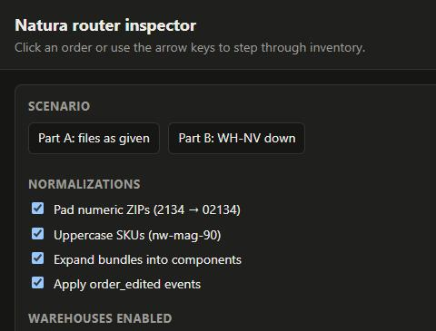

```
[Image: source: C:\Users\André Franceschini\.claude\projects\C--Users-Andr--Franceschini-OneDrive--rea-de-Trabalho-Arquivos-Trabalhos-Andr--Franceschini-Raicom-LLC\f268a8a0-3292-420a-ac32-327fbd3868e4\tool-results\mcp-Claude_Browser-blob-1793408138487-takpxt.jpg]
```

```
[read_console_messages] No console logs.


Tab Context:
- Executed on tabId: seed
- Available tabs:
  • tabId seed: "Router Inspector" ("http://localhost:5173/")
```

</details>

### Assistant · 00:55:40 UTC

It renders without console errors. The pane is narrow, so the layout is stacked. I'll read the table as text to check the routes:

<details><summary>Tool call: mcp__Claude_Browser__javascript_tool</summary>

```json
{
  "action": "javascript_exec",
  "text": "[document.getElementById('summary').innerText, ...[...document.querySelectorAll('#orders tbody tr')].map(r => [...r.cells].map(c => c.innerText.replace(/\\n/g,' | ')).join('  ·  '))].join('\\n')"
}
```

</details>

<details><summary>Result: mcp__Claude_Browser__javascript_tool</summary>

```
"WH-NJ 6\nWH-GA 12\nWH-NV 5\nPARTNER 3\n0 differ from Part A as given\n#2031  ·  13:00:00  ·  US NJ \"07030\"  ·  NW-VITD-60 ×1  ·  WH-NJ  ·  zone 1\n#2032  ·  13:03:37  ·  US GA \"30303\"  ·  NW-MULTI-30 ×1  ·  WH-GA  ·  zone 1\n#2033  ·  13:07:14  ·  US MA 2134  ·  NW-VITD-60 ×1  ·  WH-NJ  ·  zone 3 | ZIP was the number 2134; read as 02134\n#2034  ·  13:09:00  ·  US IL \"60614\"  ·  NW-MAG-90 ×1  ·  WH-GA  ·  zone 5 (tied with WH-NJ; cover 10.00 vs 0.10 days)\n#2035  ·  13:12:37  ·  US TX \"75201\"  ·  NW-VITD-60 ×1  ·  WH-GA  ·  zone 4\n#2036  ·  13:16:14  ·  US NV \"89109\"  ·  NW-MAG-90 ×2  ·  WH-NV  ·  zone 2\n#2037  ·  13:18:00  ·  CA ON \"M5V 2T6\"  ·  NW-MULTI-30 ×1  ·  PARTNER  ·  rule 1: ships outside the US (CA)\n#2038  ·  13:21:37  ·  US CA \"90012\"  ·  NW-VITD-60 ×1  ·  WH-NV  ·  zone 4\n#2039  ·  13:25:14  ·  US NJ \"07030-1834\"  ·  NW-MAG-90 ×2  ·  WH-NJ  ·  zone 1 | ZIP+4 07030-1834 read as 07030\n#2040  ·  13:27:00  ·  US NY \"10001\"  ·  NW-VITD-60 ×1 | NW-MAG-90 ×1  ·  WH-GA  ·  zone 5 (WH-NJ zone 2 short NW-MAG-90) | bundle NW-BNDL-ESS x1 expanded to NW-VITD-60 x1 + NW-MAG-90 x1\n#2041  ·  13:30:37  ·  US NV \"89117\"  ·  NW-VITD-60 ×1 | NW-MULTI-30 ×1  ·  WH-GA  ·  zone 7 (WH-NV zone 2 short NW-MULTI-30) | edited after 18 min: added NW-MULTI-30 x1\n#2042  ·  13:34:14  ·  US HI \"96815\"  ·  NW-VITD-60 ×1  ·  PARTNER  ·  rule 2: ZIP prefix 968 not in zones.json\n#2043  ·  13:36:00  ·  US CA \"94110\"  ·  NW-MAG-90 ×1  ·  WH-NV  ·  zone 3\n#2044  ·  13:39:37  ·  US CO \"80202\"  ·  NW-MULTI-30 ×1  ·  WH-GA  ·  zone 6 (WH-NV zone 4 short NW-MULTI-30)\n#2045  ·  13:43:14  ·  US NC \"28202\"  ·  NW-MAG-90 ×1  ·  WH-GA  ·  zone 3 | SKU \"nw-mag-90\" read as NW-MAG-90\n#2046  ·  13:45:00  ·  US NJ \"\"  ·  NW-MULTI-30 ×1  ·  PARTNER  ·  rule 2: no usable ZIP\n#2047  ·  13:48:37  ·  US TX \"75204\"  ·  NW-MULTI-30 ×3  ·  WH-GA  ·  zone 4\n#2048  ·  13:52:14  ·  US IL \"60601\"  ·  NW-VITD-60 ×1  ·  WH-NJ  ·  zone 5 (tied with WH-GA; cover 9.95 vs 0.03 days)\n#2049  ·  13:54:00  ·  US FL \"33130\"  ·  NW-MAG-90 ×1  ·  WH-GA  ·  zone 4\n#2050  ·  13:57:37  ·  US GA \"30309\"  ·  NW-VITD-60 ×2  ·  WH-NJ  ·  zone 5 (WH-GA zone 1 short NW-VITD-60)\n#2051  ·  14:01:14  ·  US NV \"89123\"  ·  NW-VITD-60 ×1  ·  WH-NV  ·  zone 2\n#2052  ·  14:03:00  ·  US WA \"98101\"  ·  NW-MAG-90 ×1  ·  WH-NV  ·  zone 5\n#2053  ·  14:06:37  ·  US NY \"10003\"  ·  NW-MULTI-30 ×1  ·  WH-NJ  ·  zone 2\n#2054  ·  14:10:14  ·  US TX \"75201\"  ·  NW-MAG-90 ×1  ·  WH-GA  ·  zone 4\n#2055  ·  14:12:00  ·  US CA \"90015\"  ·  NW-MULTI-30 ×1  ·  WH-GA  ·  zone 8 (WH-NV zone 4 short NW-MULTI-30; tied with WH-NJ; cover 11.76 vs 3.97 days)\n#2056  ·  14:15:37  ·  US NJ \"07047\"  ·  NW-VITD-60 ×1 | NW-MAG-90 ×1  ·  WH-GA  ·  zone 5 (WH-NJ zone 1 short NW-MAG-90) | bundle NW-BNDL-ESS x1 expanded to NW-VITD-60 x1 + NW-MAG-90 x1"
```

```
Tab Context:
- Executed on tabId: seed
- Available tabs:
  • tabId seed: "Router Inspector" ("http://localhost:5173/")
```

</details>

<details><summary>Tool call: mcp__Claude_Browser__javascript_tool</summary>

```json
{
  "action": "javascript_exec",
  "text": "const read = () => [document.querySelector('.chips').innerText.replace(/\\n/g,' '), ...[...document.querySelectorAll('#orders tbody tr')].filter(r => r.classList.contains('changed') || ['#2033','#2037','#2040','#2041','#2045','#2050','#2051','#2056'].includes(r.cells[0].innerText)).map(r => r.cells[0].innerText + ' ' + r.cells[4].innerText.replace(/\\n/g,' ') + ' — ' + r.cells[5].innerText.split('\\n')[0])].join('\\n');\ndocument.querySelector('[data-preset=\"nv-off\"]').click();\nconst nvOff = read();\ndocument.querySelector('[data-preset=\"given\"]').click();\nconst edits = document.querySelector('[data-norm=\"applyEdits\"]'); edits.checked = false; edits.dispatchEvent(new Event('change', {bubbles: true}));\nconst noEdits = read();\ndocument.querySelector('[data-preset=\"given\"]').click();\nconst b = document.querySelector('[data-norm=\"expandBundles\"]'); b.checked = false; b.dispatchEvent(new Event('change', {bubbles: true}));\nconst noBundles = read();\ndocument.querySelector('[data-preset=\"given\"]').click();\n`=== NV DOWN ===\\n${nvOff}\\n\\n=== EDITS OFF ===\\n${noEdits}\\n\\n=== BUNDLES OFF ===\\n${noBundles}`"
}
```

</details>

<details><summary>Result: mcp__Claude_Browser__javascript_tool</summary>

```
"=== NV DOWN ===\nWH-NJ 7 WH-GA 15 PARTNER 4 6 differ from Part A as given\n#2033 WH-NJ — zone 3\n#2036 WH-GA was WH-NV — zone 7\n#2037 PARTNER — rule 1: ships outside the US (CA)\n#2038 WH-NJ was WH-NV — zone 8 (tied with WH-GA; cover 9.95 vs 0.10 days)\n#2040 WH-GA — zone 5 (WH-NJ zone 2 short NW-MAG-90)\n#2041 WH-GA — zone 7\n#2043 WH-GA was WH-NV — zone 8\n#2045 WH-GA — zone 3\n#2050 WH-NJ — zone 5 (WH-GA zone 1 short NW-VITD-60)\n#2051 WH-GA was WH-NV — zone 7\n#2052 WH-GA was WH-NV — zone 8\n#2056 PARTNER was WH-GA — rule 7: no enabled warehouse has stock for the whole order\n\n=== EDITS OFF ===\nWH-NJ 5 WH-GA 11 WH-NV 7 PARTNER 3 3 differ from Part A as given\n#2033 WH-NJ — zone 3\n#2037 PARTNER — rule 1: ships outside the US (CA)\n#2040 WH-GA — zone 5 (WH-NJ zone 2 short NW-MAG-90)\n#2041 WH-NV was WH-GA — zone 2\n#2045 WH-GA — zone 3\n#2050 WH-GA was WH-NJ — zone 1\n#2051 WH-NV — zone 2\n#2056 WH-NV was WH-GA — zone 8 (WH-NJ zone 1 short NW-MAG-90; WH-GA zone 5 short NW-VITD-60)\n\n=== BUNDLES OFF ===\nWH-NJ 5 WH-GA 11 WH-NV 5 PARTNER 5 3 differ from Part A as given\n#2033 WH-NJ — zone 3\n#2037 PARTNER — rule 1: ships outside the US (CA)\n#2040 PARTNER was WH-GA — rule 7: no enabled warehouse has stock for the whole order\n#2041 WH-GA — zone 7 (WH-NV zone 2 short NW-MULTI-30)\n#2045 WH-GA — zone 3\n#2050 WH-GA was WH-NJ — zone 1\n#2051 WH-NV — zone 2\n#2056 PARTNER was WH-GA — rule 7: no enabled warehouse has stock for the whole order"
```

```
Tab Context:
- Executed on tabId: seed
- Available tabs:
  • tabId seed: "Router Inspector" ("http://localhost:5173/")
```

</details>

<details><summary>Tool call: mcp__Claude_Browser__javascript_tool</summary>

```json
{
  "action": "javascript_exec",
  "text": "document.querySelector('tr[data-index=\"9\"]').click(); document.getElementById('inspector').scrollIntoView(); document.getElementById('inspector').innerText"
}
```

</details>

<details><summary>Tool call: mcp__Claude_Browser__computer</summary>

```json
{
  "action": "screenshot",
  "scale": 0.7
}
```

</details>

<details><summary>Result: mcp__Claude_Browser__javascript_tool</summary>

```
"◀\nOrder 10 of 26\n▶\n#2040 → WH-GA\n\nzone 5 (WH-NJ zone 2 short NW-MAG-90)\n\nStock after this order\n\tWH-NJ\tWH-GA\tWH-NV\tWH-TX\noff\nNW-VITD-60\t398\nof 400\n\t3 → 2\nof 4\n\t199\nof 200\n\t500\nof 500\n\nNW-MULTI-30\t120\nof 120\n\t299\nof 300\n\t0\nof 0\n\t500\nof 500\n\nNW-MAG-90\t0\nof 2\n\t149 → 148\nof 150\n\t218\nof 220\n\t500\nof 500\n\nreserved by this order\nnot enough for this order\n\nEligible warehouses, ranked\nWH-GA zone 5, cover 0.10 days\nWH-NV zone 8, cover 19.90 days"
```

```
Tab Context:
- Executed on tabId: seed
- Available tabs:
  • tabId seed: "Router Inspector" ("http://localhost:5173/")
```

</details>

<details><summary>Result: mcp__Claude_Browser__computer</summary>

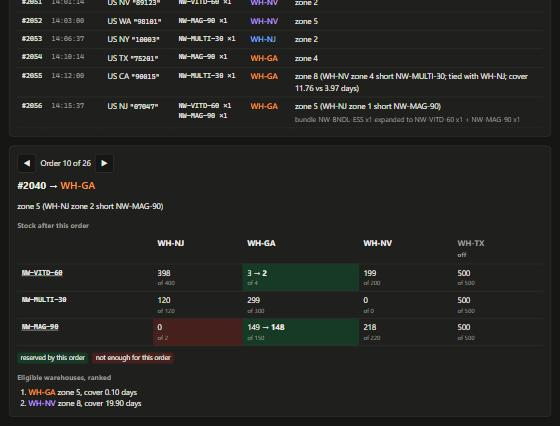

```
[Image: source: C:\Users\André Franceschini\.claude\projects\C--Users-Andr--Franceschini-OneDrive--rea-de-Trabalho-Arquivos-Trabalhos-Andr--Franceschini-Raicom-LLC\f268a8a0-3292-420a-ac32-327fbd3868e4\tool-results\mcp-Claude_Browser-blob-1793408166419-d73la1.jpg]
```

```
Screenshot size: 560x426 0.7-scale view; coordinate frame: 800x609.
```

```
Tab Context:
- Executed on tabId: seed
- Available tabs:
  • tabId seed: "Router Inspector" ("http://localhost:5173/")
```

</details>

<details><summary>Tool call: mcp__ccd_turn__update_plan</summary>

```json
{
  "advance": true
}
```

</details>

<details><summary>Result: mcp__ccd_turn__update_plan</summary>

```
Plan updated: step 5 of 8 is in progress.
```

</details>

<details><summary>Tool call: Write · C:\Users\André Franceschini\OneDrive\Área de Trabalho\Arquivos\Trabalhos\André Franceschini\Raicom LLC\natura-router\src\main.ts</summary>

```json
{
  "file_path": "C:\\Users\\André Franceschini\\OneDrive\\Área de Trabalho\\Arquivos\\Trabalhos\\André Franceschini\\Raicom LLC\\natura-router\\src\\main.ts",
  "content": "// CLI: prints one route per order to stdout; warnings and the stock ledger go to stderr.\n// Usage: node src/main.ts [--disable WH-NV] [--trace]\nimport { readFileSync } from 'node:fs';\nimport { join } from 'node:path';\nimport { parseArgs } from 'node:util';\nimport { buildOrders, formatDecision, parseZones, route } from './router.ts';\nimport type { Catalog, RawEvent, Warehouse } from './router.ts';\n\nconst { values } = parseArgs({\n  options: {\n    data: { type: 'string', default: join(import.meta.dirname, '..', 'data') },\n    disable: { type: 'string', multiple: true, default: [] },\n    trace: { type: 'boolean', default: false },\n  },\n});\n\nconst load = (file: string): unknown => JSON.parse(readFileSync(join(values.data, file), 'utf8'));\nconst events = load('orders.json') as RawEvent[];\nconst warehouses = load('warehouses.json') as Warehouse[];\nconst zones = parseZones(load('zones.json') as Record<string, unknown>);\nconst catalog = load('catalog.json') as Catalog;\n\nconst { orders, warnings } = buildOrders(events, catalog);\nconst { decisions, stock } = route(orders, warehouses, zones, values.disable);\n\nfor (const d of decisions) {\n  console.log(formatDecision(d));\n  if (values.trace) {\n    for (const m of d.movements) console.error(`  ${d.orderNumber} ${d.destination} ${m.sku} ${m.before} -> ${m.after}`);\n  }\n}\n\nfor (const w of warnings) console.error(`warning: ${w}`);\nif (values.disable.length) console.error(`disabled for this run: ${values.disable.join(', ')}`);\nconsole.error('\\nstock ledger (start -> end):');\nfor (const w of warehouses) {\n  const cells = Object.entries(w.inventory).map(([sku, s]) => `${sku} ${s.available} -> ${stock[w.code][sku].available}`);\n  console.error(`  ${w.code}${w.enabled ? '' : ' (disabled)'}: ${cells.join(', ')}`);\n}\n"
}
```

</details>

<details><summary>Result: Write</summary>

```
File created successfully at: C:\Users\André Franceschini\OneDrive\Área de Trabalho\Arquivos\Trabalhos\André Franceschini\Raicom LLC\natura-router\src\main.ts (file state is current in your context — no need to Read it back)
```

</details>

<details><summary>Tool call: Write · C:\Users\André Franceschini\OneDrive\Área de Trabalho\Arquivos\Trabalhos\André Franceschini\Raicom LLC\natura-router\test\router.test.ts</summary>

```json
{
  "file_path": "C:\\Users\\André Franceschini\\OneDrive\\Área de Trabalho\\Arquivos\\Trabalhos\\André Franceschini\\Raicom LLC\\natura-router\\test\\router.test.ts",
  "content": "import { test } from 'node:test';\nimport assert from 'node:assert/strict';\nimport { readFileSync } from 'node:fs';\nimport { join } from 'node:path';\nimport { ALL_NORMALIZATIONS, PARTNER, buildOrders, daysOfCover, normalizeZip, parseZones, route } from '../src/router.ts';\nimport type { Catalog, RawEvent, Warehouse } from '../src/router.ts';\n\nconst dataDir = join(import.meta.dirname, '..', 'data');\nconst load = (file: string): any => JSON.parse(readFileSync(join(dataDir, file), 'utf8'));\nconst rawOrders: any[] = load('orders.json');\nconst rawWarehouses: Warehouse[] = load('warehouses.json');\nconst rawZones = load('zones.json');\nconst catalog: Catalog = load('catalog.json');\nconst zones = parseZones(rawZones);\n\nfunction routeWith(events: RawEvent[] = rawOrders, options = ALL_NORMALIZATIONS, disabled: string[] = []) {\n  const { orders, warnings } = buildOrders(events, catalog, options);\n  return { orders, warnings, ...route(orders, rawWarehouses, zones, disabled) };\n}\nconst destinations = (decisions: { orderNumber: string; destination: string }[]) =>\n  Object.fromEntries(decisions.map((d) => [d.orderNumber, d.destination]));\n\n// Facts about the raw files that the normalizations depend on. If the data changes, these say so first.\ntest('source files contain the messy inputs the normalizations target', () => {\n  const byNumber = (n: string) => rawOrders.find((e) => e.type === 'order_created' && e.orderNumber === n);\n  assert.equal(byNumber('#2033').shipTo.zip, 2134);\n  assert.equal(byNumber('#2039').shipTo.zip, '07030-1834');\n  assert.equal(byNumber('#2045').lines[0].sku, 'nw-mag-90');\n  assert.equal(byNumber('#2046').shipTo.zip, '');\n  assert.equal(byNumber('#2040').lines[0].sku, 'NW-BNDL-ESS');\n  assert.ok(!rawWarehouses.some((w) => 'NW-BNDL-ESS' in w.inventory), 'no warehouse stocks the bundle SKU');\n  const edit = rawOrders.find((e) => e.type === 'order_edited');\n  assert.equal(edit.orderNumber, '#2041');\n  assert.equal((Date.parse(edit.at) - Date.parse(byNumber('#2041').at)) / 60000, 18);\n});\n\ntest('normalizeZip', () => {\n  assert.equal(normalizeZip(2134).zip, '02134');\n  assert.equal(normalizeZip(2134, false).zip, null);\n  assert.equal(normalizeZip('07030-1834').zip, '07030');\n  assert.equal(normalizeZip(' 30303 ').zip, '30303');\n  assert.equal(normalizeZip('').zip, null);\n  assert.equal(normalizeZip(undefined).zip, null);\n  assert.equal(normalizeZip('2134').zip, null, 'a string ZIP kept its zeros, so a 4-digit string is malformed, not padded');\n  assert.equal(normalizeZip('M5V 2T6').zip, null);\n});\n\ntest('buildOrders folds the edit into #2041, expands bundles and uppercases SKUs', () => {\n  const { orders, warnings } = buildOrders(rawOrders, catalog);\n  const get = (n: string) => orders.find((o) => o.orderNumber === n)!;\n  assert.equal(orders.length, 26);\n  assert.deepEqual(warnings, []);\n  assert.deepEqual(get('#2041').lines, [\n    { sku: 'NW-VITD-60', quantity: 1 },\n    { sku: 'NW-MULTI-30', quantity: 1 },\n  ]);\n  assert.deepEqual(get('#2040').lines, [\n    { sku: 'NW-VITD-60', quantity: 1 },\n    { sku: 'NW-MAG-90', quantity: 1 },\n  ]);\n  assert.deepEqual(get('#2045').lines, [{ sku: 'NW-MAG-90', quantity: 1 }]);\n  assert.equal(get('#2033').zip, '02134');\n  for (let i = 1; i < orders.length; i++) assert.ok(orders[i - 1].createdAt <= orders[i].createdAt);\n});\n\ntest('edits outside the 30-minute window, orphan edits and duplicates are reported, not applied', () => {\n  const base = { type: 'order_created', orderNumber: '#1', at: '2026-10-20T13:00:00Z', shipTo: { country: 'US', zip: '07030' } };\n  const events: RawEvent[] = [\n    { ...base, lines: [{ sku: 'NW-VITD-60', quantity: 1 }] },\n    { ...base, lines: [{ sku: 'NW-MAG-90', quantity: 9 }] },\n    { type: 'order_edited', orderNumber: '#1', at: '2026-10-20T13:31:00Z', addedLines: [{ sku: 'NW-MAG-90', quantity: 1 }] },\n    { type: 'order_edited', orderNumber: '#9', at: '2026-10-20T13:05:00Z', addedLines: [{ sku: 'NW-MAG-90', quantity: 1 }] },\n  ];\n  const { orders, warnings } = buildOrders(events, catalog);\n  assert.deepEqual(orders[0].lines, [{ sku: 'NW-VITD-60', quantity: 1 }]);\n  assert.equal(warnings.length, 3);\n});\n\ntest('a bundle plus a loose unit of the same product is checked as one combined need', () => {\n  const events: RawEvent[] = [\n    {\n      type: 'order_created',\n      orderNumber: '#1',\n      at: '2026-10-20T13:00:00Z',\n      shipTo: { country: 'US', zip: '30303' },\n      lines: [\n        { sku: 'NW-BNDL-ESS', quantity: 2 },\n        { sku: 'NW-VITD-60', quantity: 3 },\n      ],\n    },\n  ];\n  const { orders } = buildOrders(events, catalog);\n  assert.deepEqual(orders[0].lines, [\n    { sku: 'NW-VITD-60', quantity: 5 },\n    { sku: 'NW-MAG-90', quantity: 2 },\n  ]);\n  // WH-GA has only 4 VITD-60, so the combined need of 5 must skip it even though it is zone 1.\n  const { decisions } = route(orders, rawWarehouses, zones);\n  assert.notEqual(decisions[0].destination, 'WH-GA');\n});\n\ntest('days of cover treats zero velocity as unlimited', () => {\n  assert.equal(daysOfCover([{ sku: 'A', quantity: 1 }], { A: { available: 5, dailyVelocity: 0 } }), Infinity);\n  assert.equal(\n    daysOfCover([{ sku: 'A', quantity: 1 }, { sku: 'B', quantity: 1 }], {\n      A: { available: 10, dailyVelocity: 2 },\n      B: { available: 3, dailyVelocity: 3 },\n    }),\n    1,\n  );\n});\n\n// Independent reference model. It re-reads the raw files and re-derives every route with separate code\n// (its own parsing, and an explicit lexicographic minimum instead of the router's comparator), then checks\n// the router agrees order by order and that stock is conserved.\nfunction referenceRoute(disabled: string[]) {\n  const PRIORITY = ['WH-NJ', 'WH-GA', 'WH-NV', 'WH-TX'];\n  const bundles = new Map(catalog.bundles.map((b) => [b.sku, b.components]));\n  const created = rawOrders.filter((e) => e.type === 'order_created');\n  const need = new Map<string, Map<string, number>>();\n  const add = (n: string, sku: string, qty: number) => {\n    const m = need.get(n) ?? new Map<string, number>();\n    const key = sku.trim().toUpperCase();\n    for (const [s, q] of bundles.has(key) ? bundles.get(key)!.map((c) => [c.sku, c.quantity * qty] as const) : [[key, qty] as const]) {\n      m.set(s, (m.get(s) ?? 0) + q);\n    }\n    need.set(n, m);\n  };\n  for (const e of created) for (const l of e.lines) add(e.orderNumber, l.sku, l.quantity);\n  for (const e of rawOrders.filter((x) => x.type === 'order_edited')) {\n    const c = created.find((x) => x.orderNumber === e.orderNumber);\n    const minutes = (Date.parse(e.at) - Date.parse(c.at)) / 60000;\n    if (minutes >= 0 && minutes <= 30) for (const l of e.addedLines) add(e.orderNumber, l.sku, l.quantity);\n  }\n\n  const left = new Map<string, number>();\n  for (const w of rawWarehouses) for (const [sku, s] of Object.entries(w.inventory)) left.set(`${w.code}|${sku}`, s.available);\n  const velocity = (code: string, sku: string) => rawWarehouses.find((w) => w.code === code)!.inventory[sku].dailyVelocity;\n  const usable = rawWarehouses.filter((w) => w.enabled && !disabled.includes(w.code)).map((w) => w.code);\n\n  const routes: Record<string, string> = {};\n  for (const e of [...created].sort((a, b) => Date.parse(a.at) - Date.parse(b.at))) {\n    const zipText = typeof e.shipTo.zip === 'number' ? String(e.shipTo.zip).padStart(5, '0') : String(e.shipTo.zip ?? '');\n    const prefix = /^\\d{5}(-\\d{4})?$/.test(zipText.trim()) ? zipText.trim().slice(0, 3) : null;\n    const lines = [...need.get(e.orderNumber)!];\n    let best: { code: string; key: number[] } | null = null;\n    if (e.shipTo.country === 'US' && prefix && Object.values(zones).some((z) => prefix in z)) {\n      for (const code of usable) {\n        const zone = zones[code][prefix];\n        if (zone === undefined || !lines.every(([sku, q]) => (left.get(`${code}|${sku}`) ?? 0) >= q)) continue;\n        const cover = Math.min(...lines.map(([sku]) => (velocity(code, sku) === 0 ? Infinity : left.get(`${code}|${sku}`)! / velocity(code, sku))));\n        const key = [zone, -cover, PRIORITY.indexOf(code)];\n        const better = !best || key.findIndex((v, i) => v !== best!.key[i]) !== -1 && key[key.findIndex((v, i) => v !== best!.key[i])] < best.key[key.findIndex((v, i) => v !== best!.key[i])];\n        if (better) best = { code, key };\n      }\n    }\n    routes[e.orderNumber] = best ? best.code : PARTNER;\n    if (best) for (const [sku, q] of lines) left.set(`${best.code}|${sku}`, left.get(`${best.code}|${sku}`)! - q);\n  }\n  return { routes, left };\n}\n\nfor (const scenario of [\n  { name: 'Part A: files as given', disabled: [] as string[] },\n  { name: 'Part B: WH-NV down', disabled: ['WH-NV'] },\n]) {\n  test(`reference model agrees with the router on every order (${scenario.name})`, () => {\n    const { decisions, stock } = routeWith(rawOrders, ALL_NORMALIZATIONS, scenario.disabled);\n    const reference = referenceRoute(scenario.disabled);\n    assert.deepEqual(destinations(decisions), reference.routes);\n    for (const [key, available] of reference.left) {\n      const [code, sku] = key.split('|');\n      assert.equal(stock[code][sku].available, available, `${key} final stock`);\n      assert.ok(available >= 0, `${key} went negative`);\n    }\n  });\n\n  test(`stock is conserved: start - end equals what routed orders reserved (${scenario.name})`, () => {\n    const { decisions, stock } = routeWith(rawOrders, ALL_NORMALIZATIONS, scenario.disabled);\n    const reserved = new Map<string, number>();\n    for (const d of decisions) {\n      if (d.destination === PARTNER) continue;\n      for (const l of d.lines) reserved.set(`${d.destination}|${l.sku}`, (reserved.get(`${d.destination}|${l.sku}`) ?? 0) + l.quantity);\n      // Each movement continues from the stock the previous order left behind.\n      for (const m of d.movements) assert.equal(m.before - m.after, d.lines.find((l) => l.sku === m.sku)!.quantity);\n    }\n    for (const w of rawWarehouses) {\n      for (const [sku, s] of Object.entries(w.inventory)) {\n        assert.equal(s.available - stock[w.code][sku].available, reserved.get(`${w.code}|${sku}`) ?? 0, `${w.code} ${sku}`);\n      }\n    }\n    assert.ok(!decisions.some((d) => d.destination === 'WH-TX'), 'disabled WH-TX never receives orders');\n    assert.ok(!decisions.some((d) => scenario.disabled.includes(d.destination)));\n  });\n}\n\n// Each normalization changes later orders through shared stock, not just the order it touches.\ntest('cascade: ignoring the #2041 edit moves #2050 to WH-GA and #2056 to WH-NV', () => {\n  const routes = destinations(routeWith(rawOrders, { ...ALL_NORMALIZATIONS, applyEdits: false }).decisions);\n  assert.equal(routes['#2041'], 'WH-NV');\n  assert.equal(routes['#2050'], 'WH-GA');\n  assert.equal(routes['#2056'], 'WH-NV');\n});\n\ntest('cascade: not expanding bundles sends #2040 and #2056 to PARTNER and moves #2050 to WH-GA', () => {\n  const routes = destinations(routeWith(rawOrders, { ...ALL_NORMALIZATIONS, expandBundles: false }).decisions);\n  assert.equal(routes['#2040'], PARTNER);\n  assert.equal(routes['#2056'], PARTNER);\n  assert.equal(routes['#2050'], 'WH-GA');\n});\n\ntest('cascade: without #2039 taking NJ magnesium, #2040 would ship from WH-NJ', () => {\n  const routes = destinations(routeWith(rawOrders.filter((e) => e.orderNumber !== '#2039')).decisions);\n  assert.equal(routes['#2040'], 'WH-NJ');\n});\n\ntest('literal ZIP and SKU readings only change their own order', () => {\n  const given = destinations(routeWith().decisions);\n  const literal = destinations(routeWith(rawOrders, { ...ALL_NORMALIZATIONS, padNumericZip: false, uppercaseSku: false }).decisions);\n  const changed = Object.keys(given).filter((n) => given[n] !== literal[n]);\n  assert.deepEqual(changed, ['#2033', '#2045']);\n  assert.equal(literal['#2033'], PARTNER);\n  assert.equal(literal['#2045'], PARTNER);\n});\n"
}
```

</details>

<details><summary>Result: Write</summary>

```
File created successfully at: C:\Users\André Franceschini\OneDrive\Área de Trabalho\Arquivos\Trabalhos\André Franceschini\Raicom LLC\natura-router\test\router.test.ts (file state is current in your context — no need to Read it back)
```

</details>

### Assistant · 00:57:05 UTC

The `better` line in my reference model is unreadable: a triple `findIndex`. A reviewer reading it would rightly distrust it, so I'm replacing it with a plain lexicographic compare:

<details><summary>Tool call: Edit · C:\Users\André Franceschini\OneDrive\Área de Trabalho\Arquivos\Trabalhos\André Franceschini\Raicom LLC\natura-router\test\router.test.ts</summary>

```json
{
  "replace_all": false,
  "file_path": "C:\\Users\\André Franceschini\\OneDrive\\Área de Trabalho\\Arquivos\\Trabalhos\\André Franceschini\\Raicom LLC\\natura-router\\test\\router.test.ts",
  "old_string": "        const key = [zone, -cover, PRIORITY.indexOf(code)];\n        const better = !best || key.findIndex((v, i) => v !== best!.key[i]) !== -1 && key[key.findIndex((v, i) => v !== best!.key[i])] < best.key[key.findIndex((v, i) => v !== best!.key[i])];\n        if (better) best = { code, key };",
  "new_string": "        const key = [zone, -cover, PRIORITY.indexOf(code)];\n        if (!best || lexLess(key, best.key)) best = { code, key };"
}
```

</details>

<details><summary>Result: Edit</summary>

```
The file C:\Users\André Franceschini\OneDrive\Área de Trabalho\Arquivos\Trabalhos\André Franceschini\Raicom LLC\natura-router\test\router.test.ts has been updated successfully. (file state is current in your context — no need to Read it back)
```

</details>

<details><summary>Tool call: Edit · C:\Users\André Franceschini\OneDrive\Área de Trabalho\Arquivos\Trabalhos\André Franceschini\Raicom LLC\natura-router\test\router.test.ts</summary>

```json
{
  "replace_all": false,
  "file_path": "C:\\Users\\André Franceschini\\OneDrive\\Área de Trabalho\\Arquivos\\Trabalhos\\André Franceschini\\Raicom LLC\\natura-router\\test\\router.test.ts",
  "old_string": "function referenceRoute(disabled: string[]) {",
  "new_string": "// True when key a sorts before key b: first differing element decides. -Infinity === -Infinity, so equal\n// unlimited cover falls through to priority.\nfunction lexLess(a: number[], b: number[]): boolean {\n  for (let i = 0; i < a.length; i++) if (a[i] !== b[i]) return a[i] < b[i];\n  return false;\n}\n\nfunction referenceRoute(disabled: string[]) {"
}
```

</details>

<details><summary>Result: Edit</summary>

```
The file C:\Users\André Franceschini\OneDrive\Área de Trabalho\Arquivos\Trabalhos\André Franceschini\Raicom LLC\natura-router\test\router.test.ts has been updated successfully. (file state is current in your context — no need to Read it back)
```

</details>

<details><summary>Tool call: Bash · Typecheck and run the test suite</summary>

```json
{
  "command": "cd \"/c/Users/André Franceschini/OneDrive/Área de Trabalho/Arquivos/Trabalhos/André Franceschini/Raicom LLC/natura-router\" && npx tsc -p . ; echo \"tsc exit $?\"; npm test 2>&1 | grep -E \"^(not ok|ok|# (tests|pass|fail))|AssertionError|expected|actual\" | head -40",
  "description": "Typecheck and run the test suite"
}
```

</details>

<details><summary>Result: Bash</summary>

```
tsc exit 0
```

</details>

### Assistant · 00:57:16 UTC

The grep matched nothing, so the reporter output format must differ from what I expected. Showing the raw output:

<details><summary>Tool call: Bash · Run the test suite and show output</summary>

```json
{
  "command": "cd \"/c/Users/André Franceschini/OneDrive/Área de Trabalho/Arquivos/Trabalhos/André Franceschini/Raicom LLC/natura-router\" && npm test 2>&1 | tail -40",
  "description": "Run the test suite and show output"
}
```

</details>

<details><summary>Result: Bash</summary>

```
> test
> node --test test/router.test.ts

✔ source files contain the messy inputs the normalizations target (1.2314ms)
✔ normalizeZip (0.3548ms)
✔ buildOrders folds the edit into #2041, expands bundles and uppercases SKUs (1.1101ms)
✔ edits outside the 30-minute window, orphan edits and duplicates are reported, not applied (0.1428ms)
✔ a bundle plus a loose unit of the same product is checked as one combined need (0.6176ms)
✔ days of cover treats zero velocity as unlimited (0.0846ms)
✔ reference model agrees with the router on every order (Part A: files as given) (1.1555ms)
✔ stock is conserved: start - end equals what routed orders reserved (Part A: files as given) (0.4101ms)
✔ reference model agrees with the router on every order (Part B: WH-NV down) (0.4147ms)
✔ stock is conserved: start - end equals what routed orders reserved (Part B: WH-NV down) (0.2827ms)
✔ cascade: ignoring the #2041 edit moves #2050 to WH-GA and #2056 to WH-NV (0.2185ms)
✔ cascade: not expanding bundles sends #2040 and #2056 to PARTNER and moves #2050 to WH-GA (0.2038ms)
✔ cascade: without #2039 taking NJ magnesium, #2040 would ship from WH-NJ (0.255ms)
✔ literal ZIP and SKU readings only change their own order (0.923ms)
ℹ tests 14
ℹ suites 0
ℹ pass 14
ℹ fail 0
ℹ cancelled 0
ℹ skipped 0
ℹ todo 0
ℹ duration_ms 124.3831
```

</details>

<details><summary>Tool call: Bash · Mutate the router twice to confirm tests catch errors, then restore</summary>

```json
{
  "command": "cd \"/c/Users/André Franceschini/OneDrive/Área de Trabalho/Arquivos/Trabalhos/André Franceschini/Raicom LLC/natura-router\" && S=\"/c/Users/ANDRFR~1/AppData/Local/Temp/claude/C--Users-Andr--Franceschini-OneDrive--rea-de-Trabalho-Arquivos-Trabalhos-Andr--Franceschini-Raicom-LLC/f268a8a0-3292-420a-ac32-327fbd3868e4/scratchpad\" && mkdir -p \"$S\" && cp src/router.ts \"$S/router.ts.bak\" && sha1sum src/router.ts | cut -c1-12\necho \"== mutation 1: tie-break prefers LESS cover ==\"\nsed -i 's/|| b.cover - a.cover ||/|| a.cover - b.cover ||/' src/router.ts && grep -c \"a.cover - b.cover\" src/router.ts\nnpm test 2>&1 | grep -E \"^✖|ℹ (pass|fail)\"\ncp \"$S/router.ts.bak\" src/router.ts\necho \"== mutation 2: never reserve stock ==\"\nsed -i 's/      s.available -= l.quantity;/      \\/\\/ mutated/' src/router.ts && grep -c \"// mutated\" src/router.ts\nnpm test 2>&1 | grep -E \"^✖|ℹ (pass|fail)\"\ncp \"$S/router.ts.bak\" src/router.ts && sha1sum src/router.ts | cut -c1-12 && npm test 2>&1 | grep -E \"ℹ (pass|fail)\"",
  "description": "Mutate the router twice to confirm tests catch errors, then restore"
}
```

</details>

<details><summary>Result: Bash</summary>

```
711ebacfec53
== mutation 1: tie-break prefers LESS cover ==
1
✖ reference model agrees with the router on every order (Part A: files as given) (2.2131ms)
✖ reference model agrees with the router on every order (Part B: WH-NV down) (0.732ms)
✖ cascade: not expanding bundles sends #2040 and #2056 to PARTNER and moves #2050 to WH-GA (0.3232ms)
ℹ pass 11
ℹ fail 3
✖ failing tests:
✖ reference model agrees with the router on every order (Part A: files as given) (2.2131ms)
✖ reference model agrees with the router on every order (Part B: WH-NV down) (0.732ms)
✖ cascade: not expanding bundles sends #2040 and #2056 to PARTNER and moves #2050 to WH-GA (0.3232ms)
== mutation 2: never reserve stock ==
1
✖ reference model agrees with the router on every order (Part A: files as given) (1.9413ms)
✖ stock is conserved: start - end equals what routed orders reserved (Part A: files as given) (0.4303ms)
✖ reference model agrees with the router on every order (Part B: WH-NV down) (0.5357ms)
✖ stock is conserved: start - end equals what routed orders reserved (Part B: WH-NV down) (0.3264ms)
✖ cascade: ignoring the #2041 edit moves #2050 to WH-GA and #2056 to WH-NV (0.2862ms)
ℹ pass 9
ℹ fail 5
✖ failing tests:
✖ reference model agrees with the router on every order (Part A: files as given) (1.9413ms)
✖ stock is conserved: start - end equals what routed orders reserved (Part A: files as given) (0.4303ms)
✖ reference model agrees with the router on every order (Part B: WH-NV down) (0.5357ms)
✖ stock is conserved: start - end equals what routed orders reserved (Part B: WH-NV down) (0.3264ms)
✖ cascade: ignoring the #2041 edit moves #2050 to WH-GA and #2056 to WH-NV (0.2862ms)
711ebacfec53
ℹ pass 14
ℹ fail 0
[This command modified 1 file you've previously read: src\router.ts. Call Read before editing.]
```

</details>

<details><summary>Tool call: mcp__ccd_turn__update_plan</summary>

```json
{
  "advance": true
}
```

</details>

<details><summary>Result: mcp__ccd_turn__update_plan</summary>

```
Plan updated: step 6 of 8 is in progress.
```

</details>

<details><summary>Tool call: Bash · Generate routes.txt and the NV-down scenario output</summary>

```json
{
  "command": "cd \"/c/Users/André Franceschini/OneDrive/Área de Trabalho/Arquivos/Trabalhos/André Franceschini/Raicom LLC/natura-router\" && npm run --silent route && npm run --silent route:nv-off 2>/dev/null && echo \"===== routes.txt =====\" && cat routes.txt && echo && echo \"===== routes-nv-off.txt (Q1 orders + #2056) =====\" && grep -E \"^#(2033|2037|2040|2041|2045|2050|2051|2056) \" routes-nv-off.txt && wc -l routes.txt routes-nv-off.txt",
  "description": "Generate routes.txt and the NV-down scenario output"
}
```

</details>

<details><summary>Result: Bash</summary>

```
stock ledger (start -> end):
  WH-NJ: NW-VITD-60 400 -> 395, NW-MULTI-30 120 -> 119, NW-MAG-90 2 -> 0
  WH-GA: NW-VITD-60 4 -> 0, NW-MULTI-30 300 -> 293, NW-MAG-90 150 -> 144
  WH-NV: NW-VITD-60 200 -> 198, NW-MULTI-30 0 -> 0, NW-MAG-90 220 -> 216
  WH-TX (disabled): NW-VITD-60 500 -> 500, NW-MULTI-30 500 -> 500, NW-MAG-90 500 -> 500
===== routes.txt =====
#2031  WH-NJ    zone 1
#2032  WH-GA    zone 1
#2033  WH-NJ    zone 3  [ZIP was the number 2134; read as 02134]
#2034  WH-GA    zone 5 (tied with WH-NJ; cover 10.00 vs 0.10 days)
#2035  WH-GA    zone 4
#2036  WH-NV    zone 2
#2037  PARTNER  rule 1: ships outside the US (CA)
#2038  WH-NV    zone 4
#2039  WH-NJ    zone 1  [ZIP+4 07030-1834 read as 07030]
#2040  WH-GA    zone 5 (WH-NJ zone 2 short NW-MAG-90)  [bundle NW-BNDL-ESS x1 expanded to NW-VITD-60 x1 + NW-MAG-90 x1]
#2041  WH-GA    zone 7 (WH-NV zone 2 short NW-MULTI-30)  [edited after 18 min: added NW-MULTI-30 x1]
#2042  PARTNER  rule 2: ZIP prefix 968 not in zones.json
#2043  WH-NV    zone 3
#2044  WH-GA    zone 6 (WH-NV zone 4 short NW-MULTI-30)
#2045  WH-GA    zone 3  [SKU "nw-mag-90" read as NW-MAG-90]
#2046  PARTNER  rule 2: no usable ZIP
#2047  WH-GA    zone 4
#2048  WH-NJ    zone 5 (tied with WH-GA; cover 9.95 vs 0.03 days)
#2049  WH-GA    zone 4
#2050  WH-NJ    zone 5 (WH-GA zone 1 short NW-VITD-60)
#2051  WH-NV    zone 2
#2052  WH-NV    zone 5
#2053  WH-NJ    zone 2
#2054  WH-GA    zone 4
#2055  WH-GA    zone 8 (WH-NV zone 4 short NW-MULTI-30; tied with WH-NJ; cover 11.76 vs 3.97 days)
#2056  WH-GA    zone 5 (WH-NJ zone 1 short NW-MAG-90)  [bundle NW-BNDL-ESS x1 expanded to NW-VITD-60 x1 + NW-MAG-90 x1]

===== routes-nv-off.txt (Q1 orders + #2056) =====
#2033  WH-NJ    zone 3  [ZIP was the number 2134; read as 02134]
#2037  PARTNER  rule 1: ships outside the US (CA)
#2040  WH-GA    zone 5 (WH-NJ zone 2 short NW-MAG-90)  [bundle NW-BNDL-ESS x1 expanded to NW-VITD-60 x1 + NW-MAG-90 x1]
#2041  WH-GA    zone 7  [edited after 18 min: added NW-MULTI-30 x1]
#2045  WH-GA    zone 3  [SKU "nw-mag-90" read as NW-MAG-90]
#2050  WH-NJ    zone 5 (WH-GA zone 1 short NW-VITD-60)
#2051  WH-GA    zone 7
#2056  PARTNER  rule 7: no enabled warehouse has stock for the whole order  [bundle NW-BNDL-ESS x1 expanded to NW-VITD-60 x1 + NW-MAG-90 x1]
  26 routes.txt
  26 routes-nv-off.txt
  52 total
```

</details>

<details><summary>Tool call: mcp__ccd_turn__update_plan</summary>

```json
{
  "done": [
    6,
    7
  ],
  "start": 8
}
```

</details>

<details><summary>Result: mcp__ccd_turn__update_plan</summary>

```
Plan updated: step 8 of 8 is in progress.
```

</details>

<details><summary>Tool call: Write · C:\Users\André Franceschini\OneDrive\Área de Trabalho\Arquivos\Trabalhos\André Franceschini\Raicom LLC\natura-router\README.md</summary>

````json
{
  "file_path": "C:\\Users\\André Franceschini\\OneDrive\\Área de Trabalho\\Arquivos\\Trabalhos\\André Franceschini\\Raicom LLC\\natura-router\\README.md",
  "content": "# Natura Wellness order router\n\nRoutes every order in `data/orders.json` to one warehouse (or PARTNER) using rules 1-7 from the brief, reserving stock as it goes so later orders see what earlier ones left. Output: [`routes.txt`](routes.txt).\n\nTypeScript, no runtime dependencies. Node 23.6+ runs the `.ts` files directly.\n\n```bash\nnpm install          # dev tools only: typescript, vite, @types/node\nnpm run route        # writes routes.txt; warnings and the stock ledger go to stderr\nnpm test             # unit tests, independent reference model, cascade checks\nnpm run dev          # optional visual inspector (see below)\n```\n\n`node src/main.ts --trace` also prints every stock movement, order by order.\n\n## Routing rules: implemented as written\n\nThe rules are not changed. Two points the brief leaves open, and what I chose:\n\n- **Days of cover (rule 5)** uses stock *before* the order is reserved. A product with zero daily velocity never runs out, so its cover is unlimited. This only matters for WH-TX, which is disabled. On this data, measuring after reservation gives the same routes.\n- **Rule 2's \"ZIP prefix isn't in zones.json\"** means no warehouse has a zone for it. A warehouse missing a prefix that others have would just be ineligible.\n\n## Data decisions: the only liberties taken\n\nEach one is a named, switchable normalization in `src/router.ts`, and every order it touches carries a note in `routes.txt`.\n\n| Data problem | Order(s) | Decision | Why |\n|---|---|---|---|\n| ZIP stored as the number `2134` | #2033 | Left-pad numeric ZIPs to 5 digits → `02134` | JSON numbers drop leading zeros. The state (MA) confirms 021 is Boston. A *string* ZIP kept its zeros, so a short string is treated as malformed, not padded. |\n| ZIP+4 `07030-1834` | #2039 | Use the first 5 digits | It's a valid US format. |\n| SKU in lowercase `nw-mag-90` | #2045 | Trim and uppercase SKUs | Same product. Reading it literally sends a US order to the international partner. |\n| Bundle `NW-BNDL-ESS` | #2040, #2056 | Expand into its catalog components before checking stock | No warehouse stocks the bundle SKU. It ships as its components, in one parcel. |\n| `order_edited` adds a line 18 min after creation | #2041 | Fold edits into the order before routing; route it once, at its creation-time position | The brief says to route each order once with everything in it, in creation order. |\n| Same SKU from a bundle and a loose line | (none in data) | Quantities are summed per SKU before the stock check | Otherwise an order could pass the check line by line and still overdraw. |\n\nEdits outside the 30-minute window, edits for unknown orders, duplicate `order_created` events and unknown event types are reported as warnings and not applied. An invalid quantity stops the run with the order number rather than guessing.\n\n## These decisions change other orders, not just their own\n\nStock is shared, so a normalization moves later orders too. The tests pin these down:\n\n- Ignoring the #2041 edit sends #2041 to WH-NV, which leaves WH-GA with one more Vitamin D, so **#2050 moves to WH-GA and #2056 to WH-NV**.\n- Not expanding bundles sends #2040 and #2056 to PARTNER, and **#2050 moves to WH-GA**.\n- #2039 uses WH-NJ's last 2 magnesium units, which is why #2040 skips NJ (zone 2) for GA (zone 5).\n- The literal ZIP and SKU readings only change their own order (#2033 and #2045 → PARTNER).\n\n## How the output was verified\n\n- `test/router.test.ts` contains an **independent reference model**. It re-reads the raw JSON and re-derives every route with separate code (its own parsing, and a lexicographic minimum instead of the router's comparator). The router must match it on every order, and on final stock, for the files as given and with WH-NV down.\n- **Stock conservation:** for every warehouse and SKU, start − end equals the sum reserved by orders routed there; every movement continues from where the previous order left the stock; nothing goes negative; disabled warehouses receive nothing.\n- **Source-file facts** the normalizations depend on (the numeric ZIP, the lowercase SKU, the 18-minute edit, the unstocked bundle SKU) are asserted directly against the raw files.\n- **The tests can fail:** I broke the router on purpose twice (tie-break preferring *less* cover, and skipping stock reservation). The suite caught both (3 and 5 failing tests), then I restored the original byte-for-byte.\n\n## Part B helper\n\n`npm run route:nv-off` writes [`routes-nv-off.txt`](routes-nv-off.txt): the same router with WH-NV disabled, per the ops notes (water damage). It is an input for Question 1, not a Part A result. Note that in this run **#2056, a New Jersey customer, goes to PARTNER** under rule 7: once NV is out, WH-GA runs out of Vitamin D at #2051 and WH-NJ is already out of magnesium.\n\n## Visual inspector\n\n`npm run dev` opens a small Vite page that runs the same `src/router.ts`. You can step through orders and watch the stock table change, switch each normalization on or off, and enable or disable warehouses. Rows whose destination differs from Part A as given are highlighted. It's a tool for inspecting results; the tests are the proof.\n\n## Layout\n\n```\ndata/              source files from the brief, unchanged\nsrc/router.ts      normalization + routing (pure, shared by CLI, tests and UI)\nsrc/main.ts        CLI\ntest/              node:test suite\nui/, index.html    optional inspector\n```\n"
}
````

</details>

<details><summary>Result: Write</summary>

```
File created successfully at: C:\Users\André Franceschini\OneDrive\Área de Trabalho\Arquivos\Trabalhos\André Franceschini\Raicom LLC\natura-router\README.md (file state is current in your context — no need to Read it back)
```

</details>

### Assistant · 00:58:09 UTC

The README claims "measuring cover after reservation gives the same routes", and I haven't verified that. Checking it before it goes to Sean:

<details><summary>Tool call: Bash · Verify cover-after-reservation yields same routes, then restore</summary>

```json
{
  "command": "cd \"/c/Users/André Franceschini/OneDrive/Área de Trabalho/Arquivos/Trabalhos/André Franceschini/Raicom LLC/natura-router\" && S=\"/c/Users/ANDRFR~1/AppData/Local/Temp/claude/C--Users-Andr--Franceschini-OneDrive--rea-de-Trabalho-Arquivos-Trabalhos-Andr--Franceschini-Raicom-LLC/f268a8a0-3292-420a-ac32-327fbd3868e4/scratchpad\" && cp src/router.ts \"$S/router.ts.bak\"\nsed -i 's|: s.available / s.dailyVelocity;|: (s.available - l.quantity) / s.dailyVelocity;|' src/router.ts && grep -c \"(s.available - l.quantity)\" src/router.ts\nnode src/main.ts 2>/dev/null > \"$S/after.txt\"; node src/main.ts --disable WH-NV 2>/dev/null > \"$S/after-nv.txt\"\ncp \"$S/router.ts.bak\" src/router.ts\necho \"Part A destinations differing:\"; diff <(awk '{print $1,$2}' routes.txt) <(awk '{print $1,$2}' \"$S/after.txt\") && echo \"none\"\necho \"NV-off destinations differing:\"; diff <(awk '{print $1,$2}' routes-nv-off.txt) <(awk '{print $1,$2}' \"$S/after-nv.txt\") && echo \"none\"\nnpm test 2>&1 | grep -E \"ℹ (pass|fail)\"",
  "description": "Verify cover-after-reservation yields same routes, then restore"
}
```

</details>

<details><summary>Result: Bash</summary>

```
1
Part A destinations differing:
none
NV-off destinations differing:
none
ℹ pass 14
ℹ fail 0
[This command modified 1 file you've previously read: src\router.ts. Call Read before editing.]
```

</details>

### Assistant · 00:58:19 UTC

Verified: measuring cover after reservation gives identical destinations in both scenarios, so the README statement holds. The router is restored and the tests are back to 14/14.

<details><summary>Tool call: mcp__ccd_turn__wrap_up</summary>

```json
{
  "recap": "The TypeScript router, the Vite inspector, 14 tests and the README are done in natura-router/. routes.txt and routes-nv-off.txt are generated. The tests compare the router to an independent reference model and caught both deliberate mutations. Nothing is in git or on GitHub yet, and your Part B write-up isn't drafted.",
  "ask": "Create a GitHub repo for natura-router and push it?",
  "actions": [
    {
      "label": "Yes, create and push"
    },
    {
      "label": "I'll review first"
    }
  ]
}
```

</details>

<details><summary>Result: mcp__ccd_turn__wrap_up</summary>

```
Shown in the next-step box. Do not call wrap_up again this turn; the advice that follows is for your next call. recap is two or three sentences (about 300 characters); this one ran 319. Keep it to what is now true and where it stands. Your closing message is your answer to the user: write it now, in full, as the last thing you say this turn. The box asks your question, so do not ask it again.
```

</details>

### Assistant · 00:58:31 UTC

The router is built in `natura-router/`, and `routes.txt` is generated and checked against the source files. All 14 tests pass, and a mutation check shows they catch errors.

**What's in the folder:**
- [src/router.ts](natura-router/src/router.ts): the normalizations and rules 1–7. Each normalization is a named switch (all on by default) and leaves a note on any order it changed.
- [src/main.ts](natura-router/src/main.ts): the CLI. Routes go to stdout. Warnings and a start → end stock ledger go to stderr.
- [test/router.test.ts](natura-router/test/router.test.ts): the tests.
- [ui/main.ts](natura-router/ui/main.ts): the Vite inspector, open in the browser pane.
- [README.md](natura-router/README.md): every decision, with the reason for it.
- [routes.txt](natura-router/routes.txt): the Part A deliverable.
- [routes-nv-off.txt](natura-router/routes-nv-off.txt): the same router with WH-NV off, as input for Question 1.

**How I checked it without trusting my hand trace:**
- **Independent reference model.** The tests re-read the raw JSON and re-derive every route with separate code. The router matches it on every order and on final stock, both as given and with NV down.
- **Stock conservation.** For each warehouse and SKU, starting stock minus final stock equals what the orders routed there reserved. Each order's stock change starts from where the previous order left it, and nothing goes negative.
- **Facts from the source files.** The things the normalizations depend on are asserted against the raw data: the numeric ZIP, the lowercase SKU, the 18-minute edit, and that no warehouse stocks the bundle SKU.
- **Mutation check.** I broke the router twice on purpose: making ties prefer *less* cover, and skipping stock reservation. 3 and 5 tests failed respectively, and the original was restored byte-for-byte.
- **A README claim checked.** I confirmed that measuring cover after reserving the order gives identical routes.

**What the checks found:**
- **The hand trace was right on all 26 routes and all 7 Question 1 answers.** Question 1 comes out as: #2033 NJ, #2037 Partner, #2040 GA, #2041 GA, #2045 GA, #2050 NJ, #2051 GA.
- **It missed one cascade.** If the #2041 edit is ignored, #2050 moves to GA as I said. But **#2056 also moves to NV**, which my trace didn't predict. A test now covers it.
- **With NV down, #2056 (a New Jersey customer) goes to PARTNER under rule 7.** GA runs out of Vitamin D at #2051, and NJ is already out of magnesium.

**What's still open:**
- Nothing is committed or pushed. There's no git repo yet, and Raicom needs a GitHub link.
- **Question 2 is your decision**, so I didn't put an answer in the README. My recommendation from before still stands (option 3, with the caveats about NJ having no magnesium and the Monday auto-expiry). Write it in your own words for the call with Sean.
- The inspector is still running in the browser pane. Two buttons switch between Part A as given and NV down.

---

## User · 00:59:14 UTC

nice, lets review the results before moving on, walk me through the interface and show me how to check the inventory changes for orders 2039, 2040, 2041 and 2050, also explain the assumptions that could be interpreted differently from the written rules, then we can discuss question 2

<details><summary>Tool call: mcp__ccd_turn__update_plan</summary>

```json
{
  "items": [
    {
      "content": "Walk through the inspector layout",
      "status": "in_progress"
    },
    {
      "content": "Inspect inventory for #2039, #2040, #2041, #2050",
      "status": "pending"
    },
    {
      "content": "Reconcile each against the source files",
      "status": "pending"
    },
    {
      "content": "List assumptions open to other readings",
      "status": "pending"
    },
    {
      "content": "Set up the Question 2 discussion",
      "status": "pending"
    }
  ],
  "scope": "continuation"
}
```

</details>

<details><summary>Result: mcp__ccd_turn__update_plan</summary>

```
Plan shown (5 steps).
```

</details>

<details><summary>Tool call: mcp__Claude_Browser__resize_window</summary>

```json
{
  "width": 1280,
  "height": 860
}
```

</details>

<details><summary>Result: mcp__Claude_Browser__resize_window</summary>

```
Viewport set to 1280x860 on this tab (scaled down to fit if larger than the pane). Reset it with preset "desktop" as soon as you finish testing; the desktop app also clears a size you set when your turn ends or the pane's width changes, so set it again if you still need it. If the user wants to keep a phone or tablet size after your turn, they can pick Mobile or Tablet in the pane's Viewport menu; a custom size you simply set again next turn.
```

```
Tab Context:
- Executed on tabId: seed
- Available tabs:
  • tabId seed: "Router Inspector" ("http://localhost:5173/")
- Viewport: emulating 1280x860 (you set this; reset it with preset "desktop" when you finish testing; the app also clears it when your turn ends or the pane's width changes)
```

</details>

<details><summary>Tool call: mcp__Claude_Browser__browser_batch</summary>

```json
{
  "actions": [
    {
      "name": "javascript_tool",
      "input": {
        "action": "javascript_exec",
        "text": "document.querySelector('[data-preset=\"given\"]').click(); window.scrollTo(0,0); 'ok'"
      }
    },
    {
      "name": "computer",
      "input": {
        "action": "screenshot"
      }
    }
  ]
}
```

</details>

<details><summary>Result: mcp__Claude_Browser__browser_batch</summary>

```
[javascript_tool:javascript_exec] "ok"


Tab Context:
- Executed on tabId: seed
- Available tabs:
  • tabId seed: "Router Inspector" ("http://localhost:5173/")
- Viewport: emulating 1280x860 (you set this; reset it with preset "desktop" when you finish testing; the app also clears it when your turn ends or the pane's width changes)
- Note: since an earlier tool call on this tab, the user clicked or pressed keys in a page the tab has since left. The tab may not be as you left it.
```

```
[computer:screenshot] Screenshot size: 800x537


Tab Context:
- Executed on tabId: seed
- Available tabs:
  • tabId seed: "Router Inspector" ("http://localhost:5173/")
- Viewport: emulating 1280x860 (you set this; reset it with preset "desktop" when you finish testing; the app also clears it when your turn ends or the pane's width changes)
```

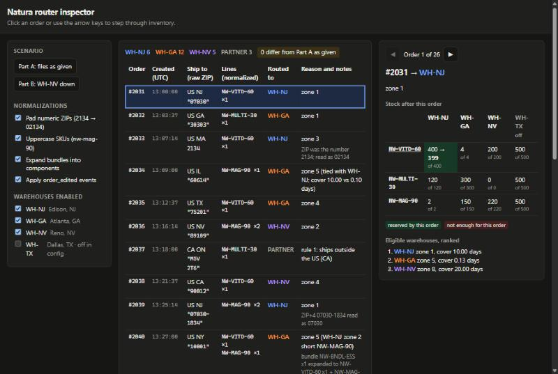

```
[Image: source: C:\Users\André Franceschini\.claude\projects\C--Users-Andr--Franceschini-OneDrive--rea-de-Trabalho-Arquivos-Trabalhos-Andr--Franceschini-Raicom-LLC\f268a8a0-3292-420a-ac32-327fbd3868e4\tool-results\mcp-Claude_Browser-blob-1793408373853-hj5wlc.jpg]
```

</details>

### Assistant · 00:59:36 UTC

Here is the three-column layout. Next I'll step to each of the four orders and zoom into the inspector panel on the right:

<details><summary>Tool call: mcp__ccd_turn__update_plan</summary>

```json
{
  "advance": true
}
```

</details>

<details><summary>Result: mcp__ccd_turn__update_plan</summary>

```
Plan updated: step 2 of 5 is in progress.
```

</details>

<details><summary>Tool call: mcp__Claude_Browser__browser_batch</summary>

```json
{
  "actions": [
    {
      "name": "javascript_tool",
      "input": {
        "action": "javascript_exec",
        "text": "document.querySelector('tr[data-index=\"8\"]').click(); 'selected #2039'"
      }
    },
    {
      "name": "computer",
      "input": {
        "action": "zoom",
        "region": [
          540,
          58,
          782,
          420
        ],
        "scale": 0.8
      }
    },
    {
      "name": "javascript_tool",
      "input": {
        "action": "javascript_exec",
        "text": "document.querySelector('tr[data-index=\"9\"]').click(); 'selected #2040'"
      }
    },
    {
      "name": "computer",
      "input": {
        "action": "zoom",
        "region": [
          540,
          58,
          782,
          420
        ],
        "scale": 0.8
      }
    },
    {
      "name": "javascript_tool",
      "input": {
        "action": "javascript_exec",
        "text": "document.querySelector('tr[data-index=\"10\"]').click(); 'selected #2041'"
      }
    },
    {
      "name": "computer",
      "input": {
        "action": "zoom",
        "region": [
          540,
          58,
          782,
          420
        ],
        "scale": 0.8
      }
    },
    {
      "name": "javascript_tool",
      "input": {
        "action": "javascript_exec",
        "text": "document.querySelector('tr[data-index=\"19\"]').click(); 'selected #2050'"
      }
    },
    {
      "name": "computer",
      "input": {
        "action": "zoom",
        "region": [
          540,
          58,
          782,
          420
        ],
        "scale": 0.8
      }
    }
  ]
}
```

</details>

<details><summary>Result: mcp__Claude_Browser__browser_batch</summary>

```
[javascript_tool:javascript_exec] "selected #2039"


Tab Context:
- Executed on tabId: seed
- Available tabs:
  • tabId seed: "Router Inspector" ("http://localhost:5173/")
- Viewport: emulating 1280x860 (you set this; reset it with preset "desktop" when you finish testing; the app also clears it when your turn ends or the pane's width changes)
```

```
[computer:zoom] Successfully captured zoomed screenshot of region (540,58) to (782,420) - 194x291 pixels, cropped from a screenshot, not magnified. 0.8-scale view; coordinate frame: 800x537.


Tab Context:
- Executed on tabId: seed
- Available tabs:
  • tabId seed: "Router Inspector" ("http://localhost:5173/")
- Viewport: emulating 1280x860 (you set this; reset it with preset "desktop" when you finish testing; the app also clears it when your turn ends or the pane's width changes)
```

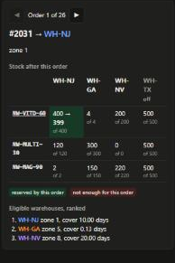

```
[Image: source: C:\Users\André Franceschini\.claude\projects\C--Users-Andr--Franceschini-OneDrive--rea-de-Trabalho-Arquivos-Trabalhos-Andr--Franceschini-Raicom-LLC\f268a8a0-3292-420a-ac32-327fbd3868e4\tool-results\mcp-Claude_Browser-blob-1793408382489-quwet7.png]
```

```
[javascript_tool:javascript_exec] "selected #2040"


Tab Context:
- Executed on tabId: seed
- Available tabs:
  • tabId seed: "Router Inspector" ("http://localhost:5173/")
- Viewport: emulating 1280x860 (you set this; reset it with preset "desktop" when you finish testing; the app also clears it when your turn ends or the pane's width changes)
```

```
[computer:zoom] Successfully captured zoomed screenshot of region (540,58) to (782,420) - 194x291 pixels, cropped from a screenshot, not magnified. 0.8-scale view; coordinate frame: 800x537.


Tab Context:
- Executed on tabId: seed
- Available tabs:
  • tabId seed: "Router Inspector" ("http://localhost:5173/")
- Viewport: emulating 1280x860 (you set this; reset it with preset "desktop" when you finish testing; the app also clears it when your turn ends or the pane's width changes)
```

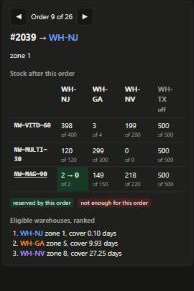

```
[Image: source: C:\Users\André Franceschini\.claude\projects\C--Users-Andr--Franceschini-OneDrive--rea-de-Trabalho-Arquivos-Trabalhos-Andr--Franceschini-Raicom-LLC\f268a8a0-3292-420a-ac32-327fbd3868e4\tool-results\mcp-Claude_Browser-blob-1793408382489-ptig6k.png]
```

```
[javascript_tool:javascript_exec] "selected #2041"


Tab Context:
- Executed on tabId: seed
- Available tabs:
  • tabId seed: "Router Inspector" ("http://localhost:5173/")
- Viewport: emulating 1280x860 (you set this; reset it with preset "desktop" when you finish testing; the app also clears it when your turn ends or the pane's width changes)
```

```
[computer:zoom] Successfully captured zoomed screenshot of region (540,58) to (782,420) - 194x291 pixels, cropped from a screenshot, not magnified. 0.8-scale view; coordinate frame: 800x537.


Tab Context:
- Executed on tabId: seed
- Available tabs:
  • tabId seed: "Router Inspector" ("http://localhost:5173/")
- Viewport: emulating 1280x860 (you set this; reset it with preset "desktop" when you finish testing; the app also clears it when your turn ends or the pane's width changes)
```

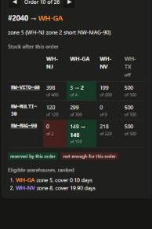

```
[Image: source: C:\Users\André Franceschini\.claude\projects\C--Users-Andr--Franceschini-OneDrive--rea-de-Trabalho-Arquivos-Trabalhos-Andr--Franceschini-Raicom-LLC\f268a8a0-3292-420a-ac32-327fbd3868e4\tool-results\mcp-Claude_Browser-blob-1793408382489-9dmr8o.png]
```

```
[javascript_tool:javascript_exec] "selected #2050"


Tab Context:
- Executed on tabId: seed
- Available tabs:
  • tabId seed: "Router Inspector" ("http://localhost:5173/")
- Viewport: emulating 1280x860 (you set this; reset it with preset "desktop" when you finish testing; the app also clears it when your turn ends or the pane's width changes)
```

```
[computer:zoom] Successfully captured zoomed screenshot of region (540,58) to (782,420) - 194x291 pixels, cropped from a screenshot, not magnified. 0.8-scale view; coordinate frame: 800x537.


Tab Context:
- Executed on tabId: seed
- Available tabs:
  • tabId seed: "Router Inspector" ("http://localhost:5173/")
- Viewport: emulating 1280x860 (you set this; reset it with preset "desktop" when you finish testing; the app also clears it when your turn ends or the pane's width changes)
```

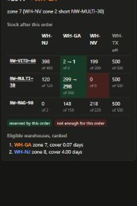

```
[Image: source: C:\Users\André Franceschini\.claude\projects\C--Users-Andr--Franceschini-OneDrive--rea-de-Trabalho-Arquivos-Trabalhos-Andr--Franceschini-Raicom-LLC\f268a8a0-3292-420a-ac32-327fbd3868e4\tool-results\mcp-Claude_Browser-blob-1793408382489-lthvkj.png]
```

</details>

<details><summary>Tool call: mcp__Claude_Browser__browser_batch</summary>

```json
{
  "actions": [
    {
      "name": "javascript_tool",
      "input": {
        "action": "javascript_exec",
        "text": "window.scrollTo(0,0); document.querySelector('tr[data-index=\"19\"]').click(); window.scrollTo(0,0); 'ok'"
      }
    },
    {
      "name": "computer",
      "input": {
        "action": "wait",
        "duration": 0.5
      }
    },
    {
      "name": "computer",
      "input": {
        "action": "zoom",
        "region": [
          540,
          58,
          782,
          420
        ],
        "scale": 0.8
      }
    },
    {
      "name": "javascript_tool",
      "input": {
        "action": "javascript_exec",
        "text": "const out = []; for (const i of [8, 9, 10, 19]) { document.querySelector(`tr[data-index=\"${i}\"]`).click(); const ins = document.getElementById('inspector'); const title = ins.querySelector('h2').innerText; const reason = ins.querySelector('p').innerText; const rows = [...ins.querySelectorAll('table.stock tbody tr')].map(r => r.cells[0].innerText.padEnd(12) + [...r.cells].slice(1).map(c => { const cls = c.className.trim(); return (c.innerText.split('\\n')[0] + (cls ? ` [${cls}]` : '')).padEnd(22); }).join('')); const cands = [...ins.querySelectorAll('.candidates li')].map(l => '   ' + l.innerText); out.push(`${title} | ${reason}\\n            ${'WH-NJ'.padEnd(22)}${'WH-GA'.padEnd(22)}${'WH-NV'.padEnd(22)}WH-TX\\n${rows.join('\\n')}\\n  ranked:\\n${cands.join('\\n')}`); } window.scrollTo(0,0); out.join('\\n\\n')"
      }
    }
  ]
}
```

</details>

<details><summary>Result: mcp__Claude_Browser__browser_batch</summary>

```
[javascript_tool:javascript_exec] "ok"


Tab Context:
- Executed on tabId: seed
- Available tabs:
  • tabId seed: "Router Inspector" ("http://localhost:5173/")
- Viewport: emulating 1280x860 (you set this; reset it with preset "desktop" when you finish testing; the app also clears it when your turn ends or the pane's width changes)
```

```
[computer:wait] waited 0.5s


Tab Context:
- Executed on tabId: seed
- Available tabs:
  • tabId seed: "Router Inspector" ("http://localhost:5173/")
- Viewport: emulating 1280x860 (you set this; reset it with preset "desktop" when you finish testing; the app also clears it when your turn ends or the pane's width changes)
```

```
[computer:zoom] Successfully captured zoomed screenshot of region (540,58) to (782,420) - 194x291 pixels, cropped from a screenshot, not magnified. 0.8-scale view; coordinate frame: 800x537.


Tab Context:
- Executed on tabId: seed
- Available tabs:
  • tabId seed: "Router Inspector" ("http://localhost:5173/")
- Viewport: emulating 1280x860 (you set this; reset it with preset "desktop" when you finish testing; the app also clears it when your turn ends or the pane's width changes)
```

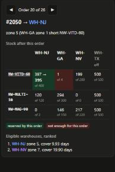

```
[Image: source: C:\Users\André Franceschini\.claude\projects\C--Users-Andr--Franceschini-OneDrive--rea-de-Trabalho-Arquivos-Trabalhos-Andr--Franceschini-Raicom-LLC\f268a8a0-3292-420a-ac32-327fbd3868e4\tool-results\mcp-Claude_Browser-blob-1793408393569-1it0ir.png]
```

```
[javascript_tool:javascript_exec] "#2039 → WH-NJ | zone 1\n            WH-NJ                 WH-GA                 WH-NV                 WH-TX\nNW-VITD-60  398                   3                     199                   500                   \nNW-MULTI-30 120                   299                   0                     500                   \nNW-MAG-90   2 → 0 [moved]         149                   218                   500                   \n  ranked:\n   WH-NJ zone 1, cover 0.10 days\n   WH-GA zone 5, cover 9.93 days\n   WH-NV zone 8, cover 27.25 days\n\n#2040 → WH-GA | zone 5 (WH-NJ zone 2 short NW-MAG-90)\n            WH-NJ                 WH-GA                 WH-NV                 WH-TX\nNW-VITD-60  398                   3 → 2 [moved]         199                   500                   \nNW-MULTI-30 120                   299                   0                     500                   \nNW-MAG-90   0 [short]             149 → 148 [moved]     218                   500                   \n  ranked:\n   WH-GA zone 5, cover 0.10 days\n   WH-NV zone 8, cover 19.90 days\n\n#2041 → WH-GA | zone 7 (WH-NV zone 2 short NW-MULTI-30)\n            WH-NJ                 WH-GA                 WH-NV                 WH-TX\nNW-VITD-60  398                   2 → 1 [moved]         199                   500                   \nNW-MULTI-30 120                   299 → 298 [moved]     0 [short]             500                   \nNW-MAG-90   0                     148                   218                   500                   \n  ranked:\n   WH-GA zone 7, cover 0.07 days\n   WH-NJ zone 8, cover 4.00 days\n\n#2050 → WH-NJ | zone 5 (WH-GA zone 1 short NW-VITD-60)\n            WH-NJ                 WH-GA                 WH-NV                 WH-TX\nNW-VITD-60  397 → 395 [moved]     1 [short]             199                   500                   \nNW-MULTI-30 120                   294                   0                     500                   \nNW-MAG-90   0                     146                   217                   500                   \n  ranked:\n   WH-NJ zone 5, cover 9.93 days\n   WH-NV zone 7, cover 19.90 days"


Tab Context:
- Executed on tabId: seed
- Available tabs:
  • tabId seed: "Router Inspector" ("http://localhost:5173/")
- Viewport: emulating 1280x860 (you set this; reset it with preset "desktop" when you finish testing; the app also clears it when your turn ends or the pane's width changes)
```

</details>

<details><summary>Tool call: mcp__ccd_turn__update_plan</summary>

```json
{
  "done": [
    2,
    3
  ],
  "start": 5
}
```

</details>

<details><summary>Result: mcp__ccd_turn__update_plan</summary>

```
Plan updated: step 5 of 5 is in progress.
```

</details>

<details><summary>Tool call: mcp__Claude_Browser__javascript_tool</summary>

```json
{
  "action": "javascript_exec",
  "text": "const lines = [];\nfor (const preset of ['given', 'nv-off']) {\n  document.querySelector(`[data-preset=\"${preset}\"]`).click();\n  const rows = [...document.querySelectorAll('#orders tbody tr')];\n  const out = [];\n  rows.forEach((r, i) => {\n    if (r.cells[4].innerText.split('\\n')[0] !== 'WH-GA') return;\n    document.querySelector(`tr[data-index=\"${i}\"]`).click();\n    const c = [...document.querySelectorAll('#inspector .candidates li')].map(l => l.innerText.match(/(WH-\\w+) zone (\\d+)/)).map(m => ({ code: m[1], zone: +m[2] }));\n    const ga = c.find(x => x.code === 'WH-GA');\n    const alt = c.filter(x => x.code !== 'WH-GA').sort((a, b) => a.zone - b.zone)[0];\n    out.push(`${r.cells[0].innerText} GA z${ga.zone} | best alternative: ${alt ? `${alt.code} z${alt.zone} (+${alt.zone - ga.zone})` : 'none -> PARTNER'}${alt && alt.zone - ga.zone <= 1 ? '  <= within one zone' : ''}`);\n  });\n  lines.push(`== ${preset} ==\\n` + out.join('\\n'));\n}\ndocument.querySelector('[data-preset=\"given\"]').click(); window.scrollTo(0, 0);\nlines.join('\\n\\n')"
}
```

</details>

<details><summary>Result: mcp__Claude_Browser__javascript_tool</summary>

```
"== given ==\n#2032 GA z1 | best alternative: WH-NJ z5 (+4)\n#2034 GA z5 | best alternative: WH-NJ z5 (+0)  <= within one zone\n#2035 GA z4 | best alternative: WH-NV z5 (+1)  <= within one zone\n#2040 GA z5 | best alternative: WH-NV z8 (+3)\n#2041 GA z7 | best alternative: WH-NJ z8 (+1)  <= within one zone\n#2044 GA z6 | best alternative: WH-NJ z7 (+1)  <= within one zone\n#2045 GA z3 | best alternative: WH-NV z7 (+4)\n#2047 GA z4 | best alternative: WH-NJ z6 (+2)\n#2049 GA z4 | best alternative: WH-NV z8 (+4)\n#2054 GA z4 | best alternative: WH-NV z5 (+1)  <= within one zone\n#2055 GA z8 | best alternative: WH-NJ z8 (+0)  <= within one zone\n#2056 GA z5 | best alternative: WH-NV z8 (+3)\n\n== nv-off ==\n#2032 GA z1 | best alternative: WH-NJ z5 (+4)\n#2034 GA z5 | best alternative: WH-NJ z5 (+0)  <= within one zone\n#2035 GA z4 | best alternative: WH-NJ z6 (+2)\n#2036 GA z7 | best alternative: WH-NJ z8 (+1)  <= within one zone\n#2040 GA z5 | best alternative: none -> PARTNER\n#2041 GA z7 | best alternative: WH-NJ z8 (+1)  <= within one zone\n#2043 GA z8 | best alternative: none -> PARTNER\n#2044 GA z6 | best alternative: WH-NJ z7 (+1)  <= within one zone\n#2045 GA z3 | best alternative: none -> PARTNER\n#2047 GA z4 | best alternative: WH-NJ z6 (+2)\n#2049 GA z4 | best alternative: none -> PARTNER\n#2051 GA z7 | best alternative: WH-NJ z8 (+1)  <= within one zone\n#2052 GA z8 | best alternative: none -> PARTNER\n#2054 GA z4 | best alternative: none -> PARTNER\n#2055 GA z8 | best alternative: WH-NJ z8 (+0)  <= within one zone"
```

```
Tab Context:
- Executed on tabId: seed
- Available tabs:
  • tabId seed: "Router Inspector" ("http://localhost:5173/")
- Viewport: emulating 1280x860 (you set this; reset it with preset "desktop" when you finish testing; the app also clears it when your turn ends or the pane's width changes)
```

</details>

### User · 01:00:21 UTC · sent while the assistant was working

after the review, lets check the solution carefully against the instructions and source data, including edge cases and any assumptions that could affect the results, i also want the interface to be intuitive enough to test different scenarios, inspect each routing decision and see how inventory changes between orders, keep it simple and focused on making the solution easy to understand and verify

<details><summary>Tool call: mcp__ccd_turn__update_plan</summary>

```json
{
  "items": [
    {
      "content": "Walk through the inspector layout",
      "status": "completed"
    },
    {
      "content": "Inspect inventory for #2039, #2040, #2041, #2050",
      "status": "completed"
    },
    {
      "content": "Reconcile each against the source files",
      "status": "completed"
    },
    {
      "content": "List assumptions open to other readings",
      "status": "completed"
    },
    {
      "content": "Gather data for Question 2",
      "status": "completed"
    },
    {
      "content": "Audit data facts and edge cases vs instructions",
      "status": "in_progress"
    },
    {
      "content": "Expose per-warehouse evaluation and deciding rule",
      "status": "pending"
    },
    {
      "content": "Make inspector explain each decision and stock history",
      "status": "pending"
    },
    {
      "content": "Verify interface and tests end to end",
      "status": "pending"
    },
    {
      "content": "Update README",
      "status": "pending"
    }
  ],
  "scope": "continuation"
}
```

</details>

<details><summary>Result: mcp__ccd_turn__update_plan</summary>

```
Plan shown (10 steps).
```

</details>

<details><summary>Tool call: Write · C:\Users\ANDRFR~1\AppData\Local\Temp\claude\C--Users-Andr--Franceschini-OneDrive--rea-de-Trabalho-Arquivos-Trabalhos-Andr--Franceschini-Raicom-LLC\f268a8a0-3292-420a-ac32-327fbd3868e4\scratchpad\data-audit.mjs</summary>

```json
{
  "file_path": "C:\\Users\\ANDRFR~1\\AppData\\Local\\Temp\\claude\\C--Users-Andr--Franceschini-OneDrive--rea-de-Trabalho-Arquivos-Trabalhos-Andr--Franceschini-Raicom-LLC\\f268a8a0-3292-420a-ac32-327fbd3868e4\\scratchpad\\data-audit.mjs",
  "content": "// Ad-hoc audit of the raw assessment data. Usage: node -I? data-audit.mjs <dataDir>\nimport { readFileSync } from 'node:fs';\nimport { join } from 'node:path';\n\nconst dir = process.argv[2];\nconst load = (f) => JSON.parse(readFileSync(join(dir, f), 'utf8'));\nconst orders = load('orders.json');\nconst warehouses = load('warehouses.json');\nconst zones = load('zones.json');\nconst catalog = load('catalog.json');\n\nconst out = (label, value) => console.log(`${label}: ${typeof value === 'string' ? value : JSON.stringify(value)}`);\n\nout('event types', [...new Set(orders.map((e) => e.type))]);\nconst created = orders.filter((e) => e.type === 'order_created');\nout('created count / unique numbers', `${created.length} / ${new Set(created.map((e) => e.orderNumber)).size}`);\nconst times = orders.map((e) => Date.parse(e.at));\nout('file order is chronological (all events)', times.every((t, i) => i === 0 || times[i - 1] <= t));\nconst dupTimes = orders.filter((e, i) => orders.some((o, j) => j !== i && o.at === e.at)).map((e) => `${e.type} ${e.orderNumber}`);\nout('events sharing a timestamp', dupTimes);\nout('countries', [...new Set(created.map((e) => e.shipTo?.country))]);\nout('zip types', created.map((e) => `${e.orderNumber}:${typeof e.shipTo?.zip}`).filter((s) => !s.endsWith('string')));\nout('non-5-digit string zips', created.filter((e) => typeof e.shipTo.zip === 'string' && !/^\\d{5}$/.test(e.shipTo.zip)).map((e) => `${e.orderNumber}=${JSON.stringify(e.shipTo.zip)}`));\nconst lines = orders.flatMap((e) => (e.lines ?? e.addedLines ?? []).map((l) => ({ n: e.orderNumber, ...l })));\nout('quantities all positive integers', lines.every((l) => Number.isInteger(l.quantity) && l.quantity > 0));\nout('max quantity', Math.max(...lines.map((l) => l.quantity)));\nconst known = new Set([...catalog.products.map((p) => p.sku), ...catalog.bundles.map((b) => b.sku)]);\nout('raw SKUs not in catalog', lines.filter((l) => !known.has(l.sku)).map((l) => `${l.n}=${l.sku}`));\nout('orders with more than one line (raw)', created.filter((e) => e.lines.length > 1).map((e) => e.orderNumber));\n\nconst whCodes = warehouses.map((w) => w.code);\nout('warehouses / enabled', warehouses.map((w) => `${w.code}:${w.enabled}`));\nout('every warehouse stocks every product', warehouses.every((w) => catalog.products.every((p) => p.sku in w.inventory)));\nout('zero-velocity entries', warehouses.flatMap((w) => Object.entries(w.inventory).filter(([, s]) => s.dailyVelocity === 0).map(([k]) => `${w.code}:${k}`)));\nout('zero-available entries', warehouses.flatMap((w) => Object.entries(w.inventory).filter(([, s]) => s.available === 0).map(([k]) => `${w.code}:${k}`)));\nconst zoneKeys = whCodes.map((c) => Object.keys(zones[c] ?? {}).sort().join(','));\nout('zones.json covers every warehouse', whCodes.every((c) => c in zones));\nout('all warehouses have identical prefix keys', new Set(zoneKeys).size === 1);\nout('zone prefixes', Object.keys(zones[whCodes[0]]));\nconst prefixes = created.filter((e) => e.shipTo.country === 'US').map((e) => `${e.orderNumber}:${String(e.shipTo.zip).padStart(5, '0').slice(0, 3)}`);\nout('US order prefixes not in zones (after padding)', prefixes.filter((p) => !(p.split(':')[1] in zones[whCodes[0]])));\nconst edits = orders.filter((e) => e.type === 'order_edited');\nout('edits (minutes after creation)', edits.map((e) => `${e.orderNumber} +${(Date.parse(e.at) - Date.parse(created.find((c) => c.orderNumber === e.orderNumber).at)) / 60000}`));\nout('orders created within 30 min before the last event (edit window still open at end of file)', created.filter((e) => Date.parse(orders.at(-1).at) - Date.parse(e.at) < 30 * 60000).map((e) => e.orderNumber));\n"
}
```

</details>

<details><summary>Result: Write</summary>

```
File created successfully at: C:\Users\ANDRFR~1\AppData\Local\Temp\claude\C--Users-Andr--Franceschini-OneDrive--rea-de-Trabalho-Arquivos-Trabalhos-Andr--Franceschini-Raicom-LLC\f268a8a0-3292-420a-ac32-327fbd3868e4\scratchpad\data-audit.mjs (file state is current in your context — no need to Read it back)
```

</details>

<details><summary>Tool call: Bash · Run the raw-data audit script</summary>

```json
{
  "command": "S=\"/c/Users/ANDRFR~1/AppData/Local/Temp/claude/C--Users-Andr--Franceschini-OneDrive--rea-de-Trabalho-Arquivos-Trabalhos-Andr--Franceschini-Raicom-LLC/f268a8a0-3292-420a-ac32-327fbd3868e4/scratchpad\"; node \"$S/data-audit.mjs\" \"/c/Users/André Franceschini/OneDrive/Área de Trabalho/Arquivos/Trabalhos/André Franceschini/Raicom LLC/natura-router/data\"",
  "description": "Run the raw-data audit script"
}
```

</details>

<details><summary>Result: Bash</summary>

```
event types: ["order_created","order_edited"]
created count / unique numbers: 26 / 26
file order is chronological (all events): true
events sharing a timestamp: ["order_edited #2041","order_created #2047"]
countries: ["US","CA"]
zip types: ["#2033:number"]
non-5-digit string zips: ["#2037=\"M5V 2T6\"","#2039=\"07030-1834\"","#2046=\"\""]
quantities all positive integers: true
max quantity: 3
raw SKUs not in catalog: ["#2045=nw-mag-90"]
orders with more than one line (raw): []
warehouses / enabled: ["WH-NJ:true","WH-GA:true","WH-NV:true","WH-TX:false"]
every warehouse stocks every product: true
zero-velocity entries: ["WH-TX:NW-VITD-60","WH-TX:NW-MULTI-30","WH-TX:NW-MAG-90"]
zero-available entries: ["WH-NV:NW-MULTI-30"]
zones.json covers every warehouse: true
all warehouses have identical prefix keys: true
zone prefixes: ["100","282","303","331","606","752","802","891","900","941","981","021","070"]
US order prefixes not in zones (after padding): ["#2042:968","#2046:000"]
edits (minutes after creation): ["#2041 +18"]
orders created within 30 min before the last event (edit window still open at end of file): ["#2047","#2048","#2049","#2050","#2051","#2052","#2053","#2054","#2055","#2056"]
```

</details>

<details><summary>Tool call: Bash · Check which tie-break rules fire in the outputs</summary>

```json
{
  "command": "cd \"/c/Users/André Franceschini/OneDrive/Área de Trabalho/Arquivos/Trabalhos/André Franceschini/Raicom LLC/natura-router\" && echo \"rule 6 (priority) used:\"; grep -c \"priority\" routes.txt routes-nv-off.txt; echo \"rule 5 (cover) used:\"; grep -h \"cover\" routes.txt routes-nv-off.txt | awk '{print $1}' | sort | uniq -c",
  "description": "Check which tie-break rules fire in the outputs"
}
```

</details>

<details><summary>Result: Bash</summary>

```
rule 6 (priority) used:
routes.txt:0
routes-nv-off.txt:0
rule 5 (cover) used:
      2 #2034
      1 #2038
      2 #2048
      2 #2055
```

</details>

<details><summary>Tool call: Read · C:\Users\André Franceschini\OneDrive\Área de Trabalho\Arquivos\Trabalhos\André Franceschini\Raicom LLC\natura-router\src\router.ts</summary>

```json
{
  "file_path": "C:\\Users\\André Franceschini\\OneDrive\\Área de Trabalho\\Arquivos\\Trabalhos\\André Franceschini\\Raicom LLC\\natura-router\\src\\router.ts",
  "offset": 185,
  "limit": 90
}
```

</details>

<details><summary>Result: Read</summary>

```
185	export function daysOfCover(lines: Line[], inventory: Record<string, Stock>): number {
186	  return Math.min(
187	    ...lines.map((l) => {
188	      const s = inventory[l.sku];
189	      return s.dailyVelocity === 0 ? Infinity : s.available / s.dailyVelocity;
190	    }),
191	  );
192	}
193	
194	function priorityRank(code: string): number {
195	  const i = TIE_BREAK_PRIORITY.indexOf(code);
196	  return i === -1 ? TIE_BREAK_PRIORITY.length : i;
197	}
198	
199	// Rules 4-6. Infinity - Infinity is NaN, which is falsy, so equal unlimited cover falls through to priority.
200	function byRoutingRules(a: Candidate, b: Candidate): number {
201	  return a.zone - b.zone || b.cover - a.cover || priorityRank(a.code) - priorityRank(b.code);
202	}
203	
204	const formatCover = (c: number) => (c === Infinity ? 'unlimited' : c.toFixed(2));
205	
206	function hasStock(lines: Line[], inventory: Record<string, Stock>): boolean {
207	  return lines.every((l) => (inventory[l.sku]?.available ?? 0) >= l.quantity);
208	}
209	
210	export function route(
211	  orders: Order[],
212	  warehouses: Warehouse[],
213	  zones: Zones,
214	  disabled: string[] = [],
215	): { decisions: Decision[]; stock: Record<string, Record<string, Stock>> } {
216	  const stock = structuredClone(Object.fromEntries(warehouses.map((w) => [w.code, w.inventory])));
217	  const open = warehouses.filter((w) => w.enabled && !disabled.includes(w.code)).map((w) => w.code);
218	
219	  const decisions = orders.map((order): Decision => {
220	    const partner = (reason: string): Decision => ({
221	      orderNumber: order.orderNumber,
222	      destination: PARTNER,
223	      reason,
224	      notes: order.notes,
225	      lines: order.lines,
226	      candidates: [],
227	      movements: [],
228	    });
229	
230	    if (order.country !== 'US') return partner(`rule 1: ships outside the US (${order.country || 'no country'})`);
231	    if (!order.zip) return partner('rule 2: no usable ZIP');
232	    const prefix = order.zip.slice(0, 3);
233	    if (!Object.values(zones).some((z) => prefix in z)) return partner(`rule 2: ZIP prefix ${prefix} not in zones.json`);
234	
235	    const reachable = open.filter((code) => zones[code]?.[prefix] !== undefined);
236	    const candidates = reachable
237	      .filter((code) => hasStock(order.lines, stock[code]))
238	      .map((code) => ({ code, zone: zones[code][prefix], cover: daysOfCover(order.lines, stock[code]) }))
239	      .sort(byRoutingRules);
240	    if (candidates.length === 0) return partner('rule 7: no enabled warehouse has stock for the whole order');
241	
242	    const [best, runnerUp] = candidates;
243	    const details: string[] = [];
244	    const closerButShort = reachable.filter((c) => zones[c][prefix] < best.zone && !hasStock(order.lines, stock[c]));
245	    for (const code of closerButShort) {
246	      const short = order.lines.filter((l) => (stock[code][l.sku]?.available ?? 0) < l.quantity).map((l) => l.sku);
247	      details.push(`${code} zone ${zones[code][prefix]} short ${short.join(', ')}`);
248	    }
249	    if (runnerUp && runnerUp.zone === best.zone) {
250	      details.push(
251	        runnerUp.cover === best.cover
252	          ? `tied with ${runnerUp.code} on zone and cover; priority`
253	          : `tied with ${runnerUp.code}; cover ${formatCover(best.cover)} vs ${formatCover(runnerUp.cover)} days`,
254	      );
255	    }
256	
257	    const movements = order.lines.map((l) => {
258	      const s = stock[best.code][l.sku];
259	      const before = s.available;
260	      s.available -= l.quantity;
261	      return { sku: l.sku, before, after: s.available };
262	    });
263	
264	    return {
265	      orderNumber: order.orderNumber,
266	      destination: best.code,
267	      reason: `zone ${best.zone}${details.length ? ` (${details.join('; ')})` : ''}`,
268	      notes: order.notes,
269	      lines: order.lines,
270	      candidates,
271	      movements,
272	    };
273	  });
274
```

</details>

<details><summary>Tool call: Edit · C:\Users\André Franceschini\OneDrive\Área de Trabalho\Arquivos\Trabalhos\André Franceschini\Raicom LLC\natura-router\src\router.ts</summary>

```json
{
  "replace_all": false,
  "file_path": "C:\\Users\\André Franceschini\\OneDrive\\Área de Trabalho\\Arquivos\\Trabalhos\\André Franceschini\\Raicom LLC\\natura-router\\src\\router.ts",
  "old_string": "export type Candidate = { code: string; zone: number; cover: number };\nexport type Movement = { sku: string; before: number; after: number };\nexport type Decision = {\n  orderNumber: string;\n  destination: string;\n  reason: string;\n  notes: string[];\n  lines: Line[];\n  candidates: Candidate[];\n  movements: Movement[];\n};",
  "new_string": "type Candidate = { code: string; zone: number; cover: number };\n// How each warehouse fared for one order, so every decision can be explained without re-deriving the rules.\nexport type WarehouseCheck = {\n  code: string;\n  zone: number | null;\n  result: 'chosen' | 'eligible' | 'short' | 'no zone' | 'disabled';\n  cover: number | null;\n  short: string[];\n};\nexport type Movement = { sku: string; before: number; after: number };\nexport type Decision = {\n  orderNumber: string;\n  destination: string;\n  decidedBy: string;\n  reason: string;\n  notes: string[];\n  lines: Line[];\n  checks: WarehouseCheck[];\n  movements: Movement[];\n};"
}
```

</details>

<details><summary>Result: Edit</summary>

```
The file C:\Users\André Franceschini\OneDrive\Área de Trabalho\Arquivos\Trabalhos\André Franceschini\Raicom LLC\natura-router\src\router.ts has been updated successfully.
```

</details>

<details><summary>Tool call: Edit · C:\Users\André Franceschini\OneDrive\Área de Trabalho\Arquivos\Trabalhos\André Franceschini\Raicom LLC\natura-router\src\router.ts</summary>

```json
{
  "replace_all": false,
  "file_path": "C:\\Users\\André Franceschini\\OneDrive\\Área de Trabalho\\Arquivos\\Trabalhos\\André Franceschini\\Raicom LLC\\natura-router\\src\\router.ts",
  "old_string": "  const decisions = orders.map((order): Decision => {\n    const partner = (reason: string): Decision => ({\n      orderNumber: order.orderNumber,\n      destination: PARTNER,\n      reason,\n      notes: order.notes,\n      lines: order.lines,\n      candidates: [],\n      movements: [],\n    });\n\n    if (order.country !== 'US') return partner(`rule 1: ships outside the US (${order.country || 'no country'})`);\n    if (!order.zip) return partner('rule 2: no usable ZIP');\n    const prefix = order.zip.slice(0, 3);\n    if (!Object.values(zones).some((z) => prefix in z)) return partner(`rule 2: ZIP prefix ${prefix} not in zones.json`);\n\n    const reachable = open.filter((code) => zones[code]?.[prefix] !== undefined);\n    const candidates = reachable\n      .filter((code) => hasStock(order.lines, stock[code]))\n      .map((code) => ({ code, zone: zones[code][prefix], cover: daysOfCover(order.lines, stock[code]) }))\n      .sort(byRoutingRules);\n    if (candidates.length === 0) return partner('rule 7: no enabled warehouse has stock for the whole order');\n\n    const [best, runnerUp] = candidates;\n    const details: string[] = [];\n    const closerButShort = reachable.filter((c) => zones[c][prefix] < best.zone && !hasStock(order.lines, stock[c]));\n    for (const code of closerButShort) {\n      const short = order.lines.filter((l) => (stock[code][l.sku]?.available ?? 0) < l.quantity).map((l) => l.sku);\n      details.push(`${code} zone ${zones[code][prefix]} short ${short.join(', ')}`);\n    }\n    if (runnerUp && runnerUp.zone === best.zone) {\n      details.push(\n        runnerUp.cover === best.cover\n          ? `tied with ${runnerUp.code} on zone and cover; priority`\n          : `tied with ${runnerUp.code}; cover ${formatCover(best.cover)} vs ${formatCover(runnerUp.cover)} days`,\n      );\n    }",
  "new_string": "  const decisions = orders.map((order): Decision => {\n    const partner = (decidedBy: string, reason: string, checks: WarehouseCheck[] = []): Decision => ({\n      orderNumber: order.orderNumber,\n      destination: PARTNER,\n      decidedBy,\n      reason,\n      notes: order.notes,\n      lines: order.lines,\n      checks,\n      movements: [],\n    });\n\n    if (order.country !== 'US') return partner('rule 1', `rule 1: ships outside the US (${order.country || 'no country'})`);\n    if (!order.zip) return partner('rule 2', 'rule 2: no usable ZIP');\n    const prefix = order.zip.slice(0, 3);\n    if (!Object.values(zones).some((z) => prefix in z)) {\n      return partner('rule 2', `rule 2: ZIP prefix ${prefix} not in zones.json`);\n    }\n\n    const reachable = open.filter((code) => zones[code]?.[prefix] !== undefined);\n    const candidates = reachable\n      .filter((code) => hasStock(order.lines, stock[code]))\n      .map((code) => ({ code, zone: zones[code][prefix], cover: daysOfCover(order.lines, stock[code]) }))\n      .sort(byRoutingRules);\n\n    const rank = (code: string) => {\n      const i = candidates.findIndex((c) => c.code === code);\n      return i === -1 ? candidates.length + priorityRank(code) : i;\n    };\n    const checks = warehouses\n      .map((w): WarehouseCheck => {\n        const zone = zones[w.code]?.[prefix] ?? null;\n        const short = order.lines.filter((l) => (stock[w.code][l.sku]?.available ?? 0) < l.quantity).map((l) => l.sku);\n        const candidate = candidates.find((c) => c.code === w.code);\n        const result = candidate\n          ? candidate === candidates[0] ? 'chosen' : 'eligible'\n          : !open.includes(w.code) ? 'disabled' : zone === null ? 'no zone' : 'short';\n        return { code: w.code, zone, result, cover: candidate?.cover ?? null, short };\n      })\n      .sort((a, b) => rank(a.code) - rank(b.code));\n\n    if (candidates.length === 0) {\n      return partner('rule 7', 'rule 7: no enabled warehouse has stock for the whole order', checks);\n    }\n\n    const [best, runnerUp] = candidates;\n    const decidedBy = !runnerUp\n      ? 'rule 3: only warehouse that can ship it all'\n      : runnerUp.zone > best.zone\n        ? 'rule 4: lowest zone'\n        : runnerUp.cover !== best.cover\n          ? 'rule 5: days of cover'\n          : 'rule 6: priority';\n\n    const details = checks\n      .filter((c) => c.result === 'short' && c.zone !== null && c.zone < best.zone)\n      .map((c) => `${c.code} zone ${c.zone} short ${c.short.join(', ')}`);\n    if (runnerUp && runnerUp.zone === best.zone) {\n      details.push(\n        runnerUp.cover === best.cover\n          ? `tied with ${runnerUp.code} on zone and cover; priority`\n          : `tied with ${runnerUp.code}; cover ${formatCover(best.cover)} vs ${formatCover(runnerUp.cover)} days`,\n      );\n    }"
}
```

</details>

<details><summary>Result: Edit</summary>

```
The file C:\Users\André Franceschini\OneDrive\Área de Trabalho\Arquivos\Trabalhos\André Franceschini\Raicom LLC\natura-router\src\router.ts has been updated successfully.
```

</details>

<details><summary>Tool call: Edit · C:\Users\André Franceschini\OneDrive\Área de Trabalho\Arquivos\Trabalhos\André Franceschini\Raicom LLC\natura-router\src\router.ts</summary>

```json
{
  "replace_all": false,
  "file_path": "C:\\Users\\André Franceschini\\OneDrive\\Área de Trabalho\\Arquivos\\Trabalhos\\André Franceschini\\Raicom LLC\\natura-router\\src\\router.ts",
  "old_string": "    return {\n      orderNumber: order.orderNumber,\n      destination: best.code,\n      reason: `zone ${best.zone}${details.length ? ` (${details.join('; ')})` : ''}`,\n      notes: order.notes,\n      lines: order.lines,\n      candidates,\n      movements,\n    };",
  "new_string": "    return {\n      orderNumber: order.orderNumber,\n      destination: best.code,\n      decidedBy,\n      reason: `zone ${best.zone}${details.length ? ` (${details.join('; ')})` : ''}`,\n      notes: order.notes,\n      lines: order.lines,\n      checks,\n      movements,\n    };"
}
```

</details>

<details><summary>Result: Edit</summary>

```
The file C:\Users\André Franceschini\OneDrive\Área de Trabalho\Arquivos\Trabalhos\André Franceschini\Raicom LLC\natura-router\src\router.ts has been updated successfully.
```

</details>

### Assistant · 01:02:26 UTC

Now the tests: synthetic cases for rule 6, which the data never triggers (both with tied finite cover and with unlimited cover), plus the deciding rule and per-warehouse checks on the real data.

<details><summary>Tool call: Edit · C:\Users\André Franceschini\OneDrive\Área de Trabalho\Arquivos\Trabalhos\André Franceschini\Raicom LLC\natura-router\test\router.test.ts</summary>

```json
{
  "replace_all": false,
  "file_path": "C:\\Users\\André Franceschini\\OneDrive\\Área de Trabalho\\Arquivos\\Trabalhos\\André Franceschini\\Raicom LLC\\natura-router\\test\\router.test.ts",
  "old_string": "  assert.equal(literal['#2033'], PARTNER);\n  assert.equal(literal['#2045'], PARTNER);\n});",
  "new_string": "  assert.equal(literal['#2033'], PARTNER);\n  assert.equal(literal['#2045'], PARTNER);\n});\n\n// The real data never reaches rule 6, so it is exercised with synthetic warehouses.\n// WH-TX is listed first on purpose: priority must come from rule 6's list, not array order.\nfunction tieScenario(velocity: number) {\n  const inventory = { 'NW-VITD-60': { available: 10, dailyVelocity: velocity } };\n  const warehouses: Warehouse[] = ['WH-TX', 'WH-NV', 'WH-GA'].map((code) => ({ code, city: '', enabled: true, inventory }));\n  const tieZones = { 'WH-TX': { '303': 2 }, 'WH-NV': { '303': 2 }, 'WH-GA': { '303': 2 } };\n  const { orders } = buildOrders(\n    [{ type: 'order_created', orderNumber: '#1', at: '2026-10-20T13:00:00Z', shipTo: { country: 'US', zip: '30303' }, lines: [{ sku: 'NW-VITD-60', quantity: 1 }] }],\n    catalog,\n  );\n  return route(orders, warehouses, tieZones).decisions[0];\n}\n\ntest('rule 6: equal zone and equal cover falls back to priority NJ, GA, NV, TX', () => {\n  const d = tieScenario(5);\n  assert.equal(d.destination, 'WH-GA');\n  assert.equal(d.decidedBy, 'rule 6: priority');\n});\n\ntest('rule 6: equal unlimited cover (zero velocity) also falls back to priority', () => {\n  const d = tieScenario(0);\n  assert.equal(d.destination, 'WH-GA');\n  assert.equal(d.decidedBy, 'rule 6: priority');\n});\n\ntest('each decision names the rule that settled it', () => {\n  const decidedBy = Object.fromEntries(routeWith().decisions.map((d) => [d.orderNumber, d.decidedBy]));\n  assert.equal(decidedBy['#2037'], 'rule 1');\n  assert.equal(decidedBy['#2042'], 'rule 2');\n  assert.equal(decidedBy['#2046'], 'rule 2');\n  assert.equal(decidedBy['#2031'], 'rule 4: lowest zone');\n  assert.equal(decidedBy['#2034'], 'rule 5: days of cover');\n  assert.equal(decidedBy['#2048'], 'rule 5: days of cover');\n  assert.equal(decidedBy['#2055'], 'rule 5: days of cover');\n  assert.ok(!Object.values(decidedBy).includes('rule 6: priority'), 'rule 6 never fires on this data');\n});\n\ntest('warehouse checks explain every exclusion, including a rule 7 PARTNER', () => {\n  const byOrder = (decisions: { orderNumber: string }[], n: string) => decisions.find((d) => d.orderNumber === n) as any;\n  const partA = routeWith().decisions;\n  const d2050 = byOrder(partA, '#2050');\n  assert.deepEqual(\n    d2050.checks.map((c: any) => [c.code, c.result, c.zone, c.short]),\n    [\n      ['WH-NJ', 'chosen', 5, []],\n      ['WH-NV', 'eligible', 7, []],\n      ['WH-GA', 'short', 1, ['NW-VITD-60']],\n      ['WH-TX', 'disabled', 4, []],\n    ],\n  );\n  const d2056 = byOrder(routeWith(rawOrders, ALL_NORMALIZATIONS, ['WH-NV']).decisions, '#2056');\n  assert.equal(d2056.destination, PARTNER);\n  assert.deepEqual(\n    d2056.checks.map((c: any) => [c.code, c.result, c.short]),\n    [\n      ['WH-NJ', 'short', ['NW-MAG-90']],\n      ['WH-GA', 'short', ['NW-VITD-60']],\n      ['WH-NV', 'disabled', []],\n      ['WH-TX', 'disabled', []],\n    ],\n  );\n});"
}
```

</details>

<details><summary>Result: Edit</summary>

```
The file C:\Users\André Franceschini\OneDrive\Área de Trabalho\Arquivos\Trabalhos\André Franceschini\Raicom LLC\natura-router\test\router.test.ts has been updated successfully. (file state is current in your context — no need to Read it back)
```

</details>

<details><summary>Tool call: Bash · Typecheck and run tests after router change</summary>

```json
{
  "command": "cd \"/c/Users/André Franceschini/OneDrive/Área de Trabalho/Arquivos/Trabalhos/André Franceschini/Raicom LLC/natura-router\" && npx tsc -p . ; echo \"tsc exit $?\"; npm test 2>&1 | grep -E \"^✖|ℹ (pass|fail)|Error|expected|actual|\\+ |\\- \" | head -40",
  "description": "Typecheck and run tests after router change"
}
```

</details>

<details><summary>Result: Bash</summary>

```
ui/main.ts(148,24): error TS2339: Property 'candidates' does not exist on type 'Decision'.
ui/main.ts(149,35): error TS2339: Property 'candidates' does not exist on type 'Decision'.
ui/main.ts(151,12): error TS7006: Parameter 'c' implicitly has an 'any' type.
tsc exit 1
✔ stock is conserved: start - end equals what routed orders reserved (Part A: files as given) (0.5195ms)
✔ stock is conserved: start - end equals what routed orders reserved (Part B: WH-NV down) (0.4966ms)
ℹ pass 18
ℹ fail 0
```

</details>

### Assistant · 01:02:44 UTC

18/18 pass. The UI type errors are expected, because the inspector still reads the old `candidates` field, and I'm rewriting it next. First, a check that the refactor didn't change any output:

<details><summary>Tool call: Bash · Confirm the refactor leaves both route outputs byte-identical</summary>

```json
{
  "command": "cd \"/c/Users/André Franceschini/OneDrive/Área de Trabalho/Arquivos/Trabalhos/André Franceschini/Raicom LLC/natura-router\" && cp routes.txt /tmp/r1 2>/dev/null || S=\"/c/Users/ANDRFR~1/AppData/Local/Temp/claude/C--Users-Andr--Franceschini-OneDrive--rea-de-Trabalho-Arquivos-Trabalhos-Andr--Franceschini-Raicom-LLC/f268a8a0-3292-420a-ac32-327fbd3868e4/scratchpad\"; S=\"/c/Users/ANDRFR~1/AppData/Local/Temp/claude/C--Users-Andr--Franceschini-OneDrive--rea-de-Trabalho-Arquivos-Trabalhos-Andr--Franceschini-Raicom-LLC/f268a8a0-3292-420a-ac32-327fbd3868e4/scratchpad\"; node src/main.ts 2>/dev/null | diff - routes.txt && echo \"routes.txt unchanged\"; node src/main.ts --disable WH-NV 2>/dev/null | diff - routes-nv-off.txt && echo \"routes-nv-off.txt unchanged\"",
  "description": "Confirm the refactor leaves both route outputs byte-identical"
}
```

</details>

<details><summary>Result: Bash</summary>

```
routes.txt unchanged
routes-nv-off.txt unchanged
```

</details>

<details><summary>Tool call: mcp__ccd_turn__update_plan</summary>

```json
{
  "done": [
    6,
    7
  ],
  "start": 8
}
```

</details>

<details><summary>Result: mcp__ccd_turn__update_plan</summary>

```
Plan updated: step 8 of 10 is in progress.
```

</details>

<details><summary>Tool call: Write · C:\Users\André Franceschini\OneDrive\Área de Trabalho\Arquivos\Trabalhos\André Franceschini\Raicom LLC\natura-router\ui\main.ts</summary>

```json
{
  "file_path": "C:\\Users\\André Franceschini\\OneDrive\\Área de Trabalho\\Arquivos\\Trabalhos\\André Franceschini\\Raicom LLC\\natura-router\\ui\\main.ts",
  "content": "// Visual inspector for the router. It runs the same src/router.ts the CLI runs and only displays what\n// the router returns, so what you see here is what routes.txt contains for the same settings.\nimport ordersJson from '../data/orders.json' with { type: 'json' };\nimport warehousesJson from '../data/warehouses.json' with { type: 'json' };\nimport zonesJson from '../data/zones.json' with { type: 'json' };\nimport catalogJson from '../data/catalog.json' with { type: 'json' };\nimport { ALL_NORMALIZATIONS, PARTNER, buildOrders, parseZones, route } from '../src/router.ts';\nimport type { Catalog, Decision, Normalizations, RawEvent, Warehouse, WarehouseCheck } from '../src/router.ts';\nimport './style.css';\n\nconst events = ordersJson as unknown as RawEvent[];\nconst sourceWarehouses = warehousesJson as Warehouse[];\nconst zones = parseZones(zonesJson);\nconst catalog = catalogJson as Catalog;\nconst skus = catalog.products.map((p) => p.sku);\nconst codes = sourceWarehouses.map((w) => w.code);\nconst eventsByOrder = Map.groupBy(events, (e) => e.orderNumber);\nconst startStock = (code: string, sku: string) =>\n  sourceWarehouses.find((w) => w.code === code)!.inventory[sku]?.available ?? 0;\n\nconst NORMALIZATION_LABELS: Record<keyof Normalizations, string> = {\n  padNumericZip: 'Pad numeric ZIPs (2134 → 02134)',\n  uppercaseSku: 'Uppercase SKUs (nw-mag-90)',\n  expandBundles: 'Expand bundles into components',\n  applyEdits: 'Apply order_edited events',\n};\n\nconst PRESETS: Record<string, { label: string; off: string[] }> = {\n  given: { label: 'Part A: files as given', off: [] },\n  q1: { label: 'Q1: WH-NV down', off: ['WH-NV'] },\n  q2: { label: 'Q2 option 1: WH-NV and WH-GA off', off: ['WH-NV', 'WH-GA'] },\n};\n\ntype Settings = { normalizations: Normalizations; enabled: Record<string, boolean> };\ntype Cell = { code: string; sku: string };\n\nfunction presetSettings(name: string): Settings {\n  return {\n    normalizations: { ...ALL_NORMALIZATIONS },\n    enabled: Object.fromEntries(sourceWarehouses.map((w) => [w.code, w.enabled && !PRESETS[name].off.includes(w.code)])),\n  };\n}\n\nfunction run(settings: Settings) {\n  const { orders, warnings } = buildOrders(events, catalog, settings.normalizations);\n  const warehouses = sourceWarehouses.map((w) => ({ ...w, enabled: settings.enabled[w.code] }));\n  return { orders, warnings, ...route(orders, warehouses, zones) };\n}\n\n// Part A as given is the reference; rows that route differently are highlighted.\nconst baseline = new Map(run(presetSettings('given')).decisions.map((d) => [d.orderNumber, d.destination]));\n\nlet settings = presetSettings('given');\nlet result = run(settings);\nlet selected = 0;\nlet focus: Cell | null = null;\n\nconst esc = (value: unknown) => String(value).replace(/[&<>\"']/g, (c) => `&#${c.charCodeAt(0)};`);\nconst dest = (code: string) => `<span class=\"dest dest-${esc(code.toLowerCase())}\">${esc(code)}</span>`;\nconst formatCover = (c: number | null) => (c === null ? '' : c === Infinity ? 'unlimited' : c.toFixed(2));\nconst matchesSettings = (name: string) =>\n  JSON.stringify(presetSettings(name)) === JSON.stringify(settings);\n\n// Stock after decisions[0..index] have reserved theirs (index -1 is the start of the day).\nfunction stockAfter(index: number): Record<string, Record<string, number>> {\n  const stock = Object.fromEntries(codes.map((c) => [c, Object.fromEntries(skus.map((s) => [s, startStock(c, s)]))]));\n  for (const d of result.decisions.slice(0, index + 1)) {\n    for (const m of d.movements) stock[d.destination][m.sku] = m.after;\n  }\n  return stock;\n}\n\nfunction renderControls() {\n  const presets = Object.entries(PRESETS)\n    .map(([name, p]) => `<button data-preset=\"${name}\" class=\"${matchesSettings(name) ? 'active' : ''}\">${esc(p.label)}</button>`)\n    .join('');\n  const normalizations = (Object.keys(NORMALIZATION_LABELS) as (keyof Normalizations)[])\n    .map(\n      (key) => `<label class=\"check\"><input type=\"checkbox\" data-norm=\"${key}\" ${settings.normalizations[key] ? 'checked' : ''} />\n        <span>${esc(NORMALIZATION_LABELS[key])}</span></label>`,\n    )\n    .join('');\n  const warehouses = sourceWarehouses\n    .map(\n      (w) => `<label class=\"check\"><input type=\"checkbox\" data-wh=\"${esc(w.code)}\" ${settings.enabled[w.code] ? 'checked' : ''} />\n        <span>${esc(w.code)} <span class=\"muted\">${esc(w.city)}${w.enabled ? '' : ' · off in config'}</span></span></label>`,\n    )\n    .join('');\n  document.getElementById('controls')!.innerHTML = `\n    <div class=\"group\"><h2>Scenario</h2>${presets}</div>\n    <div class=\"group\"><h2>Data normalizations</h2>\n      <p class=\"help\">Untick one to see what reading the data literally would do, including to later orders.</p>${normalizations}</div>\n    <div class=\"group\"><h2>Warehouses enabled</h2>${warehouses}</div>`;\n}\n\nfunction renderSummary() {\n  const counts = new Map<string, number>();\n  for (const d of result.decisions) counts.set(d.destination, (counts.get(d.destination) ?? 0) + 1);\n  const changed = result.decisions.filter((d) => baseline.get(d.orderNumber) !== d.destination).length;\n  const warnings = result.warnings.map((w) => `<li>${esc(w)}</li>`).join('');\n  document.getElementById('summary')!.innerHTML = `\n    <div class=\"chips\">${[...counts].map(([code, n]) => `<span>${dest(code)} ${n}</span>`).join('')}\n      <span class=\"chip-changed\">${changed} of ${result.decisions.length} route differently from Part A as given</span></div>\n    ${warnings ? `<ul class=\"warnings\">${warnings}</ul>` : ''}`;\n}\n\nfunction renderOrders() {\n  const rows = result.decisions\n    .map((d, i) => {\n      const created = eventsByOrder.get(d.orderNumber)?.find((e) => e.type === 'order_created');\n      const was = baseline.get(d.orderNumber);\n      const changed = was !== d.destination;\n      return `<tr data-index=\"${i}\" class=\"${i === selected ? 'selected' : ''} ${changed ? 'changed' : ''}\">\n        <td class=\"mono\">${esc(d.orderNumber)}<div class=\"muted\">${esc(created?.at.slice(11, 19) ?? '')}</div></td>\n        <td>${esc(created?.shipTo?.country)} ${esc(created?.shipTo?.state ?? '')}<div class=\"mono\">${esc(JSON.stringify(created?.shipTo?.zip))}</div></td>\n        <td class=\"mono\">${d.lines.map((l) => `${esc(l.sku)} ×${l.quantity}`).join('<br>')}</td>\n        <td>${dest(d.destination)}${changed ? `<div class=\"was\">was ${esc(was)}</div>` : ''}<div class=\"rule\">${esc(d.decidedBy.split(':')[0])}</div></td>\n        <td>${esc(d.reason)}${d.notes.length ? `<div class=\"notes\">${d.notes.map(esc).join('<br>')}</div>` : ''}</td>\n      </tr>`;\n    })\n    .join('');\n  document.getElementById('orders')!.innerHTML = `\n    <thead><tr><th>Order</th><th>Ship to · raw ZIP</th><th>Lines used</th><th>Routed to</th><th>Reason · normalization notes</th></tr></thead>\n    <tbody>${rows}</tbody>`;\n}\n\nfunction checkResult(c: WarehouseCheck, rank: number): string {\n  if (c.result === 'chosen') return '<strong>chosen</strong>';\n  if (c.result === 'eligible') return `could ship · ranked ${rank}`;\n  if (c.result === 'short') return `<span class=\"bad\">not enough ${c.short.map(esc).join(', ')}</span>`;\n  if (c.result === 'no zone') return '<span class=\"bad\">no zone for this ZIP</span>';\n  return '<span class=\"muted\">disabled</span>';\n}\n\nfunction renderOrderPanel(d: Decision): string {\n  const orderEvents = eventsByOrder.get(d.orderNumber) ?? [];\n  const created = orderEvents.find((e) => e.type === 'order_created');\n  const rawLines = orderEvents\n    .flatMap((e) => (e.type === 'order_created' ? e.lines : e.addedLines) ?? [])\n    .map((l) => `${esc(l.sku)} ×${esc(l.quantity)}`)\n    .join(', ');\n  const used = d.lines.map((l) => `${esc(l.sku)} ×${l.quantity}`).join(', ');\n  return `\n    <dl class=\"facts\">\n      <dt>Ship to</dt><dd>${esc(created?.shipTo?.country)} ${esc(created?.shipTo?.state ?? '')}, ZIP <span class=\"mono\">${esc(JSON.stringify(created?.shipTo?.zip))}</span></dd>\n      <dt>Lines in file</dt><dd class=\"mono\">${rawLines}</dd>\n      <dt>Lines routed</dt><dd class=\"mono\">${used}</dd>\n    </dl>\n    ${d.notes.length ? `<ul class=\"notes-list\">${d.notes.map((n) => `<li>${esc(n)}</li>`).join('')}</ul>` : ''}\n    <details><summary>Raw events (${orderEvents.length})</summary><pre>${esc(JSON.stringify(orderEvents, null, 2))}</pre></details>`;\n}\n\nfunction renderWarehousePanel(d: Decision): string {\n  if (d.checks.length === 0) return `<p class=\"muted\">Not compared: ${esc(d.decidedBy)} sends it to PARTNER before any warehouse is considered.</p>`;\n  let rank = 0;\n  const rows = d.checks\n    .map((c) => {\n      if (c.result === 'chosen' || c.result === 'eligible') rank++;\n      return `<tr class=\"${c.result === 'chosen' ? 'chosen' : ''}\"><td>${dest(c.code)}</td><td>${c.zone ?? '-'}</td>\n        <td>${formatCover(c.cover)}</td><td>${checkResult(c, rank)}</td></tr>`;\n    })\n    .join('');\n  return `<table class=\"checks\"><thead><tr><th>Warehouse</th><th>Zone</th><th>Cover (days)</th><th>Result</th></tr></thead><tbody>${rows}</tbody></table>\n    <p class=\"help\">Rule 3 keeps warehouses that are enabled and can ship every item; rule 4 picks the lowest zone; rules 5 and 6 break ties. Cover is measured before this order reserves stock.</p>`;\n}\n\nfunction renderStockPanel(d: Decision): string {\n  const before = stockAfter(selected - 1);\n  const after = stockAfter(selected);\n  const needs = new Map(d.lines.map((l) => [l.sku, l.quantity]));\n  const header = codes\n    .map((c) => `<th class=\"${settings.enabled[c] ? '' : 'off'}\">${esc(c)}${settings.enabled[c] ? '' : '<small>off</small>'}</th>`)\n    .join('');\n  const body = skus\n    .map((sku) => {\n      const cells = codes\n        .map((code) => {\n          const moved = d.destination === code && needs.has(sku);\n          const short = needs.has(sku) && before[code][sku] < needs.get(sku)!;\n          const isFocus = focus?.code === code && focus?.sku === sku;\n          const value = moved ? `${before[code][sku]} → <strong>${after[code][sku]}</strong>` : String(after[code][sku]);\n          return `<td data-cell=\"${esc(code)}|${esc(sku)}\" class=\"${moved ? 'moved' : ''} ${short ? 'short' : ''} ${isFocus ? 'focus' : ''}\"\n            title=\"Show the history of ${esc(code)} ${esc(sku)}\">${value}<small>start ${startStock(code, sku)}</small></td>`;\n        })\n        .join('');\n      return `<tr><th class=\"mono\">${esc(sku)}</th><td class=\"need\">${needs.get(sku) ?? ''}</td>${cells}</tr>`;\n    })\n    .join('');\n  return `<table class=\"stock\"><thead><tr><th></th><th>Needs</th>${header}</tr></thead><tbody>${body}</tbody></table>\n    <p class=\"legend\"><span class=\"moved\">reserved by this order</span><span class=\"short\">not enough for this order</span><span>click a cell for its history</span></p>\n    ${renderHistory()}`;\n}\n\nfunction renderHistory(): string {\n  if (!focus) return '';\n  const { code, sku } = focus;\n  const entries = result.decisions.flatMap((d, i) =>\n    d.destination === code ? d.movements.filter((m) => m.sku === sku).map((m) => ({ i, d, m })) : [],\n  );\n  const items = entries\n    .map(\n      ({ i, d, m }) => `<li data-goto=\"${i}\" class=\"${i === selected ? 'current' : i > selected ? 'future' : ''}\">\n        <span class=\"mono\">${esc(d.orderNumber)}</span> −${m.before - m.after} → ${m.after}</li>`,\n    )\n    .join('');\n  return `<h3>History of ${esc(code)} · ${esc(sku)}</h3>\n    <ol class=\"history\"><li class=\"start\">start of day: ${startStock(code, sku)}</li>${items || '<li class=\"muted\">no orders reserved from it</li>'}</ol>`;\n}\n\nfunction renderInspector() {\n  const d = result.decisions[selected];\n  document.getElementById('inspector')!.innerHTML = `\n    <div class=\"step\">\n      <button data-step=\"-1\" ${selected === 0 ? 'disabled' : ''} aria-label=\"Previous order\">◀</button>\n      <span>Order ${selected + 1} of ${result.decisions.length}</span>\n      <button data-step=\"1\" ${selected === result.decisions.length - 1 ? 'disabled' : ''} aria-label=\"Next order\">▶</button>\n    </div>\n    <h2>${esc(d.orderNumber)} → ${dest(d.destination)}</h2>\n    <p class=\"decided\">Decided by <strong>${esc(d.decidedBy)}</strong>${d.destination === PARTNER ? '' : ` · ${esc(d.reason)}`}</p>\n    <h3>Order</h3>${renderOrderPanel(d)}\n    <h3>Warehouses</h3>${renderWarehousePanel(d)}\n    <h3>Stock after this order</h3>${renderStockPanel(d)}`;\n}\n\nfunction render() {\n  renderControls();\n  renderSummary();\n  renderOrders();\n  renderInspector();\n}\n\nfunction select(index: number) {\n  selected = Math.max(0, Math.min(result.decisions.length - 1, index));\n  const d = result.decisions[selected];\n  if (d.movements.length) focus = { code: d.destination, sku: d.movements[0].sku };\n  renderOrders();\n  renderInspector();\n  document.querySelector('#orders tr.selected')?.scrollIntoView({ block: 'nearest' });\n}\n\nfunction rerun() {\n  result = run(settings);\n  render();\n  select(selected);\n}\n\ndocument.addEventListener('change', (event) => {\n  const input = event.target as HTMLInputElement;\n  if (input.dataset.norm) settings.normalizations[input.dataset.norm as keyof Normalizations] = input.checked;\n  else if (input.dataset.wh) settings.enabled[input.dataset.wh] = input.checked;\n  else return;\n  rerun();\n});\n\ndocument.addEventListener('click', (event) => {\n  const target = event.target as HTMLElement;\n  const preset = target.closest<HTMLElement>('[data-preset]')?.dataset.preset;\n  if (preset) {\n    settings = presetSettings(preset);\n    return rerun();\n  }\n  const step = target.closest<HTMLElement>('[data-step]')?.dataset.step;\n  if (step) return select(selected + Number(step));\n  const cell = target.closest<HTMLElement>('[data-cell]')?.dataset.cell;\n  if (cell) {\n    const [code, sku] = cell.split('|');\n    focus = { code, sku };\n    return renderInspector();\n  }\n  const goto = target.closest<HTMLElement>('[data-goto]')?.dataset.goto;\n  if (goto) return select(Number(goto));\n  const row = target.closest<HTMLElement>('tr[data-index]');\n  if (row) select(Number(row.dataset.index));\n});\n\ndocument.addEventListener('keydown', (event) => {\n  if ((event.target as HTMLElement).closest('input, button, summary')) return;\n  if (event.key === 'ArrowDown' || event.key === 'ArrowRight') select(selected + 1);\n  else if (event.key === 'ArrowUp' || event.key === 'ArrowLeft') select(selected - 1);\n  else return;\n  event.preventDefault();\n});\n\nrender();\nselect(0);\n"
}
```

</details>

<details><summary>Result: Write</summary>

```
The file C:\Users\André Franceschini\OneDrive\Área de Trabalho\Arquivos\Trabalhos\André Franceschini\Raicom LLC\natura-router\ui\main.ts has been updated successfully. (file state is current in your context — no need to Read it back)
```

</details>

<details><summary>Tool call: Edit · C:\Users\André Franceschini\OneDrive\Área de Trabalho\Arquivos\Trabalhos\André Franceschini\Raicom LLC\natura-router\ui\main.ts</summary>

```json
{
  "replace_all": false,
  "file_path": "C:\\Users\\André Franceschini\\OneDrive\\Área de Trabalho\\Arquivos\\Trabalhos\\André Franceschini\\Raicom LLC\\natura-router\\ui\\main.ts",
  "old_string": "document.addEventListener('keydown', (event) => {\n  if ((event.target as HTMLElement).closest('input, button, summary')) return;\n  if (event.key",
  "new_string": "document.addEventListener('keydown', (event) => {\n  if (event.key"
}
```

</details>

<details><summary>Result: Edit</summary>

```
The file C:\Users\André Franceschini\OneDrive\Área de Trabalho\Arquivos\Trabalhos\André Franceschini\Raicom LLC\natura-router\ui\main.ts has been updated successfully. (file state is current in your context — no need to Read it back)
```

</details>

<details><summary>Tool call: Edit · C:\Users\André Franceschini\OneDrive\Área de Trabalho\Arquivos\Trabalhos\André Franceschini\Raicom LLC\natura-router\tsconfig.json</summary>

```json
{
  "replace_all": false,
  "file_path": "C:\\Users\\André Franceschini\\OneDrive\\Área de Trabalho\\Arquivos\\Trabalhos\\André Franceschini\\Raicom LLC\\natura-router\\tsconfig.json",
  "old_string": "    \"target\": \"es2023\",\n    \"lib\": [\"es2023\", \"dom\"],",
  "new_string": "    \"target\": \"es2024\",\n    \"lib\": [\"es2024\", \"dom\"],"
}
```

</details>

<details><summary>Result: Edit</summary>

```
The file C:\Users\André Franceschini\OneDrive\Área de Trabalho\Arquivos\Trabalhos\André Franceschini\Raicom LLC\natura-router\tsconfig.json has been updated successfully. (file state is current in your context — no need to Read it back)
```

</details>

<details><summary>Tool call: Edit · C:\Users\André Franceschini\OneDrive\Área de Trabalho\Arquivos\Trabalhos\André Franceschini\Raicom LLC\natura-router\index.html</summary>

```json
{
  "replace_all": false,
  "file_path": "C:\\Users\\André Franceschini\\OneDrive\\Área de Trabalho\\Arquivos\\Trabalhos\\André Franceschini\\Raicom LLC\\natura-router\\index.html",
  "old_string": "      <p class=\"hint\">Click an order or use the arrow keys to step through inventory.</p>",
  "new_string": "      <p class=\"hint\">Pick a scenario, then click an order (or use the arrow keys) to see why it went where it did and how stock moved.</p>"
}
```

</details>

<details><summary>Result: Edit</summary>

```
The file C:\Users\André Franceschini\OneDrive\Área de Trabalho\Arquivos\Trabalhos\André Franceschini\Raicom LLC\natura-router\index.html has been updated successfully. (file state is current in your context — no need to Read it back)
```

</details>

<details><summary>Tool call: Edit · C:\Users\André Franceschini\OneDrive\Área de Trabalho\Arquivos\Trabalhos\André Franceschini\Raicom LLC\natura-router\ui\style.css</summary>

```json
{
  "replace_all": false,
  "file_path": "C:\\Users\\André Franceschini\\OneDrive\\Área de Trabalho\\Arquivos\\Trabalhos\\André Franceschini\\Raicom LLC\\natura-router\\ui\\style.css",
  "old_string": ".candidates { margin: 0; padding-left: 20px; }",
  "new_string": "button.active { border-color: var(--nj); color: var(--nj); font-weight: 600; }\n.help { color: var(--muted); font-size: 12px; margin: 0 0 6px; }\n.rule { color: var(--muted); font-size: 11.5px; margin-top: 2px; }\n.decided { margin: 4px 0 0; }\n.bad { color: var(--ga); }\n\n.facts { display: grid; grid-template-columns: auto 1fr; gap: 2px 10px; margin: 0; }\n.facts dt { color: var(--muted); }\n.facts dd { margin: 0; }\n.notes-list { margin: 6px 0; padding-left: 18px; font-size: 12.5px; }\ndetails { margin-top: 6px; font-size: 12.5px; }\ndetails pre { max-height: 220px; overflow: auto; background: var(--bg); padding: 8px; border-radius: 6px; }\n\n.checks tr.chosen { background: var(--moved); }\n.stock td[data-cell] { cursor: pointer; }\n.stock td.need { color: var(--muted); font-weight: 600; }\n.stock td.focus { outline: 2px solid var(--nj); outline-offset: -2px; }\n.stock th small { display: block; font-weight: normal; }\n\n.history { margin: 0; padding-left: 20px; font-size: 13px; }\n.history li[data-goto] { cursor: pointer; }\n.history li.current { font-weight: 700; }\n.history li.future { color: var(--muted); }\n.history li.start { list-style: none; margin-left: -20px; color: var(--muted); }"
}
```

</details>

<details><summary>Result: Edit</summary>

```
The file C:\Users\André Franceschini\OneDrive\Área de Trabalho\Arquivos\Trabalhos\André Franceschini\Raicom LLC\natura-router\ui\style.css has been updated successfully. (file state is current in your context — no need to Read it back)
```

</details>

<details><summary>Tool call: Bash · Typecheck after inspector rewrite</summary>

```json
{
  "command": "cd \"/c/Users/André Franceschini/OneDrive/Área de Trabalho/Arquivos/Trabalhos/André Franceschini/Raicom LLC/natura-router\" && npx tsc -p . ; echo \"tsc exit $?\"",
  "description": "Typecheck after inspector rewrite"
}
```

</details>

<details><summary>Result: Bash</summary>

```
tsc exit 0
```

</details>

### Assistant · 01:04:07 UTC

Typecheck is clean. Next I'll verify the interface in the browser, using real clicks rather than JS where possible:

<details><summary>Tool call: mcp__ccd_turn__update_plan</summary>

```json
{
  "advance": true
}
```

</details>

<details><summary>Result: mcp__ccd_turn__update_plan</summary>

```
Plan updated: step 9 of 10 is in progress.
```

</details>

<details><summary>Tool call: mcp__Claude_Browser__resize_window</summary>

```json
{
  "width": 1280,
  "height": 900
}
```

</details>

<details><summary>Result: mcp__Claude_Browser__resize_window</summary>

```
Viewport set to 1280x900 on this tab (scaled down to fit if larger than the pane). Reset it with preset "desktop" as soon as you finish testing; the desktop app also clears a size you set when your turn ends or the pane's width changes, so set it again if you still need it. If the user wants to keep a phone or tablet size after your turn, they can pick Mobile or Tablet in the pane's Viewport menu; a custom size you simply set again next turn.
```

```
Tab Context:
- Executed on tabId: seed
- Available tabs:
  • tabId seed: "Router Inspector" ("http://localhost:5173/")
- Viewport: emulating 1280x900 (you set this; reset it with preset "desktop" when you finish testing; the app also clears it when your turn ends or the pane's width changes)
```

</details>

<details><summary>Tool call: mcp__Claude_Browser__browser_batch</summary>

```json
{
  "actions": [
    {
      "name": "navigate",
      "input": {
        "url": "http://localhost:5173/"
      }
    },
    {
      "name": "find",
      "input": {
        "query": "#2050"
      }
    }
  ]
}
```

</details>

<details><summary>Result: mcp__Claude_Browser__browser_batch</summary>

```
[navigate] navigated to http://localhost:5173/


Tab Context:
- Executed on tabId: seed
- Available tabs:
  • tabId seed: "Router Inspector" ("http://localhost:5173/")
- Viewport: emulating 1280x900 (you set this; reset it with preset "desktop" when you finish testing; the app also clears it when your turn ends or the pane's width changes)
```

```
[find] Found 2 match(es) for "#2050":
- generic "#2050" [ref_209]
- generic "#2050" [ref_352]


Tab Context:
- Executed on tabId: seed
- Available tabs:
  • tabId seed: "Router Inspector" ("http://localhost:5173/")
- Viewport: emulating 1280x900 (you set this; reset it with preset "desktop" when you finish testing; the app also clears it when your turn ends or the pane's width changes)
```

</details>

<details><summary>Tool call: mcp__Claude_Browser__browser_batch</summary>

```json
{
  "actions": [
    {
      "name": "computer",
      "input": {
        "action": "left_click",
        "ref": "ref_209",
        "action_summary": "Selects order #2050 in the table"
      }
    },
    {
      "name": "javascript_tool",
      "input": {
        "action": "javascript_exec",
        "text": "window.scrollTo(0,0); 'ok'"
      }
    },
    {
      "name": "computer",
      "input": {
        "action": "screenshot"
      }
    },
    {
      "name": "read_console_messages",
      "input": {
        "onlyErrors": true
      }
    }
  ]
}
```

</details>

<details><summary>Result: mcp__Claude_Browser__browser_batch</summary>

```
[computer:left_click] left_click at (324, 450) [ref_209]


Tab Context:
- Executed on tabId: seed
- Available tabs:
  • tabId seed: "Router Inspector" ("http://localhost:5173/")
- Viewport: emulating 1280x900 (you set this; reset it with preset "desktop" when you finish testing; the app also clears it when your turn ends or the pane's width changes)
```

```
[javascript_tool:javascript_exec] "ok"


Tab Context:
- Executed on tabId: seed
- Available tabs:
  • tabId seed: "Router Inspector" ("http://localhost:5173/")
- Viewport: emulating 1280x900 (you set this; reset it with preset "desktop" when you finish testing; the app also clears it when your turn ends or the pane's width changes)
```

```
[computer:screenshot] Screenshot size: 800x562


Tab Context:
- Executed on tabId: seed
- Available tabs:
  • tabId seed: "Router Inspector" ("http://localhost:5173/")
- Viewport: emulating 1280x900 (you set this; reset it with preset "desktop" when you finish testing; the app also clears it when your turn ends or the pane's width changes)
```

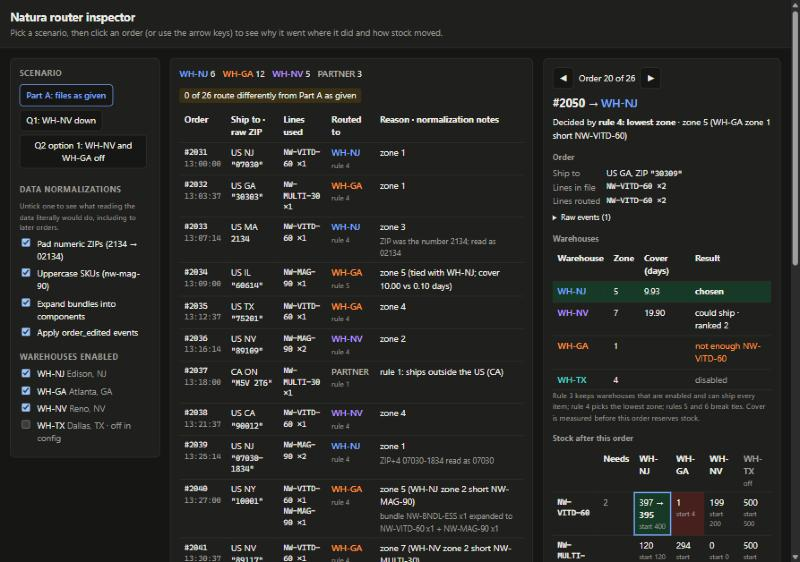

```
[Image: source: C:\Users\André Franceschini\.claude\projects\C--Users-Andr--Franceschini-OneDrive--rea-de-Trabalho-Arquivos-Trabalhos-Andr--Franceschini-Raicom-LLC\f268a8a0-3292-420a-ac32-327fbd3868e4\tool-results\mcp-Claude_Browser-blob-1793408658466-k0wcra.jpg]
```

```
[read_console_messages] [error] Uncaught TypeError: Cannot read properties of undefined (reading 'length')
    at renderInspector (http://localhost:5173/ui/main.ts?t=1793408541740:117:34)
    at render (http://localhost:5173/ui/main.ts?t=1793408541740:136:2)
    at http://localhost:5173/ui/main.ts?t=1793408541740:175:1


Tab Context:
- Executed on tabId: seed
- Available tabs:
  • tabId seed: "Router Inspector" ("http://localhost:5173/")
- Viewport: emulating 1280x900 (you set this; reset it with preset "desktop" when you finish testing; the app also clears it when your turn ends or the pane's width changes)
```

</details>

<details><summary>Tool call: Edit · C:\Users\André Franceschini\OneDrive\Área de Trabalho\Arquivos\Trabalhos\André Franceschini\Raicom LLC\natura-router\ui\style.css</summary>

```json
{
  "replace_all": false,
  "file_path": "C:\\Users\\André Franceschini\\OneDrive\\Área de Trabalho\\Arquivos\\Trabalhos\\André Franceschini\\Raicom LLC\\natura-router\\ui\\style.css",
  "old_string": ".inspector { position: sticky; top: 16px; }",
  "new_string": ".inspector { position: sticky; top: 16px; max-height: calc(100vh - 32px); overflow-y: auto; }\n\n@media (max-width: 1100px) {\n  .inspector { position: static; max-height: none; }\n}"
}
```

</details>

<details><summary>Result: Edit</summary>

```
The file C:\Users\André Franceschini\OneDrive\Área de Trabalho\Arquivos\Trabalhos\André Franceschini\Raicom LLC\natura-router\ui\style.css has been updated successfully. (file state is current in your context — no need to Read it back)
```

</details>

<details><summary>Tool call: mcp__Claude_Browser__browser_batch</summary>

```json
{
  "actions": [
    {
      "name": "navigate",
      "input": {
        "url": "http://localhost:5173/"
      }
    },
    {
      "name": "javascript_tool",
      "input": {
        "action": "javascript_exec",
        "text": "window.__errors = []; addEventListener('error', e => window.__errors.push(e.message)); document.querySelector('tr[data-index=\"19\"]').click(); const ins = document.getElementById('inspector'); ins.scrollTop = ins.scrollHeight; [getComputedStyle(ins).overflowY, ins.scrollHeight > ins.clientHeight, [...document.querySelectorAll('#orders tbody tr')].filter((r,i)=>[6,11,15].includes(i)).map(r => r.cells[0].innerText.split('\\n')[0] + ' ' + r.cells[3].innerText.replace(/\\n/g,' '))]"
      }
    },
    {
      "name": "computer",
      "input": {
        "action": "zoom",
        "region": [
          540,
          58,
          782,
          562
        ],
        "scale": 0.9
      }
    }
  ]
}
```

</details>

<details><summary>Result: mcp__Claude_Browser__browser_batch</summary>

```
[navigate] navigated to http://localhost:5173/


Tab Context:
- Executed on tabId: seed
- Available tabs:
  • tabId seed: "Router Inspector" ("http://localhost:5173/")
- Viewport: emulating 1280x900 (you set this; reset it with preset "desktop" when you finish testing; the app also clears it when your turn ends or the pane's width changes)
```

```
[javascript_tool:javascript_exec] [
  "auto",
  true,
  [
    "#2037 PARTNER rule 1",
    "#2042 PARTNER rule 2",
    "#2046 PARTNER rule 2"
  ]
]


Tab Context:
- Executed on tabId: seed
- Available tabs:
  • tabId seed: "Router Inspector" ("http://localhost:5173/")
- Viewport: emulating 1280x900 (you set this; reset it with preset "desktop" when you finish testing; the app also clears it when your turn ends or the pane's width changes)
```

```
[computer:zoom] Successfully captured zoomed screenshot of region (540,58) to (782,562) - 218x454 pixels, cropped from a screenshot, not magnified. 0.9-scale view; coordinate frame: 800x569.


Tab Context:
- Executed on tabId: seed
- Available tabs:
  • tabId seed: "Router Inspector" ("http://localhost:5173/")
- Viewport: emulating 1280x900 (you set this; reset it with preset "desktop" when you finish testing; the app also clears it when your turn ends or the pane's width changes)
```

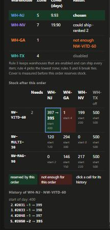

```
[Image: source: C:\Users\André Franceschini\.claude\projects\C--Users-Andr--Franceschini-OneDrive--rea-de-Trabalho-Arquivos-Trabalhos-Andr--Franceschini-Raicom-LLC\f268a8a0-3292-420a-ac32-327fbd3868e4\tool-results\mcp-Claude_Browser-blob-1793408673734-wpsl28.png]
```

</details>

<details><summary>Tool call: mcp__Claude_Browser__find</summary>

```json
{
  "query": "start 4"
}
```

</details>

<details><summary>Tool call: mcp__Claude_Browser__find</summary>

```json
{
  "query": "Q2 option 1"
}
```

</details>

<details><summary>Result: mcp__Claude_Browser__find</summary>

```
Found 2 match(es) for "start 4":
- generic "start 400" [ref_313]
- generic "start 4" [ref_315]
```

```
Tab Context:
- Executed on tabId: seed
- Available tabs:
  • tabId seed: "Router Inspector" ("http://localhost:5173/")
- Viewport: emulating 1280x900 (you set this; reset it with preset "desktop" when you finish testing; the app also clears it when your turn ends or the pane's width changes)
```

</details>

<details><summary>Result: mcp__Claude_Browser__find</summary>

```
Found 1 match(es) for "Q2 option 1":
- button "Q2 option 1: WH-NV and WH-GA off" [ref_9]
```

```
Tab Context:
- Executed on tabId: seed
- Available tabs:
  • tabId seed: "Router Inspector" ("http://localhost:5173/")
- Viewport: emulating 1280x900 (you set this; reset it with preset "desktop" when you finish testing; the app also clears it when your turn ends or the pane's width changes)
```

</details>

<details><summary>Tool call: mcp__Claude_Browser__browser_batch</summary>

```json
{
  "actions": [
    {
      "name": "computer",
      "input": {
        "action": "left_click",
        "ref": "ref_315",
        "action_summary": "Opens the history of WH-GA Vitamin D"
      }
    },
    {
      "name": "javascript_tool",
      "input": {
        "action": "javascript_exec",
        "text": "const h = document.querySelector('.history'); document.querySelector('#inspector h3:last-of-type').innerText + '\\n' + h.innerText"
      }
    },
    {
      "name": "computer",
      "input": {
        "action": "left_click",
        "ref": "ref_9",
        "action_summary": "Switches to the Q2 option 1 scenario"
      }
    },
    {
      "name": "javascript_tool",
      "input": {
        "action": "javascript_exec",
        "text": "[document.querySelector('.chips').innerText.replace(/\\n/g,' '), document.querySelector('button.active')?.innerText, ...[...document.querySelectorAll('#orders tbody tr.changed')].map(r => r.cells[0].innerText.split('\\n')[0] + ' ' + r.cells[3].innerText.replace(/\\n/g,' ') + ' — ' + r.cells[4].innerText.split('\\n')[0]), 'errors since reload: ' + JSON.stringify(window.__errors)].join('\\n')"
      }
    }
  ]
}
```

</details>

<details><summary>Result: mcp__Claude_Browser__browser_batch</summary>

```
[computer:left_click] left_click at (1091, 500) [ref_315]


Tab Context:
- Executed on tabId: seed
- Available tabs:
  • tabId seed: "Router Inspector" ("http://localhost:5173/")
- Viewport: emulating 1280x900 (you set this; reset it with preset "desktop" when you finish testing; the app also clears it when your turn ends or the pane's width changes)
```

```
[javascript_tool:javascript_exec] "History of WH-GA · NW-VITD-60\nstart of day: 4\n#2035 −1 → 3\n#2040 −1 → 2\n#2041 −1 → 1\n#2056 −1 → 0"


Tab Context:
- Executed on tabId: seed
- Available tabs:
  • tabId seed: "Router Inspector" ("http://localhost:5173/")
- Viewport: emulating 1280x900 (you set this; reset it with preset "desktop" when you finish testing; the app also clears it when your turn ends or the pane's width changes)
```

```
[computer:left_click] left_click at (133, 243) [ref_9]


Tab Context:
- Executed on tabId: seed
- Available tabs:
  • tabId seed: "Router Inspector" ("http://localhost:5173/")
- Viewport: emulating 1280x900 (you set this; reset it with preset "desktop" when you finish testing; the app also clears it when your turn ends or the pane's width changes)
```

```
[javascript_tool:javascript_exec] "WH-NJ 15 PARTNER 11 18 of 26 route differently from Part A as given\nQ2 option 1: WH-NV and WH-GA off\n#2032 WH-NJ was WH-GA rule 3 — zone 5\n#2034 WH-NJ was WH-GA rule 3 — zone 5\n#2035 WH-NJ was WH-GA rule 3 — zone 6\n#2036 PARTNER was WH-NV rule 7 — rule 7: no enabled warehouse has stock for the whole order\n#2038 WH-NJ was WH-NV rule 3 — zone 8\n#2039 PARTNER was WH-NJ rule 7 — rule 7: no enabled warehouse has stock for the whole order\n#2040 WH-NJ was WH-GA rule 3 — zone 2\n#2041 WH-NJ was WH-GA rule 3 — zone 8\n#2043 PARTNER was WH-NV rule 7 — rule 7: no enabled warehouse has stock for the whole order\n#2044 WH-NJ was WH-GA rule 3 — zone 7\n#2045 PARTNER was WH-GA rule 7 — rule 7: no enabled warehouse has stock for the whole order\n#2047 WH-NJ was WH-GA rule 3 — zone 6\n#2049 PARTNER was WH-GA rule 7 — rule 7: no enabled warehouse has stock for the whole order\n#2051 WH-NJ was WH-NV rule 3 — zone 8\n#2052 PARTNER was WH-NV rule 7 — rule 7: no enabled warehouse has stock for the whole order\n#2054 PARTNER was WH-GA rule 7 — rule 7: no enabled warehouse has stock for the whole order\n#2055 WH-NJ was WH-GA rule 3 — zone 8\n#2056 PARTNER was WH-GA rule 7 — rule 7: no enabled warehouse has stock for the whole order\nerrors since reload: []"


Tab Context:
- Executed on tabId: seed
- Available tabs:
  • tabId seed: "Router Inspector" ("http://localhost:5173/")
- Viewport: emulating 1280x900 (you set this; reset it with preset "desktop" when you finish testing; the app also clears it when your turn ends or the pane's width changes)
```

</details>

<details><summary>Tool call: mcp__ccd_turn__update_plan</summary>

```json
{
  "advance": true
}
```

</details>

<details><summary>Result: mcp__ccd_turn__update_plan</summary>

```
Plan updated: step 10 of 10 is in progress.
```

</details>

<details><summary>Tool call: Edit · C:\Users\André Franceschini\OneDrive\Área de Trabalho\Arquivos\Trabalhos\André Franceschini\Raicom LLC\natura-router\README.md</summary>

```json
{
  "replace_all": false,
  "file_path": "C:\\Users\\André Franceschini\\OneDrive\\Área de Trabalho\\Arquivos\\Trabalhos\\André Franceschini\\Raicom LLC\\natura-router\\README.md",
  "old_string": "## Routing rules: implemented as written\n\nThe rules are not changed. Two points the brief leaves open, and what I chose:\n\n- **Days of cover (rule 5)** uses stock *before* the order is reserved. A product with zero daily velocity never runs out, so its cover is unlimited. This only matters for WH-TX, which is disabled. On this data, measuring after reservation gives the same routes.\n- **Rule 2's \"ZIP prefix isn't in zones.json\"** means no warehouse has a zone for it. A warehouse missing a prefix that others have would just be ineligible.",
  "new_string": "## Routing rules: implemented as written\n\nThe rules are not changed. Every decision records which rule settled it (`decidedBy`) and how each warehouse fared: its zone, cover, and whether it was chosen, eligible, short of a SKU, without a zone, or disabled.\n\nOn this data, rule 4 settles most orders, and rule 5 (cover) breaks the zone ties in #2034, #2048 and #2055 (and #2038 with WH-NV down). **Rule 6 (priority) never fires on this data**, so it's covered by synthetic tests, including the tie between two unlimited covers.\n\n## Interpretations a reader could make differently\n\n| Point | Reading used | Other reading | Effect on this data |\n|---|---|---|---|\n| \"Apply the rules to the files exactly as given\" | Rules unchanged, data cleaned (table below) | Don't clean the data | #2033, #2040, #2045, #2056 → PARTNER and #2041 to NV; #2050 moves too |\n| When edits are applied | Folded in before routing; the order keeps its creation-time place | Route at creation, ignore late lines | #2041, #2050, #2056 change |\n| Edit windows still open | `orders.json` is treated as complete | #2047–#2056 were created < 30 min before the last event, so a live router would wait | None (no later events exist) |\n| Days of cover (rule 5) | Stock *before* this order is reserved; zero velocity = unlimited | Stock after reserving | None: verified identical |\n| \"ZIP prefix isn't in zones.json\" (rule 2) | No warehouse has a zone for it | Any warehouse lacks it | None: all warehouses list the same prefixes |\n| Edit window boundary | Inclusive (≤ 30 min) | Exclusive | None: the only edit is at +18 min |\n| A US address with no zone (#2042, Hawaii) | PARTNER, as rule 2 says | Hold for a person | #2042 |\n| Unknown SKU | Can't be stocked anywhere, so rule 7 → PARTNER | Reject or hold | None after uppercasing |\n| PARTNER capacity | Unlimited, never checked | Has its own stock | None in the data |\n| WH-NV in Part A | Enabled, as the config says; the ops notes only apply in Part B | Disable it now | See `routes-nv-off.txt` |"
}
```

</details>

<details><summary>Result: Edit</summary>

```
The file C:\Users\André Franceschini\OneDrive\Área de Trabalho\Arquivos\Trabalhos\André Franceschini\Raicom LLC\natura-router\README.md has been updated successfully. (file state is current in your context — no need to Read it back)
```

</details>

<details><summary>Tool call: Edit · C:\Users\André Franceschini\OneDrive\Área de Trabalho\Arquivos\Trabalhos\André Franceschini\Raicom LLC\natura-router\README.md</summary>

```json
{
  "replace_all": false,
  "file_path": "C:\\Users\\André Franceschini\\OneDrive\\Área de Trabalho\\Arquivos\\Trabalhos\\André Franceschini\\Raicom LLC\\natura-router\\README.md",
  "old_string": "- **The tests can fail:** I broke the router on purpose twice",
  "new_string": "- **Rules the data never exercises** get synthetic tests: rule 6 priority (with equal finite and equal unlimited cover, and warehouses listed out of priority order), edits outside the window, orphan edits, duplicate orders, and a bundle plus a loose unit of the same product.\n- **Explanations are tested too:** the deciding rule for representative orders, and the per-warehouse checks for #2050 and for #2056's rule 7 PARTNER with WH-NV down.\n- **The tests can fail:** I broke the router on purpose twice"
}
```

</details>

<details><summary>Result: Edit</summary>

```
The file C:\Users\André Franceschini\OneDrive\Área de Trabalho\Arquivos\Trabalhos\André Franceschini\Raicom LLC\natura-router\README.md has been updated successfully. (file state is current in your context — no need to Read it back)
```

</details>

<details><summary>Tool call: Edit · C:\Users\André Franceschini\OneDrive\Área de Trabalho\Arquivos\Trabalhos\André Franceschini\Raicom LLC\natura-router\README.md</summary>

```json
{
  "replace_all": false,
  "file_path": "C:\\Users\\André Franceschini\\OneDrive\\Área de Trabalho\\Arquivos\\Trabalhos\\André Franceschini\\Raicom LLC\\natura-router\\README.md",
  "old_string": "`npm run dev` opens a small Vite page that runs the same `src/router.ts`. You can step through orders and watch the stock table change, switch each normalization on or off, and enable or disable warehouses. Rows whose destination differs from Part A as given are highlighted. It's a tool for inspecting results; the tests are the proof.",
  "new_string": "`npm run dev` opens a small Vite page that runs the same `src/router.ts` and only displays what it returns:\n\n- **Scenarios:** Part A as given, Q1 (WH-NV down), Q2 option 1 (WH-NV and WH-GA off), or any mix of warehouse switches. Each data normalization can also be switched off to see the literal reading. Rows that route differently from Part A as given are highlighted.\n- **Per order:** the raw events next to the lines actually routed, the normalization notes, every warehouse's zone, cover and result, and the rule that decided.\n- **Stock:** what the order needs and before → after for every warehouse. Clicking a cell lists that cell's history for the whole day; clicking a history entry jumps to that order. Arrow keys step through orders.\n\nIt's a tool for inspecting results; the tests are the proof."
}
```

</details>

<details><summary>Result: Edit</summary>

```
The file C:\Users\André Franceschini\OneDrive\Área de Trabalho\Arquivos\Trabalhos\André Franceschini\Raicom LLC\natura-router\README.md has been updated successfully. (file state is current in your context — no need to Read it back)
```

</details>

<details><summary>Tool call: Bash · Final typecheck, tests and output check</summary>

```json
{
  "command": "cd \"/c/Users/André Franceschini/OneDrive/Área de Trabalho/Arquivos/Trabalhos/André Franceschini/Raicom LLC/natura-router\" && npx tsc -p . && echo \"tsc ok\" && npm test 2>&1 | grep -E \"^✖|ℹ (pass|fail)\" && node src/main.ts 2>/dev/null | diff -q - routes.txt && node src/main.ts --disable WH-NV 2>/dev/null | diff -q - routes-nv-off.txt && echo \"outputs unchanged\"",
  "description": "Final typecheck, tests and output check"
}
```

</details>

<details><summary>Result: Bash</summary>

```
tsc ok
ℹ pass 18
ℹ fail 0
outputs unchanged
```

</details>

### Assistant · 01:05:23 UTC

One README claim hasn't been run yet: what happens when **all** normalizations are off at once. I tested each one separately, but never the combination. Checking it:

<details><summary>Tool call: Bash · Compare routes with all normalizations on vs all off</summary>

```json
{
  "command": "cd \"/c/Users/André Franceschini/OneDrive/Área de Trabalho/Arquivos/Trabalhos/André Franceschini/Raicom LLC/natura-router\" && cat > /dev/null <<'EOF'\nEOF\nnode --input-type=module -e \"\nimport { readFileSync } from 'node:fs';\nimport { buildOrders, route, parseZones } from './src/router.ts';\nconst load = (f) => JSON.parse(readFileSync('data/' + f, 'utf8'));\nconst run = (o) => Object.fromEntries(route(buildOrders(load('orders.json'), load('catalog.json'), o).orders, load('warehouses.json'), parseZones(load('zones.json'))).decisions.map((d) => [d.orderNumber, d.destination]));\nconst on = run({ padNumericZip: true, uppercaseSku: true, expandBundles: true, applyEdits: true });\nconst off = run({ padNumericZip: false, uppercaseSku: false, expandBundles: false, applyEdits: false });\nfor (const n in on) if (on[n] !== off[n]) console.log(n, on[n], '->', off[n]);\n\"",
  "description": "Compare routes with all normalizations on vs all off"
}
```

</details>

<details><summary>Result: Bash</summary>

```
#2033 WH-NJ -> PARTNER
#2040 WH-GA -> PARTNER
#2041 WH-GA -> WH-NV
#2045 WH-GA -> PARTNER
#2050 WH-NJ -> WH-GA
#2056 WH-GA -> PARTNER
```

</details>

### Assistant · 01:05:34 UTC

That matches the README claim exactly. Resetting the browser viewport:

<details><summary>Tool call: mcp__Claude_Browser__resize_window</summary>

```json
{
  "preset": "desktop"
}
```

</details>

<details><summary>Result: mcp__Claude_Browser__resize_window</summary>

```
Viewport emulation cleared; the tab is back to the pane's responsive size (desktop).
```

```
Tab Context:
- Executed on tabId: seed
- Available tabs:
  • tabId seed: "Router Inspector" ("http://localhost:5173/")
```

</details>

<details><summary>Tool call: mcp__ccd_turn__wrap_up</summary>

```json
{
  "recap": "The inspector now explains every decision (warehouse checks, deciding rule, per-cell stock history) and has a Q2 scenario. 18 tests pass, both route files are unchanged, and the README lists every interpretation. Nothing is committed yet, and Q2 is still open.",
  "ask": "Which Question 2 option do you want to defend?",
  "actions": [
    {
      "label": "Option 3, with guards"
    },
    {
      "label": "Let's debate it first"
    }
  ]
}
```

</details>

<details><summary>Result: mcp__ccd_turn__wrap_up</summary>

```
Shown in the next-step box. Your closing message is your answer to the user: write it now, in full, as the last thing you say this turn. The box asks your question, so do not ask it again.
```

</details>

### Assistant · 01:05:54 UTC

The review held up: every result I checked traces back to the source files. The audit against the instructions found nothing wrong in the routes, but it did surface one assumption I hadn't stated, plus a rule the data never uses. The interface now explains each decision on its own. All 18 tests pass, and the outputs are unchanged.

## 1. How to use the interface (`npm run dev`)

- **Left column:** choose a scenario (Part A as given, Q1 with NV down, Q2 option 1 with NV and GA off), switch any data normalization off, or turn warehouses on and off.
- **Middle:** all 26 orders, each with the rule that decided it. Rows highlighted in yellow route differently from Part A as given.
- **Right, for the selected order:**
  - **Order:** the lines in the file next to the lines actually routed, the normalization notes, and the raw events.
  - **Warehouses:** each warehouse's zone, cover and result (chosen, ranked, missing a SKU, disabled).
  - **Stock:** what the order needs and before → after per warehouse. **Click a cell** to see its history for the whole day; click an entry in the history to jump to that order. The arrow keys step through orders.

## 2. The four orders, checked against the source files

| Order | Movement | Arithmetic from the files | Why this warehouse |
|---|---|---|---|
| #2039 | NJ magnesium **2 → 0** | NJ starts with 2; #2034 took its magnesium from GA (cover tie-break), so NJ still had 2 | NJ is zone 1 for prefix 070 |
| #2040 | GA Vitamin D **3 → 2**, magnesium **149 → 148** | GA Vitamin D: 4 − 1 (#2035) = 3. GA magnesium: 150 − 1 (#2034) = 149 | NJ (zone 2) has 0 magnesium after #2039, so the next closest is GA (zone 5) |
| #2041 | GA Vitamin D **2 → 1**, multivitamin **299 → 298** | GA multivitamin: 300 − 1 (#2032) | The edit adds a multivitamin; NV (zone 2) has 0 of it, so GA (zone 7) beats NJ (zone 8) |
| #2050 | NJ Vitamin D **397 → 395** | NJ Vitamin D: 400 − #2031 − #2033 − #2048 = 397 | GA (zone 1) has only 1 Vitamin D and the order needs 2; NJ (zone 5) beats NV (zone 7) |

The GA Vitamin D cell's history shows the whole chain: 4 → 3 → 2 → 1 → 0, ending with #2056.

## 3. Readings that could differ from the written rules

The README now has a table with each point, the reading I used, the other reading, and the effect on this data. Only three readings change any route:
1. **Cleaning the data at all.** With every normalization switched off, 6 orders change: #2033, #2040, #2045 and #2056 go to PARTNER, #2041 goes to NV, and #2050 goes to GA. I ran that combination to confirm the README claim; I had only tested each switch on its own before.
2. **Folding the edit in before routing.** Without it, #2041, #2050 and #2056 change.
3. **#2042 (Hawaii) going to PARTNER.** It's a US address, but rule 2 is explicit.

These readings change nothing on this data: cover measured before vs after reservation (I verified this), rule 2 meaning "any" vs "all" warehouses, the 30-minute boundary, and PARTNER having unlimited capacity.

## 4. Audit against the instructions

- **Every rule is implemented and appears in the output.** Rule 5 decides #2034, #2048 and #2055, plus #2038 when NV is down.
- **Rule 6 never fires on this data.** It was untested code; it now has synthetic tests, including the tie between two unlimited covers.
- **New finding:** orders **#2047–#2056 were created less than 30 minutes before the last event in the file**, so their edit windows are still open. The router treats `orders.json` as complete. Mention it to Sean, because a live system would wait for the window to close.
- **The data matches what the code assumes:**
  - The file is already in chronological order.
  - All 26 order numbers are unique, and there is only one edit.
  - Every warehouse stocks every product, and all zone maps cover the same ZIP prefixes.
  - Only TX has zero velocity, and only NV has a product at zero stock.
- **The router change was safe:** each decision now carries the rule that settled it and a result for every warehouse, and both route files stayed byte-identical.

## 5. Question 2: what the data adds to Priya's numbers

Here is the data I pulled, with NV down as it really is today. Of the 15 orders GA ships today:
- **6** have NJ within one zone, which is the case option 3 is designed for.
- **3** have NJ 2 or more zones farther away.
- **6 have no domestic alternative at all.** They are magnesium and Vitamin D orders that NJ can't fill.

Running option 1 as a scenario confirms it: **PARTNER goes from 3 orders to 11.** Turning GA off doesn't push those orders "2 zones farther" as Priya's model assumes. It pushes domestic orders to the international partner.

Caveats: this is a 26-order sample from about an hour of the day, while Priya's figures are daily averages. The "within one zone" split is taken from stock as it stood with GA on.

My position is still option 3, with two guards:
- Only route away from GA when the alternative can actually ship the whole order, and never push an order to PARTNER to avoid GA.
- Expire the rule automatically on Monday.

Option 4 is out because NV is flooded. But you are the one defending this to Sean, so tell me which option you'd pick and why, and I'll push back where your argument is weak.

---

## User · 01:06:19 UTC

lets debate it first, option 3 sounds reasonable but i want to understand the tradeoffs and how much we can conclude from the 26 order sample, can you compare the options and explain what could make option 3 the wrong choice

### Assistant · 01:07:33 UTC

# Question 2: the options compared, and where option 3 could be wrong

**Short answer:** Option 3 is the best of the four only if three things hold:
- the code change ships within a day or two,
- NJ can absorb the extra volume, and
- Priya's 30/70 split survives NV being down.

If any of those fails, option 2 (keep routing to GA as normal) is the better choice, and that's the real decision. Option 1 loses to option 3 under every assumption, and option 4 is out.

## Comparing the options

All figures use Priya's numbers (420 GA orders/day) over about 4 shipping days until Monday.

| | What happens to GA's ~420 orders/day | Customer delay | Extra cost | Risk |
|---|---|---|---|---|
| **1. GA off** | All move. 70% go 2+ zones farther, 30% go within one zone | 70%: about +2 days in transit instead of +2 in picking, so **no faster**. 30%: about 1.5 days faster | ~$741/day, ~$3,000 total | With NV down and NJ out of magnesium, many orders have **no domestic warehouse at all**. The scenario run sent 8 more domestic orders to PARTNER |
| **2. Keep GA** | Nothing moves | All arrive about 2 business days late | $0 | No change to the code. The cost is customer experience for one week |
| **3. Route away when within one zone** | ~126/day move, ~294 stay | 126 get about 1.5 days faster; 294 stay 2 days late | ~$50/day, ~$200 total | **It's new routing logic, not a switch.** It has to be built, tested, deployed and removed within the week |
| **4. GA off, NV on** | Orders go to a flooded warehouse | Orders stuck indefinitely | — | Out of the question |

The key comparison is 1 vs 3. Option 1 is option 3 plus moving the other 70%. That 70% pays $2.35 per order to arrive at about the same time, and, with today's stock, some of it ends up at the international partner. Option 3 does strictly better, so there is no case for option 1.

Priya's numbers also explain why the threshold is "within one zone". One zone farther costs about half a day, which beats waiting 2 days in picking. Two zones farther costs about 2 days, which is the same as waiting. So one zone is about where moving the order stops paying off.

## What 26 orders can and can't tell us

**They can't estimate a percentage.** GA took 15 orders, and 6 had NJ within one zone. 6 out of 15 is 40%, and the 95% confidence interval runs from about 20% to 64%. That's consistent with Priya's 30% and also with almost anything else. The sample is also:
- about 75 minutes of a single morning,
- distorted by NV being down: the West Coast ZIPs that NV normally serves fall onto GA and NJ, where both are zone 7–8, so "within one zone" is just two distant warehouses tying, and
- built as a test, with traps placed on purpose.

**They do show structural facts, and those don't depend on sample size:**
- NJ has 0 magnesium after one order, so with NV down, any magnesium order that leaves GA goes to PARTNER. That's a fact about the stock, not a statistic.
- NJ's Vitamin D drops for every order moved to it, and it's the only warehouse left serving NJ's own zone-1 customers.
- Priya's model assumes a domestic alternative always exists ("2 or more zones farther"). Today's stock breaks that assumption for some orders.

**In practice:** use the sample to question Priya's model, not to replace her numbers.

## What could make option 3 the wrong choice

Ordered by how likely I think each one is to sink it:

1. **It can't ship in time.** NV flooded on Monday and the router still shows it enabled on Tuesday ("IT will update it when they can"). If flipping a flag takes IT more than a day, a new rule plus tests plus a deploy plus a Monday rollback could easily take until Thursday. By then option 3 covers 1–2 days instead of 4, and you've added risk to production for about $100 of benefit. **This is the strongest argument for option 2.**
2. **NJ can't absorb the volume.** About 126 extra orders a day could overload NJ. Then NJ falls behind too, and you've moved the delay to NJ's own customers. The `dailyVelocity` figures (NJ ships about 90 units/day in total) suggest NJ is small, but they don't match Priya's 420 orders/day for GA, so I wouldn't treat them as capacity. **Ask operations directly.**
3. **NJ stock runs out.** Every order moved to NJ uses up stock NJ's nearby customers need. If NJ runs out of Vitamin D on Thursday, those customers go to GA (which is behind) or to PARTNER. A guard helps: only move orders while NJ's days of cover stays above a set level.
4. **Priya's 30% assumed NV was available.** Her numbers are from Tuesday, but she doesn't say whether she excluded NV. If she didn't, the real share within one zone is different. That share could be higher, but it would come from ties at distant zones, not genuinely close alternatives.
5. **The delay is shorter or different than stated.** "2 business days behind until Monday" could shrink if GA gets temporary staff. Business days of picking delay vs calendar days of transit also changes the comparison: a Thursday order that's 2 business days late lands on Monday, 4 calendar days later. That last point actually *favors* option 3.
6. **The question only offers router changes.** The cheapest real fix might not be in the router at all: overtime or temporary staff at GA, upgraded shipping for GA orders, or simply telling customers their new delivery date. Sean may want to hear that you noticed this.

One argument *for* option 3 that Priya's numbers leave out: moving 30% of GA's volume **helps GA catch up faster**, which also helps the 70% that stay.

## Where I land

I'd recommend option 3 on condition that it can be live within about a day, has an automatic expiry on Monday, and stops moving orders if NJ's cover drops below a set level. Otherwise I'd keep option 2 and tell customers about the delay. Either way, option 1 loses to option 3 everywhere, and option 4 is out.

That's an answer Sean can challenge without it falling apart, because it says which facts would change it. What's your read on point 1? How fast do you think a team that hasn't disabled NV yet can ship a new routing rule?

---

## User · 01:07:57 UTC

i would go with option 2 for now, the delay is temporary and we cant assume a new routing rule can be deployed safely in time or that nj can handle the extra volume, lets disable nv and communicate the delay, if operations confirms capacity and the rule can be shipped quickly with an automatic expiry, then option 3 is worth reconsidering

### Assistant · 01:08:18 UTC

That's a defensible decision, and you justified it with the right reasons: risk you can't verify, not just preference. Two things would make it hold up better on the call with Sean.

**1. Give the reconsideration a deadline.** "If operations confirms capacity and the rule can ship quickly" leaves "quickly" undefined. The payoff of option 3 shrinks every day until Monday: about $50/day buys roughly 1.5 days faster delivery for ~126 orders per day still left in the window. A rule that goes live Thursday covers a day or two and still carries the full deploy-and-rollback risk. So make it concrete. For example: reconsider option 3 only if both conditions are met by Wednesday midday; after that, keep option 2 until Monday. That turns "we'll see" into a decision rule.

**2. Say what would make you change your mind sooner.** Option 2 rests on "the delay is temporary and about 2 days". If GA's backlog grows instead of holding steady (more than 2 business days, or past Monday), the cost of waiting rises and the comparison changes. Name the signal you'd watch, GA's picking backlog in days, so Sean sees you're not just picking the option with no work.

**What your answer means in practice today:**
- **WH-NV off in the router now.** That's a data correction from the ops notes, not a judgment call, and it's already your Question 1 answer. It's also the same kind of flag change you're doubting IT can make quickly, which supports your caution about option 3.
- **WH-GA stays on**, so the Question 1 routes don't change: #2040, #2041, #2045 and #2051 ship from GA about 2 days late, and #2033 and #2050 from NJ.
- **Customers routed to GA are told the new delivery date.** This happens outside the router, but it's what makes option 2 a choice you made rather than one you defaulted to.
- **Option 3 stays on the table** under the conditions above.

When Sean pushes back with "you're leaving faster delivery on the table for $50 a day", your answer is that the $50 isn't the real cost. The real cost is an untested change to production routing, written by a team that hasn't disabled a flooded warehouse in more than a day, with an unconfirmed load on NJ. And the decision can be reversed: option 2 doesn't block option 3 later.

The open items are publishing the repo to GitHub and getting the AI conversation share link. I can also write these Part B answers into the repo as short call notes if you want them there; tell me which you'd like next.

---

## User · 01:10:03 UTC

lets stick with option 2 and monitor gas backlog, if it grows beyond 2 business days or recovery slips past monday we should reassess, we can reconsider option 3 by wednesday midday if nj capacity and deployment readiness are confirmed, add this reasoning as short part b notes and prepare the repo for submission, keeping the original configuration for part a

<details><summary>Tool call: mcp__ccd_turn__update_plan</summary>

```json
{
  "items": [
    {
      "content": "Confirm Part A data is byte-identical to the original",
      "status": "in_progress"
    },
    {
      "content": "Write short Part B notes",
      "status": "pending"
    },
    {
      "content": "Link notes from README and tidy repo files",
      "status": "pending"
    },
    {
      "content": "Initialize git and stage submission files",
      "status": "pending"
    },
    {
      "content": "Verify a clean export installs, tests and reproduces routes",
      "status": "pending"
    }
  ],
  "scope": "continuation"
}
```

</details>

<details><summary>Result: mcp__ccd_turn__update_plan</summary>

```
Plan shown (5 steps).
```

</details>

<details><summary>Tool call: Bash · Verify data files match the original and check git identity</summary>

```json
{
  "command": "cd \"/c/Users/André Franceschini/OneDrive/Área de Trabalho/Arquivos/Trabalhos/André Franceschini/Raicom LLC\" && for f in catalog.json orders.json warehouses.json zones.json ops-notes.md; do a=$(sha1sum \"natura-router/data/$f\" | cut -c1-40); b=$(sha1sum \"assessment/Raicom - Developer Skills Assessment/natura-wellness-backend-test 2/$f\" | cut -c1-40); [ \"$a\" = \"$b\" ] && echo \"identical  $f\" || echo \"DIFFERENT  $f\"; done; grep -A2 '\"WH-NV\"' natura-router/data/warehouses.json | head -3; head -3 natura-router/routes.txt; git -C natura-router config user.name; git -C natura-router config user.email",
  "description": "Verify data files match the original and check git identity"
}
```

</details>

<details><summary>Result: Bash</summary>

```
identical  catalog.json
identical  orders.json
identical  warehouses.json
identical  zones.json
identical  ops-notes.md
    "code": "WH-NV",
    "city": "Reno, NV",
    "enabled": true,
#2031  WH-NJ    zone 1
#2032  WH-GA    zone 1
#2033  WH-NJ    zone 3  [ZIP was the number 2134; read as 02134]
André Franceschini
profissional.andrefranceschini@proton.me
```

</details>

### User · 01:10:26 UTC · sent while the assistant was working

also improve the interface with familiar ui patterns, clear labels and a simple layout so its easy to compare scenarios and understand why each warehouse was selected and how inventory changed, keep it focused without adding unnecessary features

<details><summary>Tool call: mcp__ccd_turn__update_plan</summary>

```json
{
  "items": [
    {
      "content": "Confirm Part A data is byte-identical to the original",
      "status": "completed"
    },
    {
      "content": "Write short Part B notes",
      "status": "in_progress"
    },
    {
      "content": "Rework interface: two-pane layout, scenario switcher, plain explanations",
      "status": "pending"
    },
    {
      "content": "Verify interface in the browser",
      "status": "pending"
    },
    {
      "content": "Link notes from README and tidy repo files",
      "status": "pending"
    },
    {
      "content": "Initialize git and stage submission files",
      "status": "pending"
    },
    {
      "content": "Verify a clean export installs, tests and reproduces routes",
      "status": "pending"
    }
  ],
  "scope": "continuation"
}
```

</details>

<details><summary>Result: mcp__ccd_turn__update_plan</summary>

```
Plan shown (7 steps).
```

</details>

<details><summary>Tool call: Write · C:\Users\André Franceschini\OneDrive\Área de Trabalho\Arquivos\Trabalhos\André Franceschini\Raicom LLC\natura-router\PART-B.md</summary>

```json
{
  "file_path": "C:\\Users\\André Franceschini\\OneDrive\\Área de Trabalho\\Arquivos\\Trabalhos\\André Franceschini\\Raicom LLC\\natura-router\\PART-B.md",
  "content": "# Part B notes\n\n## Question 1: where each order ships today\n\nBasis: the Part A router plus the ops notes. WH-NV is out (water damage), so it is disabled. WH-GA stays on, because its picking delay is the Question 2 decision. Full output: [`routes-nv-off.txt`](routes-nv-off.txt).\n\n| Order | Ships from | Why |\n|---|---|---|\n| #2033 | WH-NJ | The ZIP is the number `2134`, i.e. `02134` (Boston). The state, MA, confirms it. NJ is zone 3. |\n| #2037 | Partner | Canada (rule 1). |\n| #2040 | WH-GA | The bundle is Vitamin D + Magnesium. NJ (zone 2) has had no magnesium since #2039, so GA (zone 5) is next. |\n| #2041 | WH-GA | The edit adds a multivitamin. NV (zone 2) is down, and it has no multivitamin anyway. GA (zone 7) beats NJ (zone 8). |\n| #2045 | WH-GA | `nw-mag-90` is `NW-MAG-90`. GA is zone 3. |\n| #2050 | WH-NJ | GA (zone 1) has 1 Vitamin D left and the order needs 2. NJ is zone 5. |\n| #2051 | WH-GA | NV (zone 2) is down. GA (zone 7) beats NJ (zone 8). |\n\nNone of these needs a person to decide. Worth raising on the call: with NV off, **#2056 (a New Jersey customer) goes to the international partner under rule 7**, because GA runs out of Vitamin D at #2051 and NJ has no magnesium. Also, the brief says \"question 4\" in Question 1; it means Question 2.\n\n## Question 2: keep routing to WH-GA (option 2)\n\n**Decision:** keep routing to WH-GA as normal. Disable WH-NV in the router, tell customers routed to GA their new delivery date, and monitor GA's picking backlog daily.\n\n**Why not the others**\n\n- **Option 1 (GA off)** is worse than option 3 in every case. The 70% of GA orders without a close alternative would pay about $2.35 more to arrive about as late, in transit instead of in picking. With NV down and NJ out of magnesium, some have no domestic warehouse at all: in today's orders, turning GA off sends 11 of 26 to the international partner instead of 3.\n- **Option 4** sends orders to a flooded warehouse.\n- **Option 3** is the best on paper (about $50/day so roughly 126 orders/day arrive about 1.5 days sooner). But it depends on two things nobody has confirmed:\n  - New routing logic has to be built, deployed and removed safely within days. The router still shows NV enabled a day after the flood.\n  - NJ has to have the capacity and stock for about 126 extra orders a day. It is already out of magnesium.\n\nThe delay is temporary, everything still ships, and option 2 can be reversed at any time.\n\n**When to reassess:** if GA's backlog grows beyond 2 business days, or recovery slips past Monday.\n\n**When option 3 comes back:** only if, by Wednesday midday, operations confirms NJ can take the volume and the rule can ship with an automatic expiry on Monday. After that, too little of the window is left to justify the risk.\n\n**What the 26 orders can and can't show:** GA had 15 of them, and 6 had NJ within one zone (40%, 95% interval about 20–64%). That's too few to estimate a share, so I rely on Priya's figures. The structural facts don't depend on sample size: NJ has no magnesium, and with NV down some orders have no domestic warehouse.\n"
}
```

</details>

<details><summary>Result: Write</summary>

```
File created successfully at: C:\Users\André Franceschini\OneDrive\Área de Trabalho\Arquivos\Trabalhos\André Franceschini\Raicom LLC\natura-router\PART-B.md (file state is current in your context — no need to Read it back)
```

</details>

<details><summary>Tool call: mcp__ccd_turn__update_plan</summary>

```json
{
  "advance": true
}
```

</details>

<details><summary>Result: mcp__ccd_turn__update_plan</summary>

```
Plan updated: step 3 of 7 is in progress.
```

</details>

<details><summary>Tool call: Write · C:\Users\André Franceschini\OneDrive\Área de Trabalho\Arquivos\Trabalhos\André Franceschini\Raicom LLC\natura-router\index.html</summary>

```json
{
  "file_path": "C:\\Users\\André Franceschini\\OneDrive\\Área de Trabalho\\Arquivos\\Trabalhos\\André Franceschini\\Raicom LLC\\natura-router\\index.html",
  "content": "<!doctype html>\n<html lang=\"en\">\n  <head>\n    <meta charset=\"UTF-8\" />\n    <meta name=\"viewport\" content=\"width=device-width, initial-scale=1.0\" />\n    <title>Routing Inspector</title>\n  </head>\n  <body>\n    <header class=\"topbar\">\n      <h1>Natura Wellness · order routing inspector</h1>\n      <p>Pick a scenario, then select an order to see why it ships from where it does and how stock changed.</p>\n    </header>\n    <section class=\"toolbar\" id=\"toolbar\" aria-label=\"Scenario settings\"></section>\n    <section class=\"summary\" id=\"summary\" aria-live=\"polite\"></section>\n    <main class=\"panes\">\n      <section class=\"list\" aria-label=\"Orders\">\n        <table id=\"orders\"></table>\n      </section>\n      <aside class=\"detail\" id=\"detail\" aria-label=\"Selected order\"></aside>\n    </main>\n    <script type=\"module\" src=\"/ui/main.ts\"></script>\n  </body>\n</html>\n"
}
```

</details>

<details><summary>Result: Write</summary>

```
The file C:\Users\André Franceschini\OneDrive\Área de Trabalho\Arquivos\Trabalhos\André Franceschini\Raicom LLC\natura-router\index.html has been updated successfully. (file state is current in your context — no need to Read it back)
```

</details>

<details><summary>Tool call: Write · C:\Users\André Franceschini\OneDrive\Área de Trabalho\Arquivos\Trabalhos\André Franceschini\Raicom LLC\natura-router\ui\main.ts</summary>

```json
{
  "file_path": "C:\\Users\\André Franceschini\\OneDrive\\Área de Trabalho\\Arquivos\\Trabalhos\\André Franceschini\\Raicom LLC\\natura-router\\ui\\main.ts",
  "content": "// Visual inspector for the router. It runs the same src/router.ts the CLI runs and only explains what\n// the router returns, so what you see here is what routes.txt contains for the same settings.\nimport ordersJson from '../data/orders.json' with { type: 'json' };\nimport warehousesJson from '../data/warehouses.json' with { type: 'json' };\nimport zonesJson from '../data/zones.json' with { type: 'json' };\nimport catalogJson from '../data/catalog.json' with { type: 'json' };\nimport { ALL_NORMALIZATIONS, PARTNER, buildOrders, parseZones, route } from '../src/router.ts';\nimport type { Catalog, Decision, Normalizations, Order, RawEvent, Warehouse, WarehouseCheck } from '../src/router.ts';\nimport './style.css';\n\nconst events = ordersJson as unknown as RawEvent[];\nconst sourceWarehouses = warehousesJson as Warehouse[];\nconst zones = parseZones(zonesJson);\nconst catalog = catalogJson as Catalog & { products: { sku: string; name: string }[] };\nconst skus = catalog.products.map((p) => p.sku);\nconst codes = sourceWarehouses.map((w) => w.code);\nconst names = new Map(catalog.products.map((p) => [p.sku, p.name.split(',')[0]]));\nconst productName = (sku: string) => names.get(sku) ?? sku;\nconst eventsByOrder = Map.groupBy(events, (e) => e.orderNumber);\nconst startStock = (code: string, sku: string) =>\n  sourceWarehouses.find((w) => w.code === code)?.inventory[sku]?.available ?? 0;\n\nconst DATA_FIXES: Record<keyof Normalizations, { label: string; affects: string }> = {\n  padNumericZip: { label: 'Restore leading zeros in numeric ZIPs', affects: '#2033: 2134 → 02134' },\n  uppercaseSku: { label: 'Match SKUs regardless of case', affects: '#2045: nw-mag-90' },\n  expandBundles: { label: 'Ship bundles as their components', affects: '#2040, #2056' },\n  applyEdits: { label: 'Include items added by order edits', affects: '#2041' },\n};\n\nconst SCENARIOS = [\n  { id: 'given', label: 'Part A', detail: 'files as given', off: [] as string[] },\n  { id: 'q1', label: 'Question 1', detail: 'WH-NV down', off: ['WH-NV'] },\n  { id: 'q2', label: 'Q2 option 1', detail: 'WH-NV and WH-GA off', off: ['WH-NV', 'WH-GA'] },\n];\n\nconst RULE_LABELS: Record<string, string> = {\n  'rule 1': 'Rule 1 · outside the US',\n  'rule 2': 'Rule 2 · no shipping zone',\n  'rule 3: only warehouse that can ship it all': 'Rule 3 · only option',\n  'rule 4: lowest zone': 'Rule 4 · lowest zone',\n  'rule 5: days of cover': 'Rule 5 · days of cover',\n  'rule 6: priority': 'Rule 6 · priority order',\n  'rule 7': 'Rule 7 · no stock anywhere',\n};\nconst ruleLabel = (decidedBy: string) => RULE_LABELS[decidedBy] ?? decidedBy;\n\ntype Settings = { fixes: Normalizations; enabled: Record<string, boolean> };\n\nfunction scenarioSettings(id: string): Settings {\n  const off = SCENARIOS.find((s) => s.id === id)!.off;\n  return {\n    fixes: { ...ALL_NORMALIZATIONS },\n    enabled: Object.fromEntries(sourceWarehouses.map((w) => [w.code, w.enabled && !off.includes(w.code)])),\n  };\n}\n\nfunction run(settings: Settings) {\n  const { orders, warnings } = buildOrders(events, catalog, settings.fixes);\n  const warehouses = sourceWarehouses.map((w) => ({ ...w, enabled: settings.enabled[w.code] }));\n  return { orders, warnings, ...route(orders, warehouses, zones) };\n}\n\n// Part A as given is the reference every other scenario is compared with.\nconst partA = new Map(run(scenarioSettings('given')).decisions.map((d) => [d.orderNumber, d.destination]));\n\nlet settings = scenarioSettings('given');\nlet result = run(settings);\nlet selected = 0;\nlet focus: { code: string; sku: string } | null = null;\nlet changedOnly = false;\nlet fixesOpen = false;\n\nconst esc = (value: unknown) => String(value).replace(/[&<>\"']/g, (c) => `&#${c.charCodeAt(0)};`);\nconst pill = (code: string) =>\n  `<span class=\"pill pill-${esc(code.toLowerCase())}\">${code === PARTNER ? 'Partner' : esc(code)}</span>`;\nconst items = (lines: { sku: string; quantity: number }[]) =>\n  lines.map((l) => `${esc(productName(l.sku))} ×${l.quantity}`).join('<br>');\nconst formatCover = (c: number | null) => (c === null ? '—' : c === Infinity ? 'unlimited' : c.toFixed(2));\nconst activeScenario = () => SCENARIOS.find((s) => JSON.stringify(scenarioSettings(s.id)) === JSON.stringify(settings));\nconst isChanged = (d: Decision) => partA.get(d.orderNumber) !== d.destination;\nconst visible = () => result.decisions.map((d, i) => i).filter((i) => !changedOnly || isChanged(result.decisions[i]));\nconst orderOf = (n: string): Order | undefined => result.orders.find((o) => o.orderNumber === n);\n\n// Stock after decisions[0..index] have reserved theirs (index -1 is the start of the day).\nfunction stockAfter(index: number): Record<string, Record<string, number>> {\n  const stock = Object.fromEntries(codes.map((c) => [c, Object.fromEntries(skus.map((s) => [s, startStock(c, s)]))]));\n  for (const d of result.decisions.slice(0, index + 1)) {\n    for (const m of d.movements) stock[d.destination][m.sku] = m.after;\n  }\n  return stock;\n}\n\nfunction renderToolbar() {\n  const active = activeScenario();\n  const scenarios = SCENARIOS.map(\n    (s) => `<button data-scenario=\"${s.id}\" aria-pressed=\"${active?.id === s.id}\">\n      <strong>${esc(s.label)}</strong><small>${esc(s.detail)}</small></button>`,\n  ).join('');\n  const warehouses = sourceWarehouses\n    .map(\n      (w) => `<label class=\"toggle\" title=\"${esc(w.city)}${w.enabled ? '' : ' (disabled in warehouses.json)'}\">\n        <input type=\"checkbox\" data-wh=\"${esc(w.code)}\" ${settings.enabled[w.code] ? 'checked' : ''} />\n        <span>${esc(w.code)}</span></label>`,\n    )\n    .join('');\n  const fixKeys = Object.keys(DATA_FIXES) as (keyof Normalizations)[];\n  const fixesOn = fixKeys.filter((k) => settings.fixes[k]).length;\n  const fixes = fixKeys\n    .map(\n      (k) => `<label class=\"check\"><input type=\"checkbox\" data-fix=\"${k}\" ${settings.fixes[k] ? 'checked' : ''} />\n        <span>${esc(DATA_FIXES[k].label)} <small>${esc(DATA_FIXES[k].affects)}</small></span></label>`,\n    )\n    .join('');\n  document.getElementById('toolbar')!.innerHTML = `\n    <div class=\"field\"><span class=\"field-label\">Scenario</span>\n      <div class=\"segmented\" role=\"group\" aria-label=\"Scenario\">${scenarios}</div>\n      ${active ? '' : '<span class=\"custom\">Custom settings</span>'}</div>\n    <div class=\"field\"><span class=\"field-label\">Warehouses</span><div class=\"toggles\">${warehouses}</div></div>\n    <details class=\"field fixes\" ${fixesOpen ? 'open' : ''}>\n      <summary><span class=\"field-label\">Data fixes</span> ${fixesOn} of ${fixKeys.length} on</summary>\n      <p class=\"help\">Turn one off to see what reading the file literally would do, including to later orders.</p>${fixes}\n    </details>`;\n}\n\nfunction renderSummary() {\n  const counts = new Map<string, number>();\n  for (const d of result.decisions) counts.set(d.destination, (counts.get(d.destination) ?? 0) + 1);\n  const changed = result.decisions.filter(isChanged).length;\n  const compare =\n    changed === 0\n      ? `<span class=\"muted\">${activeScenario()?.id === 'given' ? 'This is the Part A result.' : 'Same routes as Part A.'}</span>`\n      : `<span class=\"changed-note\"><strong>${changed}</strong> of ${result.decisions.length} orders ship from a different place than in Part A</span>\n         <label class=\"check inline\"><input type=\"checkbox\" data-changed-only ${changedOnly ? 'checked' : ''} /> Show only these</label>`;\n  const warnings = result.warnings.length\n    ? `<ul class=\"warnings\">${result.warnings.map((w) => `<li>${esc(w)}</li>`).join('')}</ul>`\n    : '';\n  document.getElementById('summary')!.innerHTML = `\n    <div class=\"counts\">${[...counts].map(([code, n]) => `<span>${pill(code)} ${n}</span>`).join('')}</div>\n    <div class=\"compare\">${compare}</div>${warnings}`;\n}\n\nfunction renderList() {\n  const showPartA = activeScenario()?.id !== 'given';\n  const rows = visible()\n    .map((i) => {\n      const d = result.decisions[i];\n      const created = eventsByOrder.get(d.orderNumber)?.find((e) => e.type === 'order_created');\n      const ship = created?.shipTo;\n      const zip = ship?.zip === '' || ship?.zip === undefined ? '—' : String(ship.zip);\n      const where = ship?.country === 'US' ? `${esc(ship?.state ?? '')} ${esc(zip)}` : `${esc(ship?.country)}, ${esc(ship?.state ?? '')}`;\n      const fixed = d.notes.length ? '<span class=\"tag\" title=\"The file needed a fix for this order\">data fixed</span>' : '';\n      const was = partA.get(d.orderNumber)!;\n      return `<tr data-index=\"${i}\" tabindex=\"0\" aria-selected=\"${i === selected}\" class=\"${isChanged(d) ? 'changed' : ''}\">\n        <td><span class=\"mono\">${esc(d.orderNumber)}</span></td>\n        <td>${where}</td>\n        <td>${items(d.lines)}</td>\n        <td>${pill(d.destination)} ${fixed}</td>\n        ${showPartA ? `<td>${isChanged(d) ? pill(was) : '<span class=\"muted\">same</span>'}</td>` : ''}\n        <td class=\"muted\">${esc(ruleLabel(d.decidedBy))}</td>\n      </tr>`;\n    })\n    .join('');\n  document.getElementById('orders')!.innerHTML = `\n    <thead><tr><th>Order</th><th>Ship to</th><th>Items</th><th>Ships from</th>${showPartA ? '<th>In Part A</th>' : ''}<th>Decided by</th></tr></thead>\n    <tbody>${rows || '<tr><td colspan=\"6\" class=\"muted\">No orders change in this scenario.</td></tr>'}</tbody>`;\n}\n\nfunction shortText(c: WarehouseCheck, d: Decision, before: Record<string, Record<string, number>>): string {\n  return c.short\n    .map((sku) => {\n      const need = d.lines.find((l) => l.sku === sku)!.quantity;\n      return `needs ${need} ${esc(productName(sku))}, has ${before[c.code]?.[sku] ?? 0}`;\n    })\n    .join('; ');\n}\n\n// Plain-language reading of the router's own checks; no routing rule is re-evaluated here.\nfunction explain(d: Decision, before: Record<string, Record<string, number>>): string[] {\n  const order = orderOf(d.orderNumber);\n  if (d.decidedBy === 'rule 1') return [`It ships to ${esc(order?.country || 'an unknown country')}, outside the US, so the partner warehouse takes it.`];\n  if (d.decidedBy === 'rule 2') {\n    return [\n      order?.zip\n        ? `No warehouse has a shipping zone for ZIP prefix ${esc(order.zip.slice(0, 3))}, so the partner warehouse takes it.`\n        : 'The order has no usable ZIP, so the partner warehouse takes it.',\n    ];\n  }\n  const chosen = d.checks.find((c) => c.result === 'chosen');\n  const runnerUp = d.checks.find((c) => c.result === 'eligible');\n  const closer = d.checks.filter(\n    (c) => (c.result === 'short' || c.result === 'disabled') && c.zone !== null && (!chosen || c.zone < chosen.zone!),\n  );\n  const out = closer.map((c) =>\n    c.result === 'disabled'\n      ? `${esc(c.code)} would be zone ${c.zone} but is disabled.`\n      : `${esc(c.code)} would be zone ${c.zone} but can't ship it all: ${shortText(c, d, before)}.`,\n  );\n  if (!chosen) return [...out, 'No enabled warehouse has every item in stock, so the partner warehouse takes it.'];\n  if (!runnerUp) out.push(`${esc(chosen.code)} is the only enabled warehouse with every item in stock.`);\n  else if (d.decidedBy.startsWith('rule 4')) {\n    out.push(`Of the warehouses with every item, ${esc(chosen.code)} is closest: zone ${chosen.zone}, next is ${esc(runnerUp.code)} at zone ${runnerUp.zone}.`);\n  } else if (d.decidedBy.startsWith('rule 5')) {\n    out.push(\n      `${esc(chosen.code)} and ${esc(runnerUp.code)} are both zone ${chosen.zone}. ${esc(chosen.code)} has more days of cover (${formatCover(chosen.cover)} vs ${formatCover(runnerUp.cover)}), so it wins the tie.`,\n    );\n  } else {\n    out.push(`${esc(chosen.code)} and ${esc(runnerUp.code)} tie on zone and days of cover; ${esc(chosen.code)} comes first in the priority order NJ, GA, NV, TX.`);\n  }\n  return out;\n}\n\nfunction renderChecks(d: Decision, before: Record<string, Record<string, number>>): string {\n  if (d.checks.length === 0) return '';\n  let option = 0;\n  const rows = d.checks\n    .map((c) => {\n      const inPlay = c.result === 'chosen' || c.result === 'eligible';\n      if (inPlay) option++;\n      const hasAll = c.result === 'disabled' || c.result === 'no zone' ? '—' : c.result === 'short' ? `<span class=\"no\">✗ ${shortText(c, d, before)}</span>` : '<span class=\"yes\">✓</span>';\n      const outcome = { chosen: '<strong>Selected</strong>', eligible: `Option ${option}`, short: 'Not enough stock', 'no zone': 'No zone', disabled: 'Disabled' }[c.result];\n      return `<tr class=\"${c.result === 'chosen' ? 'chosen' : ''}\"><td>${pill(c.code)}</td><td>${c.zone ?? '—'}</td>\n        <td>${hasAll}</td><td>${formatCover(c.cover)}</td><td>${outcome}</td></tr>`;\n    })\n    .join('');\n  return `<table class=\"grid\"><thead><tr><th>Warehouse</th><th>Zone</th><th>Has every item</th><th>Days of cover</th><th>Result</th></tr></thead>\n    <tbody>${rows}</tbody></table>\n    <p class=\"help\">Rule 3 keeps enabled warehouses with every item; rule 4 picks the lowest zone; rules 5 and 6 break ties. Cover is measured before this order reserves stock.</p>`;\n}\n\nfunction renderInventory(d: Decision, before: Record<string, Record<string, number>>): string {\n  const after = stockAfter(selected);\n  const needs = new Map(d.lines.map((l) => [l.sku, l.quantity]));\n  const rowsSkus = [...skus, ...d.lines.map((l) => l.sku).filter((s) => !skus.includes(s))];\n  const header = codes\n    .map((c) => `<th>${esc(c)}${settings.enabled[c] ? '' : ' <small class=\"muted\">off</small>'}</th>`)\n    .join('');\n  const body = rowsSkus\n    .map((sku) => {\n      const cells = codes\n        .map((code) => {\n          const b = before[code]?.[sku] ?? 0;\n          const a = after[code]?.[sku] ?? 0;\n          const moved = d.destination === code && needs.has(sku);\n          const short = settings.enabled[code] && needs.has(sku) && b < needs.get(sku)!;\n          const isFocus = focus?.code === code && focus?.sku === sku;\n          return `<td><button class=\"cell ${moved ? 'moved' : ''} ${short ? 'short' : ''}\" data-cell=\"${esc(code)}|${esc(sku)}\"\n            aria-pressed=\"${isFocus}\" title=\"History of ${esc(code)} ${esc(productName(sku))}\">${moved ? `${b} → <strong>${a}</strong>` : a}</button></td>`;\n        })\n        .join('');\n      return `<tr><th scope=\"row\">${esc(productName(sku))}<small class=\"mono\">${esc(sku)}</small></th>\n        <td class=\"need\">${needs.get(sku) ?? ''}</td>${cells}</tr>`;\n    })\n    .join('');\n  return `<table class=\"grid stock\"><thead><tr><th>Product</th><th>Ordered</th>${header}</tr></thead><tbody>${body}</tbody></table>\n    <p class=\"legend\"><span class=\"moved\">taken by this order</span><span class=\"short\">not enough for this order</span></p>\n    ${renderHistory()}`;\n}\n\nfunction renderHistory(): string {\n  if (!focus) return '<p class=\"help\">Select a number to see how it changed through the day.</p>';\n  const { code, sku } = focus;\n  const entries = result.decisions.flatMap((d, i) =>\n    d.destination === code ? d.movements.filter((m) => m.sku === sku).map((m) => ({ i, d, m })) : [],\n  );\n  const rows = entries\n    .map(\n      ({ i, d, m }) => `<li><button class=\"link ${i === selected ? 'current' : i > selected ? 'later' : ''}\" data-goto=\"${i}\">\n        <span class=\"mono\">${esc(d.orderNumber)}</span> took ${m.before - m.after} → ${m.after} left</button></li>`,\n    )\n    .join('');\n  return `<div class=\"history\"><h4>${esc(code)} · ${esc(productName(sku))} through the day</h4>\n    <ol><li class=\"muted\">Start of day: ${startStock(code, sku)}</li>${rows || '<li class=\"muted\">No order took any.</li>'}</ol></div>`;\n}\n\nfunction renderOrderData(d: Decision): string {\n  const orderEvents = eventsByOrder.get(d.orderNumber) ?? [];\n  const created = orderEvents.find((e) => e.type === 'order_created');\n  const order = orderOf(d.orderNumber);\n  const fileItems = orderEvents\n    .flatMap((e) =>\n      ((e.type === 'order_created' ? e.lines : e.addedLines) ?? []).map(\n        (l) => `<li><span class=\"mono\">${esc(l.sku)}</span> ×${esc(l.quantity)}${e.type === 'order_edited' ? ` <small class=\"muted\">added by edit at ${esc(e.at.slice(11, 16))} UTC</small>` : ''}</li>`,\n      ),\n    )\n    .join('');\n  return `<dl class=\"facts\">\n      <dt>Created</dt><dd>${esc(created?.at.replace('T', ' ').slice(0, 19))} UTC</dd>\n      <dt>Ship to</dt><dd>${esc(created?.shipTo?.country)} ${esc(created?.shipTo?.state ?? '')}</dd>\n      <dt>ZIP in file</dt><dd class=\"mono\">${esc(JSON.stringify(created?.shipTo?.zip))}</dd>\n      <dt>ZIP used</dt><dd class=\"mono\">${order?.zip ? esc(order.zip) : '—'}</dd>\n      <dt>Items in file</dt><dd><ul class=\"plain\">${fileItems}</ul></dd>\n      <dt>Items routed</dt><dd>${items(d.lines)}</dd>\n      <dt>Data fixes</dt><dd>${d.notes.length ? `<ul class=\"plain\">${d.notes.map((n) => `<li>${esc(n)}</li>`).join('')}</ul>` : 'None'}</dd>\n    </dl>\n    <details><summary>Raw events from orders.json</summary><pre>${esc(JSON.stringify(orderEvents, null, 2))}</pre></details>`;\n}\n\nfunction renderDetail() {\n  const d = result.decisions[selected];\n  const before = stockAfter(selected - 1);\n  const was = partA.get(d.orderNumber)!;\n  const pos = visible().indexOf(selected);\n  const count = visible().length;\n  document.getElementById('detail')!.innerHTML = `\n    <div class=\"detail-head\">\n      <div><div class=\"eyebrow\">Order ${selected + 1} of ${result.decisions.length} in creation order</div>\n        <h2>${esc(d.orderNumber)} ships from ${pill(d.destination)}</h2>\n        <div class=\"muted\">${esc(ruleLabel(d.decidedBy))}</div></div>\n      <div class=\"pager\">\n        <button data-step=\"-1\" ${pos <= 0 ? 'disabled' : ''} aria-label=\"Previous order\">‹ Prev</button>\n        <button data-step=\"1\" ${pos === -1 || pos >= count - 1 ? 'disabled' : ''} aria-label=\"Next order\">Next ›</button>\n      </div>\n    </div>\n    ${isChanged(d) ? `<p class=\"callout\">In Part A this order ships from ${pill(was)}.</p>` : ''}\n    <section class=\"card\"><h3>Why this warehouse</h3>\n      <ul class=\"why\">${explain(d, before).map((s) => `<li>${s}</li>`).join('')}</ul>${renderChecks(d, before)}</section>\n    <section class=\"card\"><h3>Inventory before → after this order</h3>${renderInventory(d, before)}</section>\n    <section class=\"card\"><h3>Order data</h3>${renderOrderData(d)}</section>`;\n}\n\nfunction render() {\n  renderToolbar();\n  renderSummary();\n  renderList();\n  renderDetail();\n}\n\nfunction select(index: number) {\n  selected = Math.max(0, Math.min(result.decisions.length - 1, index));\n  const d = result.decisions[selected];\n  if (d.movements.length) focus = { code: d.destination, sku: d.movements[0].sku };\n  renderList();\n  renderDetail();\n  document.querySelector<HTMLElement>(`#orders tr[data-index=\"${selected}\"]`)?.scrollIntoView({ block: 'nearest' });\n}\n\nfunction step(delta: number) {\n  const list = visible();\n  const pos = list.indexOf(selected);\n  const next = list[pos === -1 ? 0 : Math.max(0, Math.min(list.length - 1, pos + delta))];\n  if (next !== undefined) select(next);\n}\n\nfunction rerun() {\n  result = run(settings);\n  if (!result.decisions.some(isChanged)) changedOnly = false;\n  render();\n  select(selected);\n}\n\ndocument.addEventListener('change', (event) => {\n  const input = event.target as HTMLInputElement;\n  if (input.dataset.fix) settings.fixes[input.dataset.fix as keyof Normalizations] = input.checked;\n  else if (input.dataset.wh) settings.enabled[input.dataset.wh] = input.checked;\n  else if ('changedOnly' in input.dataset) {\n    changedOnly = input.checked;\n    renderList();\n    renderDetail();\n    return;\n  } else return;\n  rerun();\n});\n\ndocument.addEventListener('click', (event) => {\n  const target = event.target as HTMLElement;\n  const scenario = target.closest<HTMLElement>('[data-scenario]')?.dataset.scenario;\n  if (scenario) {\n    settings = scenarioSettings(scenario);\n    return rerun();\n  }\n  const delta = target.closest<HTMLElement>('[data-step]')?.dataset.step;\n  if (delta) return step(Number(delta));\n  const cell = target.closest<HTMLElement>('[data-cell]')?.dataset.cell;\n  if (cell) {\n    const [code, sku] = cell.split('|');\n    focus = { code, sku };\n    return renderDetail();\n  }\n  const goto = target.closest<HTMLElement>('[data-goto]')?.dataset.goto;\n  if (goto) return select(Number(goto));\n  const row = target.closest<HTMLElement>('tr[data-index]');\n  if (row) select(Number(row.dataset.index));\n});\n\n// <details> toggle events do not bubble, so listen during capture to remember whether \"Data fixes\" is open.\ndocument.addEventListener('toggle', (event) => {\n  if ((event.target as HTMLElement).classList.contains('fixes')) fixesOpen = (event.target as HTMLDetailsElement).open;\n}, true);\n\ndocument.addEventListener('keydown', (event) => {\n  const target = event.target as HTMLElement;\n  if (event.key === 'Enter' && target.matches('tr[data-index]')) return select(Number(target.dataset.index));\n  if (target.matches('input, summary')) return;\n  if (event.key === 'ArrowDown') step(1);\n  else if (event.key === 'ArrowUp') step(-1);\n  else return;\n  event.preventDefault();\n});\n\nrender();\nselect(0);\n"
}
```

</details>

<details><summary>Result: Write</summary>

```
The file C:\Users\André Franceschini\OneDrive\Área de Trabalho\Arquivos\Trabalhos\André Franceschini\Raicom LLC\natura-router\ui\main.ts has been updated successfully. (file state is current in your context — no need to Read it back)
```

</details>

### User · 01:11:58 UTC · sent while the assistant was working

make sure the repository is public, and please put a name following my pattern of names lol.

<details><summary>Tool call: Bash · Check GitHub auth and list the user's repositories</summary>

```json
{
  "command": "gh auth status 2>&1 | head -5; echo ---; gh repo list --limit 60 --json name,visibility,createdAt --jq '.[] | \"\\(.createdAt[0:10])  \\(.visibility)  \\(.name)\"' 2>&1 | head -60",
  "description": "Check GitHub auth and list the user's repositories"
}
```

</details>

<details><summary>Result: Bash</summary>

```
github.com
  ✓ Logged in to github.com account franceschinii (keyring)
  - Active account: true
  - Git operations protocol: https
  - Token: gho_************************************
---
2026-10-26  PRIVATE  [REDACTED: private repo]
2026-09-15  PRIVATE  [REDACTED: private repo]
2026-07-11  PRIVATE  [REDACTED: private repo]
2026-07-21  PRIVATE  [REDACTED: private repo]
2026-08-03  PRIVATE  [REDACTED: private repo]
2026-05-08  PUBLIC  temakuri-frontend
2026-05-08  PUBLIC  temakuri-backend
2026-01-22  PUBLIC  cipaso
2025-12-06  PRIVATE  [REDACTED: private repo]
2025-12-06  PRIVATE  [REDACTED: private repo]
2024-04-29  PRIVATE  [REDACTED: private repo]
2024-09-10  PRIVATE  [REDACTED: private repo]
2024-09-13  PRIVATE  [REDACTED: private repo]
2024-03-22  PRIVATE  [REDACTED: private repo]
2024-09-26  PRIVATE  [REDACTED: private repo]
2024-02-29  PRIVATE  [REDACTED: private repo]
2024-05-07  PRIVATE  [REDACTED: private repo]
2024-04-18  PRIVATE  [REDACTED: private repo]
2024-04-15  PRIVATE  [REDACTED: private repo]
2023-08-03  PRIVATE  [REDACTED: private repo]
```

</details>

<details><summary>Tool call: Write · C:\Users\André Franceschini\OneDrive\Área de Trabalho\Arquivos\Trabalhos\André Franceschini\Raicom LLC\natura-router\ui\style.css</summary>

```json
{
  "file_path": "C:\\Users\\André Franceschini\\OneDrive\\Área de Trabalho\\Arquivos\\Trabalhos\\André Franceschini\\Raicom LLC\\natura-router\\ui\\style.css",
  "content": ":root {\n  --bg: #f6f6f4;\n  --panel: #ffffff;\n  --text: #1c1c1a;\n  --muted: #6b6a65;\n  --border: #e3e2dd;\n  --accent: #2f6fde;\n  --accent-soft: #e8f0fe;\n  --changed: #fff3d1;\n  --moved: #d8f1e1;\n  --short: #fbe1de;\n  --yes: #1f7a45;\n  --no: #b3261e;\n  --nj: #2f6fde;\n  --ga: #c2410c;\n  --nv: #7c3aed;\n  --tx: #0f766e;\n  --partner: #57534e;\n  color-scheme: light dark;\n}\n\n@media (prefers-color-scheme: dark) {\n  :root {\n    --bg: #151514;\n    --panel: #1e1e1c;\n    --text: #ecebe6;\n    --muted: #9d9c96;\n    --border: #34332f;\n    --accent: #7aa7ff;\n    --accent-soft: #1d2940;\n    --changed: #3a3016;\n    --moved: #173a26;\n    --short: #46201d;\n    --yes: #5fd08f;\n    --no: #ff8a80;\n    --nj: #7aa7ff;\n    --ga: #fb923c;\n    --nv: #b794ff;\n    --tx: #4fd1c5;\n    --partner: #b5b0a8;\n  }\n}\n\n* { box-sizing: border-box; }\n\nbody {\n  margin: 0;\n  background: var(--bg);\n  color: var(--text);\n  font: 14px/1.45 system-ui, -apple-system, \"Segoe UI\", sans-serif;\n}\n\nbutton { font: inherit; color: inherit; }\nsmall { font-size: 11.5px; }\n.muted { color: var(--muted); }\n.mono { font-family: ui-monospace, \"Cascadia Mono\", Consolas, monospace; font-size: 12.5px; }\n.help { color: var(--muted); font-size: 12.5px; margin: 8px 0 0; }\n\n/* Header, toolbar, summary */\n.topbar { padding: 14px 16px 4px; }\n.topbar h1 { font-size: 18px; margin: 0; }\n.topbar p { margin: 2px 0 0; color: var(--muted); }\n\n.toolbar {\n  display: flex;\n  flex-wrap: wrap;\n  gap: 12px 24px;\n  align-items: flex-start;\n  margin: 10px 16px 0;\n  padding: 12px 14px;\n  background: var(--panel);\n  border: 1px solid var(--border);\n  border-radius: 10px;\n}\n.field { display: flex; flex-wrap: wrap; align-items: center; gap: 8px; }\n.field-label { font-size: 12px; font-weight: 600; text-transform: uppercase; letter-spacing: 0.04em; color: var(--muted); }\n\n.segmented { display: inline-flex; border: 1px solid var(--border); border-radius: 8px; overflow: hidden; }\n.segmented button {\n  display: flex; flex-direction: column; align-items: flex-start;\n  padding: 6px 12px; border: 0; border-right: 1px solid var(--border);\n  background: transparent; cursor: pointer; text-align: left;\n}\n.segmented button:last-child { border-right: 0; }\n.segmented button small { color: var(--muted); }\n.segmented button[aria-pressed=\"true\"] { background: var(--accent-soft); color: var(--accent); }\n.custom { font-size: 12px; color: var(--ga); }\n\n.toggles { display: flex; gap: 6px; flex-wrap: wrap; }\n.toggle { position: relative; cursor: pointer; }\n.toggle input { position: absolute; opacity: 0; inset: 0; cursor: pointer; }\n.toggle span {\n  display: inline-block; padding: 5px 10px; border: 1px solid var(--border); border-radius: 999px;\n  color: var(--muted); text-decoration: line-through;\n}\n.toggle input:checked + span { color: var(--text); text-decoration: none; border-color: var(--accent); background: var(--accent-soft); }\n.toggle input:focus-visible + span { outline: 2px solid var(--accent); outline-offset: 2px; }\n\n.fixes summary { cursor: pointer; }\n.fixes[open] { flex-direction: column; align-items: flex-start; }\n.check { display: flex; gap: 8px; align-items: baseline; margin: 6px 0 0; cursor: pointer; }\n.check small { color: var(--muted); margin-left: 4px; }\n.check.inline { display: inline-flex; margin: 0 0 0 12px; }\n\n.summary { display: flex; flex-wrap: wrap; gap: 8px 24px; align-items: center; margin: 10px 16px 0; }\n.counts { display: flex; gap: 14px; flex-wrap: wrap; }\n.changed-note { background: var(--changed); padding: 2px 8px; border-radius: 6px; }\n.warnings { width: 100%; margin: 0; padding-left: 18px; color: var(--no); }\n\n/* Two panes */\n.panes {\n  display: grid;\n  grid-template-columns: minmax(0, 1.25fr) minmax(380px, 1fr);\n  gap: 16px;\n  padding: 12px 16px 16px;\n  align-items: start;\n}\n.list, .detail { background: var(--panel); border: 1px solid var(--border); border-radius: 10px; }\n.list { overflow-x: auto; }\n.detail { position: sticky; top: 12px; max-height: calc(100vh - 24px); overflow-y: auto; padding: 14px; }\n\n@media (max-width: 1000px) {\n  .panes { grid-template-columns: 1fr; }\n  .detail { position: static; max-height: none; }\n}\n\ntable { border-collapse: collapse; width: 100%; }\nth, td { text-align: left; padding: 7px 10px; border-bottom: 1px solid var(--border); vertical-align: top; }\nthead th { font-size: 12px; color: var(--muted); font-weight: 600; }\n\n#orders tbody tr[data-index] { cursor: pointer; }\n#orders tbody tr:hover { background: var(--bg); }\n#orders tbody tr.changed { background: var(--changed); }\n#orders tbody tr[aria-selected=\"true\"] { background: var(--accent-soft); box-shadow: inset 3px 0 0 var(--accent); }\n#orders tbody tr:focus-visible { outline: 2px solid var(--accent); outline-offset: -2px; }\n\n.pill { display: inline-block; padding: 1px 8px; border-radius: 999px; font-weight: 600; font-size: 12.5px; border: 1px solid currentColor; white-space: nowrap; }\n.pill-wh-nj { color: var(--nj); }\n.pill-wh-ga { color: var(--ga); }\n.pill-wh-nv { color: var(--nv); }\n.pill-wh-tx { color: var(--tx); }\n.pill-partner { color: var(--partner); }\n.tag { font-size: 11px; color: var(--muted); border: 1px dashed var(--border); border-radius: 4px; padding: 0 5px; white-space: nowrap; }\n\n/* Detail pane */\n.detail-head { display: flex; justify-content: space-between; gap: 12px; align-items: flex-start; }\n.detail-head h2 { font-size: 20px; margin: 2px 0; }\n.eyebrow { font-size: 12px; color: var(--muted); }\n.pager { display: flex; gap: 6px; flex-shrink: 0; }\n.pager button, .link { cursor: pointer; }\n.pager button { padding: 5px 10px; border: 1px solid var(--border); border-radius: 6px; background: var(--bg); }\n.pager button:disabled { opacity: 0.4; cursor: default; }\n.callout { margin: 10px 0 0; padding: 8px 10px; background: var(--changed); border-radius: 8px; }\n\n.card { margin-top: 14px; padding-top: 12px; border-top: 1px solid var(--border); }\n.card h3 { font-size: 14px; margin: 0 0 8px; }\n.why { margin: 0 0 10px; padding-left: 18px; }\n.why li { margin: 3px 0; }\n\n.grid th, .grid td { padding: 5px 8px; }\n.grid tr.chosen { background: var(--moved); }\n.yes { color: var(--yes); }\n.no { color: var(--no); }\n\n.stock th[scope=\"row\"] small { display: block; color: var(--muted); font-weight: normal; }\n.stock td.need { font-weight: 600; text-align: center; }\n.cell {\n  width: 100%; padding: 3px 6px; border: 1px solid transparent; border-radius: 6px;\n  background: transparent; text-align: left; cursor: pointer; font-variant-numeric: tabular-nums;\n}\n.cell:hover { border-color: var(--border); }\n.cell[aria-pressed=\"true\"] { border-color: var(--accent); }\n.moved { background: var(--moved); }\n.short { background: var(--short); }\n.legend { display: flex; gap: 8px; font-size: 12px; margin: 8px 0 0; }\n.legend span { padding: 1px 6px; border-radius: 4px; }\n\n.history h4 { font-size: 13px; margin: 12px 0 4px; }\n.history ol { margin: 0; padding-left: 20px; }\n.link { border: 0; background: none; padding: 1px 0; text-align: left; }\n.link:hover { color: var(--accent); }\n.link.current { font-weight: 700; color: var(--accent); }\n.link.later { color: var(--muted); }\n\n.facts { display: grid; grid-template-columns: max-content 1fr; gap: 4px 12px; margin: 0; }\n.facts dt { color: var(--muted); }\n.facts dd { margin: 0; }\n.plain { margin: 0; padding: 0; list-style: none; }\ndetails > summary { cursor: pointer; }\n.card details { margin-top: 10px; font-size: 12.5px; }\n.card pre { max-height: 220px; overflow: auto; background: var(--bg); padding: 8px; border-radius: 6px; }\n"
}
```

</details>

<details><summary>Result: Write</summary>

```
The file C:\Users\André Franceschini\OneDrive\Área de Trabalho\Arquivos\Trabalhos\André Franceschini\Raicom LLC\natura-router\ui\style.css has been updated successfully. (file state is current in your context — no need to Read it back)
```

</details>

<details><summary>Tool call: Bash · Typecheck the reworked interface</summary>

```json
{
  "command": "cd \"/c/Users/André Franceschini/OneDrive/Área de Trabalho/Arquivos/Trabalhos/André Franceschini/Raicom LLC/natura-router\" && npx tsc -p . ; echo \"tsc exit $?\"",
  "description": "Typecheck the reworked interface"
}
```

</details>

<details><summary>Result: Bash</summary>

```
ui/main.ts(17,61): error TS2339: Property 'name' does not exist on type '{ sku: string; }'.
tsc exit 1
```

</details>

<details><summary>Tool call: Edit · C:\Users\André Franceschini\OneDrive\Área de Trabalho\Arquivos\Trabalhos\André Franceschini\Raicom LLC\natura-router\ui\main.ts</summary>

```json
{
  "replace_all": false,
  "file_path": "C:\\Users\\André Franceschini\\OneDrive\\Área de Trabalho\\Arquivos\\Trabalhos\\André Franceschini\\Raicom LLC\\natura-router\\ui\\main.ts",
  "old_string": "const catalog = catalogJson as Catalog & { products: { sku: string; name: string }[] };\nconst skus = catalog.products.map((p) => p.sku);\nconst codes = sourceWarehouses.map((w) => w.code);\nconst names = new Map(catalog.products.map((p) => [p.sku, p.name.split(',')[0]]));",
  "new_string": "const catalog = catalogJson as Catalog;\nconst skus = catalog.products.map((p) => p.sku);\nconst codes = sourceWarehouses.map((w) => w.code);\n// \"Vitamin D, 60 softgels\" -> \"Vitamin D\"\nconst names = new Map(catalogJson.products.map((p) => [p.sku, p.name.split(',')[0]]));"
}
```

</details>

<details><summary>Result: Edit</summary>

```
The file C:\Users\André Franceschini\OneDrive\Área de Trabalho\Arquivos\Trabalhos\André Franceschini\Raicom LLC\natura-router\ui\main.ts has been updated successfully. (file state is current in your context — no need to Read it back)
```

</details>

<details><summary>Tool call: Bash · Re-run typecheck</summary>

```json
{
  "command": "cd \"/c/Users/André Franceschini/OneDrive/Área de Trabalho/Arquivos/Trabalhos/André Franceschini/Raicom LLC/natura-router\" && npx tsc -p . ; echo \"tsc exit $?\"",
  "description": "Re-run typecheck"
}
```

</details>

<details><summary>Result: Bash</summary>

```
tsc exit 0
```

</details>

### Assistant · 01:14:01 UTC

Clean. I'll verify the new interface in the browser:

<details><summary>Tool call: mcp__ccd_turn__update_plan</summary>

```json
{
  "items": [
    {
      "content": "Confirm Part A data is byte-identical to the original",
      "status": "completed"
    },
    {
      "content": "Write short Part B notes",
      "status": "completed"
    },
    {
      "content": "Rework interface: two-pane layout, scenario switcher, plain explanations",
      "status": "completed"
    },
    {
      "content": "Verify interface in the browser",
      "status": "in_progress"
    },
    {
      "content": "Link notes from README and tidy repo files",
      "status": "pending"
    },
    {
      "content": "Initialize git and verify a clean export reproduces routes",
      "status": "pending"
    },
    {
      "content": "Create public repo raicom-natura-router and push",
      "status": "pending"
    }
  ],
  "scope": "continuation"
}
```

</details>

<details><summary>Result: mcp__ccd_turn__update_plan</summary>

```
Plan shown (7 steps).
```

</details>

<details><summary>Tool call: mcp__Claude_Browser__resize_window</summary>

```json
{
  "width": 1280,
  "height": 900
}
```

</details>

<details><summary>Result: mcp__Claude_Browser__resize_window</summary>

```
Viewport set to 1280x900 on this tab (scaled down to fit if larger than the pane). Reset it with preset "desktop" as soon as you finish testing; the desktop app also clears a size you set when your turn ends or the pane's width changes, so set it again if you still need it. If the user wants to keep a phone or tablet size after your turn, they can pick Mobile or Tablet in the pane's Viewport menu; a custom size you simply set again next turn.
```

```
Tab Context:
- Executed on tabId: seed
- Available tabs:
  • tabId seed: "Routing Inspector" ("http://localhost:5173/")
- Viewport: emulating 1280x900 (you set this; reset it with preset "desktop" when you finish testing; the app also clears it when your turn ends or the pane's width changes)
```

</details>

<details><summary>Tool call: mcp__Claude_Browser__browser_batch</summary>

```json
{
  "actions": [
    {
      "name": "navigate",
      "input": {
        "url": "http://localhost:5173/"
      }
    },
    {
      "name": "javascript_tool",
      "input": {
        "action": "javascript_exec",
        "text": "window.__errors = []; addEventListener('error', e => window.__errors.push(e.message)); 'armed'"
      }
    },
    {
      "name": "find",
      "input": {
        "query": "#2050"
      }
    }
  ]
}
```

</details>

<details><summary>Result: mcp__Claude_Browser__browser_batch</summary>

```
[navigate] navigated to http://localhost:5173/


Tab Context:
- Executed on tabId: seed
- Available tabs:
  • tabId seed: "Routing Inspector" ("http://localhost:5173/")
- Viewport: emulating 1280x900 (you set this; reset it with preset "desktop" when you finish testing; the app also clears it when your turn ends or the pane's width changes)
```

```
[javascript_tool:javascript_exec] "armed"


Tab Context:
- Executed on tabId: seed
- Available tabs:
  • tabId seed: "Routing Inspector" ("http://localhost:5173/")
- Viewport: emulating 1280x900 (you set this; reset it with preset "desktop" when you finish testing; the app also clears it when your turn ends or the pane's width changes)
```

```
[find] Found 2 match(es) for "#2050":
- generic "#2050" [ref_183]
- generic "#2050" [ref_299]


Tab Context:
- Executed on tabId: seed
- Available tabs:
  • tabId seed: "Routing Inspector" ("http://localhost:5173/")
- Viewport: emulating 1280x900 (you set this; reset it with preset "desktop" when you finish testing; the app also clears it when your turn ends or the pane's width changes)
```

</details>

<details><summary>Tool call: mcp__Claude_Browser__browser_batch</summary>

```json
{
  "actions": [
    {
      "name": "computer",
      "input": {
        "action": "left_click",
        "ref": "ref_183",
        "action_summary": "Selects order #2050 in the list"
      }
    },
    {
      "name": "javascript_tool",
      "input": {
        "action": "javascript_exec",
        "text": "window.scrollTo(0,0); 'ok'"
      }
    },
    {
      "name": "computer",
      "input": {
        "action": "screenshot"
      }
    }
  ]
}
```

</details>

<details><summary>Result: mcp__Claude_Browser__browser_batch</summary>

```
[computer:left_click] left_click at (45, 622) [ref_183]


Tab Context:
- Executed on tabId: seed
- Available tabs:
  • tabId seed: "Routing Inspector" ("http://localhost:5173/")
- Viewport: emulating 1280x900 (you set this; reset it with preset "desktop" when you finish testing; the app also clears it when your turn ends or the pane's width changes)
```

```
[javascript_tool:javascript_exec] "ok"


Tab Context:
- Executed on tabId: seed
- Available tabs:
  • tabId seed: "Routing Inspector" ("http://localhost:5173/")
- Viewport: emulating 1280x900 (you set this; reset it with preset "desktop" when you finish testing; the app also clears it when your turn ends or the pane's width changes)
```

```
[computer:screenshot] Screenshot size: 800x562


Tab Context:
- Executed on tabId: seed
- Available tabs:
  • tabId seed: "Routing Inspector" ("http://localhost:5173/")
- Viewport: emulating 1280x900 (you set this; reset it with preset "desktop" when you finish testing; the app also clears it when your turn ends or the pane's width changes)
```

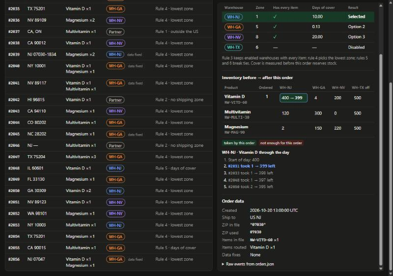

```
[Image: source: C:\Users\André Franceschini\.claude\projects\C--Users-Andr--Franceschini-OneDrive--rea-de-Trabalho-Arquivos-Trabalhos-Andr--Franceschini-Raicom-LLC\f268a8a0-3292-420a-ac32-327fbd3868e4\tool-results\mcp-Claude_Browser-blob-1793409251471-0aapwf.jpg]
```

</details>

<details><summary>Tool call: mcp__Claude_Browser__browser_batch</summary>

```json
{
  "actions": [
    {
      "name": "computer",
      "input": {
        "action": "scroll_to",
        "ref": "ref_183"
      }
    },
    {
      "name": "computer",
      "input": {
        "action": "screenshot",
        "scale": 0.6
      }
    }
  ]
}
```

</details>

<details><summary>Result: mcp__Claude_Browser__browser_batch (error)</summary>

```
actions[0] (computer:scroll_to) failed: ref is stale (element removed): ref_183 (0 completed, 1 remaining)
```

</details>

<details><summary>Tool call: mcp__Claude_Browser__find</summary>

```json
{
  "query": "#2050"
}
```

</details>

<details><summary>Result: mcp__Claude_Browser__find</summary>

```
Found 4 match(es) for "#2050":
- generic "#2050" [ref_446]
- heading "#2050 ships from WH-NJ" [ref_489]
- generic "#2050" [ref_563]
- generic "[ { \"type\": \"order_created\", \"orderNumber\": \"#2050\", \"at\": \"2026-10-20T13:57:37.000Z\",..." [ref_584]
```

```
Tab Context:
- Executed on tabId: seed
- Available tabs:
  • tabId seed: "Routing Inspector" ("http://localhost:5173/")
- Viewport: emulating 1280x900 (you set this; reset it with preset "desktop" when you finish testing; the app also clears it when your turn ends or the pane's width changes)
```

</details>

<details><summary>Tool call: mcp__Claude_Browser__browser_batch</summary>

```json
{
  "actions": [
    {
      "name": "javascript_tool",
      "input": {
        "action": "javascript_exec",
        "text": "document.getElementById('detail').scrollTop = 0; window.scrollTo(0, 0); document.querySelector('#detail h2').innerText"
      }
    },
    {
      "name": "computer",
      "input": {
        "action": "wait",
        "duration": 0.5
      }
    },
    {
      "name": "computer",
      "input": {
        "action": "screenshot"
      }
    }
  ]
}
```

</details>

<details><summary>Result: mcp__Claude_Browser__browser_batch</summary>

```
[javascript_tool:javascript_exec] "#2050 ships from WH-NJ"


Tab Context:
- Executed on tabId: seed
- Available tabs:
  • tabId seed: "Routing Inspector" ("http://localhost:5173/")
- Viewport: emulating 1280x900 (you set this; reset it with preset "desktop" when you finish testing; the app also clears it when your turn ends or the pane's width changes)
```

```
[computer:wait] waited 0.5s


Tab Context:
- Executed on tabId: seed
- Available tabs:
  • tabId seed: "Routing Inspector" ("http://localhost:5173/")
- Viewport: emulating 1280x900 (you set this; reset it with preset "desktop" when you finish testing; the app also clears it when your turn ends or the pane's width changes)
```

```
[computer:screenshot] Screenshot size: 800x562


Tab Context:
- Executed on tabId: seed
- Available tabs:
  • tabId seed: "Routing Inspector" ("http://localhost:5173/")
- Viewport: emulating 1280x900 (you set this; reset it with preset "desktop" when you finish testing; the app also clears it when your turn ends or the pane's width changes)
```

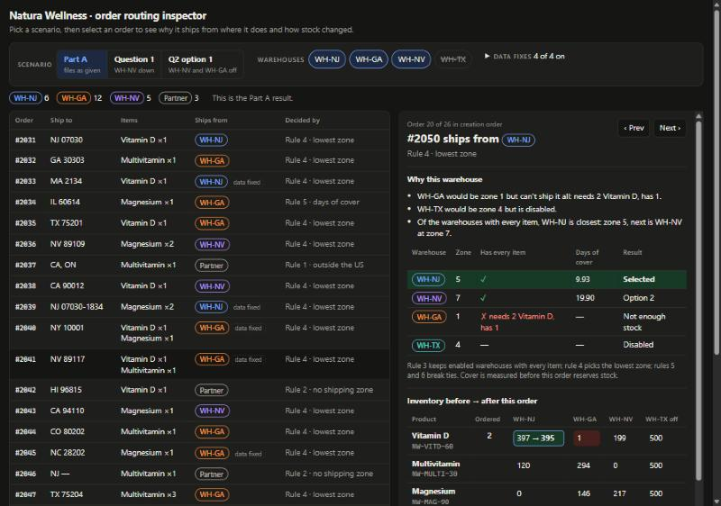

```
[Image: source: C:\Users\André Franceschini\.claude\projects\C--Users-Andr--Franceschini-OneDrive--rea-de-Trabalho-Arquivos-Trabalhos-Andr--Franceschini-Raicom-LLC\f268a8a0-3292-420a-ac32-327fbd3868e4\tool-results\mcp-Claude_Browser-blob-1793409270838-mmvhxt.jpg]
```

</details>

<details><summary>Tool call: mcp__Claude_Browser__find</summary>

```json
{
  "query": "Question 1 WH-NV down button"
}
```

</details>

<details><summary>Result: mcp__Claude_Browser__find</summary>

```
No matches for "Question 1 WH-NV down button".
```

```
Tab Context:
- Executed on tabId: seed
- Available tabs:
  • tabId seed: "Routing Inspector" ("http://localhost:5173/")
- Viewport: emulating 1280x900 (you set this; reset it with preset "desktop" when you finish testing; the app also clears it when your turn ends or the pane's width changes)
```

</details>

<details><summary>Tool call: mcp__Claude_Browser__computer</summary>

```json
{
  "action": "left_click",
  "coordinate": [
    148,
    72
  ],
  "action_summary": "Switches to the Question 1 scenario"
}
```

</details>

<details><summary>Result: mcp__Claude_Browser__computer</summary>

```
left_click at (148, 72)
```

```
Tab Context:
- Executed on tabId: seed
- Available tabs:
  • tabId seed: "Routing Inspector" ("http://localhost:5173/")
- Viewport: emulating 1280x900 (you set this; reset it with preset "desktop" when you finish testing; the app also clears it when your turn ends or the pane's width changes)
```

</details>

<details><summary>Tool call: mcp__Claude_Browser__find</summary>

```json
{
  "query": "Show only these"
}
```

</details>

<details><summary>Result: mcp__Claude_Browser__find</summary>

```
Found 1 match(es) for "Show only these":
- label "Show only these" [ref_633]
```

```
Tab Context:
- Executed on tabId: seed
- Available tabs:
  • tabId seed: "Routing Inspector" ("http://localhost:5173/")
- Viewport: emulating 1280x900 (you set this; reset it with preset "desktop" when you finish testing; the app also clears it when your turn ends or the pane's width changes)
```

</details>

<details><summary>Tool call: mcp__Claude_Browser__browser_batch</summary>

```json
{
  "actions": [
    {
      "name": "computer",
      "input": {
        "action": "left_click",
        "ref": "ref_633",
        "action_summary": "Filters the list to orders that changed"
      }
    },
    {
      "name": "computer",
      "input": {
        "action": "wait",
        "duration": 0.5
      }
    },
    {
      "name": "javascript_tool",
      "input": {
        "action": "javascript_exec",
        "text": "[document.querySelector('.segmented [aria-pressed=\"true\"]')?.innerText.replace(/\\n/g,' '), document.getElementById('summary').innerText.replace(/\\n/g,' '), ...[...document.querySelectorAll('#orders tbody tr')].map(r => [...r.cells].map(c => c.innerText.replace(/\\n/g,' ')).join(' | ')), 'detail: ' + document.querySelector('#detail h2').innerText + ' / ' + (document.querySelector('.callout')?.innerText ?? 'no callout'), 'errors: ' + JSON.stringify(window.__errors)].join('\\n')"
      }
    },
    {
      "name": "computer",
      "input": {
        "action": "screenshot"
      }
    }
  ]
}
```

</details>

<details><summary>Result: mcp__Claude_Browser__browser_batch</summary>

```
[computer:left_click] left_click at (726, 174) [ref_633]


Tab Context:
- Executed on tabId: seed
- Available tabs:
  • tabId seed: "Routing Inspector" ("http://localhost:5173/")
- Viewport: emulating 1280x900 (you set this; reset it with preset "desktop" when you finish testing; the app also clears it when your turn ends or the pane's width changes)
```

```
[computer:wait] waited 0.5s


Tab Context:
- Executed on tabId: seed
- Available tabs:
  • tabId seed: "Routing Inspector" ("http://localhost:5173/")
- Viewport: emulating 1280x900 (you set this; reset it with preset "desktop" when you finish testing; the app also clears it when your turn ends or the pane's width changes)
```

```
[javascript_tool:javascript_exec] "Question 1 WH-NV down\nWH-NJ 7 WH-GA 15 Partner 4 6 of 26 orders ship from a different place than in Part A  Show only these\n#2036 | NV 89109 | Magnesium ×2 | WH-GA | WH-NV | Rule 4 · lowest zone\n#2038 | CA 90012 | Vitamin D ×1 | WH-NJ | WH-NV | Rule 5 · days of cover\n#2043 | CA 94110 | Magnesium ×1 | WH-GA | WH-NV | Rule 3 · only option\n#2051 | NV 89123 | Vitamin D ×1 | WH-GA | WH-NV | Rule 4 · lowest zone\n#2052 | WA 98101 | Magnesium ×1 | WH-GA | WH-NV | Rule 3 · only option\n#2056 | NJ 07047 | Vitamin D ×1 Magnesium ×1 | Partner data fixed | WH-GA | Rule 7 · no stock anywhere\ndetail: #2050 ships from WH-NJ / no callout\nerrors: []"


Tab Context:
- Executed on tabId: seed
- Available tabs:
  • tabId seed: "Routing Inspector" ("http://localhost:5173/")
- Viewport: emulating 1280x900 (you set this; reset it with preset "desktop" when you finish testing; the app also clears it when your turn ends or the pane's width changes)
```

```
[computer:screenshot] Screenshot size: 800x562


Tab Context:
- Executed on tabId: seed
- Available tabs:
  • tabId seed: "Routing Inspector" ("http://localhost:5173/")
- Viewport: emulating 1280x900 (you set this; reset it with preset "desktop" when you finish testing; the app also clears it when your turn ends or the pane's width changes)
```

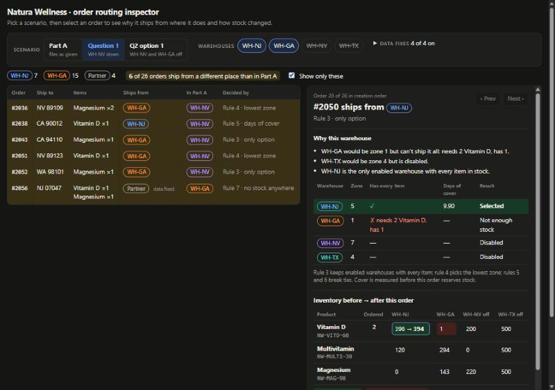

```
[Image: source: C:\Users\André Franceschini\.claude\projects\C--Users-Andr--Franceschini-OneDrive--rea-de-Trabalho-Arquivos-Trabalhos-Andr--Franceschini-Raicom-LLC\f268a8a0-3292-420a-ac32-327fbd3868e4\tool-results\mcp-Claude_Browser-blob-1793409286089-z1pyki.jpg]
```

</details>

<details><summary>Tool call: Edit · C:\Users\André Franceschini\OneDrive\Área de Trabalho\Arquivos\Trabalhos\André Franceschini\Raicom LLC\natura-router\ui\main.ts</summary>

```json
{
  "replace_all": false,
  "file_path": "C:\\Users\\André Franceschini\\OneDrive\\Área de Trabalho\\Arquivos\\Trabalhos\\André Franceschini\\Raicom LLC\\natura-router\\ui\\main.ts",
  "old_string": "function rerun() {\n  result = run(settings);\n  if (!result.decisions.some(isChanged)) changedOnly = false;\n  render();\n  select(selected);\n}",
  "new_string": "// Keeps the detail pane on an order the list is actually showing.\nfunction selectVisible() {\n  const list = visible();\n  select(list.includes(selected) ? selected : (list[0] ?? 0));\n}\n\nfunction rerun() {\n  result = run(settings);\n  if (!result.decisions.some(isChanged)) changedOnly = false;\n  render();\n  selectVisible();\n}"
}
```

</details>

<details><summary>Result: Edit</summary>

```
The file C:\Users\André Franceschini\OneDrive\Área de Trabalho\Arquivos\Trabalhos\André Franceschini\Raicom LLC\natura-router\ui\main.ts has been updated successfully. (file state is current in your context — no need to Read it back)
```

</details>

<details><summary>Tool call: Edit · C:\Users\André Franceschini\OneDrive\Área de Trabalho\Arquivos\Trabalhos\André Franceschini\Raicom LLC\natura-router\ui\main.ts</summary>

```json
{
  "replace_all": false,
  "file_path": "C:\\Users\\André Franceschini\\OneDrive\\Área de Trabalho\\Arquivos\\Trabalhos\\André Franceschini\\Raicom LLC\\natura-router\\ui\\main.ts",
  "old_string": "  else if ('changedOnly' in input.dataset) {\n    changedOnly = input.checked;\n    renderList();\n    renderDetail();\n    return;\n  } else return;",
  "new_string": "  else if ('changedOnly' in input.dataset) {\n    changedOnly = input.checked;\n    return selectVisible();\n  } else return;"
}
```

</details>

<details><summary>Result: Edit</summary>

```
The file C:\Users\André Franceschini\OneDrive\Área de Trabalho\Arquivos\Trabalhos\André Franceschini\Raicom LLC\natura-router\ui\main.ts has been updated successfully. (file state is current in your context — no need to Read it back)
```

</details>

<details><summary>Tool call: Bash · Typecheck after the selection fix</summary>

```json
{
  "command": "cd \"/c/Users/André Franceschini/OneDrive/Área de Trabalho/Arquivos/Trabalhos/André Franceschini/Raicom LLC/natura-router\" && npx tsc -p . ; echo \"tsc exit $?\"",
  "description": "Typecheck after the selection fix"
}
```

</details>

<details><summary>Result: Bash</summary>

```
tsc exit 0
```

</details>

### Assistant · 01:15:01 UTC

Now I'll reproduce the dead-end case to confirm the fix, and also test switching a data fix off:

<details><summary>Tool call: mcp__Claude_Browser__browser_batch</summary>

```json
{
  "actions": [
    {
      "name": "navigate",
      "input": {
        "url": "http://localhost:5173/"
      }
    },
    {
      "name": "javascript_tool",
      "input": {
        "action": "javascript_exec",
        "text": "window.__errors = []; addEventListener('error', e => window.__errors.push(e.message));\nconst q = (s) => document.querySelector(s);\nq('tr[data-index=\"19\"]').click();\nq('[data-scenario=\"q1\"]').click();\nconst cb = q('[data-changed-only]'); cb.checked = true; cb.dispatchEvent(new Event('change', { bubbles: true }));\nconst afterFilter = `${q('#detail h2').innerText} | prev ${q('[data-step=\"-1\"]').disabled ? 'off' : 'on'} next ${q('[data-step=\"1\"]').disabled ? 'off' : 'on'}`;\nq('[data-step=\"1\"]').click();\nconst afterNext = q('#detail h2').innerText;\nq('[data-scenario=\"given\"]').click();\nconst fix = q('[data-fix=\"applyEdits\"]'); fix.checked = false; fix.dispatchEvent(new Event('change', { bubbles: true }));\nq('tr[data-index=\"10\"]').click();\nconst editsOff = `${q('#detail h2').innerText} | ${q('.callout')?.innerText} | active scenario: ${q('.segmented [aria-pressed=\"true\"]')?.innerText ?? 'none'} | ${q('.custom')?.innerText}`;\nconst why2041 = [...document.querySelectorAll('.why li')].map(l => l.innerText).join(' / ');\nq('[data-scenario=\"given\"]').click();\n[afterFilter, afterNext, editsOff, why2041, 'errors: ' + JSON.stringify(window.__errors)].join('\\n')"
      }
    }
  ]
}
```

</details>

<details><summary>Result: mcp__Claude_Browser__browser_batch</summary>

```
[navigate] navigated to http://localhost:5173/


Tab Context:
- Executed on tabId: seed
- Available tabs:
  • tabId seed: "Routing Inspector" ("http://localhost:5173/")
- Viewport: emulating 1280x900 (you set this; reset it with preset "desktop" when you finish testing; the app also clears it when your turn ends or the pane's width changes)
```

```
[javascript_tool:javascript_exec] "#2036 ships from WH-GA | prev off next on\n#2038 ships from WH-NJ\n#2041 ships from WH-NV | In Part A this order ships from WH-GA. | active scenario: none | Custom settings\nOf the warehouses with every item, WH-NV is closest: zone 2, next is WH-GA at zone 7.\nerrors: []"


Tab Context:
- Executed on tabId: seed
- Available tabs:
  • tabId seed: "Routing Inspector" ("http://localhost:5173/")
- Viewport: emulating 1280x900 (you set this; reset it with preset "desktop" when you finish testing; the app also clears it when your turn ends or the pane's width changes)
```

</details>

<details><summary>Tool call: mcp__Claude_Browser__resize_window</summary>

```json
{
  "preset": "desktop"
}
```

</details>

<details><summary>Result: mcp__Claude_Browser__resize_window</summary>

```
Viewport emulation cleared; the tab is back to the pane's responsive size (desktop).
```

```
Tab Context:
- Executed on tabId: seed
- Available tabs:
  • tabId seed: "Routing Inspector" ("http://localhost:5173/")
```

</details>

<details><summary>Tool call: mcp__Claude_Browser__browser_batch</summary>

```json
{
  "actions": [
    {
      "name": "javascript_tool",
      "input": {
        "action": "javascript_exec",
        "text": "window.scrollTo(0,0); [innerWidth, document.documentElement.scrollWidth > innerWidth ? 'HORIZONTAL OVERFLOW' : 'no horizontal overflow']"
      }
    },
    {
      "name": "computer",
      "input": {
        "action": "screenshot",
        "scale": 0.6
      }
    }
  ]
}
```

</details>

<details><summary>Result: mcp__Claude_Browser__browser_batch</summary>

```
[javascript_tool:javascript_exec] [
  893,
  "no horizontal overflow"
]


Tab Context:
- Executed on tabId: seed
- Available tabs:
  • tabId seed: "Routing Inspector" ("http://localhost:5173/")
```

```
[computer:screenshot] Screenshot size: 480x343 0.6-scale view; coordinate frame: 800x572.


Tab Context:
- Executed on tabId: seed
- Available tabs:
  • tabId seed: "Routing Inspector" ("http://localhost:5173/")
```

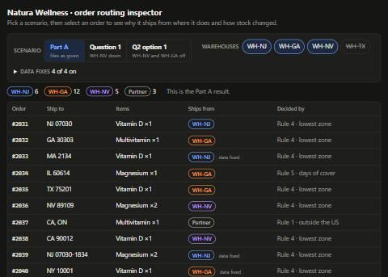

```
[Image: source: C:\Users\André Franceschini\.claude\projects\C--Users-Andr--Franceschini-OneDrive--rea-de-Trabalho-Arquivos-Trabalhos-Andr--Franceschini-Raicom-LLC\f268a8a0-3292-420a-ac32-327fbd3868e4\tool-results\mcp-Claude_Browser-blob-1793409316447-qbglhq.jpg]
```

</details>

### Assistant · 01:15:20 UTC

It works at the pane's native width too: the layout stacks, with no horizontal overflow. Next, the README: link the Part B notes and describe the new interface.

<details><summary>Tool call: mcp__ccd_turn__update_plan</summary>

```json
{
  "advance": true
}
```

</details>

<details><summary>Result: mcp__ccd_turn__update_plan</summary>

```
Plan updated: step 5 of 7 is in progress.
```

</details>

<details><summary>Tool call: Edit · C:\Users\André Franceschini\OneDrive\Área de Trabalho\Arquivos\Trabalhos\André Franceschini\Raicom LLC\natura-router\README.md</summary>

```json
{
  "replace_all": false,
  "file_path": "C:\\Users\\André Franceschini\\OneDrive\\Área de Trabalho\\Arquivos\\Trabalhos\\André Franceschini\\Raicom LLC\\natura-router\\README.md",
  "old_string": "## Part B helper\n\n`npm run route:nv-off` writes [`routes-nv-off.txt`](routes-nv-off.txt): the same router with WH-NV disabled, per the ops notes (water damage). It is an input for Question 1, not a Part A result. Note that in this run **#2056, a New Jersey customer, goes to PARTNER** under rule 7: once NV is out, WH-GA runs out of Vitamin D at #2051 and WH-NJ is already out of magnesium.",
  "new_string": "## Part B\n\nAnswers and reasoning: [`PART-B.md`](PART-B.md).\n\n`npm run route:nv-off` writes [`routes-nv-off.txt`](routes-nv-off.txt): the same router with WH-NV disabled, per the ops notes (water damage). It is the basis for Question 1, not a Part A result. The Part A configuration in `data/` is left exactly as given."
}
```

</details>

<details><summary>Result: Edit</summary>

```
The file C:\Users\André Franceschini\OneDrive\Área de Trabalho\Arquivos\Trabalhos\André Franceschini\Raicom LLC\natura-router\README.md has been updated successfully. (file state is current in your context — no need to Read it back)
```

</details>

<details><summary>Tool call: Edit · C:\Users\André Franceschini\OneDrive\Área de Trabalho\Arquivos\Trabalhos\André Franceschini\Raicom LLC\natura-router\README.md</summary>

```json
{
  "replace_all": false,
  "file_path": "C:\\Users\\André Franceschini\\OneDrive\\Área de Trabalho\\Arquivos\\Trabalhos\\André Franceschini\\Raicom LLC\\natura-router\\README.md",
  "old_string": "`npm run dev` opens a small Vite page that runs the same `src/router.ts` and only displays what it returns:\n\n- **Scenarios:** Part A as given, Q1 (WH-NV down), Q2 option 1 (WH-NV and WH-GA off), or any mix of warehouse switches. Each data normalization can also be switched off to see the literal reading. Rows that route differently from Part A as given are highlighted.\n- **Per order:** the raw events next to the lines actually routed, the normalization notes, every warehouse's zone, cover and result, and the rule that decided.\n- **Stock:** what the order needs and before → after for every warehouse. Clicking a cell lists that cell's history for the whole day; clicking a history entry jumps to that order. Arrow keys step through orders.\n\nIt's a tool for inspecting results; the tests are the proof.",
  "new_string": "`npm run dev` opens a small Vite page (at `http://localhost:5173`) that runs the same `src/router.ts` and only displays what it returns.\n\n- **Toolbar:** pick a scenario (Part A, Question 1 with WH-NV down, Question 2 option 1 with WH-NV and WH-GA off), switch warehouses on or off, or turn off a data fix to see the literal reading of the file.\n- **Order list:** where each order ships from and the rule that decided it. In any scenario other than Part A, a column shows the Part A result; \"Show only these\" filters to the orders that changed.\n- **Selected order:** a plain-language reason, each warehouse's zone, stock check, days of cover and result, the inventory before → after the order, and the raw events from `orders.json`. Clicking a stock number lists how it changed through the day; clicking an entry jumps to that order. The up and down arrow keys step through orders.\n\nIt's a tool for inspecting results; the tests are the proof."
}
```

</details>

<details><summary>Result: Edit</summary>

```
The file C:\Users\André Franceschini\OneDrive\Área de Trabalho\Arquivos\Trabalhos\André Franceschini\Raicom LLC\natura-router\README.md has been updated successfully. (file state is current in your context — no need to Read it back)
```

</details>

<details><summary>Tool call: Edit · C:\Users\André Franceschini\OneDrive\Área de Trabalho\Arquivos\Trabalhos\André Franceschini\Raicom LLC\natura-router\README.md</summary>

````json
{
  "replace_all": false,
  "file_path": "C:\\Users\\André Franceschini\\OneDrive\\Área de Trabalho\\Arquivos\\Trabalhos\\André Franceschini\\Raicom LLC\\natura-router\\README.md",
  "old_string": "test/              node:test suite\nui/, index.html    optional inspector\n```",
  "new_string": "test/              node:test suite\nui/, index.html    optional inspector\nroutes.txt         Part A output\nroutes-nv-off.txt  same router with WH-NV disabled (Question 1 basis)\nPART-B.md          Part B answers\n```\n\n## AI use\n\nBuilt with Claude Code. I directed the decisions (which data fixes to make, what not to change, option 2 for Question 2) and had every result checked against the source files and an independent model in the tests rather than trusted. The conversation link is included with the submission."
}
````

</details>

<details><summary>Result: Edit</summary>

```
The file C:\Users\André Franceschini\OneDrive\Área de Trabalho\Arquivos\Trabalhos\André Franceschini\Raicom LLC\natura-router\README.md has been updated successfully. (file state is current in your context — no need to Read it back)
```

</details>

<details><summary>Tool call: mcp__ccd_turn__update_plan</summary>

```json
{
  "advance": true
}
```

</details>

<details><summary>Result: mcp__ccd_turn__update_plan</summary>

```
Plan updated: step 6 of 7 is in progress.
```

</details>

<details><summary>Tool call: Write · C:\Users\André Franceschini\OneDrive\Área de Trabalho\Arquivos\Trabalhos\André Franceschini\Raicom LLC\natura-router\.gitattributes</summary>

```json
{
  "file_path": "C:\\Users\\André Franceschini\\OneDrive\\Área de Trabalho\\Arquivos\\Trabalhos\\André Franceschini\\Raicom LLC\\natura-router\\.gitattributes",
  "content": "* text=auto eol=lf\n"
}
```

</details>

<details><summary>Result: Write</summary>

```
File created successfully at: C:\Users\André Franceschini\OneDrive\Área de Trabalho\Arquivos\Trabalhos\André Franceschini\Raicom LLC\natura-router\.gitattributes (file state is current in your context — no need to Read it back)
```

</details>

<details><summary>Tool call: Bash · Initialize git on main and stage all files</summary>

```json
{
  "command": "cd \"/c/Users/André Franceschini/OneDrive/Área de Trabalho/Arquivos/Trabalhos/André Franceschini/Raicom LLC/natura-router\" && git init -b main -q && git add -A && git status --short && echo \"--- crlf check:\" && git ls-files --eol | awk '$2 ~ /crlf/' | head",
  "description": "Initialize git on main and stage all files"
}
```

</details>

<details><summary>Result: Bash</summary>

```
A  .gitattributes
A  .gitignore
A  PART-B.md
A  README.md
A  data/catalog.json
A  data/ops-notes.md
A  data/orders.json
A  data/warehouses.json
A  data/zones.json
A  index.html
A  package-lock.json
A  package.json
A  routes-nv-off.txt
A  routes.txt
A  src/main.ts
A  src/router.ts
A  test/router.test.ts
A  tsconfig.json
A  ui/main.ts
A  ui/style.css
--- crlf check:
```

</details>

<details><summary>Tool call: Bash · Export staged files, clean install, test, and reproduce route outputs</summary>

```json
{
  "command": "cd \"/c/Users/André Franceschini/OneDrive/Área de Trabalho/Arquivos/Trabalhos/André Franceschini/Raicom LLC/natura-router\" && S=\"/c/Users/ANDRFR~1/AppData/Local/Temp/claude/C--Users-Andr--Franceschini-OneDrive--rea-de-Trabalho-Arquivos-Trabalhos-Andr--Franceschini-Raicom-LLC/f268a8a0-3292-420a-ac32-327fbd3868e4/scratchpad/clean-export\" && rm -rf \"$S\" && git checkout-index -a --prefix=\"$S/\" && cd \"$S\" && npm ci --silent 2>&1 | tail -2; npx tsc -p . && echo \"tsc ok\"; npm test 2>&1 | grep -E \"ℹ (pass|fail)\"; cp routes.txt routes.expected; cp routes-nv-off.txt nv.expected; npm run --silent route 2>/dev/null; npm run --silent route:nv-off 2>/dev/null; cmp routes.txt routes.expected && cmp routes-nv-off.txt nv.expected && echo \"both route files reproduced byte-for-byte from a clean install\"",
  "description": "Export staged files, clean install, test, and reproduce route outputs",
  "timeout": 300000
}
```

</details>

<details><summary>Result: Bash</summary>

```
tsc ok
ℹ pass 18
ℹ fail 0
both route files reproduced byte-for-byte from a clean install
Shell cwd was reset to C:\Users\André Franceschini\OneDrive\Área de Trabalho\Arquivos\Trabalhos\André Franceschini\Raicom LLC
```

</details>

<details><summary>Tool call: Bash · Check the repository name is not taken</summary>

```json
{
  "command": "gh repo view franceschinii/raicom-natura-router --json name 2>&1 | head -2",
  "description": "Check the repository name is not taken"
}
```

</details>

<details><summary>Result: Bash</summary>

```
GraphQL: Could not resolve to a Repository with the name 'franceschinii/raicom-natura-router'. (repository)
```

</details>

<details><summary>Tool call: Bash · Create the initial commit</summary>

```json
{
  "command": "cd \"/c/Users/André Franceschini/OneDrive/Área de Trabalho/Arquivos/Trabalhos/André Franceschini/Raicom LLC/natura-router\" && git commit -q -F - <<'EOF'\nfeat(router): add order router, Part B notes and routing inspector\n\nRoutes orders.json to one warehouse or PARTNER using rules 1-7 as written,\nreserving stock in creation order. Input fixes (numeric ZIPs, ZIP+4, SKU case,\nbundles, order edits) are explicit, switchable and noted per order.\n\nIncludes routes.txt, the WH-NV-down run for Question 1, Part B notes, a\ntest suite with an independent reference model, and a Vite inspector.\nEOF\ngit log --oneline -1 && git status --short | wc -l",
  "description": "Create the initial commit"
}
```

</details>

<details><summary>Result: Bash</summary>

```
5ab8a4d feat(router): add order router, Part B notes and routing inspector
0
```

</details>

### Assistant · 01:16:10 UTC

Committed with a clean tree. Creating the public repository and pushing:

<details><summary>Tool call: mcp__ccd_turn__update_plan</summary>

```json
{
  "advance": true
}
```

</details>

<details><summary>Result: mcp__ccd_turn__update_plan</summary>

```
Plan updated: step 7 of 7 is in progress.
```

</details>

<details><summary>Tool call: Bash · Create the public GitHub repo and push main</summary>

```json
{
  "command": "cd \"/c/Users/André Franceschini/OneDrive/Área de Trabalho/Arquivos/Trabalhos/André Franceschini/Raicom LLC/natura-router\" && gh repo create raicom-natura-router --public --source . --remote origin --push --description \"Order router for the Raicom developer assessment: routes orders to warehouses with explicit data fixes, tests and a routing inspector\" 2>&1 | tail -4",
  "description": "Create the public GitHub repo and push main"
}
```

</details>

<details><summary>Result: Bash</summary>

```
https://github.com/andrefranceschini/raicom-natura-router
branch 'main' set up to track 'origin/main'.
To https://github.com/andrefranceschini/raicom-natura-router.git
 * [new branch]      HEAD -> main
```

</details>

<details><summary>Tool call: Bash · Verify repo owner, visibility, contents and anonymous access</summary>

```json
{
  "command": "gh api user --jq '\"active login: \\(.login)  (html_url \\(.html_url))\"'; gh auth status 2>&1 | grep -E \"account|Active\"; echo ---; gh repo view andrefranceschini/raicom-natura-router --json nameWithOwner,visibility,url,defaultBranchRef --jq '\"\\(.nameWithOwner)  \\(.visibility)  default=\\(.defaultBranchRef.name)  \\(.url)\"'; gh api repos/andrefranceschini/raicom-natura-router/contents --jq '[.[].name] | join(\", \")'; echo ---; curl -s -o /dev/null -w \"anonymous HTTP %{http_code}\\n\" https://github.com/andrefranceschini/raicom-natura-router",
  "description": "Verify repo owner, visibility, contents and anonymous access"
}
```

</details>

<details><summary>Result: Bash</summary>

```
active login: andrefranceschini  (html_url https://github.com/andrefranceschini)
  ✓ Logged in to github.com account franceschinii (keyring)
  - Active account: true
---
andrefranceschini/raicom-natura-router  PUBLIC  default=main  https://github.com/andrefranceschini/raicom-natura-router
.gitattributes, .gitignore, PART-B.md, README.md, data, index.html, package-lock.json, package.json, routes-nv-off.txt, routes.txt, src, test, tsconfig.json, ui
---
anonymous HTTP 200
```

</details>

<details><summary>Tool call: Bash · List existing memory files</summary>

```json
{
  "command": "ls \"/c/Users/André Franceschini/.claude/projects/C--Users-Andr--Franceschini-OneDrive--rea-de-Trabalho-Arquivos-Trabalhos-Andr--Franceschini-Raicom-LLC/memory/\" 2>&1",
  "description": "List existing memory files"
}
```

</details>

<details><summary>Result: Bash</summary>

```
(Bash completed with no output)
```

</details>

<details><summary>Tool call: Write · C:\Users\André Franceschini\.claude\projects\C--Users-Andr--Franceschini-OneDrive--rea-de-Trabalho-Arquivos-Trabalhos-Andr--Franceschini-Raicom-LLC\memory\raicom-assessment.md</summary>

```json
{
  "file_path": "C:\\Users\\André Franceschini\\.claude\\projects\\C--Users-Andr--Franceschini-OneDrive--rea-de-Trabalho-Arquivos-Trabalhos-Andr--Franceschini-Raicom-LLC\\memory\\raicom-assessment.md",
  "content": "---\nname: raicom-assessment\ndescription: Raicom LLC developer assessment (order router) — status, repo, and decisions André defends on the call with Sean\nmetadata:\n  type: project\n---\n\nRaicom LLC selection process, assessment received 2026-10-30: route Natura Wellness orders to warehouses (Part A script + routes.txt) and answer Part B on a call with Sean (Dev Team Lead). Submission due within 24h of the invitation email; booking needs the repo link and the AI conversation link.\n\nPublic repo: https://github.com/andrefranceschini/raicom-natura-router (local: `Raicom LLC/natura-router`). GitHub login is now `andrefranceschini`; the gh keyring still labels it `franceschinii`.\n\nDecisions André owns: rules unchanged, data fixed explicitly (numeric ZIP pad, ZIP+4, SKU case, bundle expansion, edits folded in); Part A keeps config as given (NV enabled). Q1 = rerun with NV disabled. Q2 = option 2 (keep GA), monitor GA backlog; reassess if > 2 business days or recovery slips past Monday; reconsider option 3 only if NJ capacity and a safe auto-expiring deploy are confirmed by Wednesday midday.\n\n**Why:** the reviewers judge decisions and how AI was directed, not polish.\n**How to apply:** keep deliverables in English; don't re-litigate these decisions unless André reopens them. Repo naming pattern: lowercase kebab-case, org/brand first.\n"
}
```

</details>

<details><summary>Result: Write</summary>

```
File created successfully at: C:\Users\André Franceschini\.claude\projects\C--Users-Andr--Franceschini-OneDrive--rea-de-Trabalho-Arquivos-Trabalhos-Andr--Franceschini-Raicom-LLC\memory\raicom-assessment.md
```

</details>

<details><summary>Tool call: Write · C:\Users\André Franceschini\.claude\projects\C--Users-Andr--Franceschini-OneDrive--rea-de-Trabalho-Arquivos-Trabalhos-Andr--Franceschini-Raicom-LLC\memory\MEMORY.md</summary>

```json
{
  "file_path": "C:\\Users\\André Franceschini\\.claude\\projects\\C--Users-Andr--Franceschini-OneDrive--rea-de-Trabalho-Arquivos-Trabalhos-Andr--Franceschini-Raicom-LLC\\memory\\MEMORY.md",
  "content": "- [Raicom assessment](raicom-assessment.md) — order router repo, Part B decisions, submission status\n"
}
```

</details>

<details><summary>Result: Write</summary>

```
File created successfully at: C:\Users\André Franceschini\.claude\projects\C--Users-Andr--Franceschini-OneDrive--rea-de-Trabalho-Arquivos-Trabalhos-Andr--Franceschini-Raicom-LLC\memory\MEMORY.md (file state is current in your context — no need to Read it back)
```

</details>

<details><summary>Tool call: mcp__ccd_turn__wrap_up</summary>

```json
{
  "recap": "The public repo andrefranceschini/raicom-natura-router has the router, routes.txt, Part B notes and the reworked inspector. A clean install reproduces both route files exactly and all 18 tests pass. Booking the call with the AI conversation link is still yours to do."
}
```

</details>

<details><summary>Result: mcp__ccd_turn__wrap_up</summary>

```
Nothing is pending, so the app draws no box; the recap is the session's status. Your closing message is your answer to the user: write it now, as the last thing you say this turn.
```

</details>

### Assistant · 01:16:56 UTC

The repo is public and ready to submit: **https://github.com/andrefranceschini/raicom-natura-router**

**Name:** `raicom-natura-router`, following your current pattern of lowercase kebab-case with the company or brand first (like `[REDACTED: private repo]` and `temakuri-backend`).

**Part A setup unchanged:** the five data files are byte-identical to what Raicom sent (WH-NV still enabled), and `routes.txt` comes from that setup. A fresh install from exactly what was committed passes the typecheck and all 18 tests, and regenerates both route files byte-for-byte.

**Part B notes:** [PART-B.md](natura-router/PART-B.md) has the Question 1 table and your Question 2 decision. That's option 2, plus three conditions:
- Reassess if GA's backlog grows beyond 2 business days, or if recovery slips past Monday.
- Reconsider option 3 only if NJ's capacity and a safe deploy with an automatic Monday expiry are confirmed by Wednesday midday.
- The notes also say how far the 26-order sample can be trusted.

**Interface changes:**
- **Layout:** the order list sits on the left and the selected order's details on the right. A toolbar holds a scenario switcher (Part A, Question 1, Q2 option 1), warehouse toggles and a collapsible "Data fixes" section.
- **Comparison:** in any scenario other than Part A, an "In Part A" column appears, and "Show only these" filters to the orders that changed.
- **Each order explains itself in plain words.** For #2050: GA would be zone 1 but has 1 Vitamin D and the order needs 2; TX would be zone 4 but is disabled; of the warehouses with every item, NJ is closest. Below that are the warehouse comparison and the inventory before → after; clicking a number shows its history through the day.
- **Product names** appear alongside SKUs.
- **One bug fixed:** "Show only these" could hide the selected order and disable both Prev and Next. It now jumps to the first changed order.

**Two things to know:**
- **The commit message is in English, not your pt-BR default**, because the reviewer is English-speaking. It has no AI signature, per your rules; the README's "AI use" section covers how you used Claude instead.
- **Your gh keyring still shows `franceschinii`, but GitHub reports your login as `andrefranceschini`.** The repo landed on the correct account, so this is only cosmetic.

**Left for you:**
- Get this conversation's share link. In the Claude desktop app, use the share option on the conversation.
- Book the call with Sean at the Calendly link from `INSTRUCTIONS.md`, giving the repo link and the conversation link.

---

## User · 01:17:55 UTC

export is unavailable in this session, can you locate the original local transcript and check whether you can convert it into a readable file for the repo, preserve the actual messages and tool results rather than reconstructing the conversation from memory, if you cant access the full history tell me whats missing

<details><summary>Tool call: mcp__ccd_turn__update_plan</summary>

```json
{
  "items": [
    {
      "content": "Locate the local session transcript",
      "status": "in_progress"
    },
    {
      "content": "Inspect its structure and check completeness",
      "status": "pending"
    },
    {
      "content": "Convert it to readable Markdown from the raw records",
      "status": "pending"
    },
    {
      "content": "Scan the output for private data before it goes public",
      "status": "pending"
    },
    {
      "content": "Report what is missing and what needs redaction",
      "status": "pending"
    }
  ],
  "scope": "continuation"
}
```

</details>

<details><summary>Result: mcp__ccd_turn__update_plan</summary>

```
Plan shown (5 steps).
```

</details>

<details><summary>Tool call: Bash · List the session transcript directory</summary>

```json
{
  "command": "P=\"/c/Users/André Franceschini/.claude/projects/C--Users-Andr--Franceschini-OneDrive--rea-de-Trabalho-Arquivos-Trabalhos-Andr--Franceschini-Raicom-LLC\"; ls -la \"$P\" | head -30; echo ---; ls \"$P/f268a8a0-3292-420a-ac32-327fbd3868e4\" 2>/dev/null | head; ls \"$P/f268a8a0-3292-420a-ac32-327fbd3868e4/tool-results\" 2>/dev/null | wc -l",
  "description": "List the session transcript directory"
}
```

</details>

<details><summary>Result: Bash</summary>

```
total 5816
drwxr-xr-x 1 André Franceschini 197608       0 Oct 30 21:36 .
drwxr-xr-x 1 André Franceschini 197608       0 Oct 30 21:36 ..
drwxr-xr-x 1 André Franceschini 197608       0 Oct 30 21:55 f268a8a0-3292-420a-ac32-327fbd3868e4
-rw-r--r-- 1 André Franceschini 197608 5932294 Oct 30 22:18 f268a8a0-3292-420a-ac32-327fbd3868e4.jsonl
drwxr-xr-x 1 André Franceschini 197608       0 Oct 30 22:16 memory
---
custom-title.json
tool-results
14
```

</details>

<details><summary>Tool call: mcp__ccd_turn__update_plan</summary>

```json
{
  "advance": true
}
```

</details>

<details><summary>Result: mcp__ccd_turn__update_plan</summary>

```
Plan updated: step 2 of 5 is in progress.
```

</details>

<details><summary>Tool call: Write · C:\Users\ANDRFR~1\AppData\Local\Temp\claude\C--Users-Andr--Franceschini-OneDrive--rea-de-Trabalho-Arquivos-Trabalhos-Andr--Franceschini-Raicom-LLC\f268a8a0-3292-420a-ac32-327fbd3868e4\scratchpad\inspect-transcript.mjs</summary>

```json
{
  "file_path": "C:\\Users\\ANDRFR~1\\AppData\\Local\\Temp\\claude\\C--Users-Andr--Franceschini-OneDrive--rea-de-Trabalho-Arquivos-Trabalhos-Andr--Franceschini-Raicom-LLC\\f268a8a0-3292-420a-ac32-327fbd3868e4\\scratchpad\\inspect-transcript.mjs",
  "content": "// Summarizes the structure of a Claude Code session JSONL without printing its content.\nimport { readFileSync } from 'node:fs';\n\nconst lines = readFileSync(process.argv[2], 'utf8').split('\\n').filter(Boolean);\nconst count = (map, key) => map.set(key, (map.get(key) ?? 0) + 1);\nconst recordTypes = new Map();\nconst blockTypes = new Map();\nconst keys = new Map();\nlet bad = 0;\nlet sidechain = 0;\nlet compact = 0;\nconst firstUser = [];\nconst records = [];\n\nfor (const line of lines) {\n  let r;\n  try { r = JSON.parse(line); } catch { bad++; continue; }\n  records.push(r);\n  count(recordTypes, r.type);\n  for (const k of Object.keys(r)) count(keys, k);\n  if (r.isSidechain) sidechain++;\n  if (r.isCompactSummary || r.type === 'summary') compact++;\n  const content = r.message?.content;\n  if (Array.isArray(content)) for (const b of content) count(blockTypes, `${r.message.role}:${b.type}`);\n  else if (typeof content === 'string') count(blockTypes, `${r.message?.role}:string`);\n  if (r.type === 'user' && firstUser.length < 3) {\n    const text = typeof content === 'string' ? content : content?.find?.((b) => b.type === 'text')?.text ?? '';\n    firstUser.push(text.replace(/\\s+/g, ' ').slice(0, 90));\n  }\n}\n\nconsole.log('lines', lines.length, 'unparseable', bad, 'sidechain', sidechain, 'compaction records', compact);\nconsole.log('record types', Object.fromEntries(recordTypes));\nconsole.log('block types', Object.fromEntries(blockTypes));\nconsole.log('top-level keys', [...keys].map(([k, n]) => `${k}:${n}`).join(' '));\nconsole.log('first user texts', firstUser);\nconst ts = records.map((r) => r.timestamp).filter(Boolean);\nconsole.log('time range', ts[0], '->', ts.at(-1));\n"
}
```

</details>

<details><summary>Result: Write</summary>

```
File created successfully at: C:\Users\ANDRFR~1\AppData\Local\Temp\claude\C--Users-Andr--Franceschini-OneDrive--rea-de-Trabalho-Arquivos-Trabalhos-Andr--Franceschini-Raicom-LLC\f268a8a0-3292-420a-ac32-327fbd3868e4\scratchpad\inspect-transcript.mjs (file state is current in your context — no need to Read it back)
```

</details>

<details><summary>Tool call: Bash · Summarize transcript record and block types</summary>

```json
{
  "command": "S=\"/c/Users/ANDRFR~1/AppData/Local/Temp/claude/C--Users-Andr--Franceschini-OneDrive--rea-de-Trabalho-Arquivos-Trabalhos-Andr--Franceschini-Raicom-LLC/f268a8a0-3292-420a-ac32-327fbd3868e4/scratchpad\"; node \"$S/inspect-transcript.mjs\" \"/c/Users/André Franceschini/.claude/projects/C--Users-Andr--Franceschini-OneDrive--rea-de-Trabalho-Arquivos-Trabalhos-Andr--Franceschini-Raicom-LLC/f268a8a0-3292-420a-ac32-327fbd3868e4.jsonl\"",
  "description": "Summarize transcript record and block types"
}
```

</details>

<details><summary>Result: Bash</summary>

```
lines 1048 unparseable 0 sidechain 0 compaction records 0
record types {
  'queue-operation': 24,
  attachment: 67,
  user: 159,
  'last-prompt': 61,
  'custom-title': 63,
  'file-history-snapshot': 8,
  'atis-latch': 61,
  'api-request-shape': 1,
  'api-request-blob': 95,
  'api-request': 84,
  'agent-name': 61,
  'bridge-session': 60,
  assistant: 280,
  system: 7,
  'file-history-delta': 17
}
block types {
  'user:string': 8,
  'user:text': 9,
  'system:text': 10,
  'assistant:thinking': 155,
  'assistant:tool_use': 264,
  'user:tool_result': 263,
  'system:tool_addition': 1,
  'assistant:text': 43
}
top-level keys type:1048 operation:24 timestamp:639 sessionId:1023 content:16 parentUuid:513 isSidechain:513 attachment:67 uuid:513 userType:513 entrypoint:513 cwd:513 version:598 gitBranch:513 rendered:33 renderedRole:33 promptId:159 message:534 permissionMode:8 origin:8 promptSource:8 turnOrigin:8 turnPosition:8 lastPrompt:61 leafUuid:61 customTitle:63 messageId:25 snapshot:8 isSnapshotUpdate:8 atis:61 renderedBesideToolResult:2 shapeHash:85 shape:1 hash:95 id:84 querySource:84 params:84 keep:84 tail:84 cacheControl:84 requestDigest:84 agentName:61 bridgeSessionId:60 lastSequenceNum:60 ownerAccountUuid:60 ownerOrganizationUuid:60 thinkingDurationMs:98 thinkingDisplay:98 apiBlockIndex:280 requestId:280 requestRef:280 requestedModel:280 advisorModel:280 effort:280 perTurnEffort:280 wireToolInputs:152 toolUseResult:151 sourceToolAssistantUUID:151 permissionDecision:151 sandboxed:34 base:83 attributionMcpServer:170 attributionMcpTool:170 subtype:7 hookCount:7 hookInfos:7 hookErrors:7 hookAdditionalContext:7 preventedContinuation:7 stopReason:7 hasOutput:7 level:7 toolUseID:7 snapshotMessageId:17 trackingPath:17 backup:17 reason:4 commandUuid:4 deliveryId:4 classifierBoundary:20
first user texts [
  'i am participating of a selective process in raicom llc, and they send me this assessement',
  '',
  ''
]
time range 2026-10-31T00:36:18.516Z -> 2026-10-31T01:18:29.287Z
```

</details>

<details><summary>Tool call: Write · C:\Users\ANDRFR~1\AppData\Local\Temp\claude\C--Users-Andr--Franceschini-OneDrive--rea-de-Trabalho-Arquivos-Trabalhos-Andr--Franceschini-Raicom-LLC\f268a8a0-3292-420a-ac32-327fbd3868e4\scratchpad\inspect-details.mjs</summary>

```json
{
  "file_path": "C:\\Users\\ANDRFR~1\\AppData\\Local\\Temp\\claude\\C--Users-Andr--Franceschini-OneDrive--rea-de-Trabalho-Arquivos-Trabalhos-Andr--Franceschini-Raicom-LLC\\f268a8a0-3292-420a-ac32-327fbd3868e4\\scratchpad\\inspect-details.mjs",
  "content": "// Second pass: where user-authored text lives, how images and thinking are stored.\nimport { readFileSync } from 'node:fs';\n\nconst records = readFileSync(process.argv[2], 'utf8').split('\\n').filter(Boolean).map((l) => JSON.parse(l));\nconst snip = (s, n = 70) => String(s ?? '').replace(/\\s+/g, ' ').slice(0, n);\nconst count = (m, k) => m.set(k, (m.get(k) ?? 0) + 1);\n\nconst attachmentTypes = new Map();\nfor (const r of records.filter((r) => r.type === 'attachment')) count(attachmentTypes, r.attachment?.type);\nconsole.log('attachment types', Object.fromEntries(attachmentTypes));\n\nconsole.log('\\nqueue operations:');\nfor (const r of records.filter((r) => r.type === 'queue-operation')) console.log(' ', r.operation, '|', snip(r.content, 60));\n\nconsole.log('\\nuser string/text messages (not tool results):');\nfor (const r of records.filter((r) => r.type === 'user' && r.message)) {\n  const c = r.message.content;\n  const texts = typeof c === 'string' ? [c] : c.filter((b) => b.type === 'text').map((b) => b.text);\n  for (const t of texts) console.log(' ', r.timestamp?.slice(11, 19), r.isMeta ? '[meta]' : '', '|', snip(t));\n}\n\nconsole.log('\\nattachments that look user-authored:');\nfor (const r of records.filter((r) => r.type === 'attachment' && /queued|command|prompt/.test(r.attachment?.type ?? ''))) {\n  console.log(' ', r.timestamp?.slice(11, 19), r.attachment.type, '|', snip(r.attachment.prompt ?? r.attachment.content ?? JSON.stringify(r.attachment), 80));\n}\n\nconst thinking = records.flatMap((r) => (r.type === 'assistant' && Array.isArray(r.message?.content) ? r.message.content : []))\n  .filter((b) => b.type === 'thinking');\nconsole.log('\\nthinking blocks', thinking.length, 'with readable text', thinking.filter((b) => (b.thinking ?? '').trim().length > 0).length);\n\nconst resultItemTypes = new Map();\nfor (const r of records.filter((r) => r.type === 'user' && Array.isArray(r.message?.content))) {\n  for (const b of r.message.content.filter((b) => b.type === 'tool_result')) {\n    if (typeof b.content === 'string') count(resultItemTypes, 'string');\n    else for (const i of b.content ?? []) count(resultItemTypes, i.type);\n  }\n}\nconsole.log('tool_result item types', Object.fromEntries(resultItemTypes));\nconst sys = records.filter((r) => r.type === 'system');\nconsole.log('system subtypes', sys.map((r) => r.subtype));\n"
}
```

</details>

<details><summary>Result: Write</summary>

```
File created successfully at: C:\Users\ANDRFR~1\AppData\Local\Temp\claude\C--Users-Andr--Franceschini-OneDrive--rea-de-Trabalho-Arquivos-Trabalhos-Andr--Franceschini-Raicom-LLC\f268a8a0-3292-420a-ac32-327fbd3868e4\scratchpad\inspect-details.mjs (file state is current in your context — no need to Read it back)
```

</details>

<details><summary>Tool call: Bash · Inspect user messages, attachments, images and thinking</summary>

```json
{
  "command": "S=\"/c/Users/ANDRFR~1/AppData/Local/Temp/claude/C--Users-Andr--Franceschini-OneDrive--rea-de-Trabalho-Arquivos-Trabalhos-Andr--Franceschini-Raicom-LLC/f268a8a0-3292-420a-ac32-327fbd3868e4/scratchpad\"; node \"$S/inspect-details.mjs\" \"/c/Users/André Franceschini/.claude/projects/C--Users-Andr--Franceschini-OneDrive--rea-de-Trabalho-Arquivos-Trabalhos-Andr--Franceschini-Raicom-LLC/f268a8a0-3292-420a-ac32-327fbd3868e4.jsonl\"",
  "description": "Inspect user messages, attachments, images and thinking"
}
```

</details>

<details><summary>Result: Bash</summary>

```
attachment types {
  hook_non_blocking_error: 1,
  hook_success: 17,
  hook_additional_context: 5,
  environment: 10,
  model: 1,
  deferred_tools_delta: 2,
  agent_listing_delta: 1,
  mcp_instructions_delta: 2,
  skill_listing: 1,
  auto_mode: 1,
  instructions: 1,
  session_context: 1,
  date: 1,
  credential_org: 1,
  remote_session_change: 2,
  prompt_snapshot: 2,
  queued_command: 4,
  deferred_tools_record: 13,
  edited_text_file: 1
}

queue operations:
  enqueue | i am participating of a selective process in raicom llc, and
  dequeue | 
  enqueue | agora da a mesma resposta em pt-br
  dequeue | 
  enqueue | i see that the main challenge is handling messy data without
  dequeue | 
  enqueue | i would like to start with a simple visual interface so we c
  remove | i would like to start with a simple visual interface so we c
  enqueue | nice, lets review the results before moving on, walk me thro
  dequeue | 
  enqueue | after the review, lets check the solution carefully against 
  remove | after the review, lets check the solution carefully against 
  enqueue | lets debate it first, option 3 sounds reasonable but i want 
  dequeue | 
  enqueue | i would go with option 2 for now, the delay is temporary and
  dequeue | 
  enqueue | lets stick with option 2 and monitor gas backlog, if it grow
  dequeue | 
  enqueue | also improve the interface with familiar ui patterns, clear 
  remove | also improve the interface with familiar ui patterns, clear 
  enqueue | make sure the repository is public, and please put a name fo
  remove | make sure the repository is public, and please put a name fo
  enqueue | export is unavailable in this session, can you locate the or
  dequeue | 

user string/text messages (not tool results):
  00:36:18  | i am participating of a selective process in raicom llc, and they send
  00:39:10  | agora da a mesma resposta em pt-br
  00:49:22  | i see that the main challenge is handling messy data without changing 
  00:59:14  | nice, lets review the results before moving on, walk me through the in
  01:06:19  | lets debate it first, option 3 sounds reasonable but i want to underst
  01:07:57  | i would go with option 2 for now, the delay is temporary and we cant a
  01:10:03  | lets stick with option 2 and monitor gas backlog, if it grows beyond 2
  01:17:55  | export is unavailable in this session, can you locate the original loc

attachments that look user-authored:
  00:36:18 prompt_snapshot | {"type":"prompt_snapshot","systemPrompt":["\nYou are an agent working with the u
  00:36:26 prompt_snapshot | {"type":"prompt_snapshot","systemPrompt":["\nYou are an agent working with the u
  00:51:41 queued_command | i would like to start with a simple visual interface so we can test the routing 
  01:00:21 queued_command | after the review, lets check the solution carefully against the instructions and
  01:10:26 queued_command | also improve the interface with familiar ui patterns, clear labels and a simple 
  01:11:58 queued_command | make sure the repository is public, and please put a name following my pattern o

thinking blocks 100 with readable text 35
tool_result item types { text: 124, string: 91, image: 14 }
system subtypes [
  'stop_hook_summary',
  'stop_hook_summary',
  'stop_hook_summary',
  'stop_hook_summary',
  'stop_hook_summary',
  'stop_hook_summary',
  'stop_hook_summary'
]
```

</details>

<details><summary>Tool call: mcp__ccd_turn__update_plan</summary>

```json
{
  "advance": true
}
```

</details>

<details><summary>Result: mcp__ccd_turn__update_plan</summary>

```
Plan updated: step 3 of 5 is in progress.
```

</details>

<details><summary>Tool call: Write · C:\Users\André Franceschini\OneDrive\Área de Trabalho\Arquivos\Trabalhos\André Franceschini\Raicom LLC\natura-router\ai-conversation\convert-transcript.mjs</summary>

```json
{
  "file_path": "C:\\Users\\André Franceschini\\OneDrive\\Área de Trabalho\\Arquivos\\Trabalhos\\André Franceschini\\Raicom LLC\\natura-router\\ai-conversation\\convert-transcript.mjs",
  "content": "// Converts a Claude Code session log (JSONL) into a readable Markdown transcript.\n// It copies messages and tool results verbatim; nothing is summarized or rewritten.\n// Usage: node convert-transcript.mjs <session.jsonl> <outDir> [redactions.json]\n//\n// Included: user messages (also those sent mid-turn), assistant replies, every tool call with its\n// input, and every tool result (screenshots saved as images).\n// Excluded: harness context (system prompt, environment, tool and skill listings, hook output,\n// <system-reminder> blocks), API bookkeeping records, and model reasoning, which the log stores\n// only partially.\nimport { mkdirSync, readFileSync, writeFileSync } from 'node:fs';\nimport { join } from 'node:path';\n\nconst [input, outDir, redactionsPath] = process.argv.slice(2);\nconst records = readFileSync(input, 'utf8').split('\\n').filter(Boolean).map((l) => JSON.parse(l));\n// Each redaction is { find, replace, reason }; applied to the whole output and listed in the header.\nconst redactions = redactionsPath ? JSON.parse(readFileSync(redactionsPath, 'utf8')) : [];\nmkdirSync(join(outDir, 'images'), { recursive: true });\n\nconst stripReminders = (text) => String(text).replace(/<system-reminder>[\\s\\S]*?<\\/system-reminder>/g, '').trim();\n// A fence longer than any backtick run inside the content, so code never breaks out of its block.\nconst fence = (text, lang = '') => {\n  const longest = Math.max(2, ...(String(text).match(/`+/g) ?? []).map((m) => m.length));\n  const f = '`'.repeat(longest + 1);\n  return `${f}${lang}\\n${text}\\n${f}`;\n};\nconst time = (ts) => (ts ? ts.slice(11, 19) + ' UTC' : '');\n\nconst out = [];\nconst seenBlocks = new Set();\nconst toolNames = new Map();\nlet images = 0;\nlet userMessages = 0;\nlet toolCalls = 0;\nlet toolResults = 0;\n\nfunction renderResultContent(content) {\n  const parts = [];\n  const items = typeof content === 'string' ? [{ type: 'text', text: content }] : content ?? [];\n  for (const item of items) {\n    if (item.type === 'text') {\n      const text = stripReminders(item.text);\n      if (text) parts.push(fence(text));\n    } else if (item.type === 'image' && item.source?.type === 'base64') {\n      const ext = item.source.media_type === 'image/png' ? 'png' : 'jpg';\n      const file = `images/screenshot-${String(++images).padStart(2, '0')}.${ext}`;\n      writeFileSync(join(outDir, file), Buffer.from(item.source.data, 'base64'));\n      parts.push(``);\n    }\n  }\n  return parts.join('\\n\\n') || '_(empty result)_';\n}\n\nfor (const r of records) {\n  if (r.isSidechain) continue;\n\n  if (r.type === 'attachment' && r.attachment?.type === 'queued_command') {\n    userMessages++;\n    out.push(`### User · ${time(r.timestamp)} · sent while the assistant was working\\n\\n${stripReminders(r.attachment.prompt)}`);\n    continue;\n  }\n\n  if (r.type === 'user' && r.message && !r.isMeta) {\n    const content = r.message.content;\n    const blocks = typeof content === 'string' ? [{ type: 'text', text: content }] : content;\n    for (const b of blocks) {\n      if (b.type === 'text') {\n        const text = stripReminders(b.text);\n        if (!text) continue;\n        userMessages++;\n        out.push(`---\\n\\n## User · ${time(r.timestamp)}\\n\\n${text}`);\n      } else if (b.type === 'tool_result') {\n        toolResults++;\n        const name = toolNames.get(b.tool_use_id) ?? 'tool';\n        const status = b.is_error ? ' (error)' : '';\n        out.push(`<details><summary>Result: ${name}${status}</summary>\\n\\n${renderResultContent(b.content)}\\n\\n</details>`);\n      }\n    }\n    continue;\n  }\n\n  if (r.type === 'assistant' && Array.isArray(r.message?.content)) {\n    r.message.content.forEach((b, i) => {\n      const key = b.id ?? `${r.message.id}:${r.apiBlockIndex ?? i}:${b.type}`;\n      if (seenBlocks.has(key)) return;\n      seenBlocks.add(key);\n      if (b.type === 'text' && b.text.trim()) {\n        out.push(`### Assistant · ${time(r.timestamp)}\\n\\n${b.text.trim()}`);\n      } else if (b.type === 'tool_use') {\n        toolCalls++;\n        toolNames.set(b.id, b.name);\n        const target = b.input?.file_path ?? b.input?.description ?? b.input?.url ?? '';\n        out.push(`<details><summary>Tool call: ${b.name}${target ? ` · ${String(target).replace(/</g, '&lt;')}` : ''}</summary>\\n\\n${fence(JSON.stringify(b.input, null, 2), 'json')}\\n\\n</details>`);\n      }\n    });\n  }\n}\n\nconst times = records.map((r) => r.timestamp).filter(Boolean);\nconst model = records.find((r) => r.type === 'assistant')?.message?.model ?? 'unknown';\nconst header = `# AI conversation: Raicom assessment\n\nGenerated from the local Claude Code session log by [\\`convert-transcript.mjs\\`](convert-transcript.mjs). Messages and tool results are copied verbatim, not reconstructed.\n\n- Session: \\`${records.find((r) => r.sessionId)?.sessionId}\\`\n- Model: \\`${model}\\`\n- Time: ${times[0]} to ${times.at(-1)}\n- ${userMessages} user messages, ${toolCalls} tool calls, ${toolResults} tool results, ${images} screenshots\n\n**Left out:** harness context injected by the app (system prompt, environment details, tool and skill listings, hook output, \\`<system-reminder>\\` blocks), API bookkeeping records, and the model's reasoning blocks, which the log stores only partially. Tool calls and results are collapsed; click to expand.\n${redactions.length ? `\\n**Redacted for privacy** (each occurrence replaced with the bracketed text):\\n${redactions.map((x) => `- ${x.reason}`).join('\\n')}\\n` : ''}`;\n\nlet markdown = `${header}\\n${out.join('\\n\\n')}\\n`;\nfor (const x of redactions) markdown = markdown.split(x.find).join(x.replace);\nwriteFileSync(join(outDir, 'transcript.md'), markdown);\nconsole.log(JSON.stringify({ userMessages, toolCalls, toolResults, images, bytes: markdown.length }));\n"
}
```

</details>

<details><summary>Result: Write</summary>

```
File created successfully at: C:\Users\André Franceschini\OneDrive\Área de Trabalho\Arquivos\Trabalhos\André Franceschini\Raicom LLC\natura-router\ai-conversation\convert-transcript.mjs (file state is current in your context — no need to Read it back)
```

</details>

<details><summary>Tool call: Bash · Run the converter into a scratch draft and check user messages</summary>

```json
{
  "command": "cd \"/c/Users/André Franceschini/OneDrive/Área de Trabalho/Arquivos/Trabalhos/André Franceschini/Raicom LLC/natura-router\" && J=\"/c/Users/André Franceschini/.claude/projects/C--Users-Andr--Franceschini-OneDrive--rea-de-Trabalho-Arquivos-Trabalhos-Andr--Franceschini-Raicom-LLC/f268a8a0-3292-420a-ac32-327fbd3868e4.jsonl\"; S=\"/c/Users/ANDRFR~1/AppData/Local/Temp/claude/C--Users-Andr--Franceschini-OneDrive--rea-de-Trabalho-Arquivos-Trabalhos-Andr--Franceschini-Raicom-LLC/f268a8a0-3292-420a-ac32-327fbd3868e4/scratchpad/transcript-draft\"; rm -rf \"$S\"; node ai-conversation/convert-transcript.mjs \"$J\" \"$S\" && ls -la \"$S\" \"$S/images\" | head -25 && grep -c \"^## User\" \"$S/transcript.md\" && grep \"^## User\\|^### User\" \"$S/transcript.md\"",
  "description": "Run the converter into a scratch draft and check user messages"
}
```

</details>

<details><summary>Result: Bash</summary>

```
{"userMessages":12,"toolCalls":157,"toolResults":156,"images":14,"bytes":355544}
/c/Users/ANDRFR~1/AppData/Local/Temp/claude/C--Users-Andr--Franceschini-OneDrive--rea-de-Trabalho-Arquivos-Trabalhos-Andr--Franceschini-Raicom-LLC/f268a8a0-3292-420a-ac32-327fbd3868e4/scratchpad/transcript-draft:
total 360
drwxr-xr-x 1 André Franceschini 197608      0 Oct 30 22:19 .
drwxr-xr-x 1 André Franceschini 197608      0 Oct 30 22:19 ..
drwxr-xr-x 1 André Franceschini 197608      0 Oct 30 22:19 images
-rw-r--r-- 1 André Franceschini 197608 357389 Oct 30 22:19 transcript.md

/c/Users/ANDRFR~1/AppData/Local/Temp/claude/C--Users-Andr--Franceschini-OneDrive--rea-de-Trabalho-Arquivos-Trabalhos-Andr--Franceschini-Raicom-LLC/f268a8a0-3292-420a-ac32-327fbd3868e4/scratchpad/transcript-draft/images:
total 728
drwxr-xr-x 1 André Franceschini 197608     0 Oct 30 22:19 .
drwxr-xr-x 1 André Franceschini 197608     0 Oct 30 22:19 ..
-rw-r--r-- 1 André Franceschini 197608 19526 Oct 30 22:19 screenshot-01.jpg
-rw-r--r-- 1 André Franceschini 197608 26669 Oct 30 22:19 screenshot-02.jpg
-rw-r--r-- 1 André Franceschini 197608 53727 Oct 30 22:19 screenshot-03.jpg
-rw-r--r-- 1 André Franceschini 197608 47014 Oct 30 22:19 screenshot-04.png
-rw-r--r-- 1 André Franceschini 197608 45741 Oct 30 22:19 screenshot-05.png
-rw-r--r-- 1 André Franceschini 197608 50235 Oct 30 22:19 screenshot-06.png
-rw-r--r-- 1 André Franceschini 197608 44493 Oct 30 22:19 screenshot-07.png
-rw-r--r-- 1 André Franceschini 197608 48304 Oct 30 22:19 screenshot-08.png
-rw-r--r-- 1 André Franceschini 197608 67047 Oct 30 22:19 screenshot-09.jpg
-rw-r--r-- 1 André Franceschini 197608 97651 Oct 30 22:19 screenshot-10.png
-rw-r--r-- 1 André Franceschini 197608 67766 Oct 30 22:19 screenshot-11.jpg
-rw-r--r-- 1 André Franceschini 197608 69246 Oct 30 22:19 screenshot-12.jpg
-rw-r--r-- 1 André Franceschini 197608 52217 Oct 30 22:19 screenshot-13.jpg
-rw-r--r-- 1 André Franceschini 197608 27333 Oct 30 22:19 screenshot-14.jpg
8
## User · 00:36:18 UTC
## User · 00:39:10 UTC
## User · 00:49:22 UTC
### User · 00:51:41 UTC · sent while the assistant was working
## User · 00:59:14 UTC
### User · 01:00:21 UTC · sent while the assistant was working
## User · 01:06:19 UTC
## User · 01:07:57 UTC
## User · 01:10:03 UTC
### User · 01:10:26 UTC · sent while the assistant was working
### User · 01:11:58 UTC · sent while the assistant was working
## User · 01:17:55 UTC
```

</details>

<details><summary>Tool call: Write · C:\Users\ANDRFR~1\AppData\Local\Temp\claude\C--Users-Andr--Franceschini-OneDrive--rea-de-Trabalho-Arquivos-Trabalhos-Andr--Franceschini-Raicom-LLC\f268a8a0-3292-420a-ac32-327fbd3868e4\scratchpad\check-fidelity.mjs</summary>

```json
{
  "file_path": "C:\\Users\\ANDRFR~1\\AppData\\Local\\Temp\\claude\\C--Users-Andr--Franceschini-OneDrive--rea-de-Trabalho-Arquivos-Trabalhos-Andr--Franceschini-Raicom-LLC\\f268a8a0-3292-420a-ac32-327fbd3868e4\\scratchpad\\check-fidelity.mjs",
  "content": "// Cross-checks a generated transcript against the raw JSONL using separate logic.\nimport { readFileSync } from 'node:fs';\n\nconst [jsonl, md] = process.argv.slice(2);\nconst records = readFileSync(jsonl, 'utf8').split('\\n').filter(Boolean).map((l) => JSON.parse(l));\nconst transcript = readFileSync(md, 'utf8');\n\nconst assistant = records.filter((r) => r.type === 'assistant' && !r.isSidechain);\nconst toolIds = new Set(assistant.flatMap((r) => r.message.content.filter((b) => b.type === 'tool_use').map((b) => b.id)));\nconst resultIds = new Set(\n  records.filter((r) => r.type === 'user' && Array.isArray(r.message?.content))\n    .flatMap((r) => r.message.content.filter((b) => b.type === 'tool_result').map((b) => b.tool_use_id)),\n);\nconst texts = [...new Set(assistant.flatMap((r) => r.message.content.filter((b) => b.type === 'text' && b.text.trim()).map((b) => b.text.trim())))];\n\nconsole.log('unique tool calls in log', toolIds.size, '| rendered', (transcript.match(/<summary>Tool call:/g) ?? []).length);\nconsole.log('results in log', resultIds.size, '| rendered', (transcript.match(/<summary>Result:/g) ?? []).length);\nconsole.log('calls without a result', [...toolIds].filter((id) => !resultIds.has(id)).length, '(the call running now)');\nconsole.log('unique assistant texts', texts.length, '| rendered', (transcript.match(/^### Assistant/gm) ?? []).length);\nconst missing = texts.filter((t) => !transcript.includes(t));\nconsole.log('assistant texts not found verbatim', missing.length, missing.map((t) => t.slice(0, 60)));\nconst longest = texts.reduce((a, b) => (b.length > a.length ? b : a), '');\nconsole.log('longest reply', longest.length, 'chars, present verbatim:', transcript.includes(longest));\n"
}
```

</details>

<details><summary>Result: Write</summary>

```
File created successfully at: C:\Users\ANDRFR~1\AppData\Local\Temp\claude\C--Users-Andr--Franceschini-OneDrive--rea-de-Trabalho-Arquivos-Trabalhos-Andr--Franceschini-Raicom-LLC\f268a8a0-3292-420a-ac32-327fbd3868e4\scratchpad\check-fidelity.mjs (file state is current in your context — no need to Read it back)
```

</details>

<details><summary>Tool call: Bash · Cross-check transcript against the raw log</summary>

```json
{
  "command": "S=\"/c/Users/ANDRFR~1/AppData/Local/Temp/claude/C--Users-Andr--Franceschini-OneDrive--rea-de-Trabalho-Arquivos-Trabalhos-Andr--Franceschini-Raicom-LLC/f268a8a0-3292-420a-ac32-327fbd3868e4/scratchpad\"; node \"$S/check-fidelity.mjs\" \"/c/Users/André Franceschini/.claude/projects/C--Users-Andr--Franceschini-OneDrive--rea-de-Trabalho-Arquivos-Trabalhos-Andr--Franceschini-Raicom-LLC/f268a8a0-3292-420a-ac32-327fbd3868e4.jsonl\" \"$S/transcript-draft/transcript.md\"",
  "description": "Cross-check transcript against the raw log"
}
```

</details>

<details><summary>Result: Bash</summary>

```
unique tool calls in log 159 | rendered 158
results in log 158 | rendered 157
calls without a result 1 (the call running now)
unique assistant texts 30 | rendered 30
assistant texts not found verbatim 0 []
longest reply 7527 chars, present verbatim: true
```

</details>

<details><summary>Tool call: mcp__ccd_turn__update_plan</summary>

```json
{
  "advance": true
}
```

</details>

<details><summary>Result: mcp__ccd_turn__update_plan</summary>

```
Plan updated: step 4 of 5 is in progress.
```

</details>

<details><summary>Tool call: Bash · Scan the draft transcript for private data</summary>

```json
{
  "command": "T=\"/c/Users/ANDRFR~1/AppData/Local/Temp/claude/C--Users-Andr--Franceschini-OneDrive--rea-de-Trabalho-Arquivos-Trabalhos-Andr--Franceschini-Raicom-LLC/f268a8a0-3292-420a-ac32-327fbd3868e4/scratchpad/transcript-draft/transcript.md\"; for p in '@outlook' '@proton' '[A-Za-z0-9._%+-]+@[A-Za-z0-9.-]+\\.[a-z]{2,}' 'gho_[A-Za-z0-9]{6,}' 'sk-[A-Za-z0-9]' 'Bearer ' '[REDACTED: unrelated file]' '[REDACTED: unrelated file]' '[REDACTED: private repo]' '[REDACTED: private repo]' '[REDACTED: private repo]' '[REDACTED: private repo]' '[REDACTED: private repo]' '[REDACTED: school]' '[REDACTED: private repo]' '[REDACTED: private repo]' '[REDACTED: private repo]' '[REDACTED: private repo]' 'cipaso' 'temakuri' 'franceschinii' 'Robespierre' 'ORIENTA' 'userEmail' 'Vault' 'OneDrive' 'ANDRFR~1' 'ownerAccountUuid' 'keyring'; do n=$(grep -Eoc -- \"$p\" \"$T\"); [ \"$n\" != \"0\" ] && echo \"$n lines  ::  $p\"; done; echo \"--- distinct emails:\"; grep -Eo '[A-Za-z0-9._%+-]+@[A-Za-z0-9.-]+\\.[a-z]{2,}' \"$T\" | sort | uniq -c",
  "description": "Scan the draft transcript for private data"
}
```

</details>

<details><summary>Result: Bash</summary>

```
1 lines  ::  @proton
1 lines  ::  [A-Za-z0-9._%+-]+@[A-Za-z0-9.-]+\.[a-z]{2,}
1 lines  ::  [REDACTED: unrelated file]
1 lines  ::  [REDACTED: unrelated file]
1 lines  ::  [REDACTED: private repo]
3 lines  ::  [REDACTED: private repo]
2 lines  ::  [REDACTED: private repo]
1 lines  ::  [REDACTED: private repo]
1 lines  ::  [REDACTED: private repo]
6 lines  ::  [REDACTED: school]
1 lines  ::  [REDACTED: private repo]
1 lines  ::  [REDACTED: private repo]
1 lines  ::  [REDACTED: private repo]
1 lines  ::  [REDACTED: private repo]
1 lines  ::  cipaso
3 lines  ::  temakuri
6 lines  ::  franceschinii
214 lines  ::  OneDrive
18 lines  ::  ANDRFR~1
1 lines  ::  ownerAccountUuid
4 lines  ::  keyring
--- distinct emails:
      1 profissional.andrefranceschini@proton.me
```

</details>

<details><summary>Tool call: Write · C:\Users\André Franceschini\OneDrive\Área de Trabalho\Arquivos\Trabalhos\André Franceschini\Raicom LLC\natura-router\ai-conversation\redactions.json</summary>

```json
{
  "file_path": "C:\\Users\\André Franceschini\\OneDrive\\Área de Trabalho\\Arquivos\\Trabalhos\\André Franceschini\\Raicom LLC\\natura-router\\ai-conversation\\redactions.json",
  "content": "[\n  { \"find\": \"[REDACTED: unrelated file]\", \"replace\": \"[unrelated personal file]\", \"reason\": \"An unrelated file name from the Downloads folder listing.\" },\n  { \"find\": \"[REDACTED: private repo]\", \"replace\": \"[private repo]\", \"reason\": \"Names of private GitHub repositories, listed while choosing the repo name.\" },\n  { \"find\": \"[REDACTED: private repo]\", \"replace\": \"[private repo]\", \"reason\": \"\" },\n  { \"find\": \"[REDACTED: private repo]\", \"replace\": \"[private repo]\", \"reason\": \"\" },\n  { \"find\": \"[REDACTED: private repo]\", \"replace\": \"[private repo]\", \"reason\": \"\" },\n  { \"find\": \"[REDACTED: private repo]\", \"replace\": \"[private repo]\", \"reason\": \"\" },\n  { \"find\": \"[REDACTED: private repo]\", \"replace\": \"[private repo]\", \"reason\": \"\" },\n  { \"find\": \"[REDACTED: private repo]\", \"replace\": \"[private repo]\", \"reason\": \"\" },\n  { \"find\": \"[REDACTED: private repo]\", \"replace\": \"[private repo]\", \"reason\": \"\" },\n  { \"find\": \"[REDACTED: private repo]\", \"replace\": \"[private repo]\", \"reason\": \"\" },\n  { \"find\": \"[REDACTED: private repo]\", \"replace\": \"[private repo]\", \"reason\": \"\" },\n  { \"find\": \"[REDACTED: private repo]\", \"replace\": \"[private repo]\", \"reason\": \"\" },\n  { \"find\": \"[REDACTED: private repo]\", \"replace\": \"[private repo]\", \"reason\": \"\" },\n  { \"find\": \"[REDACTED: private repo]\", \"replace\": \"[private repo]\", \"reason\": \"\" },\n  { \"find\": \"[REDACTED: private repo]\", \"replace\": \"[private repo]\", \"reason\": \"\" },\n  { \"find\": \"  [REDACTED: private repo]\\n\", \"replace\": \"  [private repo]\\n\", \"reason\": \"\" },\n  { \"find\": \"  [REDACTED: private repo]\\n\", \"replace\": \"  [private repo]\\n\", \"reason\": \"\" },\n  { \"find\": \"  [REDACTED: private repo]\\n\", \"replace\": \"  [private repo]\\n\", \"reason\": \"\" }\n]\n"
}
```

</details>

<details><summary>Result: Write</summary>

```
File created successfully at: C:\Users\André Franceschini\OneDrive\Área de Trabalho\Arquivos\Trabalhos\André Franceschini\Raicom LLC\natura-router\ai-conversation\redactions.json (file state is current in your context — no need to Read it back)
```

</details>

<details><summary>Tool call: Edit · C:\Users\André Franceschini\OneDrive\Área de Trabalho\Arquivos\Trabalhos\André Franceschini\Raicom LLC\natura-router\ai-conversation\convert-transcript.mjs</summary>

```json
{
  "replace_all": false,
  "file_path": "C:\\Users\\André Franceschini\\OneDrive\\Área de Trabalho\\Arquivos\\Trabalhos\\André Franceschini\\Raicom LLC\\natura-router\\ai-conversation\\convert-transcript.mjs",
  "old_string": "${redactions.length ? `\\n**Redacted for privacy** (each occurrence replaced with the bracketed text):\\n${redactions.map((x) => `- ${x.reason}`).join('\\n')}\\n` : ''}`;",
  "new_string": "${redactions.length ? `\\n**Redacted for privacy** (each occurrence replaced with the bracketed text):\\n${redactions.filter((x) => x.reason).map((x) => `- ${x.reason}`).join('\\n')}\\n` : ''}`;"
}
```

</details>

<details><summary>Result: Edit</summary>

```
The file C:\Users\André Franceschini\OneDrive\Área de Trabalho\Arquivos\Trabalhos\André Franceschini\Raicom LLC\natura-router\ai-conversation\convert-transcript.mjs has been updated successfully. (file state is current in your context — no need to Read it back)
```

</details>

<details><summary>Tool call: Edit · C:\Users\André Franceschini\OneDrive\Área de Trabalho\Arquivos\Trabalhos\André Franceschini\Raicom LLC\natura-router\ai-conversation\redactions.json</summary>

```json
{
  "replace_all": false,
  "file_path": "C:\\Users\\André Franceschini\\OneDrive\\Área de Trabalho\\Arquivos\\Trabalhos\\André Franceschini\\Raicom LLC\\natura-router\\ai-conversation\\redactions.json",
  "old_string": "  { \"find\": \"  [REDACTED: private repo]\\n\", \"replace\": \"  [private repo]\\n\", \"reason\": \"\" }",
  "new_string": "  { \"find\": \"  [REDACTED: private repo]\\n\", \"replace\": \"  [private repo]\\n\", \"reason\": \"\" },\n  { \"find\": \"[REDACTED: school]-Title_Case\", \"replace\": \"[school]-Title_Case\", \"reason\": \"\" }"
}
```

</details>

<details><summary>Result: Edit</summary>

```
The file C:\Users\André Franceschini\OneDrive\Área de Trabalho\Arquivos\Trabalhos\André Franceschini\Raicom LLC\natura-router\ai-conversation\redactions.json has been updated successfully. (file state is current in your context — no need to Read it back)
```

</details>

<details><summary>Tool call: Bash · Dry-run redactions and rescan for leftovers</summary>

```json
{
  "command": "cd \"/c/Users/André Franceschini/OneDrive/Área de Trabalho/Arquivos/Trabalhos/André Franceschini/Raicom LLC/natura-router\" && J=\"/c/Users/André Franceschini/.claude/projects/C--Users-Andr--Franceschini-OneDrive--rea-de-Trabalho-Arquivos-Trabalhos-Andr--Franceschini-Raicom-LLC/f268a8a0-3292-420a-ac32-327fbd3868e4.jsonl\"; S=\"/c/Users/ANDRFR~1/AppData/Local/Temp/claude/C--Users-Andr--Franceschini-OneDrive--rea-de-Trabalho-Arquivos-Trabalhos-Andr--Franceschini-Raicom-LLC/f268a8a0-3292-420a-ac32-327fbd3868e4/scratchpad/transcript-redacted\"; rm -rf \"$S\"; node ai-conversation/convert-transcript.mjs \"$J\" \"$S\" ai-conversation/redactions.json >/dev/null; T=\"$S/transcript.md\"; echo \"residual private matches in the transcript body (excluding the redactions.json tool call):\"; awk '/Tool call: Write · .*redactions.json/{skip=1} skip&&/<\\/details>/{skip=0;next} !skip' \"$T\" | grep -Eo '[REDACTED: unrelated file]|[REDACTED: unrelated file]|[REDACTED: private repo]|[REDACTED: private repo]|[REDACTED: private repo]|[REDACTED: private repo]|[REDACTED: private repo]|[REDACTED: school]|[REDACTED: private repo]|[REDACTED: private repo]|[REDACTED: private repo]|[REDACTED: private repo]' | sort | uniq -c; echo \"(end)\"; echo \"--- inside the redactions.json tool calls themselves:\"; grep -c \"[REDACTED: private repo]\" \"$T\"; sed -n '1,20p' \"$T\"",
  "description": "Dry-run redactions and rescan for leftovers"
}
```

</details>

<details><summary>Result: Bash</summary>

```
residual private matches in the transcript body (excluding the redactions.json tool call):
      1 [REDACTED: private repo]
      3 [REDACTED: private repo]
      2 [REDACTED: school]
      2 [REDACTED: unrelated file]
      2 [REDACTED: private repo]
      2 [REDACTED: unrelated file]
      2 [REDACTED: private repo]
      1 [REDACTED: private repo]
(end)
--- inside the redactions.json tool calls themselves:
0
# AI conversation: Raicom assessment

Generated from the local Claude Code session log by [`convert-transcript.mjs`](convert-transcript.mjs). Messages and tool results are copied verbatim, not reconstructed.

- Session: `f268a8a0-3292-420a-ac32-327fbd3868e4`
- Model: `claude-opus-5-5`
- Time: 2026-10-31T00:36:18.516Z to 2026-10-31T01:21:01.899Z
- 12 user messages, 165 tool calls, 164 tool results, 14 screenshots

**Left out:** harness context injected by the app (system prompt, environment details, tool and skill listings, hook output, `<system-reminder>` blocks), API bookkeeping records, and the model's reasoning blocks, which the log stores only partially. Tool calls and results are collapsed; click to expand.

**Redacted for privacy** (each occurrence replaced with the bracketed text):
- An unrelated file name from the Downloads folder listing.
- Names of private GitHub repositories, listed while choosing the repo name.

---

## User · 00:36:18 UTC

i am participating of a selective process in raicom llc, and they send me this assessement to solve this problem, i need to solve this in the best way and in 12hours, but im sure we can do better, before we continue, extract then folder and resume to me the problem first, than after it, tell me all the little details
```

</details>

<details><summary>Tool call: Bash · Move the redaction list out of the repository</summary>

```json
{
  "command": "cd \"/c/Users/André Franceschini/OneDrive/Área de Trabalho/Arquivos/Trabalhos/André Franceschini/Raicom LLC\" && mv natura-router/ai-conversation/redactions.json ./transcript-redactions.local.json && ls natura-router/ai-conversation/ && ls *.json",
  "description": "Move the redaction list out of the repository"
}
```

</details>

<details><summary>Tool call: Read · C:\Users\André Franceschini\OneDrive\Área de Trabalho\Arquivos\Trabalhos\André Franceschini\Raicom LLC\transcript-redactions.local.json</summary>

```json
{
  "file_path": "C:\\Users\\André Franceschini\\OneDrive\\Área de Trabalho\\Arquivos\\Trabalhos\\André Franceschini\\Raicom LLC\\transcript-redactions.local.json",
  "offset": 18,
  "limit": 3
}
```

</details>

<details><summary>Result: Bash</summary>

```
convert-transcript.mjs
transcript-redactions.local.json
```

</details>

<details><summary>Result: Read</summary>

```
18	  { "find": "  [REDACTED: private repo]\n", "replace": "  [private repo]\n", "reason": "" },
19	  { "find": "  [REDACTED: private repo]\n", "replace": "  [private repo]\n", "reason": "" },
20	  { "find": "[REDACTED: school]-Title_Case", "replace": "[school]-Title_Case", "reason": "" }
```

</details>

<details><summary>Tool call: Edit · C:\Users\André Franceschini\OneDrive\Área de Trabalho\Arquivos\Trabalhos\André Franceschini\Raicom LLC\transcript-redactions.local.json</summary>

```json
{
  "replace_all": false,
  "file_path": "C:\\Users\\André Franceschini\\OneDrive\\Área de Trabalho\\Arquivos\\Trabalhos\\André Franceschini\\Raicom LLC\\transcript-redactions.local.json",
  "old_string": "  { \"find\": \"[REDACTED: school]-Title_Case\", \"replace\": \"[school]-Title_Case\", \"reason\": \"\" }",
  "new_string": "  { \"find\": \"[REDACTED: school]-Title_Case\", \"replace\": \"[school]-Title_Case\", \"reason\": \"\" },\n  { \"find\": \"[REDACTED: unrelated file]\", \"replace\": \"[redacted]\", \"reason\": \"\" },\n  { \"find\": \"[REDACTED: unrelated file]\", \"replace\": \"[redacted]\", \"reason\": \"\" },\n  { \"find\": \"[REDACTED: unrelated file]\", \"replace\": \"[redacted]\", \"reason\": \"\" },\n  { \"find\": \"[REDACTED: private repo]\", \"replace\": \"[private repo]\", \"reason\": \"\" },\n  { \"find\": \"[REDACTED: private repo]\", \"replace\": \"[private repo]\", \"reason\": \"\" },\n  { \"find\": \"[REDACTED: private repo]\", \"replace\": \"[private repo]\", \"reason\": \"\" },\n  { \"find\": \"[REDACTED: private repo]\", \"replace\": \"[private repo]\", \"reason\": \"\" },\n  { \"find\": \"[REDACTED: private repo]\", \"replace\": \"[private repo]\", \"reason\": \"\" },\n  { \"find\": \"[REDACTED: private repo]\", \"replace\": \"[private repo]\", \"reason\": \"\" },\n  { \"find\": \"[REDACTED: school]\", \"replace\": \"[school]\", \"reason\": \"\" }"
}
```

</details>

<details><summary>Result: Edit</summary>

```
The file C:\Users\André Franceschini\OneDrive\Área de Trabalho\Arquivos\Trabalhos\André Franceschini\Raicom LLC\transcript-redactions.local.json has been updated successfully.
```

</details>

<details><summary>Tool call: Bash · Regenerate with full redaction list and verify nothing private remains</summary>

```json
{
  "command": "cd \"/c/Users/André Franceschini/OneDrive/Área de Trabalho/Arquivos/Trabalhos/André Franceschini/Raicom LLC/natura-router\" && J=\"/c/Users/André Franceschini/.claude/projects/C--Users-Andr--Franceschini-OneDrive--rea-de-Trabalho-Arquivos-Trabalhos-Andr--Franceschini-Raicom-LLC/f268a8a0-3292-420a-ac32-327fbd3868e4.jsonl\"; S=\"/c/Users/ANDRFR~1/AppData/Local/Temp/claude/C--Users-Andr--Franceschini-OneDrive--rea-de-Trabalho-Arquivos-Trabalhos-Andr--Franceschini-Raicom-LLC/f268a8a0-3292-420a-ac32-327fbd3868e4/scratchpad/transcript-redacted\"; rm -rf \"$S\"; node ai-conversation/convert-transcript.mjs \"$J\" \"$S\" ../transcript-redactions.local.json; T=\"$S/transcript.md\"; L=$(node -e \"console.log(JSON.parse(require('fs').readFileSync('../transcript-redactions.local.json','utf8')).map(x=>x.find.trim()).join('|'))\"); echo \"matches of any redaction term left in the whole file:\"; node -e \"const t=require('fs').readFileSync(process.argv[1],'utf8');const terms=JSON.parse(require('fs').readFileSync('../transcript-redactions.local.json','utf8')).map(x=>x.find.trim());const hits=terms.filter(x=>t.includes(x));console.log(hits.length?hits:'none')\" \"$T\"; grep -o \"\\[private repo\\]\\|\\[school\\]\\|\\[redacted\\]\\|\\[unrelated personal file\\]\" \"$T\" | sort | uniq -c",
  "description": "Regenerate with full redaction list and verify nothing private remains"
}
```

</details>

<details><summary>Result: Bash</summary>

```
{"userMessages":12,"toolCalls":169,"toolResults":168,"images":14,"bytes":376141}
matches of any redaction term left in the whole file:
none
    105 [private repo]
     14 [redacted]
     14 [school]
      3 [unrelated personal file]
```

</details>

<details><summary>Tool call: mcp__ccd_turn__update_plan</summary>

```json
{
  "advance": true
}
```

</details>

<details><summary>Result: mcp__ccd_turn__update_plan</summary>

```
Plan updated: step 5 of 5 is in progress.
```

</details>

<details><summary>Tool call: SendUserFile</summary>

```json
{
  "files": [
    "C:\\Users\\ANDRFR~1\\AppData\\Local\\Temp\\claude\\C--Users-Andr--Franceschini-OneDrive--rea-de-Trabalho-Arquivos-Trabalhos-Andr--Franceschini-Raicom-LLC\\f268a8a0-3292-420a-ac32-327fbd3868e4\\scratchpad\\transcript-redacted\\transcript.md"
  ],
  "caption": "Redacted draft of the conversation transcript, not in the repo yet. Tool calls and results are collapsed.",
  "status": "normal",
  "display": "attach"
}
```

</details>

<details><summary>Result: SendUserFile</summary>

```
1 file delivered to user.
  C:\Users\ANDRFR~1\AppData\Local\Temp\claude\C--Users-Andr--Franceschini-OneDrive--rea-de-Trabalho-Arquivos-Trabalhos-Andr--Franceschini-Raicom-LLC\f268a8a0-3292-420a-ac32-327fbd3868e4\scratchpad\transcript-redacted\transcript.md → file_uuid: 7082b76f-34ed-4a27-a463-7696719498a9
```

</details>

<details><summary>Tool call: mcp__ccd_turn__wrap_up</summary>

```json
{
  "recap": "The session log was found and converted verbatim into a redacted Markdown transcript with 14 screenshots, checked against the raw log. The draft and converter are ready, but nothing is committed or pushed yet.",
  "ask": "Add the redacted transcript to the public repo and push it?",
  "actions": [
    {
      "label": "Yes, add and push"
    },
    {
      "label": "I'll review it first"
    }
  ]
}
```

</details>

<details><summary>Result: mcp__ccd_turn__wrap_up</summary>

```
Shown in the next-step box. Your closing message is your answer to the user: write it now, in full, as the last thing you say this turn. The box asks your question, so do not ask it again.
```

</details>

### Assistant · 01:21:50 UTC

I found the original transcript and turned it into a readable Markdown file built directly from the raw log, not from memory. It's complete apart from the gaps listed below. Nothing has gone into the repo yet: the redacted draft is in the file I just sent you, and the converter sits uncommitted in `natura-router/ai-conversation/`.

**Where it came from:** Claude Code stores this session at `~/.claude/projects/<this folder>/f268a8a0-….jsonl` (5.9 MB, 1,048 records). Screenshots are stored inside the log itself.

**What the file contains:**
- **All 12 of your messages, in order.** Four of them you sent while I was working, and the log stores those separately; they're included and labeled.
- **All 30 of my replies, word for word.** I checked each one against the log with a separate script, including the longest (7,527 characters).
- **Every tool call with its full input, and every tool result.** These are collapsed by default so the conversation stays readable.
- **All 14 screenshots**, saved as image files and linked in place.
- **A header** with the session ID, model, time range, counts, and what was left out or redacted.

The converter, [convert-transcript.mjs](natura-router/ai-conversation/convert-transcript.mjs), would go into the repo as well, so reviewers can see the file was generated from the log.

**What's missing and why:**
- **Nothing was lost to the session itself.** The context was never compacted or summarized, and the log starts at your first message.
- **My internal reasoning is left out on purpose.** Only 35 of the 100 reasoning blocks in the log contain text; the rest are empty. Publishing a partial version would mislead more than it shows.
- **Context the app injects is left out on purpose.** That's the system prompt, your CLAUDE.md instructions (which include your Outlook email), tool and skill listings, and hook output. None of it is part of the conversation, and it's private.
- **The end of this conversation won't be in it.** The file is generated during a turn, so it always stops before that turn's final reply. Whenever we publish, I'll regenerate it as the last step so it covers everything up to then.

**Redactions:** the repo is public, so I removed two things that came through verbatim:
- **The names of your private GitHub repos**, which appeared when I listed your repos to choose the name.
- **An unrelated video filename** from your Downloads folder.

Each removal leaves a visible marker such as `[private repo]`, and a final scan found none of those terms left. The redaction list itself stays outside the repo (`Raicom LLC/transcript-redactions.local.json`), since publishing it would expose exactly what it hides. Your Proton email is still in the file; it's already public in the commit metadata.

---

## User · 01:22:35 UTC

before pushing, confirm that only sensitive information was redacted and that all original messages and tool results are preserved, clearly mark any redactions and explain any missing content in the transcript, then give me the public repo link and the direct transcript link for the submission

### Assistant · 01:22:58 UTC

I'll do this in order:
1. Verify against the raw log with an independent script:
   - every user message, reply, tool input and tool result is present,
   - every redaction hit only sensitive text.
2. Make the markers unambiguous (`[REDACTED: …]`) and put the explanation of missing content into the transcript itself.
3. Regenerate the file as the last step, then push and confirm the links work.

<details><summary>Tool call: mcp__ccd_turn__update_plan</summary>

```json
{
  "items": [
    {
      "content": "Make redaction markers explicit and document gaps in the header",
      "status": "in_progress"
    },
    {
      "content": "Verify every message and tool result is preserved",
      "status": "pending"
    },
    {
      "content": "Verify each redaction hits only sensitive text",
      "status": "pending"
    },
    {
      "content": "Add transcript to repo and link it from README",
      "status": "pending"
    },
    {
      "content": "Commit, push, and confirm public links resolve",
      "status": "pending"
    }
  ],
  "scope": "continuation"
}
```

</details>

<details><summary>Result: mcp__ccd_turn__update_plan</summary>

```
Plan shown (5 steps).
```

</details>

<details><summary>Tool call: Write · C:\Users\André Franceschini\OneDrive\Área de Trabalho\Arquivos\Trabalhos\André Franceschini\Raicom LLC\natura-router\ai-conversation\convert-transcript.mjs</summary>

```json
{
  "file_path": "C:\\Users\\André Franceschini\\OneDrive\\Área de Trabalho\\Arquivos\\Trabalhos\\André Franceschini\\Raicom LLC\\natura-router\\ai-conversation\\convert-transcript.mjs",
  "content": "// Converts a Claude Code session log (JSONL) into a readable Markdown transcript.\n// It copies messages and tool results verbatim; nothing is summarized or rewritten.\n// Usage: node convert-transcript.mjs <session.jsonl> <outDir> [redactions.json]\n//\n// Included: user messages (also those sent mid-turn), assistant replies, every tool call with its\n// input, and every tool result (screenshots saved as images).\n// Excluded, and explained in the generated header: app-injected context, <system-reminder> notes,\n// API bookkeeping records, and model reasoning, which the log stores only partially.\n// The redaction list is kept outside the repository, because it names what it hides.\nimport { mkdirSync, readFileSync, writeFileSync } from 'node:fs';\nimport { join } from 'node:path';\n\nconst [input, outDir, redactionsPath] = process.argv.slice(2);\nconst records = readFileSync(input, 'utf8').split('\\n').filter(Boolean).map((l) => JSON.parse(l));\n// Each redaction is { find, replace, category }; applied to the whole output, counted per category.\nconst redactions = redactionsPath ? JSON.parse(readFileSync(redactionsPath, 'utf8')) : [];\nmkdirSync(join(outDir, 'images'), { recursive: true });\n\nconst REMINDER = /<system-reminder>[\\s\\S]*?<\\/system-reminder>/g;\nlet remindersStripped = 0;\nconst stripReminders = (text) =>\n  String(text)\n    .replace(REMINDER, () => {\n      remindersStripped++;\n      return '';\n    })\n    .trim();\n// A fence longer than any backtick run inside the content, so code never breaks out of its block.\nconst fence = (text, lang = '') => {\n  const longest = Math.max(2, ...(String(text).match(/`+/g) ?? []).map((m) => m.length));\n  const f = '`'.repeat(longest + 1);\n  return `${f}${lang}\\n${text}\\n${f}`;\n};\nconst time = (ts) => (ts ? ts.slice(11, 19) + ' UTC' : '');\n\nconst out = [];\nconst seenBlocks = new Set();\nconst toolNames = new Map();\nconst counts = { userMessages: 0, toolCalls: 0, toolResults: 0, images: 0, thinking: 0, thinkingWithText: 0 };\n\nfunction renderResultContent(content) {\n  const parts = [];\n  const items = typeof content === 'string' ? [{ type: 'text', text: content }] : content ?? [];\n  for (const item of items) {\n    if (item.type === 'text') {\n      const text = stripReminders(item.text);\n      if (text) parts.push(fence(text));\n    } else if (item.type === 'image' && item.source?.type === 'base64') {\n      const ext = item.source.media_type === 'image/png' ? 'png' : 'jpg';\n      const file = `images/screenshot-${String(++counts.images).padStart(2, '0')}.${ext}`;\n      writeFileSync(join(outDir, file), Buffer.from(item.source.data, 'base64'));\n      parts.push(``);\n    }\n  }\n  return parts.join('\\n\\n') || '_(no output)_';\n}\n\nfor (const r of records) {\n  if (r.isSidechain) continue;\n\n  if (r.type === 'attachment' && r.attachment?.type === 'queued_command') {\n    counts.userMessages++;\n    out.push(`### User · ${time(r.timestamp)} · sent while the assistant was working\\n\\n${stripReminders(r.attachment.prompt)}`);\n    continue;\n  }\n\n  if (r.type === 'user' && r.message && !r.isMeta) {\n    const content = r.message.content;\n    const blocks = typeof content === 'string' ? [{ type: 'text', text: content }] : content;\n    for (const b of blocks) {\n      if (b.type === 'text') {\n        const text = stripReminders(b.text);\n        if (!text) continue;\n        counts.userMessages++;\n        out.push(`---\\n\\n## User · ${time(r.timestamp)}\\n\\n${text}`);\n      } else if (b.type === 'tool_result') {\n        counts.toolResults++;\n        const name = toolNames.get(b.tool_use_id) ?? 'tool';\n        const status = b.is_error ? ' (error)' : '';\n        out.push(`<details><summary>Result: ${name}${status}</summary>\\n\\n${renderResultContent(b.content)}\\n\\n</details>`);\n      }\n    }\n    continue;\n  }\n\n  if (r.type === 'assistant' && Array.isArray(r.message?.content)) {\n    r.message.content.forEach((b, i) => {\n      const key = b.id ?? `${r.message.id}:${r.apiBlockIndex ?? i}:${b.type}`;\n      if (seenBlocks.has(key)) return;\n      seenBlocks.add(key);\n      if (b.type === 'thinking') {\n        counts.thinking++;\n        if ((b.thinking ?? '').trim()) counts.thinkingWithText++;\n      } else if (b.type === 'text' && b.text.trim()) {\n        out.push(`### Assistant · ${time(r.timestamp)}\\n\\n${b.text.trim()}`);\n      } else if (b.type === 'tool_use') {\n        counts.toolCalls++;\n        toolNames.set(b.id, b.name);\n        const target = b.input?.file_path ?? b.input?.description ?? b.input?.url ?? '';\n        out.push(`<details><summary>Tool call: ${b.name}${target ? ` · ${String(target).replace(/</g, '&lt;')}` : ''}</summary>\\n\\n${fence(JSON.stringify(b.input, null, 2), 'json')}\\n\\n</details>`);\n      }\n    });\n  }\n}\n\nlet body = out.join('\\n\\n');\nconst redactedByCategory = new Map();\nfor (const x of redactions) {\n  const hits = body.split(x.find).length - 1;\n  if (hits) redactedByCategory.set(x.category, (redactedByCategory.get(x.category) ?? 0) + hits);\n  body = body.split(x.find).join(x.replace);\n}\n\nconst times = records.map((r) => r.timestamp).filter(Boolean);\nconst model = records.find((r) => r.type === 'assistant')?.message?.model ?? 'unknown';\nconst redactionNote = redactedByCategory.size\n  ? `Each removal is marked inline as \\`[REDACTED: …]\\`. Nothing else was changed.\\n\\n${[...redactedByCategory]\n      .map(([category, n]) => `- **${category}**: ${n} occurrence${n === 1 ? '' : 's'}`)\n      .join('\\n')}`\n  : 'None.';\n\nconst header = `# AI conversation: Raicom assessment\n\nGenerated from the local Claude Code session log by [\\`convert-transcript.mjs\\`](convert-transcript.mjs). Messages, tool calls and tool results are copied verbatim from the log, not reconstructed. Tool calls and results are collapsed; click to expand.\n\n- Session: \\`${records.find((r) => r.sessionId)?.sessionId}\\`\n- Model: \\`${model}\\`\n- Covers: ${times[0]} to ${times.at(-1)}\n- Contains: ${counts.userMessages} user messages, ${counts.toolCalls} tool calls, ${counts.toolResults} tool results, ${counts.images} screenshots\n\n## Redactions\n\nThe repository is public, so private details that came through tool output were removed. ${redactionNote}\n\n## What this file does not contain\n\n- **Model reasoning.** The log holds ${counts.thinking} reasoning blocks, but only ${counts.thinkingWithText} still contain text; the rest are stored empty. None are included, so the file doesn't present a partial view of the reasoning as complete.\n- **Context injected by the app**, not written by the user or returned by a tool: the system prompt, the user's personal assistant instructions, environment details, tool, skill and agent listings, and hook output. The ${remindersStripped} \\`<system-reminder>\\` notes the app attached to messages and tool results are also removed; they are app notices, not tool output.\n- **API bookkeeping records** (request metadata, snapshots, titles).\n- **The end of the session.** The file covers the log up to the time above. The final reply of the turn that generated it, and anything after, came later.\n`;\n\nwriteFileSync(join(outDir, 'transcript.md'), `${header}\\n---\\n\\n${body}\\n`);\nconsole.log(JSON.stringify({ ...counts, remindersStripped, redactions: Object.fromEntries(redactedByCategory) }));\n"
}
```

</details>

<details><summary>Result: Write</summary>

```
The file C:\Users\André Franceschini\OneDrive\Área de Trabalho\Arquivos\Trabalhos\André Franceschini\Raicom LLC\natura-router\ai-conversation\convert-transcript.mjs has been updated successfully. (file state is current in your context — no need to Read it back)
```

</details>

### Assistant · 01:23:27 UTC

Now the redaction list moves to explicit `[REDACTED: …]` markers, each with a category, so the header can count them per category:

<details><summary>Tool call: Write · C:\Users\André Franceschini\OneDrive\Área de Trabalho\Arquivos\Trabalhos\André Franceschini\Raicom LLC\transcript-redactions.local.json</summary>

```json
{
  "file_path": "C:\\Users\\André Franceschini\\OneDrive\\Área de Trabalho\\Arquivos\\Trabalhos\\André Franceschini\\Raicom LLC\\transcript-redactions.local.json",
  "content": "[\n  { \"find\": \"[REDACTED: unrelated file]\", \"replace\": \"[REDACTED: unrelated file]\", \"category\": \"Unrelated personal file name from the Downloads folder listing\" },\n  { \"find\": \"[REDACTED: unrelated file]\", \"replace\": \"[REDACTED: unrelated file]\", \"category\": \"Unrelated personal file name from the Downloads folder listing\" },\n  { \"find\": \"[REDACTED: unrelated file]\", \"replace\": \"[REDACTED: unrelated file]\", \"category\": \"Unrelated personal file name from the Downloads folder listing\" },\n  { \"find\": \"[REDACTED: unrelated file]\", \"replace\": \"[REDACTED: unrelated file]\", \"category\": \"Unrelated personal file name from the Downloads folder listing\" },\n  { \"find\": \"[REDACTED: private repo]\", \"replace\": \"[REDACTED: private repo]\", \"category\": \"Names of private GitHub repositories, listed while choosing the repo name\" },\n  { \"find\": \"[REDACTED: private repo]\", \"replace\": \"[REDACTED: private repo]\", \"category\": \"Names of private GitHub repositories, listed while choosing the repo name\" },\n  { \"find\": \"[REDACTED: private repo]\", \"replace\": \"[REDACTED: private repo]\", \"category\": \"Names of private GitHub repositories, listed while choosing the repo name\" },\n  { \"find\": \"[REDACTED: private repo]\", \"replace\": \"[REDACTED: private repo]\", \"category\": \"Names of private GitHub repositories, listed while choosing the repo name\" },\n  { \"find\": \"[REDACTED: private repo]\", \"replace\": \"[REDACTED: private repo]\", \"category\": \"Names of private GitHub repositories, listed while choosing the repo name\" },\n  { \"find\": \"[REDACTED: private repo]\", \"replace\": \"[REDACTED: private repo]\", \"category\": \"Names of private GitHub repositories, listed while choosing the repo name\" },\n  { \"find\": \"[REDACTED: private repo]\", \"replace\": \"[REDACTED: private repo]\", \"category\": \"Names of private GitHub repositories, listed while choosing the repo name\" },\n  { \"find\": \"[REDACTED: private repo]\", \"replace\": \"[REDACTED: private repo]\", \"category\": \"Names of private GitHub repositories, listed while choosing the repo name\" },\n  { \"find\": \"[REDACTED: private repo]\", \"replace\": \"[REDACTED: private repo]\", \"category\": \"Names of private GitHub repositories, listed while choosing the repo name\" },\n  { \"find\": \"[REDACTED: private repo]\", \"replace\": \"[REDACTED: private repo]\", \"category\": \"Names of private GitHub repositories, listed while choosing the repo name\" },\n  { \"find\": \"[REDACTED: private repo]\", \"replace\": \"[REDACTED: private repo]\", \"category\": \"Names of private GitHub repositories, listed while choosing the repo name\" },\n  { \"find\": \"[REDACTED: private repo]\", \"replace\": \"[REDACTED: private repo]\", \"category\": \"Names of private GitHub repositories, listed while choosing the repo name\" },\n  { \"find\": \"[REDACTED: private repo]\", \"replace\": \"[REDACTED: private repo]\", \"category\": \"Names of private GitHub repositories, listed while choosing the repo name\" },\n  { \"find\": \"[REDACTED: private repo]\", \"replace\": \"[REDACTED: private repo]\", \"category\": \"Names of private GitHub repositories, listed while choosing the repo name\" },\n  { \"find\": \"[REDACTED: private repo]\", \"replace\": \"[REDACTED: private repo]\", \"category\": \"Names of private GitHub repositories, listed while choosing the repo name\" },\n  { \"find\": \"[REDACTED: private repo]\", \"replace\": \"[REDACTED: private repo]\", \"category\": \"Names of private GitHub repositories, listed while choosing the repo name\" },\n  { \"find\": \"[REDACTED: private repo]\", \"replace\": \"[REDACTED: private repo]\", \"category\": \"Names of private GitHub repositories, listed while choosing the repo name\" },\n  { \"find\": \"[REDACTED: private repo]\", \"replace\": \"[REDACTED: private repo]\", \"category\": \"Names of private GitHub repositories, listed while choosing the repo name\" },\n  { \"find\": \"[REDACTED: private repo]\", \"replace\": \"[REDACTED: private repo]\", \"category\": \"Names of private GitHub repositories, listed while choosing the repo name\" },\n  { \"find\": \"[REDACTED: private repo]\", \"replace\": \"[REDACTED: private repo]\", \"category\": \"Names of private GitHub repositories, listed while choosing the repo name\" },\n  { \"find\": \"[REDACTED: school]\", \"replace\": \"[REDACTED: school]\", \"category\": \"School name that identifies private coursework repositories\" }\n]\n"
}
```

</details>

<details><summary>Result: Write</summary>

```
The file C:\Users\André Franceschini\OneDrive\Área de Trabalho\Arquivos\Trabalhos\André Franceschini\Raicom LLC\transcript-redactions.local.json has been updated successfully. (file state is current in your context — no need to Read it back)
```

</details>

---

## User · 01:23:43 UTC

please make sure the transcript preserves the original conversation exactly, the goal is to share the actual chat, so dont rewrite, translate, summarize or remove mistakes or decisions, only redact sensitive information and clearly mark those redactions, verify

<details><summary>Tool call: mcp__ccd_turn__update_plan</summary>

```json
{
  "advance": true
}
```

</details>

<details><summary>Result: mcp__ccd_turn__update_plan</summary>

```
Plan updated: step 2 of 5 is in progress.
```

</details>

<details><summary>Tool call: Write · C:\Users\ANDRFR~1\AppData\Local\Temp\claude\C--Users-Andr--Franceschini-OneDrive--rea-de-Trabalho-Arquivos-Trabalhos-Andr--Franceschini-Raicom-LLC\f268a8a0-3292-420a-ac32-327fbd3868e4\scratchpad\verify-transcript.mjs</summary>

```json
{
  "file_path": "C:\\Users\\ANDRFR~1\\AppData\\Local\\Temp\\claude\\C--Users-Andr--Franceschini-OneDrive--rea-de-Trabalho-Arquivos-Trabalhos-Andr--Franceschini-Raicom-LLC\\f268a8a0-3292-420a-ac32-327fbd3868e4\\scratchpad\\verify-transcript.mjs",
  "content": "// Independent fidelity check of a generated transcript against the raw session log.\n// Usage: node verify-transcript.mjs <session.jsonl> <unredacted.md> <redacted.md> <redactions.json>\nimport { readFileSync } from 'node:fs';\n\nconst [jsonl, rawMdPath, redMdPath, redactionsPath] = process.argv.slice(2);\nconst records = readFileSync(jsonl, 'utf8').split('\\n').filter(Boolean).map((l) => JSON.parse(l));\nconst rawMd = readFileSync(rawMdPath, 'utf8');\nconst redMd = readFileSync(redMdPath, 'utf8');\nconst redactions = JSON.parse(readFileSync(redactionsPath, 'utf8'));\nconst strip = (t) => String(t).replace(/<system-reminder>[\\s\\S]*?<\\/system-reminder>/g, '').trim();\nconst redact = (t) => redactions.reduce((s, x) => s.split(x.find).join(x.replace), t);\n\n// 1. Extract everything the transcript must contain, straight from the log.\nconst items = { 'user message': [], 'assistant reply': [], 'tool input': [], 'tool result text': [] };\nlet images = 0;\nconst skippedMeta = [];\nconst seenTools = new Set();\nfor (const r of records) {\n  if (r.isSidechain) continue;\n  if (r.type === 'attachment' && r.attachment?.type === 'queued_command') items['user message'].push(strip(r.attachment.prompt));\n  if (r.type === 'user' && r.message) {\n    const blocks = typeof r.message.content === 'string' ? [{ type: 'text', text: r.message.content }] : r.message.content;\n    for (const b of blocks) {\n      if (b.type === 'text' && strip(b.text)) (r.isMeta ? skippedMeta : items['user message']).push(strip(b.text));\n      if (b.type === 'tool_result') {\n        const parts = typeof b.content === 'string' ? [{ type: 'text', text: b.content }] : b.content ?? [];\n        for (const p of parts) {\n          if (p.type === 'text' && strip(p.text)) items['tool result text'].push(strip(p.text));\n          if (p.type === 'image') images++;\n        }\n      }\n    }\n  }\n  if (r.type === 'assistant' && Array.isArray(r.message?.content)) {\n    for (const b of r.message.content) {\n      if (b.type === 'text' && b.text.trim()) items['assistant reply'].push(b.text.trim());\n      if (b.type === 'tool_use' && !seenTools.has(b.id)) {\n        seenTools.add(b.id);\n        items['tool input'].push(JSON.stringify(b.input, null, 2));\n      }\n    }\n  }\n}\n\n// 2. Every item must appear verbatim in the unredacted file, and in redacted form in the published file.\nconst body = (md) => md.slice(md.indexOf('\\n---\\n\\n') + 6);\nfor (const [kind, list] of Object.entries(items)) {\n  const unique = [...new Set(list)];\n  const missingRaw = unique.filter((t) => !rawMd.includes(t));\n  const missingRed = unique.filter((t) => !redMd.includes(redact(t)));\n  console.log(`${kind}: ${unique.length} | missing verbatim ${missingRaw.length} | missing after redaction ${missingRed.length}`,\n    missingRaw.slice(0, 2).map((t) => t.slice(0, 80)));\n}\nconsole.log(`screenshots in log ${images} | linked in file ${(redMd.match(/!\\[screenshot \\d+\\]/g) ?? []).length}`);\nconsole.log(`user text records marked meta (not user-authored), skipped: ${skippedMeta.length}`, skippedMeta.map((t) => t.slice(0, 60)));\n\n// 3. The published body must equal the unredacted body with only the redactions applied.\nconsole.log('published body == unredacted body + redactions only:', redact(body(rawMd)) === body(redMd));\n\n// 4. Each redaction hit, with context, to confirm only sensitive text is touched.\nconsole.log('\\nredaction hits (context from the unredacted file):');\nlet tokenText = body(rawMd);\nfor (const x of redactions) {\n  const contexts = new Set();\n  let i = tokenText.indexOf(x.find);\n  while (i !== -1) {\n    contexts.add(tokenText.slice(Math.max(0, i - 25), i + x.find.length + 15).replace(/\\s+/g, ' '));\n    i = tokenText.indexOf(x.find, i + x.find.length);\n  }\n  const hits = tokenText.split(x.find).length - 1;\n  if (hits) console.log(`  ${x.find.slice(0, 40)} x${hits}:`, [...contexts].slice(0, 3));\n  tokenText = tokenText.split(x.find).join(x.replace);\n}\nconsole.log('\\nredaction terms left in published file:', redactions.filter((x) => redMd.includes(x.find)).length);\nconsole.log('markers in published file:', (redMd.match(/\\[REDACTED: [^\\]]+\\]/g) ?? []).length);\n"
}
```

</details>

<details><summary>Result: Write</summary>

```
File created successfully at: C:\Users\ANDRFR~1\AppData\Local\Temp\claude\C--Users-Andr--Franceschini-OneDrive--rea-de-Trabalho-Arquivos-Trabalhos-Andr--Franceschini-Raicom-LLC\f268a8a0-3292-420a-ac32-327fbd3868e4\scratchpad\verify-transcript.mjs (file state is current in your context — no need to Read it back)
```

</details>

<details><summary>Tool call: Bash · Generate raw and redacted transcripts from one log snapshot and verify fidelity</summary>

```json
{
  "command": "cd \"/c/Users/André Franceschini/OneDrive/Área de Trabalho/Arquivos/Trabalhos/André Franceschini/Raicom LLC/natura-router\" && J=\"/c/Users/André Franceschini/.claude/projects/C--Users-Andr--Franceschini-OneDrive--rea-de-Trabalho-Arquivos-Trabalhos-Andr--Franceschini-Raicom-LLC/f268a8a0-3292-420a-ac32-327fbd3868e4.jsonl\"; S=\"/c/Users/ANDRFR~1/AppData/Local/Temp/claude/C--Users-Andr--Franceschini-OneDrive--rea-de-Trabalho-Arquivos-Trabalhos-Andr--Franceschini-Raicom-LLC/f268a8a0-3292-420a-ac32-327fbd3868e4/scratchpad\"; cp \"$J\" \"$S/session-snapshot.jsonl\"; rm -rf \"$S/t-raw\" \"$S/t-red\"; node ai-conversation/convert-transcript.mjs \"$S/session-snapshot.jsonl\" \"$S/t-raw\" && node ai-conversation/convert-transcript.mjs \"$S/session-snapshot.jsonl\" \"$S/t-red\" ../transcript-redactions.local.json && node \"$S/verify-transcript.mjs\" \"$S/session-snapshot.jsonl\" \"$S/t-raw/transcript.md\" \"$S/t-red/transcript.md\" ../transcript-redactions.local.json",
  "description": "Generate raw and redacted transcripts from one log snapshot and verify fidelity"
}
```

</details>

<details><summary>Result: Bash</summary>

````
{"userMessages":14,"toolCalls":178,"toolResults":177,"images":14,"thinking":118,"thinkingWithText":43,"remindersStripped":0,"redactions":{}}
{"userMessages":14,"toolCalls":178,"toolResults":177,"images":14,"thinking":118,"thinkingWithText":43,"remindersStripped":0,"redactions":{"Unrelated personal file name from the Downloads folder listing":17,"Names of private GitHub repositories, listed while choosing the repo name":98,"School name that identifies private coursework repositories":10}}
user message: 14 | missing verbatim 0 | missing after redaction 0 []
assistant reply: 33 | missing verbatim 0 | missing after redaction 0 []
tool input: 156 | missing verbatim 0 | missing after redaction 0 []
tool result text: 175 | missing verbatim 0 | missing after redaction 0 []
screenshots in log 14 | linked in file 14
user text records marked meta (not user-authored), skipped: 0 []
published body == unredacted body + redactions only: true

redaction hits (context from the unredacted file):
  [REDACTED: unrelated file].to_YouTube_Media_[REDACTED: unrelated file]_Fiz- x3: [
  '8 107224507 Oct 30 20:33 [REDACTED: unrelated file] ``` </details',
  'nt": "[\\n { \\"find\\": \\"[REDACTED: unrelated file]\\", \\"replace\\"'
]
  [REDACTED: unrelated file] x6: [
  "-[A-Za-z0-9]' 'Bearer ' '[REDACTED: unrelated file]' '[REDACTED: unrelated file]' 'premo",
  '\\.[a-z]{2,} 1 lines :: [REDACTED: unrelated file] 1 lines :: M',
  `skip' \\"$T\\" | grep -Eo '[REDACTED: unrelated file]|[REDACTED: unrelated file]|premonica`
]
  [REDACTED: unrelated file] x6: [
  "ACTED: unrelated file]' '[REDACTED: unrelated file]' 'premonicaoso",
  'lated file] 1 lines :: [REDACTED: unrelated file] 1 lines :: p',
  'EDACTED: unrelated file]|[REDACTED: unrelated file]|premonicaosoci'
]
  [REDACTED: unrelated file] x2: [
  '\\"\\" },\\n { \\"find\\": \\"[REDACTED: unrelated file]\\", \\"replace\\"',
  'ng\\" },\\n { \\"find\\": \\"[REDACTED: unrelated file]\\", \\"replace\\"'
]
  [REDACTED: private repo] x3: [
  'end 2024-04-29 PRIVATE [REDACTED: private repo] 2024-09-10 PR',
  '\\"\\" },\\n { \\"find\\": \\"[REDACTED: private repo]\\", \\"replace\\"',
  'ng\\" },\\n { \\"find\\": \\"[REDACTED: private repo]\\", \\"replace\\"'
]
  [REDACTED: private repo] x3: [
  'po] 2024-09-10 PRIVATE [REDACTED: private repo] 2024-09-13 PR',
  '\\"\\" },\\n { \\"find\\": \\"[REDACTED: private repo]\\", \\"replace\\"',
  'me\\" },\\n { \\"find\\": \\"[REDACTED: private repo]\\", \\"replace\\"'
]
  [REDACTED: private repo] x3: [
  'po] 2024-09-13 PRIVATE [REDACTED: private repo] 2024-03-22 PR',
  '\\"\\" },\\n { \\"find\\": \\"[REDACTED: private repo]\\", \\"replace\\"',
  'me\\" },\\n { \\"find\\": \\"[REDACTED: private repo]\\", \\"replace\\"'
]
  [REDACTED: private repo] x3: [
  'ify 2024-02-29 PRIVATE [REDACTED: private repo] 2024-05-07 PR',
  '\\"\\" },\\n { \\"find\\": \\"[REDACTED: private repo]\\", \\"replace\\"',
  'me\\" },\\n { \\"find\\": \\"[REDACTED: private repo]\\", \\"replace\\"'
]
  [REDACTED: private repo] x3: [
  'po] 2024-05-07 PRIVATE [REDACTED: private repo] 2024-04-18 PR',
  '\\"\\" },\\n { \\"find\\": \\"[REDACTED: private repo]\\", \\"replace\\"',
  'me\\" },\\n { \\"find\\": \\"[REDACTED: private repo]\\", \\"replace\\"'
]
  [REDACTED: private repo] x3: [
  'po] 2024-04-18 PRIVATE [REDACTED: private repo] 2024-04-15 PR',
  '\\"\\" },\\n { \\"find\\": \\"[REDACTED: private repo]\\", \\"replace\\"',
  'me\\" },\\n { \\"find\\": \\"[REDACTED: private repo]\\", \\"replace\\"'
]
  [REDACTED: private repo] x4: [
  'ial 2026-09-15 PRIVATE [REDACTED: private repo] 2026-07-11 PR',
  'ny or brand first (like `[REDACTED: private repo]` and `temakuri',
  'e.\\" },\\n { \\"find\\": \\"[REDACTED: private repo]\\", \\"replace\\"'
]
  [REDACTED: private repo] x3: [
  'aso 2025-12-06 PRIVATE [REDACTED: private repo] 2025-12-06 PR',
  '\\"\\" },\\n { \\"find\\": \\"[REDACTED: private repo]\\", \\"replace\\"',
  'me\\" },\\n { \\"find\\": \\"[REDACTED: private repo]\\", \\"replace\\"'
]
  [REDACTED: private repo] x3: [
  'po] 2025-12-06 PRIVATE [REDACTED: private repo] 2024-04-29 PR',
  '\\"\\" },\\n { \\"find\\": \\"[REDACTED: private repo]\\", \\"replace\\"',
  'me\\" },\\n { \\"find\\": \\"[REDACTED: private repo]\\", \\"replace\\"'
]
  [REDACTED: private repo] x6: [
  'hub 2026-07-21 PRIVATE [REDACTED: private repo] 2026-08-03 PR',
  "al' '[REDACTED: private repo]' '[REDACTED: private repo]' '[REDACTED: private repo]' '[REDACTED: private repo]' 'FA",
  ' [REDACTED: private repo] 1 lines :: [REDACTED: private repo] 1 lines :: r'
]
  [REDACTED: private repo] x7: [
  '--- 2026-10-26 PRIVATE [REDACTED: private repo] 2026-09-15 PR',
  "ACTED: unrelated file]' '[REDACTED: private repo]' '[REDACTED: private repo]' 'marc",
  'lated file] 1 lines :: [REDACTED: private repo] 3 lines :: 8'
]
  [REDACTED: private repo] x5: [
  'po] 2024-03-22 PRIVATE [REDACTED: private repo] 2024-09-26 PR',
  "po]' '[REDACTED: private repo]' '[REDACTED: school]' '[REDACTED: private repo]' '[REDACTED: private repo]' ",
  ' :: [REDACTED: school] 1 lines :: [REDACTED: private repo] 1 lines :: A'
]
  [REDACTED: private repo] x3: [
  'tOS 2023-08-03 PRIVATE [REDACTED: private repo] ``` </details',
  '\\"\\" },\\n { \\"find\\": \\"[REDACTED: private repo]\\", \\"replace\\"',
  'me\\" },\\n { \\"find\\": \\"[REDACTED: private repo]\\", \\"replace\\"'
]
  [REDACTED: private repo] x6: [
  'po] 2024-09-26 PRIVATE [REDACTED: private repo] 2024-02-29 PR',
  "EDACTED: private repo]' '[REDACTED: private repo]' '[REDACTED: private repo]' 'Rock",
  'ivate repo] 1 lines :: [REDACTED: private repo] 1 lines :: A'
]
  [REDACTED: private repo] x8: [
  'po] 2026-07-11 PRIVATE [REDACTED: private repo] 2026-07-21 PR',
  "EDACTED: private repo]' '[REDACTED: private repo]' '[REDACTED: private repo]' '",
  'ivate repo] 3 lines :: [REDACTED: private repo] 2 lines :: m'
]
  [REDACTED: private repo] x6: [
  "EDACTED: private repo]' '[REDACTED: private repo]' '[REDACTED: p",
  'ivate repo] 2 lines :: [REDACTED: private repo] 1 lines :: [',
  '[REDACTED: private repo]|[REDACTED: private repo]|[REDACTED: pri'
]
  [REDACTED: private repo] x9: [
  'po] 2026-08-03 PRIVATE [REDACTED: private repo] 2026-05-08 PU',
  "EDACTED: private repo]' '[REDACTED: private repo]' '[REDACTED: school]' '[RE",
  'ivate repo] 1 lines :: [REDACTED: private repo] 6 lines :: F'
]
  [REDACTED: private repo] x11: [
  'po] 2024-04-15 PRIVATE [REDACTED: private repo] 2023-08-03 PR',
  "EDACTED: private repo]' '[REDACTED: private repo]' '[REDACTED: private repo]' ",
  'ivate repo] 1 lines :: [REDACTED: private repo] 1 lines :: R'
]
  [REDACTED: private repo] x6: [
  "EDACTED: private repo]' '[REDACTED: private repo]' 'cipaso' 'tem",
  'ivate repo] 1 lines :: [REDACTED: private repo] 1 lines :: c',
  "[REDACTED: private repo]|[REDACTED: private repo]' | sort | uniq"
]
  [REDACTED: private repo] x3: [
  'ED: private repo]|[REDACTED: school]|[REDACTED: private repo]|[REDACTED: pri',
  '\\"\\" },\\n { \\"find\\": \\"[REDACTED: private repo]\\", \\"replace\\"',
  'me\\" },\\n { \\"find\\": \\"[REDACTED: private repo]\\", \\"replace\\"'
]
  [REDACTED: school] x10: [
  "EDACTED: private repo]' '[REDACTED: school]' '[REDACTED: p",
  'ivate repo] 6 lines :: [REDACTED: school] 1 lines :: [',
  '\\"\\" },\\n { \\"find\\": \\"[REDACTED: school]-Title_Case\\", '
]

redaction terms left in published file: 0
markers in published file: 155
````

</details>

<details><summary>Tool call: Edit · C:\Users\André Franceschini\OneDrive\Área de Trabalho\Arquivos\Trabalhos\André Franceschini\Raicom LLC\natura-router\ai-conversation\convert-transcript.mjs</summary>

```json
{
  "replace_all": false,
  "file_path": "C:\\Users\\André Franceschini\\OneDrive\\Área de Trabalho\\Arquivos\\Trabalhos\\André Franceschini\\Raicom LLC\\natura-router\\ai-conversation\\convert-transcript.mjs",
  "old_string": "- **Context injected by the app**, not written by the user or returned by a tool: the system prompt, the user's personal assistant instructions, environment details, tool, skill and agent listings, and hook output. The ${remindersStripped} \\`<system-reminder>\\` notes the app attached to messages and tool results are also removed; they are app notices, not tool output.",
  "new_string": "- **Context injected by the app**, not written by the user or returned by a tool: the system prompt, the user's personal assistant instructions, environment details, tool, skill and agent listings, and hook output. The log stores these as separate records, so leaving them out removes nothing from the messages or tool results.${remindersStripped ? ` ${remindersStripped} \\`<system-reminder>\\` app notices found inside messages were also removed.` : ''}"
}
```

</details>

<details><summary>Result: Edit</summary>

```
The file C:\Users\André Franceschini\OneDrive\Área de Trabalho\Arquivos\Trabalhos\André Franceschini\Raicom LLC\natura-router\ai-conversation\convert-transcript.mjs has been updated successfully. (file state is current in your context — no need to Read it back)
```

</details>

<details><summary>Tool call: Edit · C:\Users\André Franceschini\OneDrive\Área de Trabalho\Arquivos\Trabalhos\André Franceschini\Raicom LLC\natura-router\README.md</summary>

```json
{
  "replace_all": false,
  "file_path": "C:\\Users\\André Franceschini\\OneDrive\\Área de Trabalho\\Arquivos\\Trabalhos\\André Franceschini\\Raicom LLC\\natura-router\\README.md",
  "old_string": "Built with Claude Code. I directed the decisions (which data fixes to make, what not to change, option 2 for Question 2) and had every result checked against the source files and an independent model in the tests rather than trusted. The conversation link is included with the submission.",
  "new_string": "Built with Claude Code. I directed the decisions (which data fixes to make, what not to change, option 2 for Question 2) and had every result checked against the source files and an independent model in the tests rather than trusted.\n\nThe full conversation is in [`ai-conversation/transcript.md`](ai-conversation/transcript.md), generated from the local session log by [`convert-transcript.mjs`](ai-conversation/convert-transcript.mjs). It keeps every message, tool call and tool result as they happened, mistakes included. The only changes are a few private details (names of my private repositories and an unrelated file name), each marked `[REDACTED: …]`. The file's header explains what it doesn't contain and why."
}
```

</details>

<details><summary>Result: Edit</summary>

```
The file C:\Users\André Franceschini\OneDrive\Área de Trabalho\Arquivos\Trabalhos\André Franceschini\Raicom LLC\natura-router\README.md has been updated successfully. (file state is current in your context — no need to Read it back)
```

</details>

<details><summary>Tool call: mcp__ccd_turn__update_plan</summary>

```json
{
  "items": [
    {
      "content": "Make redaction markers explicit and document gaps in the header",
      "status": "completed"
    },
    {
      "content": "Verify every message and tool result is preserved",
      "status": "completed"
    },
    {
      "content": "Verify each redaction hits only sensitive text",
      "status": "completed"
    },
    {
      "content": "Add transcript to repo and link it from README",
      "status": "completed"
    },
    {
      "content": "Commit, push, and confirm public links resolve",
      "status": "in_progress"
    }
  ],
  "scope": "continuation"
}
```

</details>

<details><summary>Result: mcp__ccd_turn__update_plan</summary>

```
Plan shown (5 steps).
```

</details>

<details><summary>Tool call: Bash · Regenerate, verify, scan, then commit and push the transcript</summary>

```json
{
  "command": "set -e\ncd \"/c/Users/André Franceschini/OneDrive/Área de Trabalho/Arquivos/Trabalhos/André Franceschini/Raicom LLC/natura-router\"\nJ=\"/c/Users/André Franceschini/.claude/projects/C--Users-Andr--Franceschini-OneDrive--rea-de-Trabalho-Arquivos-Trabalhos-Andr--Franceschini-Raicom-LLC/f268a8a0-3292-420a-ac32-327fbd3868e4.jsonl\"\nS=\"/c/Users/ANDRFR~1/AppData/Local/Temp/claude/C--Users-Andr--Franceschini-OneDrive--rea-de-Trabalho-Arquivos-Trabalhos-Andr--Franceschini-Raicom-LLC/f268a8a0-3292-420a-ac32-327fbd3868e4/scratchpad\"\nR=../transcript-redactions.local.json\ncp \"$J\" \"$S/final-snapshot.jsonl\"\nrm -rf \"$S/final-raw\" ai-conversation/images ai-conversation/transcript.md\nnode ai-conversation/convert-transcript.mjs \"$S/final-snapshot.jsonl\" \"$S/final-raw\" >/dev/null\nnode ai-conversation/convert-transcript.mjs \"$S/final-snapshot.jsonl\" ai-conversation \"$R\"\nnode \"$S/verify-transcript.mjs\" \"$S/final-snapshot.jsonl\" \"$S/final-raw/transcript.md\" ai-conversation/transcript.md \"$R\" > \"$S/final-verify.txt\"\ngrep -E \"^(user message|assistant reply|tool input|tool result text|screenshots|published body|redaction terms left|markers)\" \"$S/final-verify.txt\"\ngrep -q \"redactions only: true\" \"$S/final-verify.txt\"\n! grep -qE \"missing verbatim [1-9]|missing after redaction [1-9]\" \"$S/final-verify.txt\"\nnode -e \"for (const x of JSON.parse(require('fs').readFileSync(process.argv[1],'utf8'))) console.log(x.find)\" \"$R\" > \"$S/terms.txt\"\necho \"repo files containing a redaction term: $(git ls-files -co --exclude-standard | xargs grep -lF -f \"$S/terms.txt\" 2>/dev/null | wc -l)\"\n[ \"$(git ls-files -co --exclude-standard | xargs grep -lF -f \"$S/terms.txt\" 2>/dev/null | wc -l)\" = \"0\" ]\nls -la ai-conversation | head; du -sh ai-conversation/transcript.md ai-conversation/images\ngit add -A && git status --short\ngit commit -q -F - <<'EOF'\ndocs(ai): add redacted conversation transcript\n\nGenerated from the local Claude Code session log by convert-transcript.mjs.\nMessages, tool calls and tool results are verbatim; only private details are\nreplaced with [REDACTED: ...] markers, and the header explains what is left out.\nEOF\ngit push -q origin main && git log --oneline -2",
  "description": "Regenerate, verify, scan, then commit and push the transcript",
  "timeout": 180000
}
```

</details>
